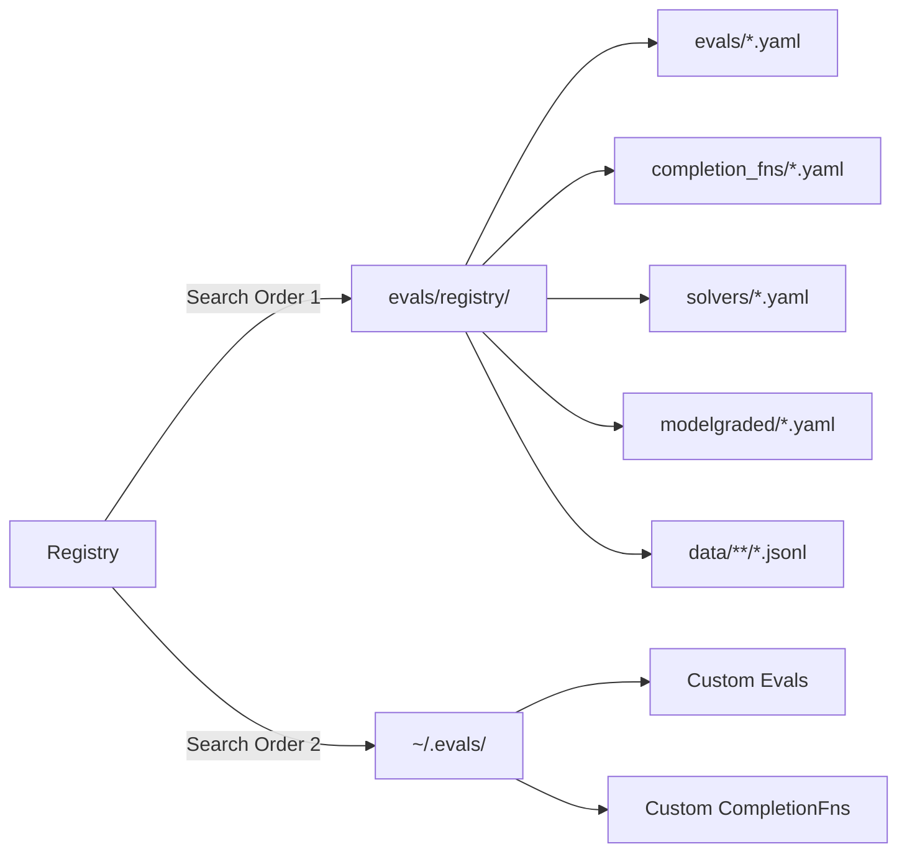
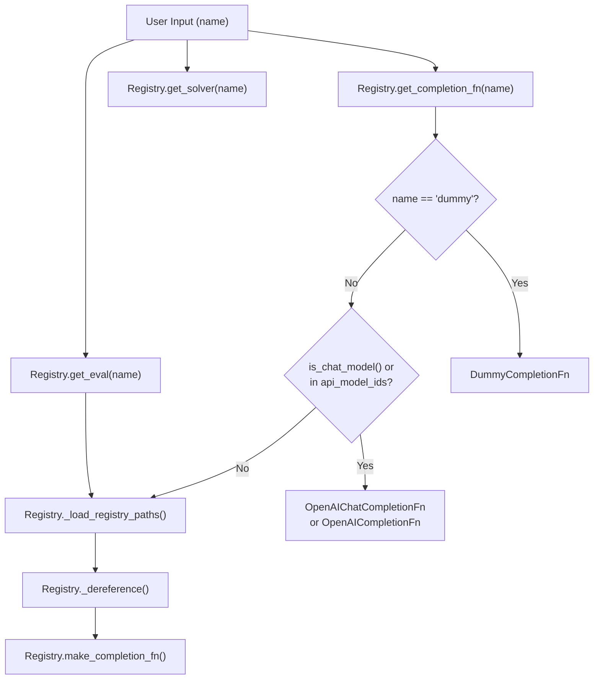
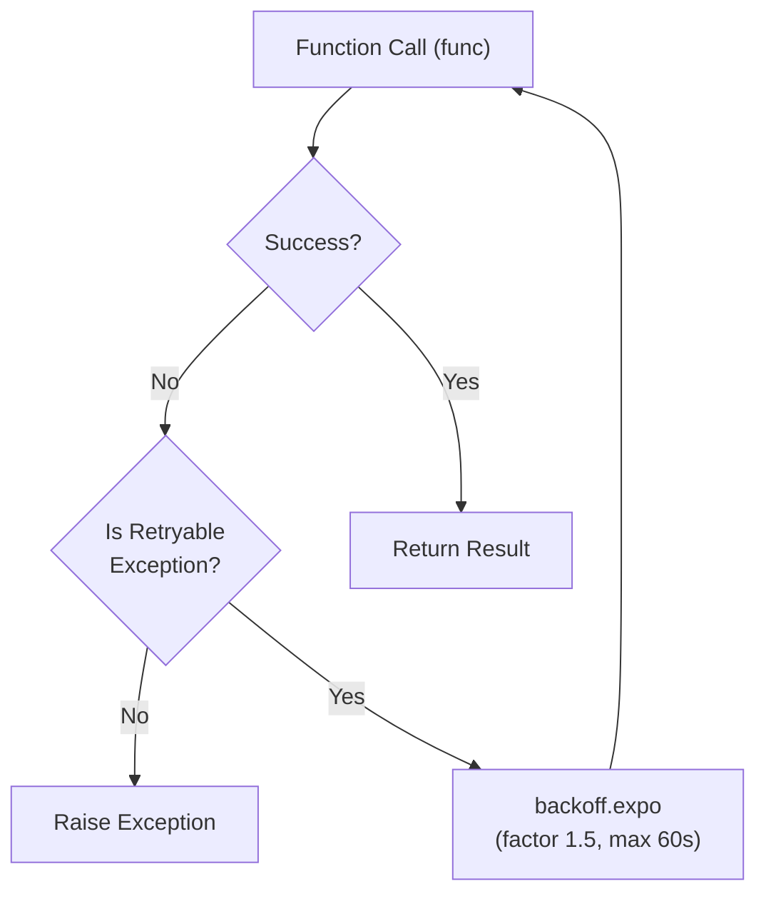
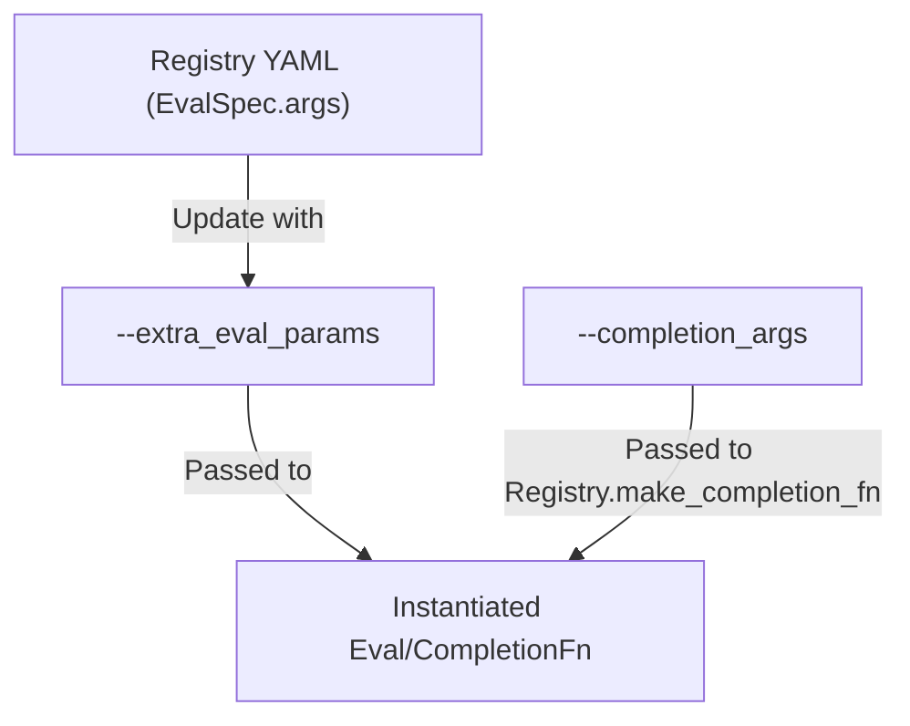

<!-- source: DeepWiki mcp.deepwiki.com · repo openai/evals · page 5.3 Configuration and Advanced Options · fetched 2026-10-26 -->

# Configuration and Advanced Options

<details>
<summary>Relevant source files</summary>

The following files were used as context for generating this wiki page:

- [.github/workflows/run_tests.yaml](.github/workflows/run_tests.yaml)
- [.github/workflows/test_eval.yaml](.github/workflows/test_eval.yaml)
- [evals/cli/oaieval.py](evals/cli/oaieval.py)
- [evals/completion_fns/langchain_math.py](evals/completion_fns/langchain_math.py)
- [evals/completion_fns/openai.py](evals/completion_fns/openai.py)
- [evals/completion_fns/retrieval.py](evals/completion_fns/retrieval.py)
- [evals/elsuite/make_me_say/autoeval.py](evals/elsuite/make_me_say/autoeval.py)
- [evals/elsuite/make_me_say/utils.py](evals/elsuite/make_me_say/utils.py)
- [evals/registry.py](evals/registry.py)
- [evals/registry/completion_fns/cot.yaml](evals/registry/completion_fns/cot.yaml)
- [evals/registry/data/word_association/corpus_tools/validators.py](evals/registry/data/word_association/corpus_tools/validators.py)
- [evals/registry/solvers/gemini.yaml](evals/registry/solvers/gemini.yaml)
- [evals/registry_test.py](evals/registry_test.py)
- [evals/solvers/providers/google/gemini_solver.py](evals/solvers/providers/google/gemini_solver.py)
- [evals/solvers/providers/google/gemini_solver_test.py](evals/solvers/providers/google/gemini_solver_test.py)
- [evals/solvers/providers/google/requirements.txt](evals/solvers/providers/google/requirements.txt)
- [evals/utils/api_utils.py](evals/utils/api_utils.py)
- [examples/retrieval-completionfn.ipynb](examples/retrieval-completionfn.ipynb)
- [pyproject.toml](pyproject.toml)

</details>


This page documents advanced configuration options for running evaluations beyond the basic CLI usage. For basic usage of the `oaieval` and `oaievalset` commands, see [Using oaieval CLI](#5.1) and [Using oaievalset CLI](#5.2).

This page covers:
- Environment variables that control evaluation behavior
- Custom registry paths and resolution
- Dynamic parameter overrides for evaluations and completion functions
- Sampling configuration (max_samples, seed, caching)
- Retry and backoff mechanisms
- Advanced logging and recording options

## Environment Variables

The evals framework supports several environment variables that control execution behavior globally:

| Variable | Purpose | Default | Used By |
|----------|---------|---------|---------|
| `OPENAI_API_KEY` | OpenAI API authentication | None (required) | All OpenAI completion functions |
| `EVALS_THREAD_TIMEOUT` | Timeout for each thread in seconds | `40` | `oaievalset` parallel execution |
| `EVALS_THREADS` | Number of parallel threads | `10` | `oaievalset` parallel execution |

**Setting environment variables:**

```bash
# Linux/macOS
export EVALS_THREAD_TIMEOUT=600
export EVALS_THREADS=42

# Windows (PowerShell)
$env:EVALS_THREAD_TIMEOUT="600"
$env:EVALS_THREADS="42"
```

The `EVALS_THREAD_TIMEOUT` value determines how long each individual eval can run before timing out and restarting. Higher values may be necessary for evaluations with long prompts or expected long responses.

**Sources:** [evals/utils/api_utils.py:6](), [evals/registry.py:26](), [evals/completion_fns/openai.py:119]()

## Registry Path Configuration

### Default Registry Paths

The registry system searches for configuration files in default locations:



**Sources:** [evals/registry.py:30-33]()

### Adding Custom Registry Paths

Use the `--registry_path` flag to add custom registry locations. This flag can be specified multiple times:

```bash
# Single custom path
oaieval gpt-3.5-turbo my-eval --registry_path /path/to/my/registry

# Multiple custom paths
oaieval gpt-3.5-turbo my-eval \
  --registry_path /path/to/registry1 \
  --registry_path /path/to/registry2
```

The registry system searches paths in the order they are added, with later paths taking precedence for duplicate entries.

**Programmatic registry path addition:**

```python
from evals.registry import Registry

registry = Registry()
registry.add_registry_paths([
    "/path/to/custom/registry1",
    "/path/to/custom/registry2"
])
```

**Sources:** [evals/cli/oaieval.py:50-55](), [evals/registry.py:104-108]()

### Registry Resolution Process

The `Registry` class handles the instantiation of objects based on string identifiers.



**Sources:** [evals/registry.py:120-151](), [evals/registry.py:156-192](), [evals/registry.py:202-211]()

## Extra Evaluation Parameters

The `--extra_eval_params` flag allows dynamic modification of eval configuration without editing YAML files.

**Syntax:**
```bash
--extra_eval_params "key1=value1,key2=value2"
```

**Parameter parsing:**
- Comma-separated key-value pairs.
- Values are automatically cast to `int`, `float`, or `str` by `parse_extra_eval_params` in `evals/cli/oaieval.py`.
- Parameters override or extend the eval's `args` from the registry.

**Implementation:**

[evals/cli/oaieval.py:136-162]() parses the parameter string and merges it with the `EvalSpec` args:

```python
extra_eval_params = parse_extra_eval_params(args.extra_eval_params)

if eval_spec.args is None:
    eval_spec.args = extra_eval_params
else:
    eval_spec.args.update(extra_eval_params)
```

**Sources:** [evals/cli/oaieval.py:33](), [evals/cli/oaieval.py:136-162]()

## Completion Function Arguments

### The completion_args Flag

The `--completion_args` flag provides runtime configuration for completion functions, allowing overrides for parameters like temperature or API base URLs.

**Syntax:**
```bash
--completion_args "key1=value1,key2=value2"
```

**How it works:**

[evals/cli/oaieval.py:164-171]() parses the arguments and passes them as `**kwargs` to `Registry.make_completion_fn`:

```python
completion_args = args.completion_args.split(",")
additional_completion_args = {k: v for k, v in (kv.split("=") for kv in completion_args if kv)}

completion_fn_instances = [
    registry.make_completion_fn(url, **additional_completion_args) for url in completion_fns
]
```

**Sources:** [evals/cli/oaieval.py:35-39](), [evals/cli/oaieval.py:164-171](), [evals/registry.py:120-151]()

### Extra Options Parameter

OpenAI completion functions (`OpenAICompletionFn` and `OpenAIChatCompletionFn`) accept an `extra_options` dictionary which is merged with call-time `kwargs` and passed to the underlying OpenAI API client.

**Sources:** [evals/completion_fns/openai.py:90-97](), [evals/completion_fns/openai.py:122](), [evals/completion_fns/openai.py:141-147](), [evals/completion_fns/openai.py:172]()

## Sampling Configuration

### Max Samples

The `--max_samples` flag limits the number of samples evaluated. This is globally set using `evals.eval.set_max_samples`.

**Implementation:** [evals/cli/oaieval.py:40](), [evals/cli/oaieval.py:124-125]()

### Seed

The `--seed` flag (default `20220722`) controls randomization for reproducibility. It is passed into the `run_config` and eventually the evaluation execution.

**Sources:** [evals/cli/oaieval.py:43](), [evals/cli/oaieval.py:176]()

### Caching

The `--cache` flag (enabled by default) controls API response caching. Disabling it sets the `cache_level` to `0` in `api_extra_options`.

**Implementation:** [evals/cli/oaieval.py:41](), [evals/cli/oaieval.py:210-212]()

## Retry and Backoff Behavior

### Retry Mechanism

The framework uses the `backoff` library to handle transient API errors. The core utility `create_retrying` in `evals/utils/api_utils.py` implements exponential backoff.



**Sources:** [evals/utils/api_utils.py:10-23]()

### Retryable Exceptions

For OpenAI-based completion functions, the following exceptions trigger a retry:
- `openai.RateLimitError`
- `openai.APIConnectionError`
- `openai.APITimeoutError`
- `openai.InternalServerError`

**Sources:** [evals/completion_fns/openai.py:19-24](), [evals/elsuite/make_me_say/utils.py:13-22]()

## Model Context Length Configuration

The `Registry` automatically determines the context window (`n_ctx`) for known OpenAI models to prevent overflow.

| Model Prefix | n_ctx |
|-------|-------|
| `gpt-3.5-turbo-16k-` | 16,384 |
| `gpt-3.5-turbo-` | 4,096 |
| `gpt-4-32k-` | 32,768 |
| `gpt-4-` | 8,192 |
| `gpt-4-1106-preview` | 128,000 |

**Sources:** [evals/registry.py:37-81]()

## Logging and Recording Options

### Record Path Configuration

The `--record_path` flag specifies where evaluation logs (JSONL) are written. If not provided, it defaults to a path in `/tmp/evallogs/`.

**Sources:** [evals/cli/oaieval.py:45](), [evals/cli/oaieval.py:197-201]()

### Advanced Recording Modes

The CLI supports different `RecorderBase` implementations:

| Mode | Flag | Recorder Class | Description |
|------|------|----------------|-------------|
| Dry Run | `--dry-run` | `DummyRecorder` | No persistence, optionally logs to console. |
| Local | `--local-run` | `LocalRecorder` | Writes events to a local JSONL file. |
| HTTP | `--http-run` | `HttpRecorder` | POSTs event batches to a remote URL. |

**Sources:** [evals/cli/oaieval.py:245-261](), [evals/record.py:15]()

### HTTP Recording Parameters

When using `--http-run`, the following options apply:
- `--http-run-url`: The destination for POST requests.
- `--http-batch-size`: Number of events per request (default 100).
- `--http-fail-percent-threshold`: Acceptable failure rate before the run is considered failed (default 5%).

**Sources:** [evals/cli/oaieval.py:72-89](), [evals/cli/oaieval.py:251-261]()

## Configuration Priority and Merging

Configuration is resolved at runtime by merging registry defaults with CLI overrides.



**Sources:** [evals/cli/oaieval.py:157-171]()

---

