<!-- source: DeepWiki mcp.deepwiki.com · repo openai/evals · page 6 Evaluation Types · fetched 2026-10-26 -->

# Evaluation Types

Relevant source files

The following files were used as context for generating this wiki page:

- [docs/eval-templates.md](docs/eval-templates.md)
- [evals/elsuite/basic/fuzzy_match.py](evals/elsuite/basic/fuzzy_match.py)
- [evals/elsuite/basic/fuzzy_match_test.py](evals/elsuite/basic/fuzzy_match_test.py)
- [evals/elsuite/basic/includes.py](evals/elsuite/basic/includes.py)
- [evals/elsuite/basic/includes_test.py](evals/elsuite/basic/includes_test.py)
- [evals/elsuite/basic/json_match.py](evals/elsuite/basic/json_match.py)
- [evals/elsuite/basic/json_match_test.py](evals/elsuite/basic/json_match_test.py)
- [evals/elsuite/basic/json_validator.py](evals/elsuite/basic/json_validator.py)
- [evals/elsuite/basic/json_validator_test.py](evals/elsuite/basic/json_validator_test.py)
- [evals/elsuite/basic/match.py](evals/elsuite/basic/match.py)
- [evals/elsuite/basic/match_test.py](evals/elsuite/basic/match_test.py)
- [evals/elsuite/basic/match_with_solvers.py](evals/elsuite/basic/match_with_solvers.py)
- [evals/elsuite/modelgraded/base.py](evals/elsuite/modelgraded/base.py)
- [evals/elsuite/modelgraded/classify.py](evals/elsuite/modelgraded/classify.py)
- [evals/elsuite/modelgraded/classify_utils.py](evals/elsuite/modelgraded/classify_utils.py)
- [evals/elsuite/test/match.py](evals/elsuite/test/match.py)
- [evals/elsuite/translate.py](evals/elsuite/translate.py)
- [evals/elsuite/utils.py](evals/elsuite/utils.py)
- [evals/elsuite/utils_test.py](evals/elsuite/utils_test.py)
- [evals/eval.py](evals/eval.py)
- [evals/prompt/base.py](evals/prompt/base.py)
- [evals/registry/data/icelandic-inflection-easy/samples.jsonl](evals/registry/data/icelandic-inflection-easy/samples.jsonl)
- [evals/registry/data/icelandic-inflection-hard/samples.jsonl](evals/registry/data/icelandic-inflection-hard/samples.jsonl)
- [evals/registry/data/icelandic-inflection-medium/samples.jsonl](evals/registry/data/icelandic-inflection-medium/samples.jsonl)
- [evals/registry/eval_sets/test-basic.yaml](evals/registry/eval_sets/test-basic.yaml)
- [evals/registry/eval_sets/test-modelgraded.yaml](evals/registry/eval_sets/test-modelgraded.yaml)
- [evals/registry/evals/icelandic-inflection-easy.yaml](evals/registry/evals/icelandic-inflection-easy.yaml)
- [evals/registry/evals/icelandic-inflection-hard.yaml](evals/registry/evals/icelandic-inflection-hard.yaml)
- [evals/registry/evals/icelandic-inflection-medium.yaml](evals/registry/evals/icelandic-inflection-medium.yaml)
- [evals/registry/evals/test-basic.yaml](evals/registry/evals/test-basic.yaml)
- [evals/registry/evals/test-modelgraded.yaml](evals/registry/evals/test-modelgraded.yaml)
- [evals/registry/modelgraded/battle.yaml](evals/registry/modelgraded/battle.yaml)
- [evals/registry/modelgraded/best.yaml](evals/registry/modelgraded/best.yaml)
- [evals/registry/modelgraded/diversity.yaml](evals/registry/modelgraded/diversity.yaml)
- [evals/registry/modelgraded/fact.yaml](evals/registry/modelgraded/fact.yaml)
- [evals/registry/modelgraded/humor.yaml](evals/registry/modelgraded/humor.yaml)
- [evals/solvers/human_cli_solver.py](evals/solvers/human_cli_solver.py)
- [evals/solvers/prompts/cot.py](evals/solvers/prompts/cot.py)
- [evals/solvers/prompts/hhh.py](evals/solvers/prompts/hhh.py)
- [evals/solvers/solver.py](evals/solvers/solver.py)
- [evals/solvers/utils.py](evals/solvers/utils.py)
- [evals/utils/test.py](evals/utils/test.py)

This document provides a comprehensive overview of the different evaluation patterns supported by the OpenAI Evals framework. It covers the taxonomy of evaluation types, their implementation classes, execution patterns, and how to select the appropriate type for your use case.

For detailed implementation guidance on specific evaluation types, see:
- Basic evaluations: [Basic Evaluations](#6.1)
- Model-graded evaluations: [Model-Graded Evaluations](#6.2)
- Solver-based evaluations: [Solver-Based Evaluations](#6.3)
- Custom implementation: [Custom Evaluation Implementation](#6.4)

For information on running evaluations via CLI, see [Running Evaluations](#5).

## Overview of Evaluation Architecture

All evaluation types in the framework inherit from the base `evals.Eval` class [evals/eval.py:46](), which defines the core evaluation lifecycle. Evaluations are instantiated via the Registry system [evals/registry/registry.py]() using YAML configuration files stored in `evals/registry/evals/`.

The framework supports three primary evaluation paradigms:

1.  **Basic (Rule-Based) Evaluations**: Direct comparison between model output and reference answers using deterministic matching logic [docs/eval-templates.md:5-18]().
2.  **Model-Graded Evaluations**: Using an LLM as a judge to evaluate subjective or complex outputs [evals/elsuite/modelgraded/classify.py:14]().
3.  **Solver-Based Evaluations**: Stateful, multi-turn evaluations for complex interactive scenarios [evals/eval.py:168]().

Each evaluation type is designed to handle specific assessment needs, from objective factual questions to open-ended creative tasks.

## Evaluation Type Hierarchy

```mermaid
graph TB
    EvalBase["evals.Eval<br/>(evals/eval.py)"]
    
    subgraph BasicEvals["Basic Evaluations<br/>(evals/elsuite/basic/)"]
        Match["Match<br/>match.py<br/>Exact prefix matching"]
        Includes["Includes<br/>includes.py<br/>Substring presence"]
        FuzzyMatch["FuzzyMatch<br/>fuzzy_match.py<br/>Bidirectional fuzzy match"]
        JsonValidator["JsonValidator<br/>json_validator.py<br/>JSON structure validation"]
        JsonMatch["JsonMatch<br/>json_match.py<br/>Structural JSON comparison"]
    end
    
    subgraph ModelGraded["Model-Graded Evaluations<br/>(evals/elsuite/modelgraded/)"]
        ModelBasedClassify["ModelBasedClassify<br/>classify.py<br/>LLM-as-judge evaluation"]
    end
    
    subgraph SolverBased["Solver-Based Evaluations<br/>(evals/solvers/)"]
        SolverEval["SolverEval<br/>Base for stateful evals"]
    end
    
    subgraph DomainSpecific["Domain-Specific Evaluations<br/>(evals/elsuite/)"]
        Translate["Translate<br/>translate.py<br/>SacreBLEU scoring"]
        Custom["Custom Eval Classes<br/>Task-specific logic"]
    end
    
    EvalBase --> Match
    EvalBase --> Includes
    EvalBase --> FuzzyMatch
    EvalBase --> JsonValidator
    EvalBase --> JsonMatch
    EvalBase --> ModelBasedClassify
    EvalBase --> SolverEval
    EvalBase --> Translate
    EvalBase --> Custom
    
    style EvalBase fill:#f9f9f9
    style BasicEvals fill:#f0f0f0
    style ModelGraded fill:#f0f0f0
    style SolverBased fill:#f0f0f0
    style DomainSpecific fill:#f0f0f0
```

**Sources**: [evals/eval.py:46](), [evals/elsuite/basic/match.py:9](), [evals/elsuite/basic/includes.py:9](), [evals/elsuite/basic/fuzzy_match.py:9](), [evals/elsuite/basic/json_validator.py:18](), [evals/elsuite/modelgraded/classify.py:14](), [docs/eval-templates.md:1-22]()

## Execution Flow by Evaluation Type

Different evaluation types follow distinct execution patterns based on their complexity and assessment approach.

**Sources**: [evals/elsuite/basic/match.py:30-56](), [evals/elsuite/modelgraded/classify.py:53-102](), [evals/elsuite/modelgraded/classify_utils.py:51-87](), [evals/eval.py:168-195]()

## Key Evaluation Components

### Base Eval Class Methods

The `evals.Eval` base class [evals/eval.py:46]() defines the standard evaluation interface:

| Method | Purpose | Implementation Required |
| :--- | :--- | :--- |
| `eval_sample(sample, rng)` | Evaluate a single sample | Yes (override) [evals/eval.py:76-78]() |
| `run(recorder)` | Execute full evaluation and return metrics | Yes (override) [evals/eval.py:85-88]() |
| `get_samples()` | Load dataset from `samples_jsonl` | Inherited [evals/eval.py:149-156]() |
| `eval_all_samples(recorder, samples)` | Parallel execution of `eval_sample` | Inherited [evals/eval.py:112-147]() |
| `completion_fn` | Ergonomic access to primary CompletionFn | Inherited property [evals/eval.py:80-83]() |

**Sources**: [evals/eval.py:46-166]()

## Basic Evaluations

Basic evaluations implement deterministic matching logic for objective assessments. All basic evals are located in `evals/elsuite/basic/`.

### Match
**Class**: `evals.elsuite.basic.match:Match` [evals/elsuite/basic/match.py:9]()
**Logic**: `any([sampled.startswith(ideal) for ideal in ideals])` [docs/eval-templates.md:10]()
Checks if the model's completion starts with any of the reference answers. Often used for multiple-choice or short-answer tasks.

### Includes
**Class**: `evals.elsuite.basic.includes:Includes` [evals/elsuite/basic/includes.py:9]()
**Logic**: `any([(ideal in sampled) for ideal in ideals])` [docs/eval-templates.md:11]()
Checks if any reference answer appears as a substring in the completion.

### FuzzyMatch
**Class**: `evals.elsuite.basic.fuzzy_match:FuzzyMatch` [evals/elsuite/basic/fuzzy_match.py:9]()
**Logic**: Bidirectional substring match after normalization (lowercasing, punctuation removal) [evals/elsuite/utils.py:46-53]().
Returns true if `normalized(sampled) in normalized(ideal)` OR `normalized(ideal) in normalized(sampled)`.

### JsonValidator & JsonMatch
- **JsonValidator**: Validates that model output is syntactically valid JSON [evals/elsuite/basic/json_validator.py:18]().
- **JsonMatch**: Compares model JSON output to a reference JSON object, ignoring key order and whitespace [docs/eval-templates.md:15-16]().

**Sources**: [evals/elsuite/basic/match.py](), [evals/elsuite/basic/includes.py](), [evals/elsuite/basic/fuzzy_match.py](), [evals/elsuite/basic/json_validator.py](), [docs/eval-templates.md:5-21]()

## Model-Graded Evaluations

Model-graded evaluations use an LLM (the "evaluator model") to judge the quality of another model's output.

### ModelBasedClassify
**Class**: `evals.elsuite.modelgraded.classify:ModelBasedClassify` [evals/elsuite/modelgraded/classify.py:14]()
This class implements the main logic:
1.  **Policy Completion**: Gets the model's completion to the original prompt [evals/elsuite/modelgraded/classify.py:63-80]().
2.  **Grading**: Wraps that completion in an evaluation prompt and queries the `eval_completion_fn` [evals/elsuite/modelgraded/classify.py:84-92]().
3.  **Parsing**: Parses the response into a choice (e.g., "Yes", "No") and logs the associated score [evals/elsuite/modelgraded/classify_utils.py:110-128]().

### Parameters for Model-Graded Evals
- `eval_type`: Controls response formatting (`cot_classify`, `classify_cot`, `classify`) [docs/eval-templates.md:36-40]().
- `choice_strings`: Valid choices expected from the evaluator (e.g., "ABCDE") [evals/elsuite/modelgraded/classify_utils.py:37-48]().
- `choice_scores`: Mapping of choices to numeric scores for metric aggregation [evals/elsuite/modelgraded/classify_utils.py:90-103]().

**Sources**: [evals/elsuite/modelgraded/classify.py](), [evals/elsuite/modelgraded/classify_utils.py](), [docs/eval-templates.md:22-60]()

## Solver-Based Evaluations

Solver-based evaluations support stateful, multi-turn interactions.

### SolverEval Pattern
**Class**: `evals.eval:SolverEval` [evals/eval.py:168]()
Unlike standard `Eval`, `SolverEval` creates a new `Solver` instance for every sample [evals/eval.py:173-175](). This allows solvers to maintain internal state (memory, scratchpads) without interference between samples.

**Example**: `MatchWithSolvers` uses a solver to generate a response and then applies standard matching logic to the result.

**Sources**: [evals/eval.py:168-195](), [evals/solvers/solver.py]()

## Custom Evaluation Implementation

For evaluations requiring domain-specific logic (e.g., calculating SacreBLEU scores for translation), developers can implement custom classes inheriting from `evals.Eval`.

**Example**: `evals.elsuite.translate:Translate` implements specific logic for machine translation benchmarks [docs/eval-templates.md:20]().

For details, see [Custom Evaluation Implementation](#6.4).

**Sources**: [evals/eval.py:46](), [docs/eval-templates.md:18-21]()

---

