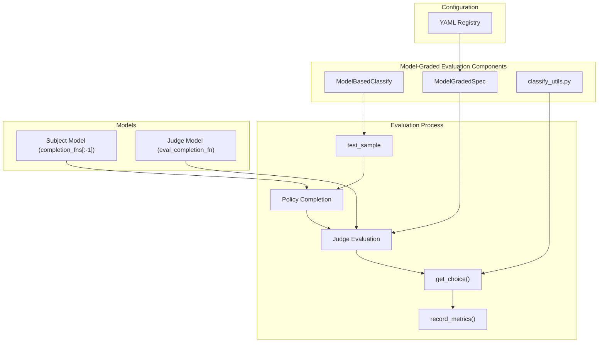
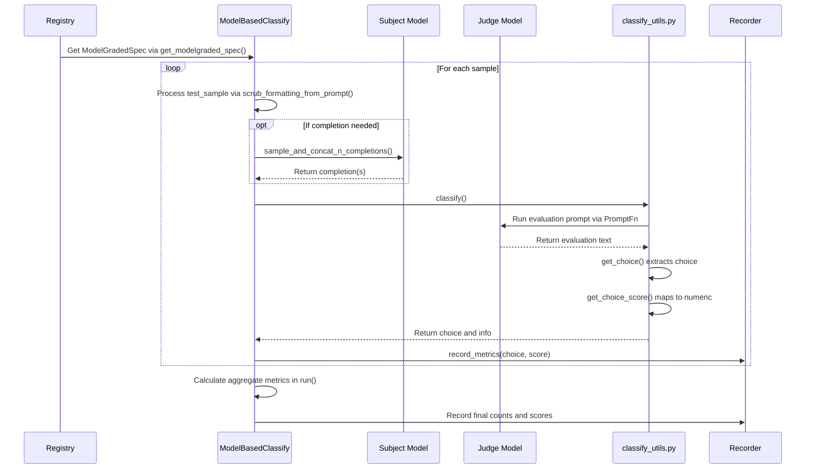

<!-- source: DeepWiki mcp.deepwiki.com · repo openai/evals · page 6.2 Model-Graded Evaluations · fetched 2026-10-26 -->

# Model-Graded Evaluations

<details>
<summary>Relevant source files</summary>

The following files were used as context for generating this wiki page:

- [evals/elsuite/modelgraded/base.py](evals/elsuite/modelgraded/base.py)
- [evals/elsuite/modelgraded/classify.py](evals/elsuite/modelgraded/classify.py)
- [evals/elsuite/modelgraded/classify_utils.py](evals/elsuite/modelgraded/classify_utils.py)
- [evals/elsuite/utils.py](evals/elsuite/utils.py)
- [evals/elsuite/utils_test.py](evals/elsuite/utils_test.py)
- [evals/prompt/base.py](evals/prompt/base.py)
- [evals/registry/data/event_categories/samples.jsonl](evals/registry/data/event_categories/samples.jsonl)
- [evals/registry/data/sql/spider_sql.jsonl](evals/registry/data/sql/spider_sql.jsonl)
- [evals/registry/data/test_modelgraded/humor_people_jp.jsonl](evals/registry/data/test_modelgraded/humor_people_jp.jsonl)
- [evals/registry/data/test_multiio/battles/joke_animals_vs_fruits.jsonl](evals/registry/data/test_multiio/battles/joke_animals_vs_fruits.jsonl)
- [evals/registry/data/test_multiio/battles/rap_animals_vs_fruits.jsonl](evals/registry/data/test_multiio/battles/rap_animals_vs_fruits.jsonl)
- [evals/registry/data/test_multiio/battles/rap_people_vs_fruits.jsonl](evals/registry/data/test_multiio/battles/rap_people_vs_fruits.jsonl)
- [evals/registry/data/test_multiio/battles/rap_people_vs_people.jsonl](evals/registry/data/test_multiio/battles/rap_people_vs_people.jsonl)
- [evals/registry/eval_sets/coqa-ex.yaml](evals/registry/eval_sets/coqa-ex.yaml)
- [evals/registry/eval_sets/test-all.yaml](evals/registry/eval_sets/test-all.yaml)
- [evals/registry/eval_sets/test-modelgraded.yaml](evals/registry/eval_sets/test-modelgraded.yaml)
- [evals/registry/evals/coqa-ex.yaml](evals/registry/evals/coqa-ex.yaml)
- [evals/registry/evals/event-categories.yaml](evals/registry/evals/event-categories.yaml)
- [evals/registry/evals/logic.yaml](evals/registry/evals/logic.yaml)
- [evals/registry/evals/sql.yaml](evals/registry/evals/sql.yaml)
- [evals/registry/evals/test-modelgraded-battle.yaml](evals/registry/evals/test-modelgraded-battle.yaml)
- [evals/registry/evals/test-modelgraded-generated.yaml](evals/registry/evals/test-modelgraded-generated.yaml)
- [evals/registry/evals/test-modelgraded.yaml](evals/registry/evals/test-modelgraded.yaml)
- [evals/registry/modelgraded/battle.yaml](evals/registry/modelgraded/battle.yaml)
- [evals/registry/modelgraded/best.yaml](evals/registry/modelgraded/best.yaml)
- [evals/registry/modelgraded/closedqa.yaml](evals/registry/modelgraded/closedqa.yaml)
- [evals/registry/modelgraded/diversity.yaml](evals/registry/modelgraded/diversity.yaml)
- [evals/registry/modelgraded/fact.yaml](evals/registry/modelgraded/fact.yaml)
- [evals/registry/modelgraded/humor.yaml](evals/registry/modelgraded/humor.yaml)
- [evals/registry/modelgraded/sql.yaml](evals/registry/modelgraded/sql.yaml)

</details>


Model-graded evaluations allow using language models as judges to evaluate outputs from other models. This approach is particularly valuable for subjective or nuanced assessment tasks where simple string matching or rule-based evaluations would be insufficient. For basic string matching evaluations, see [Basic Evaluations](#6.1).

## Overview and Purpose

Model-graded evaluations leverage one model (the "judge") to evaluate responses generated by another model (the "subject") based on specified criteria. This paradigm addresses evaluation challenges for creative, subjective, or complex tasks where ground truth can be ambiguous or multifaceted.

Key capabilities include:
- Evaluating subjective qualities (humor, helpfulness, relevance).
- Comparing outputs from multiple models.
- Implementing Likert scales for nuanced scoring.
- Supporting various reasoning patterns (chain-of-thought, direct classification).
- Meta-evaluation to assess the judge model's performance.

Sources:
- [evals/elsuite/modelgraded/classify.py:1-102]()
- [evals/registry/evals/test-modelgraded.yaml:1-98]()

## System Architecture

### Architecture Overview



Sources:
- [evals/elsuite/modelgraded/classify.py:14-102]()
- [evals/elsuite/modelgraded/base.py:11-26]()
- [evals/elsuite/modelgraded/classify_utils.py:10-187]()

### Evaluation Flow



Sources:
- [evals/elsuite/modelgraded/classify.py:51-102]()
- [evals/elsuite/modelgraded/classify_utils.py:51-127]()
- [evals/elsuite/utils.py:91-100]()

## Core Components

### ModelBasedClassify

The `ModelBasedClassify` class [evals/elsuite/modelgraded/classify.py:14]() is the main implementation. It inherits from the base `Eval` class and manages the lifecycle:

- **Initialization**: Separates the `eval_completion_fn` (the judge) from the subject `completion_fns` [evals/elsuite/modelgraded/classify.py:30-32]().
- **`eval_sample`**: Coordinates the generation of subject responses and the subsequent judging by the model-graded spec [evals/elsuite/modelgraded/classify.py:53-102]().
- **`run`**: Aggregates per-sample metrics into final counts and average scores [evals/elsuite/modelgraded/classify.py:104-127]().

### ModelGradedSpec

The `ModelGradedSpec` [evals/elsuite/modelgraded/base.py:11]() defines the judge's behavior:

| Field | Type | Description |
|-------|------|-------------|
| `prompt` | `str` | The prompt template for the judge model [evals/elsuite/modelgraded/base.py:12](). |
| `choice_strings` | `list[str]` | Valid output tokens (e.g., "Yes", "No") [evals/elsuite/modelgraded/base.py:14](). |
| `input_outputs` | `dict` | Mapping of input variables to output variables in the prompt [evals/elsuite/modelgraded/base.py:15](). |
| `choice_scores` | `dict` | Mapping of choice strings to numeric floats [evals/elsuite/modelgraded/base.py:17](). |
| `output_template` | `str` | Template for formatting multiple completions [evals/elsuite/modelgraded/base.py:18](). |

### Classification Utilities

The `classify_utils.py` module provides the logic for parsing judge outputs:

- `classify()`: High-level entry point that calls the judge and scores the result [evals/elsuite/modelgraded/classify_utils.py:51]().
- `get_choice()`: Logic for finding a valid choice in the judge's response, handling CoT reversals [evals/elsuite/modelgraded/classify_utils.py:110]().
- `get_choice_score()`: Returns the numeric value for a choice, or the minimum score if the choice is `__invalid__` [evals/elsuite/modelgraded/classify_utils.py:90]().

## Evaluation Types

The framework uses `ANSWER_PROMPTS` [evals/elsuite/modelgraded/classify_utils.py:13]() to enforce specific reasoning patterns:

| Evaluation Type | Reasoning Pattern | Implementation Detail |
|-----------------|-------------------|-----------------------|
| `classify` | Direct Answer | Uses `classify` prompt template [evals/elsuite/modelgraded/classify_utils.py:15](). |
| `classify_cot` | Answer then Explain | Choice first, then step-by-step reasoning [evals/elsuite/modelgraded/classify_utils.py:17](). |
| `cot_classify` | Explain then Answer | Step-by-step reasoning first, then choice on a new line [evals/elsuite/modelgraded/classify_utils.py:19](). |
| `cot_classify_jp` | Japanese CoT | Japanese version of the reasoning-first prompt [evals/elsuite/modelgraded/classify_utils.py:23](). |

Sources:
- [evals/elsuite/modelgraded/classify_utils.py:13-28]()

## Configuration and Usage

### YAML Configuration

Evaluations are registered by pointing to the `ModelBasedClassify` class and providing arguments:

```yaml
joke-fruits:
  class: evals.elsuite.modelgraded.classify:ModelBasedClassify
  args:
    samples_jsonl: test_modelgraded/joke_fruits.jsonl
    eval_type: cot_classify
    modelgraded_spec: humor
```

Sources:
- [evals/registry/evals/test-modelgraded.yaml:5-11]()

### ModelGraded Specifications

Specs are defined in the `modelgraded` registry:

```yaml
sql:
  prompt: |
    Compare the content and correctness of the submitted SQL...
  choice_strings:
    - "Correct"
    - "Incorrect"
  choice_scores:
    "Correct": 1.0
    "Incorrect": 0.0
```

Sources:
- [evals/registry/modelgraded/sql.yaml:1-26]()

## Common Use Cases

### Likert Scale Rating
By mapping choice strings to scores (e.g., 1-5), the framework calculates an average "score" metric [evals/registry/evals/test-modelgraded.yaml:24-33]().

### Meta-Evaluation
Setting `metaeval: true` compares the judge's `choice` against a pre-labeled `choice` field in the `test_sample` [evals/elsuite/modelgraded/classify.py:96-98]().

### Multiple Completion Comparison
The `multicomp_n` parameter allows evaluating sets of responses:
- `multicomp_n: 4`: Generates 4 samples from the subject model [evals/registry/evals/test-modelgraded.yaml:81]().
- `multicomp_n: from_models`: Compares completions from multiple different models [evals/registry/evals/test-modelgraded.yaml:96]().

Sources:
- [evals/elsuite/modelgraded/classify.py:42-50]()
- [evals/elsuite/modelgraded/classify_utils.py:152-173]()

## Implementation Details

### Choice Extraction Logic
The `get_choice` function [evals/elsuite/modelgraded/classify_utils.py:110]() handles the extraction:
1. Strips whitespace and punctuation from judge output.
2. If `eval_type` is `cot_classify`, it reverses the lines to find the choice at the end [evals/elsuite/modelgraded/classify_utils.py:118]().
3. Uses a `match_fn` (defaulting to `starts_or_endswith`) to validate the line against `choice_strings` [evals/elsuite/modelgraded/classify_utils.py:125]().

### Prompt Formatting
The `PromptFn` class [evals/elsuite/utils.py:144]() wraps completion calls, ensuring that input variables like `{input}` or `{completion}` are correctly injected into the templates using `format_necessary` [evals/elsuite/utils.py:103]().

Sources:
- [evals/elsuite/modelgraded/classify_utils.py:110-128]()
- [evals/elsuite/utils.py:144-195]()

---

