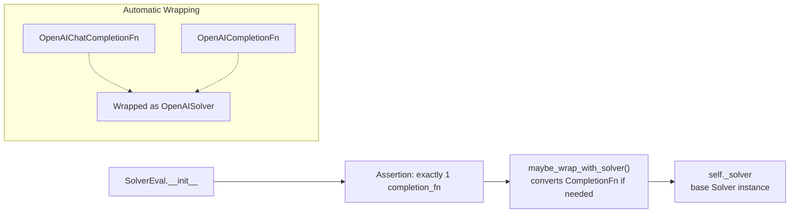
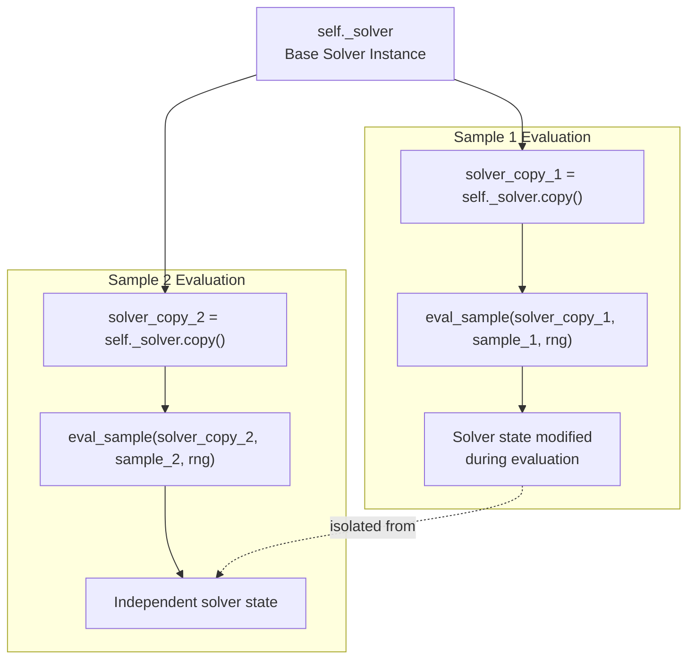
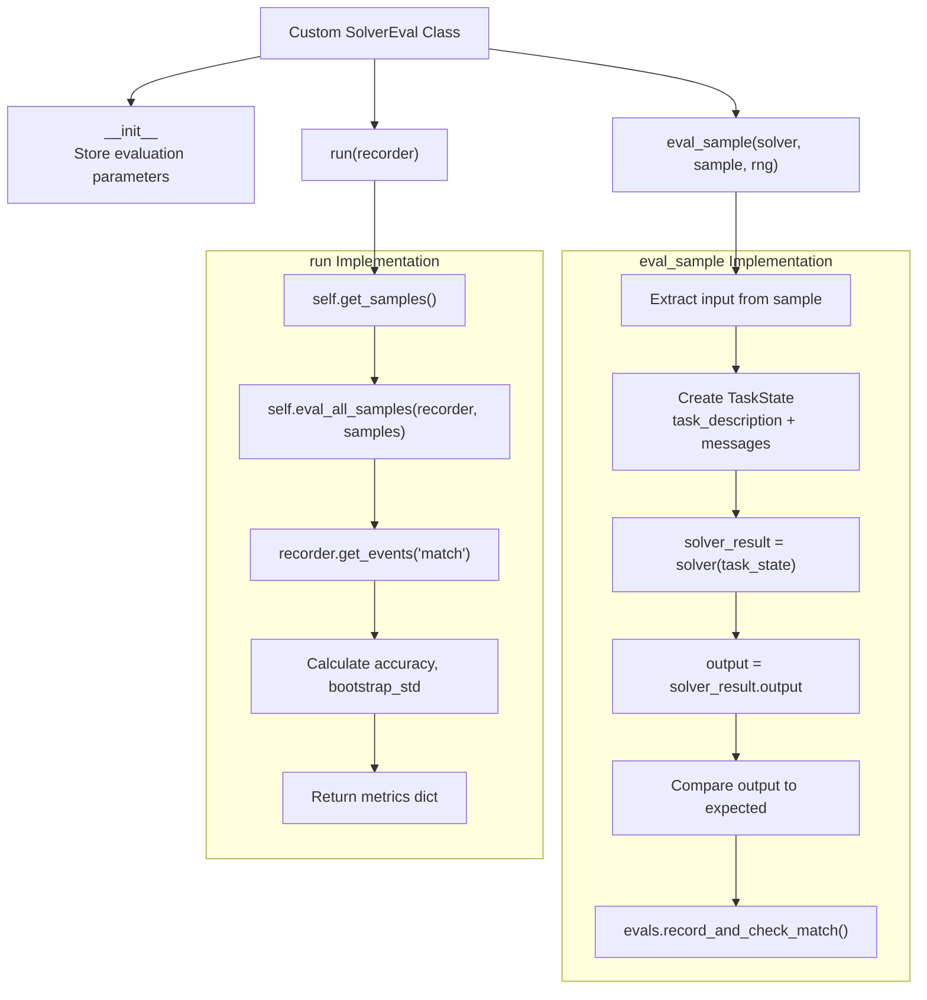
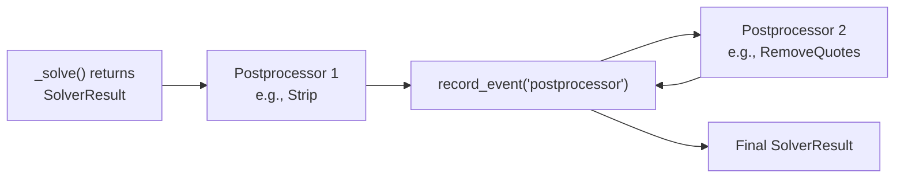
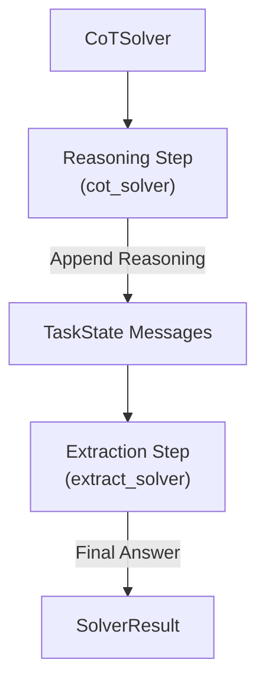
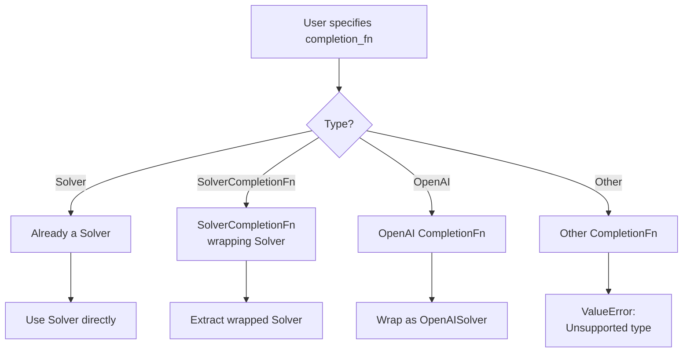

<!-- source: DeepWiki mcp.deepwiki.com · repo openai/evals · page 6.3 Solver-Based Evaluations · fetched 2026-10-26 -->

# Solver-Based Evaluations

<details>
<summary>Relevant source files</summary>

The following files were used as context for generating this wiki page:

- [evals/elsuite/basic/match_with_solvers.py](evals/elsuite/basic/match_with_solvers.py)
- [evals/eval.py](evals/eval.py)
- [evals/registry/solvers/bluff.yaml](evals/registry/solvers/bluff.yaml)
- [evals/registry/solvers/defaults.yaml](evals/registry/solvers/defaults.yaml)
- [evals/registry/solvers/make-me-pay.yaml](evals/registry/solvers/make-me-pay.yaml)
- [evals/registry/solvers/self_prompting.yaml](evals/registry/solvers/self_prompting.yaml)
- [evals/registry/solvers/theory_of_mind.yaml](evals/registry/solvers/theory_of_mind.yaml)
- [evals/solvers/README.md](evals/solvers/README.md)
- [evals/solvers/human_cli_solver.py](evals/solvers/human_cli_solver.py)
- [evals/solvers/nested/cot_solver.py](evals/solvers/nested/cot_solver.py)
- [evals/solvers/nested/self_consistency_solver.py](evals/solvers/nested/self_consistency_solver.py)
- [evals/solvers/postprocessors/README.md](evals/solvers/postprocessors/README.md)
- [evals/solvers/prompts/cot.py](evals/solvers/prompts/cot.py)
- [evals/solvers/prompts/hhh.py](evals/solvers/prompts/hhh.py)
- [evals/solvers/solver.py](evals/solvers/solver.py)
- [evals/solvers/utils.py](evals/solvers/utils.py)

</details>


## Purpose and Scope

This page documents the `SolverEval` pattern for building evaluations that work with stateful, composable `Solver` objects rather than stateless `CompletionFn` objects. Solver-based evaluations enable complex multi-step reasoning, memory retention across interactions, and hierarchical composition of behaviors.

For basic evaluation patterns using direct completion matching, see [Basic Evaluations](#6.1). For model-graded approaches, see [Model-Graded Evaluations](#6.2). For details on the `Solver` abstraction itself and how solvers interact with models, see [Solver Framework](#4.2).

---

## Architecture Overview

The `SolverEval` class extends the base `Eval` class to provide native support for `Solver` objects. The key architectural principle is **per-sample solver isolation**: each evaluation sample gets its own independent solver instance, preventing state leakage between samples while enabling stateful behavior within a single sample's evaluation.

```mermaid
graph TB
    subgraph "SolverEval Lifecycle"
        Init["SolverEval.__init__<br/>wraps completion_fn as Solver"]
        BaseSolver["self._solver<br/>base Solver instance"]
        RunMethod["run(recorder)<br/>loads samples"]
        EvalAll["eval_all_samples()<br/>parallel execution"]
        
        subgraph "Per-Sample Execution"
            SampleLoop["For each sample"]
            CopySolver["solver_copy = self._solver.copy()<br/>independent instance"]
            EvalSample["eval_sample(solver_copy, sample, rng)<br/>user-defined logic"]
            TaskStateCreate["Create TaskState<br/>task_description + messages"]
            SolverCall["solver_copy(task_state)<br/>returns SolverResult"]
            PostProcess["Apply postprocessors<br/>transform output"]
            Record["Record metrics"]
        end
        
        Init --> BaseSolver
        BaseSolver --> RunMethod
        RunMethod --> EvalAll
        EvalAll --> SampleLoop
        SampleLoop --> CopySolver
        CopySolver --> EvalSample
        EvalSample --> TaskStateCreate
        TaskStateCreate --> SolverCall
        SolverCall --> PostProcess
        PostProcess --> Record
        Record --> SampleLoop
    end
```



**Diagram: SolverEval execution flow showing per-sample solver isolation**

Sources: [evals/eval.py:168-256]()

---

## Key Differences from Basic Eval

| Aspect | Basic Eval | SolverEval |
|--------|-----------|------------|
| **Input Type** | Accepts list of `CompletionFn` or `Solver` | Single `Solver` only (enforced) |
| **State Management** | Stateless per completion | Stateful per sample via `copy()` |
| **Sample Processing** | `eval_sample(sample, rng)` | `eval_sample(solver, sample, rng)` |
| **Task Context** | Manually format prompts | `TaskState` object with `task_description` + `messages` |
| **Result Structure** | Raw completion strings | `SolverResult` with `output` and `metadata` |
| **Composition** | Limited | Native support via `NestedSolver` |
| **Postprocessing** | Manual | Built-in postprocessor pipeline |

Sources: [evals/eval.py:46-89](), [evals/eval.py:168-256]()

---

## Core Components

### SolverEval Class



**Diagram: SolverEval initialization and automatic solver wrapping**

The `SolverEval` constructor enforces a single completion function and automatically wraps it as a `Solver` if needed:

```python
# From evals/eval.py:186-194
def __init__(self, *args, **kwargs):
    super().__init__(*args, **kwargs)
    assert (
        len(self.completion_fns) == 1
    ), f"{type(self).__name__} supports exactly one completion_fn, got {len(self.completion_fns)}."
    self._solver = maybe_wrap_with_solver(self.completion_fns[0])
```

Sources: [evals/eval.py:186-194](), [evals/solvers/utils.py:28-56]()

### TaskState Object

`TaskState` encapsulates the evaluation context passed to solvers:

| Field | Type | Description |
|-------|------|-------------|
| `task_description` | `str` | High-level description of the task |
| `messages` | `list[Message]` | Conversation history with roles (user, assistant, system) |
| `current_state` | `dict` | Optional task-specific state (e.g., game state) |

Solvers receive a **deep copy** of `TaskState` to prevent accidental modification of the original:

```python
# From evals/solvers/solver.py:76-82
def __call__(self, task_state: TaskState, **kwargs) -> SolverResult:
    """Deepcopies task_state to prevent solvers from modifying the original object."""
    res = self._solve(deepcopy(task_state), **kwargs)
    # ... postprocessor application ...
```

Sources: [evals/solvers/solver.py:76-97](), [evals/elsuite/basic/match_with_solvers.py:50-55]()

### SolverResult Object

The standardized return type from solver calls:

```python
# From evals/solvers/solver.py:18-38
class SolverResult:
    def __init__(self, output: str, **metadata):
        self._output = output
        self._metadata = metadata
    
    @property
    def output(self) -> str:
        return self._output
    
    @property
    def metadata(self) -> dict:
        return self._metadata
```

The `output` property contains the solver's final answer. The `metadata` dictionary can store arbitrary diagnostic information like intermediate reasoning steps, token counts, or timing data.

Sources: [evals/solvers/solver.py:18-38]()

---

## Per-Sample Solver Isolation

The critical design pattern in `SolverEval` is **solver copying**: each sample gets an independent solver instance to prevent state leakage.



**Diagram: Per-sample solver isolation via copy()**

Implementation in `eval_all_samples`:

```python
# From evals/eval.py:214-226
def eval_sample(args):
    """Evaluate a single sample."""
    sample, idx = args
    base_name, split = self.name.split(".")[0:2]
    sample_id = f"{base_name}.{split}.{idx}"
    with recorder.as_default_recorder(sample_id):
        seed = f"{sample_id}:{self.seed}".encode("utf-8")
        rng = random.Random(seed)
        
        per_sample_solver = self._solver.copy()
        return idx, self.eval_sample(per_sample_solver, sample, rng)
```

The `copy()` method uses `deepcopy` by default but can be overridden for solvers where deep copying is expensive or inappropriate:

```python
# From evals/solvers/solver.py:122-125
def copy(self: SolverType) -> SolverType:
    #   The deepcopy may be quite heavy for some solvers; if that's the
    #   case they should override this function.
    return deepcopy(self)
```

Sources: [evals/eval.py:214-226](), [evals/solvers/solver.py:122-125]()

---

## Implementing a SolverEval

### Required Methods

To create a custom `SolverEval`, implement two abstract methods:

| Method | Signature | Purpose |
|--------|-----------|---------|
| `eval_sample` | `eval_sample(solver, sample, rng) -> Any` | Evaluate a single sample using the provided solver |
| `run` | `run(recorder) -> Dict[str, float]` | Orchestrate evaluation and compute aggregate metrics |

### Implementation Pattern



**Diagram: Standard implementation pattern for custom SolverEval**

Sources: [evals/eval.py:168-256](), [evals/elsuite/basic/match_with_solvers.py:1-81]()

---

## Example: MatchWithSolvers

The `MatchWithSolvers` evaluation demonstrates the complete SolverEval pattern:

### Class Definition

```python
# From evals/elsuite/basic/match_with_solvers.py:15-40
class MatchWithSolvers(SolverEval):
    def __init__(
        self,
        completion_fns: list[CompletionFn],
        samples_jsonl: str,
        task_description: str,
        n_samples: Optional[int] = None,
        shuffle: bool = True,
        *args,
        **kwargs,
    ):
        super().__init__(completion_fns, *args, **kwargs)
        
        # Load task description from file or use string directly
        if os.path.exists(task_description):
            self.task_description = open(task_description, "r").read()
        else:
            self.task_description = task_description
        
        self.samples_jsonl = samples_jsonl
        self.n_samples = n_samples
        self.shuffle = shuffle
```

### eval_sample Implementation

```python
# From evals/elsuite/basic/match_with_solvers.py:42-66
def eval_sample(self, solver: Solver, sample: Any, *_):
    # Validate sample structure
    assert isinstance(sample, dict), "sample must be a dict"
    assert "input" in sample, "sample must have an 'input' key"
    assert "ideal" in sample, "sample must have an 'ideal' key"
    
    # Convert input messages to Message objects
    messages = [Message(**msg) for msg in sample["input"]]
    
    # Create TaskState
    task_state = TaskState(
        task_description=self.task_description,
        messages=messages,
    )
    
    # Call solver and extract output
    solver_result = solver(task_state)
    output = solver_result._output
    
    # Get expected answer
    ideal = sample["ideal"] if isinstance(sample["ideal"], str) else sample["ideal"][0]
    
    # Record and check match
    return evals.record_and_check_match(
        prompt=sample["input"],
        sampled=output,
        expected=[ideal, ideal.capitalize()],
    )
```

### run Implementation

```python
# From evals/elsuite/basic/match_with_solvers.py:68-80
def run(self, recorder):
    # Load and optionally shuffle samples
    samples = self.get_samples()
    if self.shuffle:
        np.random.shuffle(samples)
    samples = samples[: self.n_samples] if self.n_samples is not None else samples
    
    # Evaluate all samples in parallel
    self.eval_all_samples(recorder, samples)
    
    # Aggregate results
    events = recorder.get_events("match")
    return {
        "accuracy": evals.metrics.get_accuracy(events),
        "bootstrap_std": evals.metrics.get_bootstrap_accuracy_std(events),
    }
```

Sources: [evals/elsuite/basic/match_with_solvers.py:1-81]()

---

## Advanced Features

### Postprocessor Pipeline

Solvers support a configurable postprocessor pipeline that transforms output before it's returned. This is useful for cleaning model outputs (e.g., removing quotes or periods) to ensure match criteria work correctly [evals/solvers/postprocessors/README.md:1-6]().



**Diagram: Postprocessor pipeline execution**

```python
# From evals/solvers/solver.py:84-96
if hasattr(self, "postprocessors"):
    # Iteratively apply postprocessors to the output
    for postprocessor in self.postprocessors:
        prev_output = res.output
        res = postprocessor(res)
        record_event(
            "postprocessor",
            {
                "name": postprocessor.__class__.__name__,
                "input": prev_output,
                "output": res.output,
            },
        )
```

Sources: [evals/solvers/solver.py:84-96](), [evals/solvers/postprocessors/README.md:1-32]()

### Nested Solvers and Chain-of-Thought

The `NestedSolver` pattern enables hierarchical composition where one solver delegates to sub-solvers. A prime example is `CoTSolver`, which uses a reasoning solver followed by an extraction solver [evals/solvers/nested/cot_solver.py:9-23]().



**Diagram: CoTSolver execution flow**

Another advanced implementation is `SelfConsistencySolver`, which runs multiple generations and selects a consensus answer [evals/solvers/nested/self_consistency_solver.py:16-43]().

Sources: [evals/solvers/solver.py:137-210](), [evals/solvers/nested/cot_solver.py:50-81](), [evals/solvers/nested/self_consistency_solver.py:62-134]()

### Human-in-the-Loop

The `HumanCliSolver` allows human evaluation by printing prompts to the command line and reading input from it. This is particularly useful for debugging or creating "Gold Standard" interactions [evals/solvers/human_cli_solver.py:8-13]().

```python
# From evals/solvers/human_cli_solver.py:29-44
def _solve(self, task_state: TaskState, **kwargs) -> SolverResult:
    msgs = [Message("system", task_state.task_description)]
    msgs += task_state.messages

    prompt = (
        "\n".join([f"{msg.role}: {msg.content}" for msg in msgs]) + f"\n{self.input_prompt}"
    )
    answer = input(prompt)
    # ... recording and returning ...
```

Sources: [evals/solvers/human_cli_solver.py:8-49]()

---

## Integration with Completion Functions

The `SolverEval` framework provides seamless interoperability with `CompletionFn` through automatic wrapping. If a `CompletionFn` is passed to a `SolverEval`, `maybe_wrap_with_solver` converts it into an `OpenAISolver` or `DummySolver` as appropriate [evals/solvers/utils.py:28-56]().



**Diagram: Automatic wrapping logic in maybe_wrap_with_solver()**

Sources: [evals/solvers/utils.py:28-56](), [evals/eval.py:186-194]()

---

