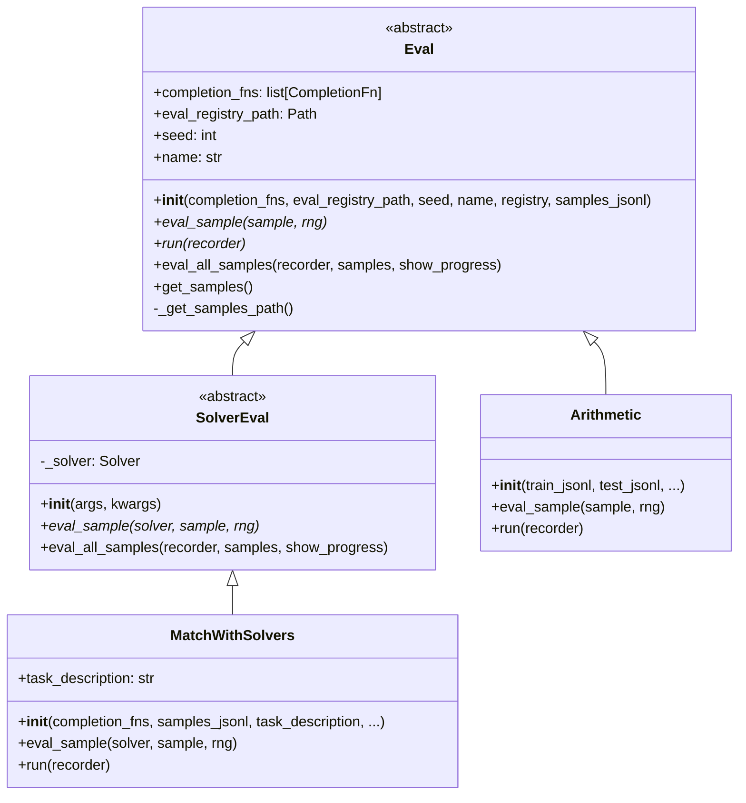
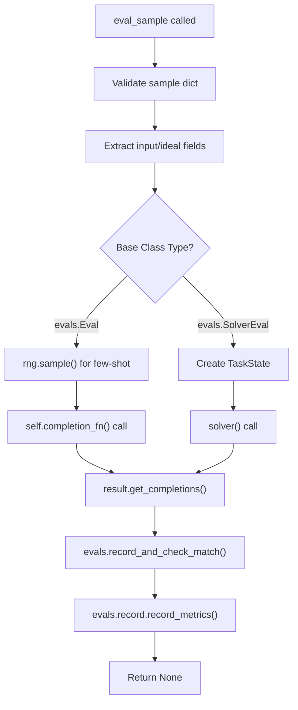

<!-- source: DeepWiki mcp.deepwiki.com · repo openai/evals · page 6.4 Custom Evaluation Implementation · fetched 2026-10-26 -->

# Custom Evaluation Implementation

<details>
<summary>Relevant source files</summary>

The following files were used as context for generating this wiki page:

- [.gitattributes](.gitattributes)
- [.github/config.yml](.github/config.yml)
- [Makefile](Makefile)
- [README.md](README.md)
- [docs/build-eval.md](docs/build-eval.md)
- [docs/completion-fn-protocol.md](docs/completion-fn-protocol.md)
- [docs/completion-fns.md](docs/completion-fns.md)
- [docs/custom-eval.md](docs/custom-eval.md)
- [evals/elsuite/basic/fuzzy_match.py](evals/elsuite/basic/fuzzy_match.py)
- [evals/elsuite/basic/fuzzy_match_test.py](evals/elsuite/basic/fuzzy_match_test.py)
- [evals/elsuite/basic/includes.py](evals/elsuite/basic/includes.py)
- [evals/elsuite/basic/includes_test.py](evals/elsuite/basic/includes_test.py)
- [evals/elsuite/basic/json_validator.py](evals/elsuite/basic/json_validator.py)
- [evals/elsuite/basic/json_validator_test.py](evals/elsuite/basic/json_validator_test.py)
- [evals/elsuite/basic/match.py](evals/elsuite/basic/match.py)
- [evals/elsuite/basic/match_test.py](evals/elsuite/basic/match_test.py)
- [evals/elsuite/basic/match_with_solvers.py](evals/elsuite/basic/match_with_solvers.py)
- [evals/elsuite/test/match.py](evals/elsuite/test/match.py)
- [evals/elsuite/translate.py](evals/elsuite/translate.py)
- [evals/eval.py](evals/eval.py)
- [evals/registry/data/pattern_identification/samples.v0.jsonl](evals/registry/data/pattern_identification/samples.v0.jsonl)
- [evals/registry/eval_sets/test-basic.yaml](evals/registry/eval_sets/test-basic.yaml)
- [evals/registry/evals/pattern_identification.yaml](evals/registry/evals/pattern_identification.yaml)
- [evals/registry/evals/test-basic.yaml](evals/registry/evals/test-basic.yaml)
- [evals/solvers/human_cli_solver.py](evals/solvers/human_cli_solver.py)
- [evals/solvers/prompts/cot.py](evals/solvers/prompts/cot.py)
- [evals/solvers/prompts/hhh.py](evals/solvers/prompts/hhh.py)
- [evals/solvers/solver.py](evals/solvers/solver.py)
- [evals/solvers/utils.py](evals/solvers/utils.py)

</details>


This page provides a technical guide for implementing custom evaluation classes that extend the base evaluation framework. Custom evaluations are needed when the existing evaluation templates ([#6.1](), [#6.2]()) do not provide the required evaluation logic. For information on using existing evaluation templates, see [Basic Evaluations](#6.1) and [Model-Graded Evaluations](#6.2). For data preparation and YAML configuration, see [Data Preparation](#7.1) and [Registry Configuration](#7.2).

## When to Implement Custom Evaluations

Custom evaluation implementations are required when:

- Your evaluation requires complex prompting logic that cannot be expressed in the basic matching templates.
- You need custom metrics beyond accuracy, precision, and recall.
- You need domain-specific scoring functions (e.g., BLEU scores for translation).
- You need multi-step evaluation workflows or interactive scenarios.
- Your evaluation requires maintaining state across samples.

**Important Note**: The repository currently does not accept pull requests with custom evaluation code [README.md:75](), [docs/build-eval.md:3](). However, you can implement custom evaluations for private use or submit model-graded evaluations with custom YAML configurations.

Sources: [README.md:75](), [docs/build-eval.md:3]()

## Base Class Architecture

All evaluations inherit from one of two abstract base classes defined in `evals/eval.py` [evals/eval.py:46](), [evals/eval.py:168]().

### Eval Base Class

The `Eval` base class is for evaluations that interact directly with `CompletionFn` objects. It supports multiple completion functions and provides utilities for sample loading and parallel execution [evals/eval.py:46-64]().

**Key Attributes:**
- `completion_fns`: List of `CompletionFn` or `Solver` objects (wrapped automatically via `maybe_wrap_with_compl_fn`) [evals/eval.py:69]().
- `completion_fn`: Property providing ergonomic access to the first completion function [evals/eval.py:81-83]().
- `eval_registry_path`: Path to the registry directory [evals/eval.py:70]().
- `seed`: Random seed for reproducibility [evals/eval.py:71]().
- `name`: Evaluation name in format `<base_eval>.<split>.<version>` [evals/eval.py:61]().
- `samples_jsonl`: Path to the samples data file [evals/eval.py:74]().

**Abstract Methods:**
- `eval_sample(sample, rng)`: Evaluate a single sample [evals/eval.py:76-78]().
- `run(recorder)`: Run the full evaluation and return metrics [evals/eval.py:85-88]().

Sources: [evals/eval.py:46-89](), [evals/eval.py:69-74]()

### SolverEval Base Class

The `SolverEval` base class is for evaluations that use `Solver` objects, which provide statefulness and multi-turn capabilities [evals/eval.py:168-184]().

**Key Differences from Eval:**
- Accepts exactly one completion function/solver [evals/eval.py:188-190]().
- Automatically wraps `CompletionFn` objects in `Solver` via `maybe_wrap_with_solver()` [evals/eval.py:194]().
- Passes the solver directly to `eval_sample()` [evals/eval.py:179-180]().

Sources: [evals/eval.py:168-195]()

### Evaluation Class Hierarchy

The following diagram maps the Natural Language concepts of "Evaluations" to the specific Code Entities in the `evals` package.


Sources: [evals/eval.py:46-184](), [docs/custom-eval.md:39](), [evals/elsuite/basic/match_with_solvers.py:16]()

## Implementing the `eval_sample` Method

The `eval_sample` method processes a single data sample and records metrics. It must not return a value (recording is done via side effects).

### Typical Workflow for Custom Evaluations

The diagram below bridges the logic of a custom evaluation (Natural Language Space) to the functions and classes used in the codebase (Code Entity Space).


Sources: [docs/custom-eval.md:63-96](), [evals/eval.py:131-137](), [evals/elsuite/basic/match_with_solvers.py:42-66]()

### Example: Eval Implementation

In a custom `Eval` class, you typically manage prompt formatting manually:

```python
    def eval_sample(self, test_sample, rng: random.Random):
        stuffing = rng.sample(self.train_samples, self.train_samples_per_prompt)

        prompt = [
            {"role": "system", "content": "Solve the following math problems"},
        ]
        # ... prompt building logic ...

        result = self.completion_fn(prompt=prompt, temperature=0.0, max_tokens=1)
        sampled = result.get_completions()[0]

        evals.record_and_check_match(prompt=prompt, sampled=sampled, expected=test_sample["answer"])
```
Sources: [docs/custom-eval.md:63-96]()

### Example: SolverEval Implementation

In a `SolverEval`, you use the `TaskState` abstraction:

```python
    def eval_sample(self, solver: Solver, sample: Any, *_):
        prompt = sample["input"]
        task_state = TaskState(
            task_description=self.task_description,
            messages=prompt,
        )
        solver_result = solver(task_state)
        sampled = solver_result.output

        return evals.record_and_check_match(
            prompt=prompt,
            sampled=sampled,
            expected=sample["ideal"],
        )
```
Sources: [evals/elsuite/basic/match_with_solvers.py:42-66]()

## Implementing the `run` Method

The `run` method orchestrates the full evaluation: loading data, evaluating samples, and computing final metrics [evals/eval.py:85-88]().

### Standard Implementation Pattern

```python
    def run(self, recorder):
        self.train_samples = evals.get_jsonl(self.train_jsonl)
        test_samples = evals.get_jsonl(self.test_jsonl)
        self.eval_all_samples(recorder, test_samples)

        return {
            "accuracy": evals.metrics.get_accuracy(recorder.get_events("match")),
        }
```
Sources: [docs/custom-eval.md:46-58]()

### Parallel Execution Logic

The `eval_all_samples` method handles parallel execution automatically [evals/eval.py:112-122](). It uses a `ThreadPool` and respects environment variables like `EVALS_THREADS` [evals/eval.py:124-147]().

| Variable | Default | Purpose |
|----------|---------|---------|
| `EVALS_THREADS` | 10 | Number of parallel threads for evaluation [evals/eval.py:124](). |
| `EVALS_SEQUENTIAL` | 0 | If "1", runs samples one by one for easier debugging [evals/eval.py:140](). |
| `EVALS_SHOW_EVAL_PROGRESS` | True | Controls the `tqdm` progress bar [evals/eval.py:125](). |

Sources: [evals/eval.py:123-147]()

## Data Loading and Path Resolution

The framework provides utilities to resolve data paths relative to the registry [evals/eval.py:149-165]().

1. `self.get_samples()`: Loads the JSONL file specified in `self.samples_jsonl` [evals/eval.py:149-156]().
2. `self._prefix_registry_path(data_path)`: Resolves a path. If the file doesn't exist locally, it looks in `eval_registry_path / "data" / data_path` [evals/eval.py:161-165]().
3. `evals.get_jsonl(path)`: A global utility to load JSONL files into a list of dictionaries [evals/eval.py:17](), [docs/custom-eval.md:50-51]().

Sources: [evals/eval.py:149-165](), [docs/custom-eval.md:50-51]()

## Recording Utilities

Evaluations use a default recorder set by `eval_all_samples` [evals/eval.py:134]().

| Function | Source | Description |
|----------|--------|-------------|
| `evals.record_and_check_match` | `evals/api.py` | Checks completion against expected and logs a `match` event [docs/custom-eval.md:96-98](). |
| `evals.record.record_match` | `evals/record.py` | Logs a boolean match result directly [evals/elsuite/basic/includes.py:45-47](). |
| `evals.record.record_metrics` | `evals/record.py` | Logs arbitrary float metrics [evals/elsuite/basic/fuzzy_match.py:48-51](). |
| `evals.metrics.get_accuracy` | `evals/metrics.py` | Calculates accuracy from recorded `match` events [docs/custom-eval.md:56](). |

Sources: [docs/custom-eval.md:96-100](), [evals/elsuite/basic/fuzzy_match.py:48-51](), [evals/eval.py:134]()

## Registration and Execution

To make a custom evaluation available to the `oaieval` CLI, it must be registered in a YAML file under `evals/registry/evals/` [docs/custom-eval.md:102-106]().

### Registry Entry Example
```yaml
arithmetic.dev.match-v1:
  class: evals.elsuite.arithmetic:Arithmetic
  args:
    train_jsonl: /tmp/train.jsonl
    test_jsonl: /tmp/test.jsonl
```
The `class` string uses the format `module:ClassName` [docs/custom-eval.md:106-122]().

### Execution
```bash
oaieval gpt-3.5-turbo arithmetic
```
The framework instantiates the class, passes the `args` from YAML to the constructor, and then calls the `run` method [docs/custom-eval.md:133-140]().

Sources: [docs/custom-eval.md:102-140](), [docs/build-eval.md:42-53]()

---

