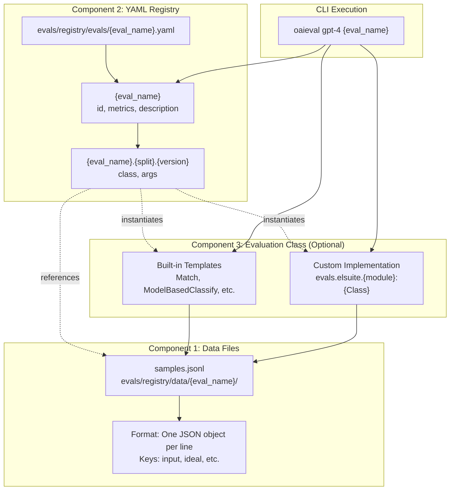
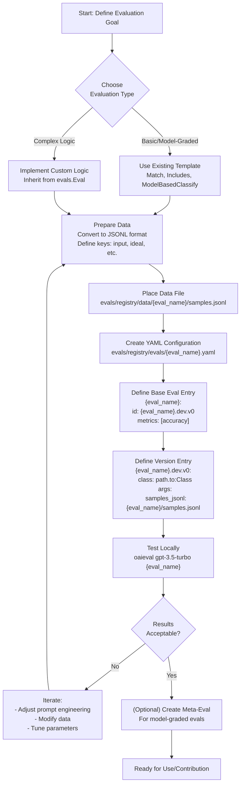
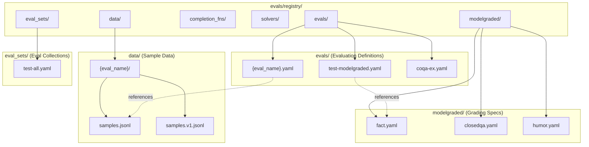
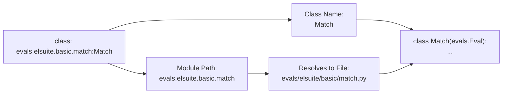
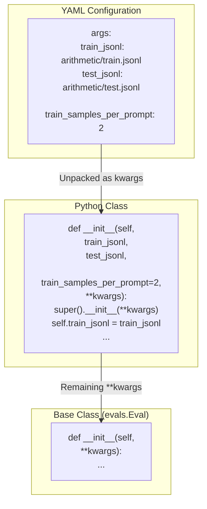

<!-- source: DeepWiki mcp.deepwiki.com · repo openai/evals · page 7 Creating and Configuring Evaluations · fetched 2026-10-26 -->

# Creating and Configuring Evaluations

<details>
<summary>Relevant source files</summary>

The following files were used as context for generating this wiki page:

- [.gitattributes](.gitattributes)
- [.github/config.yml](.github/config.yml)
- [Makefile](Makefile)
- [README.md](README.md)
- [docs/build-eval.md](docs/build-eval.md)
- [docs/completion-fn-protocol.md](docs/completion-fn-protocol.md)
- [docs/completion-fns.md](docs/completion-fns.md)
- [docs/custom-eval.md](docs/custom-eval.md)
- [evals/cli/oaievalset.py](evals/cli/oaievalset.py)
- [evals/data.py](evals/data.py)
- [evals/data_test.py](evals/data_test.py)
- [evals/record.py](evals/record.py)
- [evals/record_test.py](evals/record_test.py)
- [evals/registry/data/README.md](evals/registry/data/README.md)
- [evals/registry/data/logic/samples.jsonl](evals/registry/data/logic/samples.jsonl)
- [evals/registry/data/pattern_identification/samples.v0.jsonl](evals/registry/data/pattern_identification/samples.v0.jsonl)
- [evals/registry/evals/pattern_identification.yaml](evals/registry/evals/pattern_identification.yaml)
- [evals/utils/misc.py](evals/utils/misc.py)
- [mypy.ini](mypy.ini)
- [scripts/battle_generator.py](scripts/battle_generator.py)
- [scripts/modelgraded_generator.py](scripts/modelgraded_generator.py)
- [scripts/pattern_identification_generator.py](scripts/pattern_identification_generator.py)

</details>


## Purpose and Scope

This page provides a comprehensive guide to creating and configuring new evaluations in the OpenAI Evals framework. It covers the end-to-end workflow from conceptualizing an evaluation to registering it in the system and making it executable via the CLI.

This page focuses on the **overall process and system architecture** for creating evaluations. For detailed information on specific aspects:
- For data format specifications and data management, see [Data Preparation](#7.1)
- For detailed YAML configuration schemas and registry organization, see [Registry Configuration](#7.2)
- For automated eval generation tools and scripts, see [Generator Scripts](#7.3)
- For implementing custom evaluation logic beyond templates, see [Custom Evaluation Implementation](#6.4)
- For running evaluations once configured, see [Using oaieval CLI](#5.1)

**Note:** The framework currently does not accept contributions with custom code [README.md:75-75](). However, you can still create and submit model-graded evaluations with custom YAML configurations [docs/build-eval.md:3-4]().

## Overview: The Three-Component System

Every evaluation in the framework consists of three components:

1. **Data Files** - JSONL files containing evaluation samples [docs/build-eval.md:23-24]().
2. **YAML Configuration** - Registry entries defining evaluation parameters [docs/build-eval.md:42-43]().
3. **Evaluation Class** (optional) - Python implementation if using custom logic [docs/custom-eval.md:28-30]().



Sources: [docs/build-eval.md:1-98](), [README.md:66-98]()

## Evaluation Creation Workflow

The following diagram shows the complete workflow for creating and registering a new evaluation:



Sources: [docs/build-eval.md:6-93](), [docs/custom-eval.md:1-156]()

## Naming Conventions and Registry Structure

The registry follows a strict hierarchical naming convention that enables version management and organization:

### Naming Pattern

The naming convention for evals is in the form `<eval_name>.<split>.<version>` [docs/build-eval.md:57-57]().

| Component | Description | Examples |
|-----------|-------------|----------|
| `<eval_name>` | Base evaluation name, groups comparable evals | `coqa-match`, `joke-fruits`, `arithmetic` |
| `<split>` | Data split identifier (e.g., "val", "test", or "dev") | `dev`, `val`, `test`, `train` |
| `<version>` | Version identifier (avoid `.` in version) | `v0`, `v1`, `match-v1` |

### Registry File Organization

The `Registry` class [evals/cli/oaievalset.py:11-11]() resolves paths within `evals/registry/`.



Sources: [docs/build-eval.md:40-63](), [evals/registry/data/README.md:1-34](), [scripts/modelgraded_generator.py:6-6]()

## YAML Configuration Structure

### Basic Evaluation Example

The YAML configuration has two levels: a base entry (alias) and a version entry [docs/custom-eval.md:109-128]().

```yaml
# Base eval entry (alias)
coqa-match:
  id: coqa-match.dev.v0
  metrics: [accuracy]
  description: CoQA dataset with exact matching

# Version entry (concrete implementation)
coqa-match.dev.v0:
  class: evals.elsuite.basic.match:Match
  args:
    samples_jsonl: coqa/match.jsonl
```

| Field | Level | Required | Description |
|-------|-------|----------|-------------|
| `id` | Base | Yes | Points to the concrete version to use |
| `metrics` | Base | Yes | List of metrics to compute (first is primary) |
| `description` | Base | No | Human-readable description |
| `class` | Version | Yes | Python class path `module.path:ClassName` |
| `args` | Version | Yes | Arguments passed to class constructor |

Sources: [docs/build-eval.md:40-53](), [docs/custom-eval.md:102-128]()

### Model-Graded Evaluation Example

Model-graded evaluations reference a `modelgraded_spec` and specify an `eval_type` [docs/build-eval.md:76-80]().

```yaml
mg-humor-fruits:
  id: mg-humor-fruits.dev.v0
  metrics: [accuracy]

mg-humor-fruits.dev.v0:
  class: evals.elsuite.modelgraded.classify:ModelBasedClassify
  args:
    samples_jsonl: test_modelgraded/humor_fruits.jsonl
    eval_type: cot_classify_jp
    modelgraded_spec: humor_jp
```

Sources: [scripts/modelgraded_generator.py:18-28](), [docs/build-eval.md:76-80]()

## Class Path Resolution

The `class` field in YAML uses Python's dotted import notation to resolve to an implementation of `evals.Eval` [docs/custom-eval.md:28-28]().



Common class paths:

| Template Type | Class Path |
|---------------|------------|
| Match | `evals.elsuite.basic.match:Match` |
| ModelBasedClassify | `evals.elsuite.modelgraded.classify:ModelBasedClassify` [scripts/modelgraded_generator.py:23-23]() |
| Custom | `evals.elsuite.{your_module}:{YourClass}` |

Sources: [docs/build-eval.md:40-53](), [docs/custom-eval.md:102-128]()

## Data File Format and Requirements

### Required JSONL Structure

Data files must be in JSONL format, with one JSON object per line [docs/build-eval.md:23-24](). The `evals.data` module provides utilities like `get_jsonl` [evals/data.py:120-120]() and `iter_jsonls` [evals/data.py:146-146]() to process these files.

### Common Keys by Evaluation Type

| Eval Type | Required Keys | Optional Keys | Example |
|-----------|---------------|---------------|---------|
| Match/FuzzyMatch | `input`, `ideal` | | `{"input": "Q?", "ideal": "A"}` [evals/registry/data/README.md:9-9]() |
| ModelBasedClassify (single) | `input` | `ideal` (for meta-eval) | `{"input": "..."}` [scripts/modelgraded_generator.py:190-190]() |
| ModelBasedClassify (battle) | `input1`, `input2` | | `{"input1": "...", "input2": "..."}` [scripts/battle_generator.py:56-57]() |

### Chat Format for Input

The `input` field should use chat format (list of role/content dictionaries) for best compatibility [docs/build-eval.md:32-32]().

```json
{
  "input": [
    {"role": "system", "content": "You are a helpful assistant."},
    {"role": "user", "content": "What is the capital of France?"}
  ],
  "ideal": "Paris"
}
```

Sources: [docs/build-eval.md:21-38](), [evals/registry/data/README.md:8-34]()

## Mapping: YAML Args to Class Constructor

The `args` dictionary in YAML is unpacked and passed to the evaluation class constructor [docs/custom-eval.md:39-44]().



Sources: [docs/custom-eval.md:39-44](), [docs/build-eval.md:40-53]()

## Testing Your Evaluation

### Local Testing Process

1. **Install in editable mode**:
   ```bash
   pip install -e .
   ```
   Changes to your eval will be reflected immediately without reinstalling [README.md:39-42]().

2. **Run the evaluation**:
   ```bash
   oaieval gpt-3.5-turbo <eval_name>
   ```

3. **Review output**:
   The `RecorderBase` logs events [evals/record.py:54-54](). You can find results in local JSON files or Snowflake if configured [README.md:64-64]().

### Resume Mode

Use `oaievalset` to run multiple evaluations and resume from checkpoints if interrupted [evals/cli/oaievalset.py:59-63]().

Sources: [README.md:39-42](), [evals/cli/oaievalset.py:111-129](), [docs/custom-eval.md:133-156]()

## Generator Scripts for Scale

For creating large numbers of similar evaluations, generator scripts automate YAML and data file creation.

- **`modelgraded_generator.py`**: Generates `ModelBasedClassify` evals based on subjects and prompts [scripts/modelgraded_generator.py:188-214]().
- **`battle_generator.py`**: Creates pairwise "battle" evaluations between different subjects [scripts/battle_generator.py:52-70]().
- **`pattern_identification_generator.py`**: Generates synthetic pattern-matching tasks with system/user chat prompts [scripts/pattern_identification_generator.py:54-70]().

Sources: [scripts/modelgraded_generator.py:1-219](), [scripts/battle_generator.py:1-76](), [scripts/pattern_identification_generator.py:1-71]()

## Quality Criteria Checklist

Before submitting an evaluation, verify these criteria [docs/build-eval.md:83-93]():

- [ ] **Data Format**: Samples are valid JSONL and use chat format where possible.
- [ ] **Registry**: YAML is correctly placed in `evals/registry/evals/`.
- [ ] **Versioning**: Follows `<eval_name>.<split>.<version>` convention.
- [ ] **Metrics**: Primary metric is defined in the base eval entry.
- [ ] **Meta-Eval**: Model-graded evals include human-provided labels (choice keys) for verification [docs/build-eval.md:79-80]().
- [ ] **LFS**: Data files are tracked via Git LFS [README.md:19-24]().

Sources: [docs/build-eval.md:57-93](), [README.md:19-24]()

---

