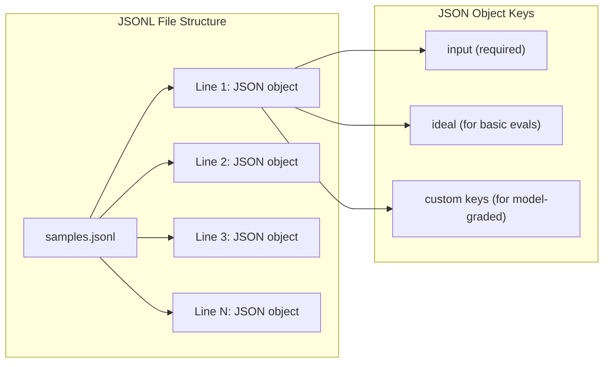
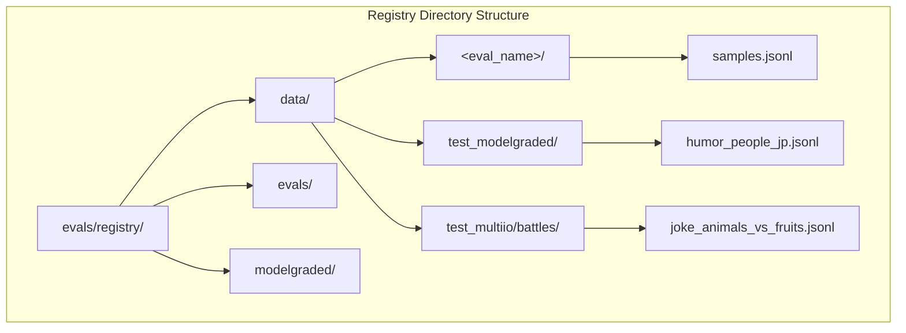
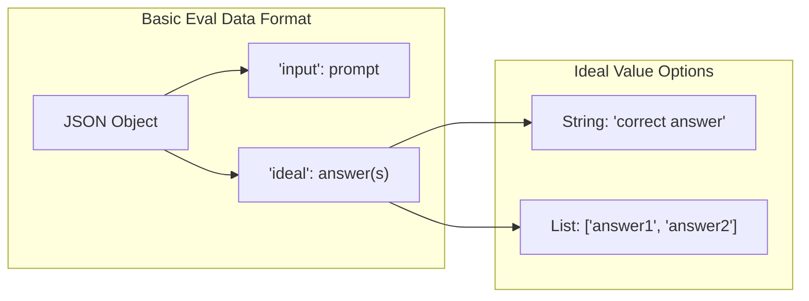
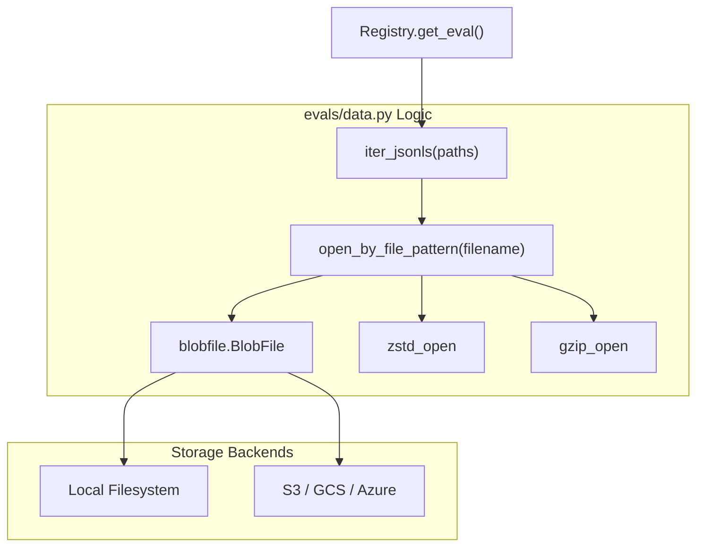

<!-- source: DeepWiki mcp.deepwiki.com · repo openai/evals · page 7.1 Data Preparation · fetched 2026-10-26 -->

# Data Preparation

<details>
<summary>Relevant source files</summary>

The following files were used as context for generating this wiki page:

- [.gitattributes](.gitattributes)
- [.github/config.yml](.github/config.yml)
- [Makefile](Makefile)
- [README.md](README.md)
- [docs/build-eval.md](docs/build-eval.md)
- [docs/completion-fn-protocol.md](docs/completion-fn-protocol.md)
- [docs/completion-fns.md](docs/completion-fns.md)
- [docs/custom-eval.md](docs/custom-eval.md)
- [evals/cli/oaievalset.py](evals/cli/oaievalset.py)
- [evals/data.py](evals/data.py)
- [evals/data_test.py](evals/data_test.py)
- [evals/record.py](evals/record.py)
- [evals/record_test.py](evals/record_test.py)
- [evals/registry/data/README.md](evals/registry/data/README.md)
- [evals/registry/data/logic/samples.jsonl](evals/registry/data/logic/samples.jsonl)
- [evals/registry/data/pattern_identification/samples.v0.jsonl](evals/registry/data/pattern_identification/samples.v0.jsonl)
- [evals/registry/evals/pattern_identification.yaml](evals/registry/evals/pattern_identification.yaml)
- [evals/utils/misc.py](evals/utils/misc.py)
- [mypy.ini](mypy.ini)
- [scripts/battle_generator.py](scripts/battle_generator.py)
- [scripts/modelgraded_generator.py](scripts/modelgraded_generator.py)
- [scripts/pattern_identification_generator.py](scripts/pattern_identification_generator.py)

</details>


This page covers the preparation of datasets for use in the Evals framework. This includes JSONL format requirements, data organization, storage using Git LFS, conversion tools, and automated generation scripts. For information about registering evaluations that use this data, see [Registry Configuration](#7.2). For running evaluations with prepared data, see [Using oaieval CLI](#5.1).

---

## JSONL Format Overview

All evaluation data in the Evals framework must be provided in JSON Lines (JSONL) format. Each line in a JSONL file contains a single, self-contained JSON object representing one evaluation sample.

### Basic Structure



**JSONL Format Requirements**

Every evaluation sample is a JSON object on a single line. The required keys depend on the evaluation type:

| Key | Required For | Description |
|-----|-------------|-------------|
| `input` | All evals | The prompt for the model, in chat format or string |
| `ideal` | Basic evals (`Match`, `Includes`, `FuzzyMatch`) | The correct answer(s), as string or list of strings |
| Custom keys | Model-graded evals | Keys matching `{key}` placeholders in the evaluation prompt |

Sources: [docs/build-eval.md:23-36](), [docs/custom-eval.md:16-24]()

### Chat Format vs String Format

The framework encourages use of chat format for prompts, even when evaluating non-chat models. The conversion between formats is handled automatically by the prompt base logic.

**Chat Format Example:**
```json
{
  "input": [
    {"role": "system", "content": "You are a helpful assistant."},
    {"role": "user", "content": "What is 2+2?"}
  ],
  "ideal": "4"
}
```

**String Format Example (deprecated but supported):**
```json
{
  "input": "What is 2+2?",
  "ideal": "4"
}
```

The chat format provides better control over model behavior and is the recommended approach for new evaluations.

Sources: [docs/build-eval.md:32-33](), [docs/custom-eval.md:18-19]()

---

## Data Storage and Organization

### Directory Structure



**Standard Data Paths:**

All evaluation data files are stored under `evals/registry/data/`. The typical organization is:

- `evals/registry/data/<eval_name>/samples.jsonl` - Standard location for eval data
- `evals/registry/data/<eval_name>/samples.v0.jsonl` - Versioned data files
- `evals/registry/data/test_modelgraded/` - Model-graded test examples
- `evals/registry/data/test_multiio/battles/` - Multi-input/output battle examples

When registering an eval, specify the path relative to `evals/registry/data/`. For example:

```yaml
samples_jsonl: coqa/match.jsonl
```

This will resolve to `evals/registry/data/coqa/match.jsonl`.

Sources: [docs/build-eval.md:38-56](), [scripts/modelgraded_generator.py:183-191](), [scripts/battle_generator.py:9-10]()

### Git LFS Configuration

The Evals registry uses Git Large File Storage (Git LFS) to manage data files efficiently. All JSONL data files are stored as LFS pointer files in the repository.

**Setting Up Git LFS:**

```bash
# Install Git LFS
# Then fetch all data
cd evals
git lfs fetch --all
git lfs pull
```

**Fetching Specific Eval Data:**

```bash
# Fetch data for a single eval
git lfs fetch --include=evals/registry/data/${your_eval}
git lfs pull
```

**LFS Pointer Files:**

Data files in the repository appear as small pointer files referencing the actual data stored in Git LFS. The `.gitattributes` file ensures that all `.jsonl` files in the registry are handled by the LFS filter.

Sources: [README.md:17-32](), [.gitattributes:1-1]()

### Cloud Storage References

For private evaluations or large datasets, the framework supports path-style URLs for cloud object storage. These are for personal use only and will not be accepted in public PRs.

The `open_by_file_pattern` function in `evals/data.py` uses `blobfile` to handle these remote paths seamlessly.

Supported cloud storage patterns:
- AWS S3: `s3://bucket-name/path/to/file.jsonl`
- Google Cloud Storage: `gs://bucket-name/path/to/file.jsonl`
- Azure Blob Storage: `https://account.blob.core.windows.net/container/path/to/file.jsonl`

Sources: [docs/build-eval.md:38-39](), [evals/data.py:47-77]()

---

## Data Format Specifications by Eval Type

### Basic Evaluation Formats

Basic evaluations (`Match`, `Includes`, `FuzzyMatch`) require two keys: `input` and `ideal`.



**Example - Match Format:**

```json
{"input": [{"role": "system", "content": "Complete the phrase."}, {"role": "user", "content": "Once upon a "}], "ideal": "time"}
```

The `ideal` field can be a single string or a list of acceptable answers. The evaluation passes if the model completion matches according to the eval template's logic.

Sources: [docs/build-eval.md:34-35](), [evals/registry/data/README.md:7-12]()

### Model-Graded Evaluation Formats

Model-graded evaluations use custom keys that correspond to placeholders in the evaluation prompt template. The required keys are determined by the `{key}` placeholders in the `prompt` field of the model-graded specification.

**Example - Fact Evaluation Format:**

The `fact` model-graded spec often checks a model completion against a ground truth. The data sample provides the context and the reference answer:

```json
{
  "input": [{"role": "user", "content": "What is the capital of France?"}],
  "ideal": "Paris"
}
```

When the evaluation runs, the model's output and the `ideal` value are passed to a grader model to verify factual consistency.

Sources: [docs/build-eval.md:34-36](), [evals/registry/data/README.md:28-30]()

### Multi-Input/Output Formats (Battle Evaluations)

Battle evaluations compare two model completions generated from different inputs. The data format uses `input1` and `input2` keys.

```json
{
  "input1": "write a 1-2 line joke about cat",
  "input2": "write a 1-2 line joke about apple"
}
```

The evaluation:
1. Generates a completion for `input1`.
2. Generates a completion for `input2`.
3. Uses a model-graded spec (like `battle`) to determine which completion is better.

Sources: [scripts/battle_generator.py:54-61](), [evals/registry/data/README.md:35-37]()

---

## Data Conversion and Generation Tools

### OpenAI CLI Data Preparation Tool

The `openai` Python package includes a CLI tool for converting common file formats to JSONL:

```bash
openai tools fine_tunes.prepare_data -f data[.csv, .json, .txt, .xlsx, .tsv]
```

Sources: [docs/build-eval.md:25-28]()

### Automated Generation Scripts

The framework includes several scripts in the `scripts/` directory to generate large datasets programmatically.

#### Model-Graded Generator (`modelgraded_generator.py`)
This script uses subject lists and prompt templates to generate model-graded evaluation samples and their corresponding YAML registry entries.

```python
# Defined in scripts/modelgraded_generator.py
unlabeled_prompts = dict(
    humor=dict(
        modelgraded_spec="humor_jp",
        prompt="{subject}で数行の大喜利を書いて。",
        eval_type="cot_classify_jp",
    ),
)
```

Sources: [scripts/modelgraded_generator.py:31-37](), [scripts/modelgraded_generator.py:188-198]()

#### Pattern Identification Generator (`pattern_identification_generator.py`)
This script generates complex logic puzzles where the model must identify a pattern between symbols and labels. It constructs samples containing multiple "exemplars" (few-shot examples) within a single `input` field.

```python
# Logic from scripts/pattern_identification_generator.py
d = {
    "input": [
        {"role": "system", "content": "You are a helpful assistant."},
        {"role": "user", "content": eval_example_str},
    ],
    "ideal": target,
}
```

Sources: [scripts/pattern_identification_generator.py:61-69]()

---

## Technical Implementation: Data Flow

The `evals/data.py` module provides the core utilities for reading evaluation data. It supports streaming and local/remote file access.



**Key Functions:**
- `open_by_file_pattern`: Handles local paths, GCS/S3 URLs, and transparent decompression for `.gz`, `.lz4`, and `.zst` files. [evals/data.py:47-77]()
- `iter_jsonls`: Iterates over JSONL files in a directory or list of paths, using an iterator to conserve memory. [evals/data.py:146-165]()
- `get_jsonl`: Extracts all JSON lines from a path into a single list. [evals/data.py:120-133]()

Sources: [evals/data.py:1-165]()

---

## Best Practices

1. **Version Your Data**: Use the `<eval_name>.<split>.<version>` convention (e.g., `arithmetic.dev.v1`). Bump the version whenever the dataset changes to maintain reproducibility. [docs/build-eval.md:57-62]()
2. **Use Chat Format**: Even for non-chat models, chat format is preferred as the framework handles conversion. [docs/build-eval.md:32-33]()
3. **Validate Locally**: Put your `jsonl` file in `evals/registry/data/<eval_name>/samples.jsonl` for local development before submitting. [docs/build-eval.md:38-38]()
4. **Compression**: For very large datasets, use `.gz` or `.zst` extensions; the `evals.data` utilities will handle decompression automatically. [evals/data.py:58-63]()

Sources: [docs/build-eval.md:57-62](), [evals/data.py:47-77]()

---

