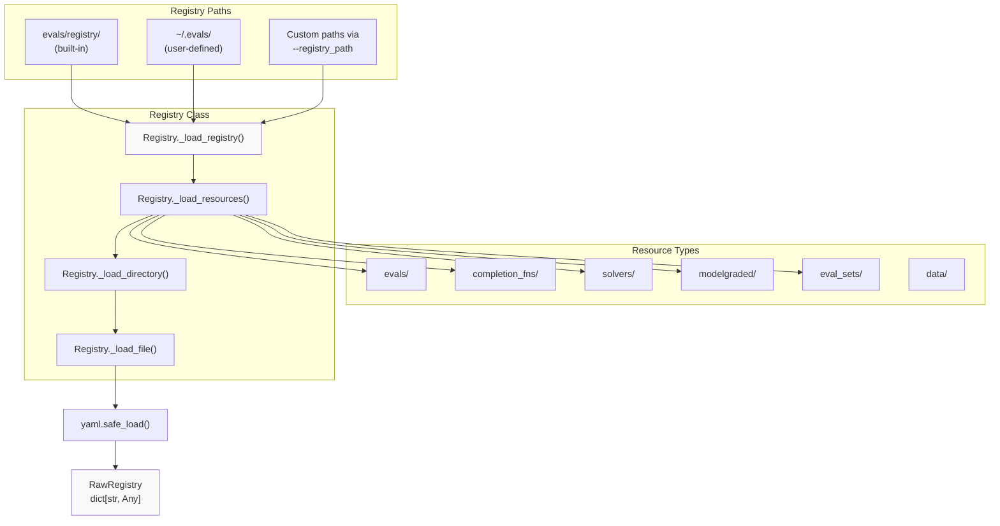
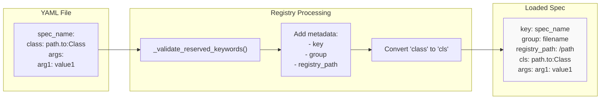
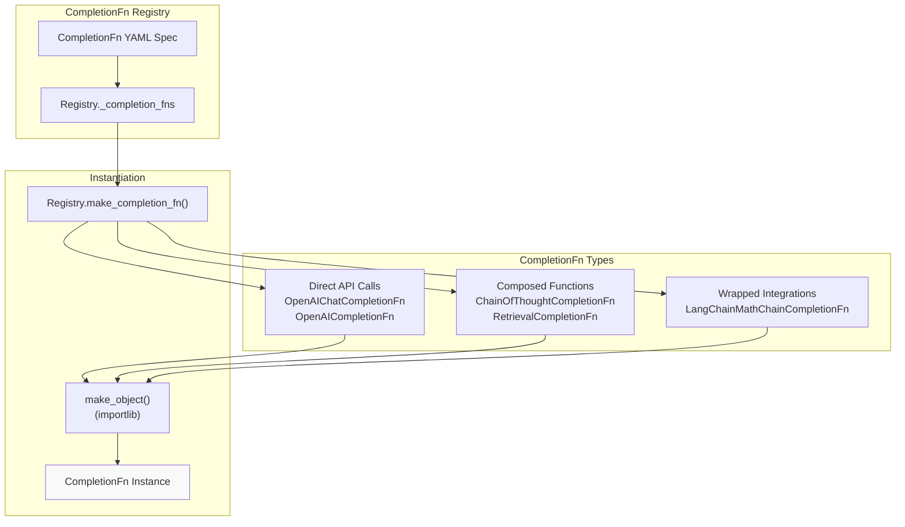
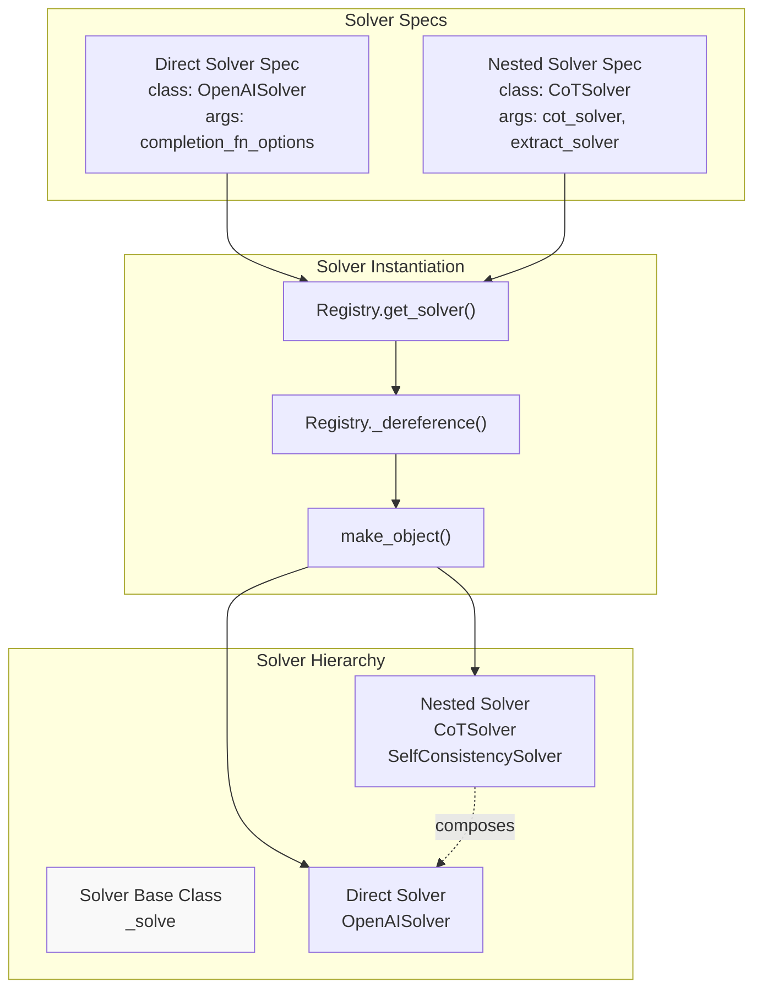
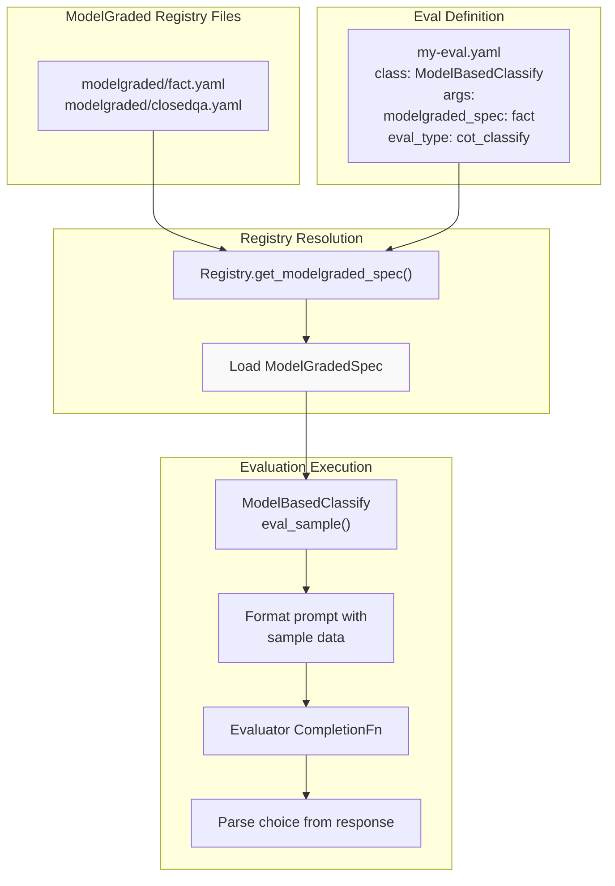
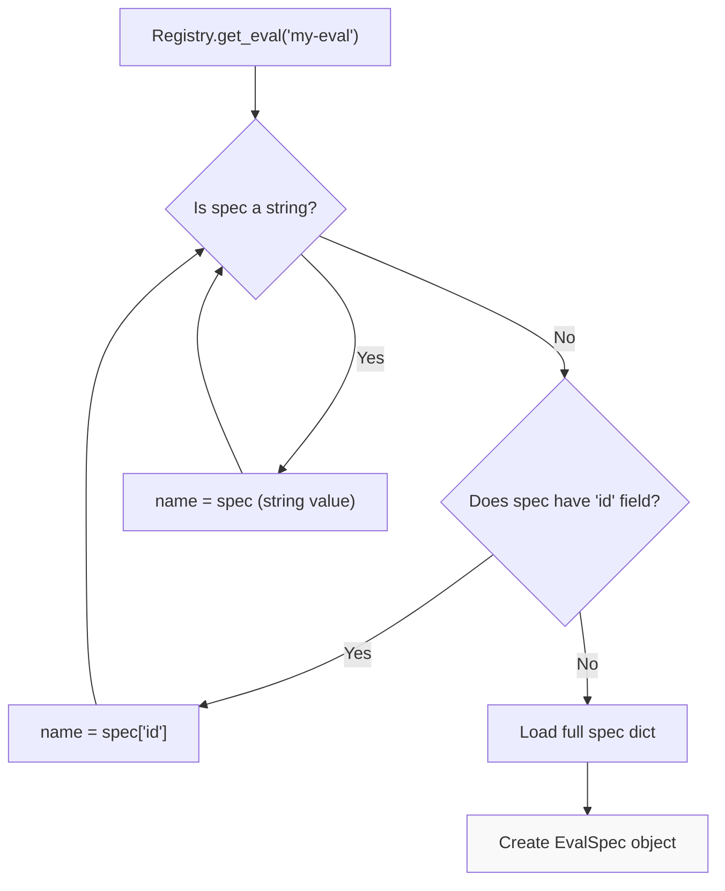
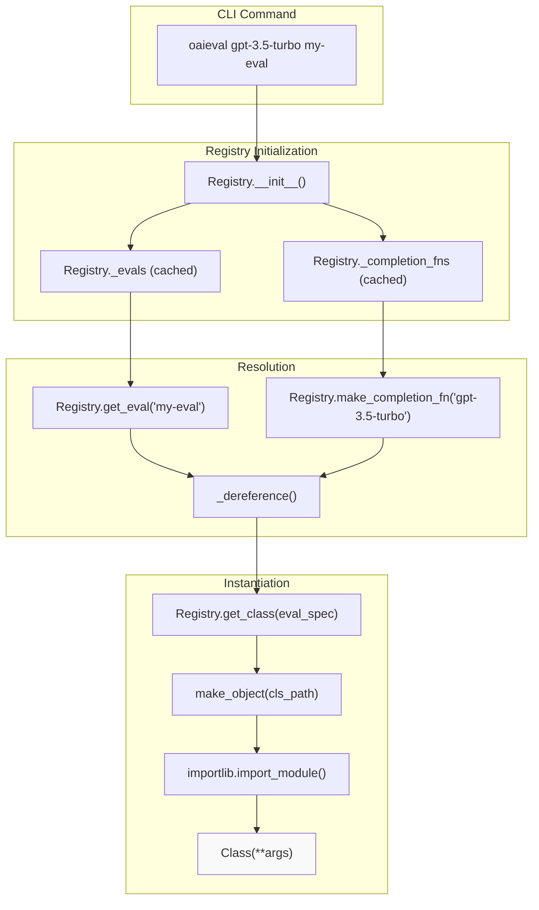

<!-- source: DeepWiki mcp.deepwiki.com · repo openai/evals · page 7.2 Registry Configuration · fetched 2026-10-26 -->

# Registry Configuration

<details>
<summary>Relevant source files</summary>

The following files were used as context for generating this wiki page:

- [.gitattributes](.gitattributes)
- [.github/config.yml](.github/config.yml)
- [Makefile](Makefile)
- [README.md](README.md)
- [docs/build-eval.md](docs/build-eval.md)
- [docs/completion-fn-protocol.md](docs/completion-fn-protocol.md)
- [docs/completion-fns.md](docs/completion-fns.md)
- [docs/custom-eval.md](docs/custom-eval.md)
- [evals/cli/oaieval.py](evals/cli/oaieval.py)
- [evals/completion_fns/langchain_math.py](evals/completion_fns/langchain_math.py)
- [evals/completion_fns/openai.py](evals/completion_fns/openai.py)
- [evals/completion_fns/retrieval.py](evals/completion_fns/retrieval.py)
- [evals/elsuite/make_me_say/autoeval.py](evals/elsuite/make_me_say/autoeval.py)
- [evals/elsuite/make_me_say/utils.py](evals/elsuite/make_me_say/utils.py)
- [evals/registry.py](evals/registry.py)
- [evals/registry/completion_fns/cot.yaml](evals/registry/completion_fns/cot.yaml)
- [evals/registry/data/pattern_identification/samples.v0.jsonl](evals/registry/data/pattern_identification/samples.v0.jsonl)
- [evals/registry/data/word_association/corpus_tools/validators.py](evals/registry/data/word_association/corpus_tools/validators.py)
- [evals/registry/evals/pattern_identification.yaml](evals/registry/evals/pattern_identification.yaml)
- [evals/registry/solvers/bluff.yaml](evals/registry/solvers/bluff.yaml)
- [evals/registry/solvers/defaults.yaml](evals/registry/solvers/defaults.yaml)
- [evals/registry/solvers/make-me-pay.yaml](evals/registry/solvers/make-me-pay.yaml)
- [evals/registry/solvers/self_prompting.yaml](evals/registry/solvers/self_prompting.yaml)
- [evals/registry/solvers/theory_of_mind.yaml](evals/registry/solvers/theory_of_mind.yaml)
- [evals/registry_test.py](evals/registry_test.py)
- [evals/solvers/README.md](evals/solvers/README.md)
- [evals/solvers/nested/cot_solver.py](evals/solvers/nested/cot_solver.py)
- [evals/solvers/nested/self_consistency_solver.py](evals/solvers/nested/self_consistency_solver.py)
- [evals/solvers/postprocessors/README.md](evals/solvers/postprocessors/README.md)
- [evals/utils/api_utils.py](evals/utils/api_utils.py)
- [examples/retrieval-completionfn.ipynb](examples/retrieval-completionfn.ipynb)

</details>


This page documents the YAML configuration structure used by the OpenAI Evals registry system. The registry provides a declarative way to define evaluations, completion functions, solvers, and model-graded specifications without writing code. All components are configured through YAML files that are loaded dynamically at runtime.

For information about the Registry class itself and how it loads configurations, see [Core Architecture - Registry System](3.1). For guidance on preparing data files to use with your registry configurations, see [Data Preparation](7.1).

## Registry Directory Structure

The registry system loads YAML files from specific directory structures. By default, two paths are searched:

```
evals/registry/           # Built-in registry
├── evals/                # Evaluation definitions
├── completion_fns/       # CompletionFn definitions
├── solvers/              # Solver definitions
├── modelgraded/          # ModelGraded spec definitions
├── eval_sets/            # Eval set definitions (collections)
└── data/                 # Data files (JSONL, etc.)

~/.evals/                 # User registry (optional)
├── evals/
├── completion_fns/
├── solvers/
└── modelgraded/
```

Each subdirectory can contain multiple YAML files. The registry loads all `.yaml` files from each resource type directory.

**Sources:** [evals/registry.py:30-33](), [evals/registry.py:262-277]()

### Registry Loading Data Flow


**Sources:** [evals/registry.py:104-108](), [evals/registry.py:251-310]()

## YAML Configuration Format

All registry YAML files follow a common structure:

```yaml
<spec_name>:
  class: <dotted.path.to:ClassName>  # Python class to instantiate
  args:                               # Arguments passed to __init__
    <arg_name>: <arg_value>
    ...
```

The registry automatically adds metadata to each specification:

| Field | Type | Description | Source |
|-------|------|-------------|--------|
| `key` | string | The name from the YAML (e.g., `my-eval.dev.v1`) | Added by registry |
| `group` | string | Filename without extension (e.g., `my-eval` from `my-eval.yaml`) | Added by registry |
| `registry_path` | Path | Path to the registry directory | Added by registry |
| `cls` | string | Normalized from `class` field | Converted by registry |

Reserved keywords that cannot be used in YAML specs: `key`, `group`, `cls`.

**Sources:** [evals/registry.py:34](), [evals/registry.py:280-309]()

### YAML to Internal Spec Conversion


**Sources:** [evals/registry.py:280-309]()

## Eval Specifications

Eval specifications define individual evaluations. Each eval must specify a Python class that implements the evaluation logic and the arguments to pass to that class.

### Eval Naming Convention

Eval names follow the pattern: `<eval_name>.<split>.<version>`

- `<eval_name>`: Groups evals whose scores are comparable
- `<split>`: Data split (e.g., `dev`, `test`, `val`)
- `<version>`: Version identifier (e.g., `v0`, `v1`, `2023-01-15`)

### Base Eval vs Full Eval

```yaml
# Base eval (alias to a specific version)
my-arithmetic:
  id: my-arithmetic.dev.v1
  description: "Tests arithmetic capabilities"
  metrics: [accuracy]

# Full eval specification
my-arithmetic.dev.v1:
  class: evals.elsuite.basic.match:Match
  args:
    samples_jsonl: my-arithmetic/samples.jsonl
```

The base eval (without split/version) serves as an alias and defines metadata like description and metrics. The full eval specifies the implementation.

**Sources:** [docs/build-eval.md:42-62](), [evals/registry.py:229-249]()

### Common Eval Classes

| Class | Purpose | Required Args |
|-------|---------|---------------|
| `evals.elsuite.basic.match:Match` | Exact prefix matching | `samples_jsonl` |
| `evals.elsuite.basic.includes:Includes` | Substring matching | `samples_jsonl` |
| `evals.elsuite.basic.fuzzy_match:FuzzyMatch` | Bidirectional fuzzy match | `samples_jsonl` |
| `evals.elsuite.modelgraded.classify:ModelBasedClassify` | Model-graded evaluation | `samples_jsonl`, `eval_type`, `modelgraded_spec` |

**Sources:** [docs/build-eval.md:42-53]()

## CompletionFn Specifications

CompletionFn specifications define model interfaces for generating completions. These can wrap API calls, LangChain integrations, or custom logic.

### CompletionFn Structure

```yaml
my-completion-fn:
  class: evals.completion_fns.openai:OpenAIChatCompletionFn
  args:
    model: gpt-3.5-turbo
    extra_options:
      temperature: 0.5
      max_tokens: 1024
```

### Common CompletionFn Classes

| Class | Purpose | Key Args |
|-------|---------|----------|
| `evals.completion_fns.openai:OpenAIChatCompletionFn` | OpenAI chat models | `model`, `api_base`, `api_key`, `n_ctx` |
| `evals.completion_fns.openai:OpenAICompletionFn` | OpenAI completion models | `model`, `api_base`, `api_key`, `n_ctx` |
| `evals.completion_fns.retrieval:RetrievalCompletionFn` | RAG with embeddings | `completion_fn`, `embeddings_and_text_path`, `k` |
| `evals.completion_fns.langchain_math:LangChainMathChainCompletionFn` | Math chain integration | None (uses default OpenAI) |

**Sources:** [evals/completion_fns/openai.py:83-147](), [evals/completion_fns/retrieval.py:53-89](), [evals/completion_fns/langchain_math.py:19-31]()

### CompletionFn Instantiation Logic


**Sources:** [evals/registry.py:120-151](), [evals/registry.py:312-314]()

## Solver Specifications

Solvers are stateful extensions of CompletionFns that support multi-turn interactions. They are often configured via YAML to define specific behaviors or nested logic.

### Nested Solvers

Solvers can be composed hierarchically in the registry:

```yaml
generation/cot/gpt-4:
  class: evals.solvers.nested.cot_solver:CoTSolver
  args:
    cot_solver:
      class: evals.solvers.openai_solver:OpenAISolver
      args:
        completion_fn_options:
          model: gpt-4
    extract_solver:
      class: evals.solvers.openai_solver:OpenAISolver
      args:
        completion_fn_options:
          model: gpt-4
```

**Sources:** [evals/registry/solvers/defaults.yaml:1-10](), [evals/solvers/nested/cot_solver.py:1-10]()

### Solver Instantiation and Hierarchy


**Sources:** [evals/registry.py:207-208](), [evals/registry.py:317-318]()

## ModelGraded Specifications

ModelGraded specifications define reusable evaluation templates for using an LLM to grade another LLM's output. These specs are referenced by model-graded eval definitions.

### ModelGradedSpec Structure

```yaml
humor:
  prompt: |
    You are evaluating a joke for humor. The joke is:
    
    {joke}
    
    Rate this joke on a scale from 1-5.
  choice_strings: ["1", "2", "3", "4", "5"]
  choice_scores:
    "1": 0.0
    "2": 0.25
    "3": 0.5
    "4": 0.75
    "5": 1.0
  eval_type: cot_classify
  input_outputs:
    joke: output
```

**Sources:** [docs/build-eval.md:72-81](), [evals/elsuite/modelgraded/base.py:23]()

### ModelGraded Evaluation Data Flow


**Sources:** [evals/registry.py:193-200](), [evals/registry.py:329-330]()

## Aliases and References

Specs can reference other specs using aliases, enabling configuration reuse and versioning.

### Resolution Process

The `Registry._dereference` function handles the resolution of names to actual specification objects. It supports both direct string aliases and the `id` field in dictionaries.



**Sources:** [evals/registry.py:156-191]()

## Registry Resolution and Instantiation

The registry uses a two-phase process: resolution (finding the spec) and instantiation (creating the object).

### Instantiation Flow

1. **CLI Call**: `oaieval` calls `run` in `evals/cli/oaieval.py` [evals/cli/oaieval.py:118-226]().
2. **Spec Retrieval**: `registry.get_eval(args.eval)` retrieves the `EvalSpec` [evals/cli/oaieval.py:131]().
3. **CompletionFn Creation**: `registry.make_completion_fn(url)` instantiates the model interface [evals/cli/oaieval.py:170]().
4. **Class Instantiation**: `registry.get_class(eval_spec)` uses `make_object` to load the Python class [evals/registry.py:153-154]().

### Registry Object Instantiation Logic


**Sources:** [evals/cli/oaieval.py:118-226](), [evals/registry.py:120-154]()

## Adding Custom Registry Paths

You can extend the registry with custom paths at runtime:

### Via CLI
```bash
oaieval gpt-3.5-turbo my-eval --registry_path /path/to/custom/registry
```

### Programmatically
```python
from evals.registry import Registry

registry = Registry()
registry.add_registry_paths(["/path/to/custom/registry"])
```

**Sources:** [evals/cli/oaieval.py:50-55](), [evals/cli/oaieval.py:128-129](), [evals/registry.py:107-108]()

---

