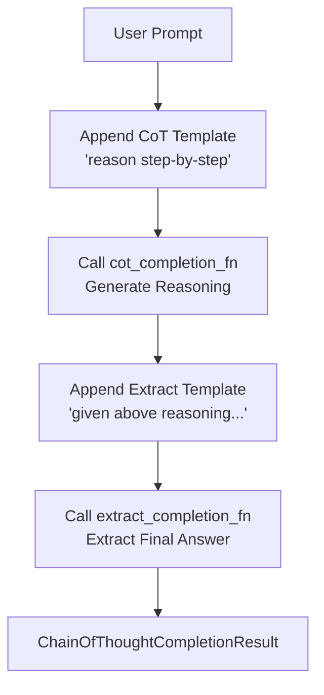
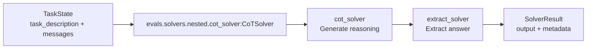
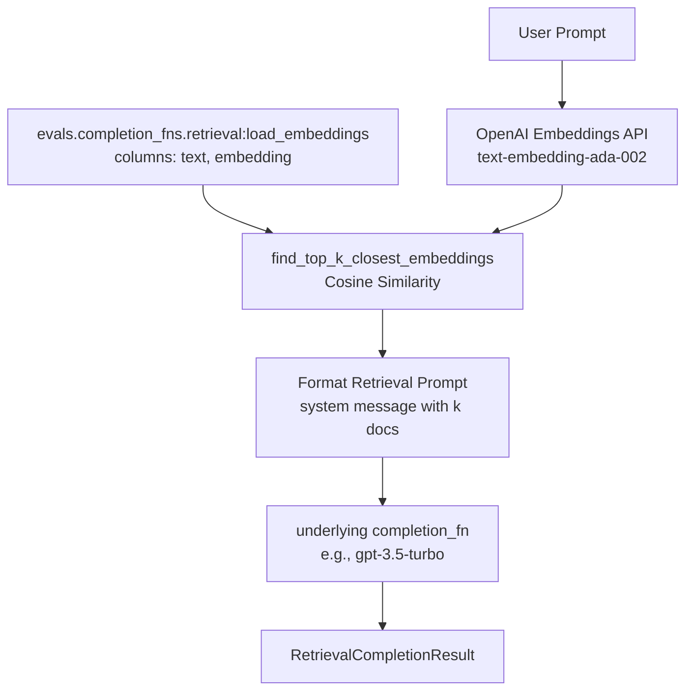
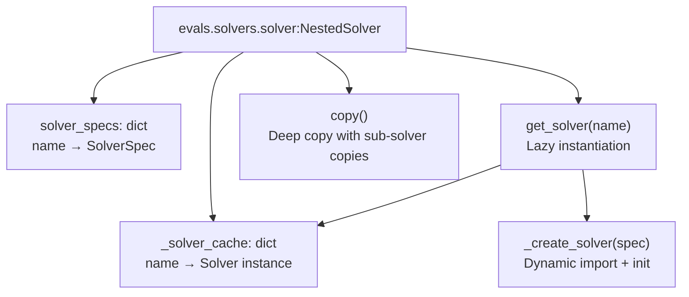
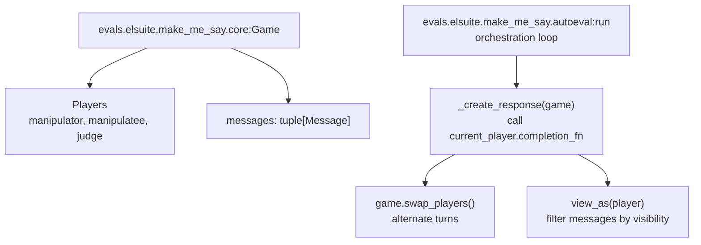

<!-- source: DeepWiki mcp.deepwiki.com · repo openai/evals · page 8 Advanced Features · fetched 2026-10-26 -->

# Advanced Features

<details>
<summary>Relevant source files</summary>

The following files were used as context for generating this wiki page:

- [.gitignore](.gitignore)
- [evals/cli/oaieval.py](evals/cli/oaieval.py)
- [evals/completion_fns/cot.py](evals/completion_fns/cot.py)
- [evals/completion_fns/langchain_llm.py](evals/completion_fns/langchain_llm.py)
- [evals/completion_fns/langchain_math.py](evals/completion_fns/langchain_math.py)
- [evals/completion_fns/openai.py](evals/completion_fns/openai.py)
- [evals/completion_fns/retrieval.py](evals/completion_fns/retrieval.py)
- [evals/elsuite/make_me_say/autoeval.py](evals/elsuite/make_me_say/autoeval.py)
- [evals/elsuite/make_me_say/utils.py](evals/elsuite/make_me_say/utils.py)
- [evals/registry.py](evals/registry.py)
- [evals/registry/completion_fns/cot.yaml](evals/registry/completion_fns/cot.yaml)
- [evals/registry/completion_fns/langchain_llms.yaml](evals/registry/completion_fns/langchain_llms.yaml)
- [evals/registry/data/word_association/corpus_tools/validators.py](evals/registry/data/word_association/corpus_tools/validators.py)
- [evals/registry/solvers/bluff.yaml](evals/registry/solvers/bluff.yaml)
- [evals/registry/solvers/defaults.yaml](evals/registry/solvers/defaults.yaml)
- [evals/registry/solvers/make-me-pay.yaml](evals/registry/solvers/make-me-pay.yaml)
- [evals/registry/solvers/self_prompting.yaml](evals/registry/solvers/self_prompting.yaml)
- [evals/registry/solvers/theory_of_mind.yaml](evals/registry/solvers/theory_of_mind.yaml)
- [evals/registry_test.py](evals/registry_test.py)
- [evals/solvers/README.md](evals/solvers/README.md)
- [evals/solvers/nested/cot_solver.py](evals/solvers/nested/cot_solver.py)
- [evals/solvers/nested/self_consistency_solver.py](evals/solvers/nested/self_consistency_solver.py)
- [evals/solvers/postprocessors/README.md](evals/solvers/postprocessors/README.md)
- [evals/utils/api_utils.py](evals/utils/api_utils.py)
- [examples/retrieval-completionfn.ipynb](examples/retrieval-completionfn.ipynb)

</details>


This document covers advanced patterns and techniques for building sophisticated evaluation scenarios in the Evals framework. These features enable complex prompting strategies, retrieval-augmented generation, multi-turn interactions, and robust error handling.

For basic evaluation patterns (Match, Includes, FuzzyMatch), see [Basic Evaluations](#6.1). For implementing custom evaluation classes, see [Custom Evaluation Implementation](#6.4). For the fundamentals of the Solver framework, see [Solver Framework](#4.2).

---

## 8.1 Chain-of-Thought and Prompting

Chain-of-thought (CoT) prompting improves model reasoning by instructing the model to explain its reasoning before producing a final answer. The framework provides both `CompletionFn`-level and `Solver`-level implementations.

### ChainOfThoughtCompletionFn

The `ChainOfThoughtCompletionFn` wraps any completion function to add two-stage reasoning: first generating reasoning steps, then extracting the final answer.

**Two-Stage Execution Diagram:**



**Implementation:** The class performs a two-stage call pattern where the first stage elicits reasoning and the second stage extracts the answer. Both stages are recorded separately using `record_sampling`.

[evals/completion_fns/cot.py:23-66]()

| Configuration Parameter | Description | Default |
|------------------------|-------------|---------|
| `cot_template` | Prompt appended to elicit reasoning | "Before answering, reason in a step-by-step manner..." |
| `extract_answer_template` | Prompt appended to extract final answer | "Given the above reasoning, the answer..." |
| `cot_completion_fn` | Model used for reasoning stage | Required |
| `extract_completion_fn` | Model used for extraction stage | Same as `cot_completion_fn` |

**Registry Configuration:**

[evals/registry/completion_fns/cot.yaml:1-21]()

Example usage:
```yaml
cot/gpt-3.5-turbo:
  class: evals.completion_fns.cot:ChainOfThoughtCompletionFn
  args:
    cot_completion_fn: gpt-3.5-turbo
```

### CoTSolver

For Solver-based evaluations, the `CoTSolver` is a `NestedSolver` implementation that performs similar two-stage reasoning but operates on `TaskState` objects and supports `private_interaction_length` to control which messages are visible to evaluators.

**Architecture:**



The `CoTSolver` is configured with two sub-solvers in the registry, often using providers like `AnthropicSolver`.

[evals/registry/solvers/anthropic.yaml:10-20]()

### Prompt Engineering Patterns

**Default CoT Templates:** The framework provides standard templates that can be customized:

[evals/solvers/prompts/cot.py:1-4]()

- `DEFAULT_COT_TEMPLATE`: Instructs reasoning with privacy guarantee.
- `DEFAULT_EXTRACT_ANSWER_TEMPLATE`: Requests formatted final answer.

**Task-Specific Prompting:** Evaluations can inject custom system messages to elicit specific capabilities. The `CONARTIST_MSG` demonstrates domain-specific prompt engineering for persuasion tasks, including role specification and output format requirements.

[evals/elsuite/make_me_pay/solvers/prompts.py:1-19]()

**Sources:** 
- evals/completion_fns/cot.py
- evals/solvers/prompts/cot.py
- evals/registry/completion_fns/cot.yaml
- evals/registry/solvers/anthropic.yaml
- evals/elsuite/make_me_pay/solvers/prompts.py

---

## 8.2 Retrieval and Composition

The framework supports composing completion functions and solvers to build complex behaviors, including retrieval-augmented generation (RAG) and hierarchical solver nesting.

### RetrievalCompletionFn (RAG Pattern)

The `RetrievalCompletionFn` implements RAG by embedding the prompt, finding similar documents in a local CSV, and injecting them as context.

**Architecture:**



**Implementation Details:**

[evals/completion_fns/retrieval.py:53-120]()

| Parameter | Description | Default |
|-----------|-------------|---------|
| `completion_fn` | Underlying completion function name | Required |
| `embeddings_and_text_path` | Path to CSV with "text" and "embedding" columns | Required |
| `k` | Number of documents to retrieve | 4 |
| `embedding_model` | OpenAI embedding model | "text-embedding-ada-002" |

**Similarity Calculation:** Uses normalized cosine similarity with NumPy.

[evals/completion_fns/retrieval.py:28-39]()

### NestedSolver Composition

The `NestedSolver` abstract class enables hierarchical composition where solvers coordinate other solvers. This is fundamental to building complex multi-stage reasoning systems.

**Class Structure:**



**Key Methods:**

[evals/solvers/solver.py:137-209]()

- `get_solver(solver_name)`: Returns cached solver instance or creates new one using `make_object`.
- `copy()`: Performs deep copy of nested structure, calling `copy()` on each sub-solver to maintain isolation.

### Postprocessors

Postprocessors are transformations applied to solver outputs after the `_solve` method completes. They enable modular output processing.

**Execution Flow:**

[evals/solvers/solver.py:76-97]()

Each postprocessor receives the `SolverResult`, transforms the output, and returns a new `SolverResult`. Each transformation is recorded as a `postprocessor` event.

**Sources:**
- evals/completion_fns/retrieval.py
- evals/solvers/solver.py
- examples/retrieval-completionfn.ipynb

---

## 8.3 Multi-Turn and Interactive Evaluations

Multi-turn evaluations test conversational and strategic capabilities through extended interactions. The framework supports game-based evaluations and stateful solvers.

### Game-Based Evaluation Pattern

Game-based evaluations model multi-player interactions with turn-taking and message history. The `MakeMeSay` evaluation exemplifies this pattern.

**Core Architecture:**



**Player and Game Structure:** Players are instantiated with specific `CompletionFn` objects, and the game loop alternates turns until `max_turns` is reached.

[evals/elsuite/make_me_say/autoeval.py:34-110]()

### TaskState Management for Solvers

For Solver-based multi-turn evaluations, `TaskState` provides the interface for maintaining conversation history and arbitrary state metadata.

**Per-Sample Isolation:** The `SolverEval` base class creates a new solver copy for each sample to ensure state does not leak between parallel executions.

[evals/eval.py:225-226]()

**Sources:**
- evals/elsuite/make_me_say/autoeval.py
- evals/elsuite/make_me_say/core.py
- evals/eval.py
- evals/elsuite/basic/match_with_solvers.py

---

## 8.4 Error Handling and Retry Logic

The framework implements comprehensive retry logic with exponential backoff to handle transient API errors like rate limits and timeouts.

### create_retrying Function

The core retry mechanism is `create_retrying`, a wrapper that retries any function on specified exceptions using `backoff`.

[evals/utils/api_utils.py:10-22]()

**Backoff Configuration:**
- `wait_gen=backoff.expo`: Exponential backoff strategy.
- `max_value=60`: Maximum wait time of 60 seconds.
- `factor=1.5`: Exponential growth factor.

### Provider-Specific Retry Patterns

Each model provider integration defines retry-enabled wrappers with provider-specific exception types.

#### OpenAI Retry Implementation

**Exception Types:** Includes `RateLimitError`, `APIConnectionError`, `APITimeoutError`, and `InternalServerError`.

[evals/completion_fns/openai.py:19-24]()

**Retry Wrappers:** `openai_completion_create_retrying` and `openai_chat_completion_create_retrying` wrap the OpenAI SDK calls.

[evals/completion_fns/openai.py:27-52]()

#### Make Me Say Retry Pattern

For complex interactive evals, retry logic is applied directly to the chat completion utility:

[evals/elsuite/make_me_say/utils.py:13-26]()

### Timeout Configuration

Thread-level timeouts for parallel execution are configured via environment variables:

[evals/utils/api_utils.py:6]()

```python
EVALS_THREAD_TIMEOUT = float(os.environ.get("EVALS_THREAD_TIMEOUT", "40"))
```

**Sources:**
- evals/utils/api_utils.py
- evals/completion_fns/openai.py
- evals/elsuite/make_me_say/utils.py
- evals/eval.py

---

