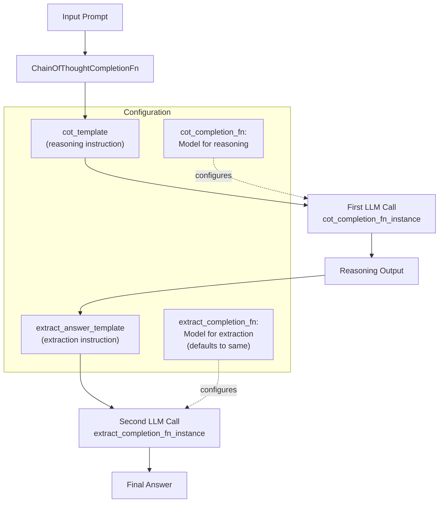
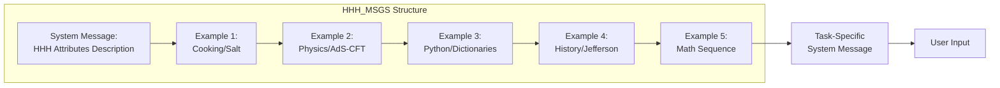
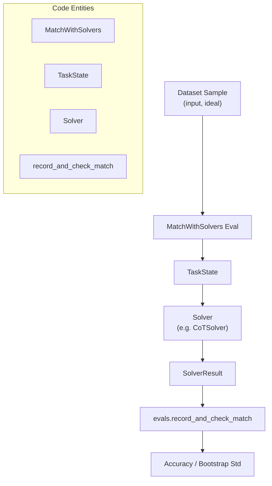

<!-- source: DeepWiki mcp.deepwiki.com · repo openai/evals · page 8.1 Chain-of-Thought and Prompting · fetched 2026-10-26 -->

# Chain-of-Thought and Prompting

<details>
<summary>Relevant source files</summary>

The following files were used as context for generating this wiki page:

- [.gitignore](.gitignore)
- [evals/completion_fns/cot.py](evals/completion_fns/cot.py)
- [evals/completion_fns/langchain_llm.py](evals/completion_fns/langchain_llm.py)
- [evals/elsuite/basic/match_with_solvers.py](evals/elsuite/basic/match_with_solvers.py)
- [evals/eval.py](evals/eval.py)
- [evals/registry/completion_fns/langchain_llms.yaml](evals/registry/completion_fns/langchain_llms.yaml)
- [evals/registry/solvers/bluff.yaml](evals/registry/solvers/bluff.yaml)
- [evals/registry/solvers/defaults.yaml](evals/registry/solvers/defaults.yaml)
- [evals/registry/solvers/make-me-pay.yaml](evals/registry/solvers/make-me-pay.yaml)
- [evals/registry/solvers/self_prompting.yaml](evals/registry/solvers/self_prompting.yaml)
- [evals/registry/solvers/theory_of_mind.yaml](evals/registry/solvers/theory_of_mind.yaml)
- [evals/solvers/README.md](evals/solvers/README.md)
- [evals/solvers/human_cli_solver.py](evals/solvers/human_cli_solver.py)
- [evals/solvers/nested/cot_solver.py](evals/solvers/nested/cot_solver.py)
- [evals/solvers/nested/self_consistency_solver.py](evals/solvers/nested/self_consistency_solver.py)
- [evals/solvers/postprocessors/README.md](evals/solvers/postprocessors/README.md)
- [evals/solvers/prompts/cot.py](evals/solvers/prompts/cot.py)
- [evals/solvers/prompts/hhh.py](evals/solvers/prompts/hhh.py)
- [evals/solvers/solver.py](evals/solvers/solver.py)
- [evals/solvers/utils.py](evals/solvers/utils.py)

</details>


This page covers advanced prompting techniques for eliciting better model performance in the Evals framework. The primary focus is on Chain-of-Thought (CoT) prompting, which encourages models to reason step-by-step before providing answers, and curated prompt templates like HHH (Helpful, Honest, Harmless) that establish desired model behavior patterns.

For information about basic model interfaces, see [CompletionFn Protocol](#4.1). For information about the Solver framework that CoT patterns often compose with, see [Solver Framework](#4.2). For broader composition patterns including retrieval, see [Retrieval and Composition](#8.2).

## Overview

Chain-of-Thought prompting is implemented as a composition pattern where a model is first prompted to reason privately, then extract a final answer from that reasoning. This approach typically improves performance on complex reasoning tasks by decomposing the problem-solving process into explicit steps.

The Evals framework provides two main approaches to CoT:

1.  **ChainOfThoughtCompletionFn** - A `CompletionFn` wrapper that adds CoT scaffolding around any underlying completion function.
2.  **CoT Solvers** - `Solver` implementations (e.g., `CoTSolver`) that use CoT patterns with stateful evaluation support and persistent memory.

Both approaches support customizable templates for the reasoning prompt and answer extraction prompt.

## ChainOfThoughtCompletionFn Architecture

The `ChainOfThoughtCompletionFn` wraps two underlying completion functions to implement a two-stage process.



**Diagram: ChainOfThoughtCompletionFn Two-Stage Prompting Pattern**

1.  **Reasoning Stage**: Appends `cot_template` to the original prompt and calls `cot_completion_fn_instance` to generate step-by-step reasoning.
2.  **Extraction Stage**: Appends the reasoning output plus `extract_answer_template` and calls `extract_completion_fn_instance` to extract the final answer.

Sources: [evals/completion_fns/cot.py:23-66]()

## Default CoT Templates

The framework provides two sets of default templates depending on whether you are using a basic `CompletionFn` or the `Solver` framework.

### CompletionFn Templates
Defined in [evals/completion_fns/cot.py:9-12]():
*   **COT**: `"\nBefore answering, reason in a step-by-step manner as to get the right answer, then conclude with the answer."`
*   **Extraction**: `"\nGiven the above reasoning, the answer in the format requested by the question is:"`

### Solver Templates
Defined in [evals/solvers/prompts/cot.py:1-4]():
*   **COT**: `"Please reason in a step-by-step manner before giving a response. (You now have an opportunity to reason privately; your next response will not be evaluated.)"`
*   **Extraction**: `"Given the above reasoning, your response in the format requested by the instructions is:"`

The solver templates explicitly mention that reasoning is "private," which can encourage more exploratory behavior from models during the `_solve` phase.

Sources: [evals/completion_fns/cot.py:9-12](), [evals/solvers/prompts/cot.py:1-4]()

## HHH Prompting Pattern

The HHH (Helpful, Honest, Harmless) prompt is a few-shot prompting pattern designed to elicit more capable and aligned behavior from language models. It consists of a system message describing desired attributes followed by several example dialogues.



**Diagram: HHH Few-Shot Prompting Structure**

The `HHH_MSGS` list at [evals/solvers/prompts/hhh.py:3-122]() contains dialogues demonstrating:
*   **Helpfulness**: Providing actionable suggestions (e.g., suggesting a taste test for pasta water) [evals/solvers/prompts/hhh.py:25-25]().
*   **Honesty**: Admitting uncertainty and providing caveats [evals/solvers/prompts/hhh.py:6-6]().
*   **Sophistication**: Handling complex technical topics like AdS/CFT correspondence [evals/solvers/prompts/hhh.py:41-51]().
*   **Nuance**: Managing sensitive historical or interpersonal topics with emotional awareness [evals/solvers/prompts/hhh.py:101-113]().

Sources: [evals/solvers/prompts/hhh.py:1-122]()

## CoT Solvers and Self-Consistency

The `CoTSolver` is a `NestedSolver` that manages the two-stage CoT interaction pattern while maintaining a `TaskState`.

### CoTSolver Implementation
The `CoTSolver` at [evals/solvers/nested/cot_solver.py:9-86]() uses two sub-solvers: `cot_solver` and `extract_solver`.

| Feature | Description |
|---------|-------------|
| **Nested Architecture** | Inherits from `NestedSolver`, allowing it to wrap any registered solvers as reasoning/extraction engines [evals/solvers/nested/cot_solver.py:9-23](). |
| **Persistent Memory** | Optionally uses `PersistentMemoryCache` to save private reasoning across turns in multi-turn evals [evals/solvers/nested/cot_solver.py:28-30](). |
| **Private Interaction** | Injects reasoning instructions as `system` messages and hides them from the final evaluated output [evals/solvers/nested/cot_solver.py:60-72](). |

### Self-Consistency
The `SelfConsistencySolver` [evals/solvers/nested/self_consistency_solver.py]() extends this by running multiple CoT paths in parallel and aggregating the results (e.g., via majority vote) to improve reliability.

Sources: [evals/solvers/nested/cot_solver.py:9-86](), [evals/solvers/nested/self_consistency_solver.py:1-50]()

## Registry Configuration and Solvers

The registry allows for complex composition of CoT patterns. For example, `generation/cot/gpt-4` is defined as a `CoTSolver` wrapping two `OpenAISolver` instances.

```yaml
generation/cot/gpt-4:
  class: evals.solvers.nested.cot_solver:CoTSolver
  args:
    cot_solver:
      class: evals.solvers.providers.openai.openai_solver:OpenAISolver
      args:
        completion_fn_options:
          model: gpt-4
    extract_solver:
      class: evals.solvers.providers.openai.openai_solver:OpenAISolver
      args:
        completion_fn_options:
          model: gpt-4
```

Sources: [evals/registry/solvers/defaults.yaml:94-113]()

## Evaluation Integration: MatchWithSolvers

Evaluations like `MatchWithSolvers` [evals/elsuite/basic/match_with_solvers.py:15-81]() bridge the gap between dataset samples and these prompting patterns.



**Diagram: Data Flow in MatchWithSolvers**

1.  The `eval_sample` method converts raw JSONL input into a `TaskState` [evals/elsuite/basic/match_with_solvers.py:50-55]().
2.  The `solver` (which could be a `CoTSolver` or `HHHSolver`) is called with this state [evals/elsuite/basic/match_with_solvers.py:57]().
3.  The output is recorded and checked against the "ideal" answer using standard metrics [evals/elsuite/basic/match_with_solvers.py:62-66]().

Sources: [evals/elsuite/basic/match_with_solvers.py:15-81](), [evals/eval.py:168-195]()

## Prompt Engineering Patterns

### Human-in-the-Loop
The `HumanCliSolver` [evals/solvers/human_cli_solver.py:8-49]() allows developers to manually test prompting strategies by printing the task state to the console and reading the response from `stdin`. This is useful for "vibe-checking" CoT templates before large-scale runs.

### Postprocessing
Solvers support a `postprocessors` pipeline [evals/solvers/solver.py:49-57](). After a CoT extraction, postprocessors can be used to:
*   Strip whitespace or specific delimiters.
*   Normalize JSON or mathematical expressions.
*   Log the transformation for debugging via `record_event` [evals/solvers/solver.py:89-96]().

Sources: [evals/solvers/solver.py:41-97](), [evals/solvers/human_cli_solver.py:8-49]()

---

