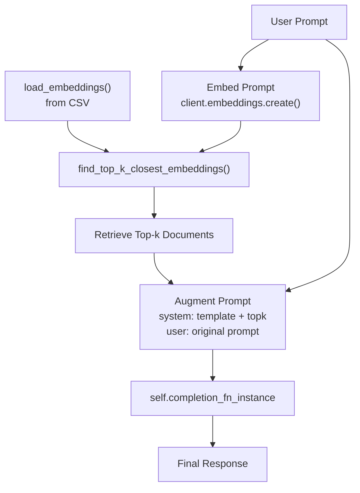
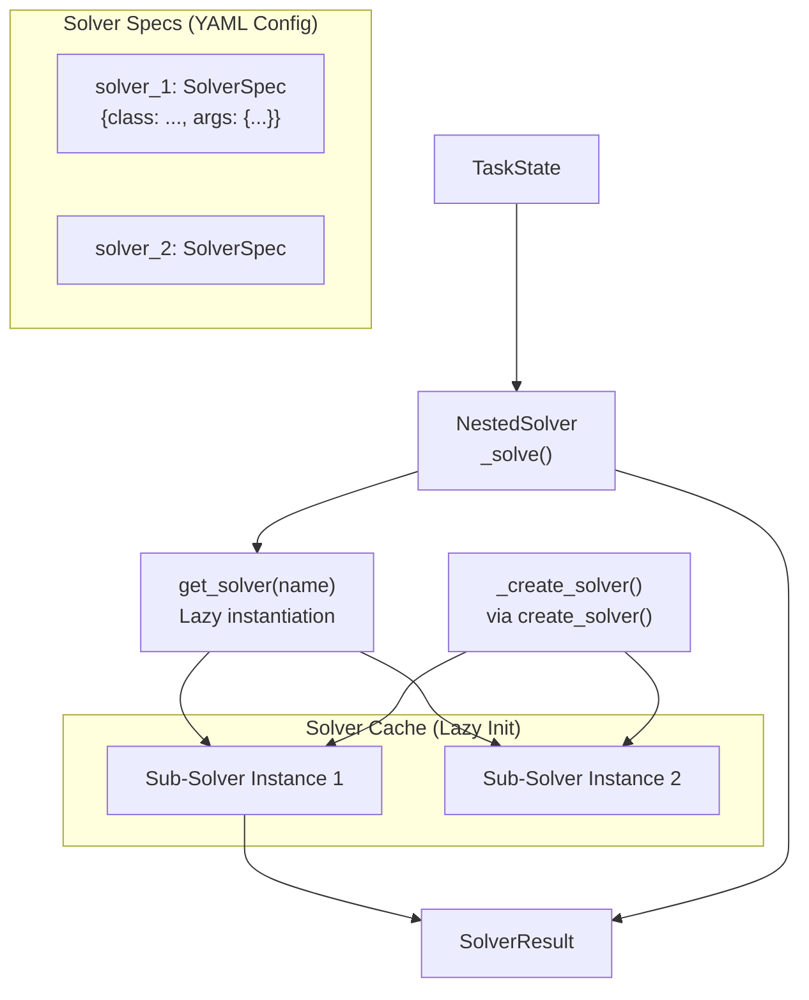
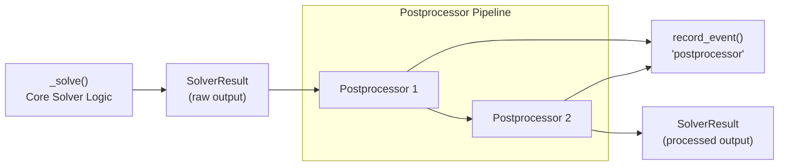

<!-- source: DeepWiki mcp.deepwiki.com · repo openai/evals · page 8.2 Retrieval and Composition · fetched 2026-10-26 -->

# Retrieval and Composition

<details>
<summary>Relevant source files</summary>

The following files were used as context for generating this wiki page:

- [evals/cli/oaieval.py](evals/cli/oaieval.py)
- [evals/completion_fns/langchain_math.py](evals/completion_fns/langchain_math.py)
- [evals/completion_fns/openai.py](evals/completion_fns/openai.py)
- [evals/completion_fns/retrieval.py](evals/completion_fns/retrieval.py)
- [evals/elsuite/basic/match_with_solvers.py](evals/elsuite/basic/match_with_solvers.py)
- [evals/elsuite/make_me_say/autoeval.py](evals/elsuite/make_me_say/autoeval.py)
- [evals/elsuite/make_me_say/utils.py](evals/elsuite/make_me_say/utils.py)
- [evals/eval.py](evals/eval.py)
- [evals/registry.py](evals/registry.py)
- [evals/registry/completion_fns/cot.yaml](evals/registry/completion_fns/cot.yaml)
- [evals/registry/data/word_association/corpus_tools/validators.py](evals/registry/data/word_association/corpus_tools/validators.py)
- [evals/registry/solvers/bluff.yaml](evals/registry/solvers/bluff.yaml)
- [evals/registry/solvers/defaults.yaml](evals/registry/solvers/defaults.yaml)
- [evals/registry/solvers/make-me-pay.yaml](evals/registry/solvers/make-me-pay.yaml)
- [evals/registry/solvers/self_prompting.yaml](evals/registry/solvers/self_prompting.yaml)
- [evals/registry/solvers/theory_of_mind.yaml](evals/registry/solvers/theory_of_mind.yaml)
- [evals/registry_test.py](evals/registry_test.py)
- [evals/solvers/README.md](evals/solvers/README.md)
- [evals/solvers/human_cli_solver.py](evals/solvers/human_cli_solver.py)
- [evals/solvers/nested/cot_solver.py](evals/solvers/nested/cot_solver.py)
- [evals/solvers/nested/self_consistency_solver.py](evals/solvers/nested/self_consistency_solver.py)
- [evals/solvers/postprocessors/README.md](evals/solvers/postprocessors/README.md)
- [evals/solvers/prompts/cot.py](evals/solvers/prompts/cot.py)
- [evals/solvers/prompts/hhh.py](evals/solvers/prompts/hhh.py)
- [evals/solvers/solver.py](evals/solvers/solver.py)
- [evals/solvers/utils.py](evals/solvers/utils.py)
- [evals/utils/api_utils.py](evals/utils/api_utils.py)
- [examples/retrieval-completionfn.ipynb](examples/retrieval-completionfn.ipynb)

</details>


## Purpose and Scope

This document covers advanced composition patterns for building sophisticated completion functions and solvers in the Evals framework. These patterns enable:

1.  **Retrieval-Augmented Generation (RAG)**: Adding external knowledge to prompts via embedding-based retrieval using `RetrievalCompletionFn`.
2.  **Hierarchical Composition**: Building complex solvers from simpler sub-solvers using the `NestedSolver` abstraction.
3.  **Output Transformation Pipelines**: Applying sequential postprocessors to solver outputs to normalize or validate results.

For basic completion function usage, see [CompletionFn Protocol](). For Chain-of-Thought patterns specifically, see [Chain-of-Thought and Prompting](). For multi-turn stateful patterns, see [Multi-Turn and Interactive Evaluations]().

---

## RetrievalCompletionFn: RAG Pattern Implementation

The `RetrievalCompletionFn` class implements retrieval-augmented generation by enriching prompts with relevant context retrieved from a document corpus using embedding similarity.

### Architecture Overview



**Diagram: RetrievalCompletionFn Data Flow**

Sources: [evals/completion_fns/retrieval.py:53-121]()

### Core Components

| Component | Purpose | Implementation |
| :--- | :--- | :--- |
| `load_embeddings()` | Load pre-computed embeddings from CSV | [evals/completion_fns/retrieval.py:20-25]() |
| `find_top_k_closest_embeddings()` | Compute cosine similarity and rank using `np.dot` | [evals/completion_fns/retrieval.py:28-39]() |
| `RetrievalCompletionFn.__call__()` | Orchestrate embedding, retrieval, and completion | [evals/completion_fns/retrieval.py:91-120]() |

Sources: [evals/completion_fns/retrieval.py:20-120]()

### Configuration and Usage

The `RetrievalCompletionFn` wraps another completion function and requires a CSV file containing text chunks and their embeddings.

**Registry Configuration Example:**

```yaml
retrieval/knowledge/gpt-3.5-turbo:
  class: evals.completion_fns.retrieval:RetrievalCompletionFn
  args:
    completion_fn: gpt-3.5-turbo
    embeddings_and_text_path: /path/to/embeddings.csv
    retrieval_template: "Use the provided context to answer the question. "
    k: 4
    embedding_model: text-embedding-ada-002
```

Sources: [evals/completion_fns/retrieval.py:58-90]()

### Embedding Data Format

The CSV file must contain exactly two columns: `text` and `embedding`. The `embedding` column is parsed using `literal_eval`.

```python
def load_embeddings(embeddings_and_text_path: str):
    df = pd.read_csv(embeddings_and_text_path, converters={"embedding": literal_eval})
    assert (
        "text" in df.columns and "embedding" in df.columns
    ), "The embeddings file must have columns named 'text' and 'embedding'"
    return df
```

Sources: [evals/completion_fns/retrieval.py:20-25]()

---

## Nested Solvers: Hierarchical Composition

The `NestedSolver` abstract class enables building complex solvers by composing simpler sub-solvers. This pattern supports hierarchical architectures where one solver orchestrates multiple others.

### NestedSolver Architecture



**Diagram: NestedSolver Composition Architecture**

Sources: [evals/solvers/solver.py:137-210]()

### Key Implementation Details

1.  **Lazy Initialization**: Sub-solvers are instantiated only when first requested via `get_solver(name)` [evals/solvers/solver.py:160-186]().
2.  **Recursive Copying**: `NestedSolver.copy()` manually invokes `.copy()` on all cached sub-solvers to ensure that stateful sub-solvers (like those with memory) are correctly isolated per evaluation sample [evals/solvers/solver.py:191-197]().
3.  **Validation**: The constructor uses `TypeAdapter(SolverSpec)` to ensure provided arguments conform to the expected `{class: str, args: dict}` structure [evals/solvers/solver.py:147-154]().

Sources: [evals/solvers/solver.py:137-210]()

---

## Postprocessor Pipelines

Postprocessors provide a mechanism to apply sequential transformations to solver outputs. They are defined in the solver's configuration and executed in `Solver.__call__`.

### Postprocessor Execution Flow



**Diagram: Postprocessor Pipeline Execution**

Sources: [evals/solvers/solver.py:76-97]()

### Core Implementation

The `Solver` base class handles the loading and sequential execution of postprocessors:

*   **Loading**: In `__init__`, postprocessor strings (e.g., `module.path:ClassName`) are split and dynamically imported using `import_module` [evals/solvers/solver.py:44-57]().
*   **Execution**: In `__call__`, the solver iterates through `self.postprocessors`. It captures the `prev_output`, applies the postprocessor, and logs the change using `record_event` [evals/solvers/solver.py:86-96]().

Sources: [evals/solvers/solver.py:44-97]()

---

## Complete Composition Example

A common pattern is wrapping a base solver to modify its behavior, as seen in `LMConArtistSolver`.

```python
class LMConArtistSolver(Solver):
    def __init__(self, base_solver_class: str, base_solver_args: dict, **kwargs):
        # Dynamically load the base solver
        module_name, class_name = base_solver_class.split(":")
        module = import_module(module_name)
        cls = getattr(module, class_name)
        
        # Instantiate base solver (composition)
        self.base_solver = cls(**base_solver_args)

    def _solve(self, task_state: TaskState, **kwargs) -> SolverResult:
        # Augment the task state before delegating
        task_state.task_description += "\nAdditional context..."
        return self.base_solver(task_state, **kwargs)
```

Sources: [evals/elsuite/make_me_pay/solvers/lm_con_artist_solver.py:14-83]()

| Pattern | Key Entity | Primary Role |
| :--- | :--- | :--- |
| **RAG** | `RetrievalCompletionFn` | Augments `Prompt` with external `text` chunks [evals/completion_fns/retrieval.py:53]() |
| **Hierarchical** | `NestedSolver` | Manages a `_solver_cache` of sub-solvers [evals/solvers/solver.py:137]() |
| **Postprocessing** | `Solver.postprocessors` | Sequential `SolverResult` transformations [evals/solvers/solver.py:49]() |

Sources: [evals/completion_fns/retrieval.py:53-121](), [evals/solvers/solver.py:44-210]()

---

