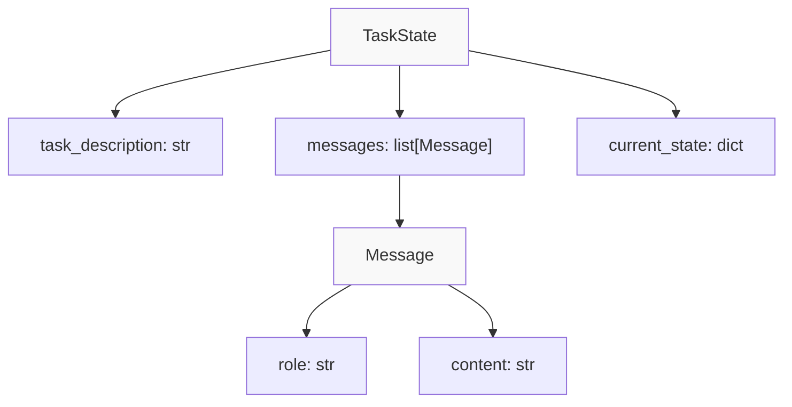
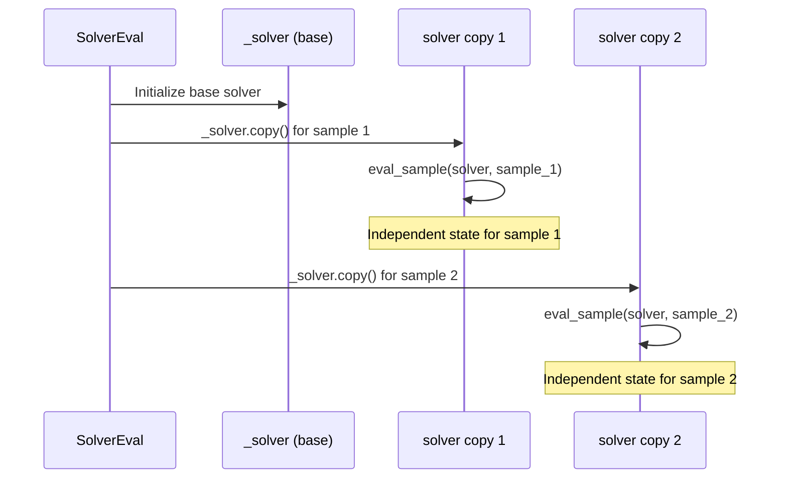
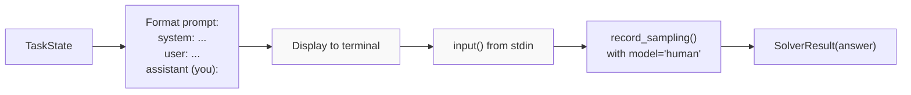

<!-- source: DeepWiki mcp.deepwiki.com · repo openai/evals · page 8.3 Multi-Turn and Interactive Evaluations · fetched 2026-10-26 -->

# Multi-Turn and Interactive Evaluations

<details>
<summary>Relevant source files</summary>

The following files were used as context for generating this wiki page:

- [evals/elsuite/basic/match_with_solvers.py](evals/elsuite/basic/match_with_solvers.py)
- [evals/elsuite/track_the_stat/README.md](evals/elsuite/track_the_stat/README.md)
- [evals/elsuite/track_the_stat/eval.py](evals/elsuite/track_the_stat/eval.py)
- [evals/elsuite/track_the_stat/prompts/__init__.py](evals/elsuite/track_the_stat/prompts/__init__.py)
- [evals/elsuite/track_the_stat/prompts/median.py](evals/elsuite/track_the_stat/prompts/median.py)
- [evals/elsuite/track_the_stat/prompts/mode.py](evals/elsuite/track_the_stat/prompts/mode.py)
- [evals/elsuite/track_the_stat/scripts/make_plots.py](evals/elsuite/track_the_stat/scripts/make_plots.py)
- [evals/elsuite/track_the_stat/scripts/run_experiments.sh](evals/elsuite/track_the_stat/scripts/run_experiments.sh)
- [evals/elsuite/track_the_stat/solvers.py](evals/elsuite/track_the_stat/solvers.py)
- [evals/elsuite/track_the_stat/utils.py](evals/elsuite/track_the_stat/utils.py)
- [evals/elsuite/twenty_questions/eval.py](evals/elsuite/twenty_questions/eval.py)
- [evals/elsuite/twenty_questions/readme.md](evals/elsuite/twenty_questions/readme.md)
- [evals/elsuite/twenty_questions/scripts/make_plots.py](evals/elsuite/twenty_questions/scripts/make_plots.py)
- [evals/elsuite/twenty_questions/scripts/run_experiments.sh](evals/elsuite/twenty_questions/scripts/run_experiments.sh)
- [evals/elsuite/twenty_questions/test_utils.py](evals/elsuite/twenty_questions/test_utils.py)
- [evals/elsuite/twenty_questions/utils.py](evals/elsuite/twenty_questions/utils.py)
- [evals/eval.py](evals/eval.py)
- [evals/registry/data/twenty_questions/LICENSE](evals/registry/data/twenty_questions/LICENSE)
- [evals/registry/data/twenty_questions/dataset.jsonl](evals/registry/data/twenty_questions/dataset.jsonl)
- [evals/registry/data/twenty_questions/lexicon_nouns.jsonl](evals/registry/data/twenty_questions/lexicon_nouns.jsonl)
- [evals/registry/evals/track_the_stat.yaml](evals/registry/evals/track_the_stat.yaml)
- [evals/registry/evals/twenty_questions.yaml](evals/registry/evals/twenty_questions.yaml)
- [evals/registry/solvers/track_the_stat.yaml](evals/registry/solvers/track_the_stat.yaml)
- [evals/registry/solvers/twenty_questions.yaml](evals/registry/solvers/twenty_questions.yaml)
- [evals/solvers/human_cli_solver.py](evals/solvers/human_cli_solver.py)
- [evals/solvers/prompts/cot.py](evals/solvers/prompts/cot.py)
- [evals/solvers/prompts/hhh.py](evals/solvers/prompts/hhh.py)
- [evals/solvers/solver.py](evals/solvers/solver.py)
- [evals/solvers/utils.py](evals/solvers/utils.py)

</details>


## Purpose and Scope

This document covers evaluation patterns designed for multi-turn conversational scenarios and interactive game-based evaluations. These evaluations maintain conversation state across multiple exchanges between agents and can model complex scenarios like strategic games, tracking variables over time, and extended dialogues.

Key implementations covered include:
- **Stateful tracking**: `track_the_stat` for maintaining state across turns.
- **Game-based evaluations**: `twenty_questions` for goal-oriented interactive dialogue.
- **Solver framework**: The underlying architecture enabling stateful interaction via `TaskState`.

For details on the SolverEval base class, see [Solver-Based Evaluations](#6.3). For single-turn model-graded evaluations, see [Model-Graded Evaluations](#6.2).

## Overview

Multi-turn evaluations differ from single-turn evaluations by maintaining context and state over several interactions.

| Aspect | Single-Turn | Multi-Turn |
|--------|------------|------------|
| **State** | Stateless; each sample is independent | Stateful; conversation history or internal state maintained |
| **Interaction** | One prompt → one response → evaluation | Multiple exchanges with cumulative context |
| **Evaluation** | Based on single output | Based on conversation trajectory and outcomes |
| **Isolation** | Sample-level isolation via separate calls | Per-sample solver copies maintain independent state |

The primary mechanisms for multi-turn evaluations are:
- **TaskState**: Container for task description, message history, and evaluation-specific `current_state`.
- **Message**: Structured conversation turns with role and content.
- **Solver.copy()**: Ensures per-sample isolation of stateful solvers.

Sources: [evals/eval.py:168-184](), [evals/solvers/solver.py:12-13](), [evals/task_state.py]()

## TaskState and Message History

### TaskState Structure

`TaskState` is the core data structure for multi-turn evaluations. It acts as a container for the task description, the accumulated message history, and a `current_state` dictionary used for tracking arbitrary data (e.g., game state, running tallies).



In multi-turn scenarios, `TaskState.messages` accumulates turns, while `TaskState.current_state` allows the evaluation logic to store and pass back information between the evaluator and the solver.

Sources: [evals/task_state.py](), [evals/solvers/solver.py:60-74](), [evals/elsuite/track_the_stat/solvers.py:34-39]()

### Per-Sample Solver Isolation

The `SolverEval` class ensures that each evaluation sample receives its own independent solver instance. This is critical for multi-turn evaluations where a solver might maintain internal state or a specific `TaskState`.



The `SolverEval` class performs a deepcopy of the solver at [evals/eval.py:225](). This allows solvers to be stateful (e.g., having a memory or tracking a conversation) without interfering with other samples.

Sources: [evals/eval.py:168-194](), [evals/solvers/solver.py:122-125]()

## Interactive Evaluation Examples

### Twenty Questions

The `twenty_questions` evaluation models a classic game where one agent (the "guesser") tries to identify a secret noun by asking yes/no questions to a "gamemaster".

- **Solver Roles**: It often uses a `CoTSolver` for the guesser to allow for reasoning before asking a question.
- **Gamemaster**: A fixed solver (often a high-capability model like GPT-4) acts as the referee, answering only "yes", "no", or "skip".
- **State**: The game tracks the number of questions asked and the history of guesses.

Sources: [evals/registry/solvers/twenty_questions.yaml:1-80](), [evals/elsuite/twenty_questions/eval.py]()

### Track the Stat

`track_the_stat` tests a model's ability to maintain a running statistic (like the median or mode) over a sequence of numbers provided one by one.

#### Explicit State Solver
The `ExplicitStateSolver` is a `NestedSolver` that manually injects the "current state" (the running list of numbers or the calculated stat) back into the prompt. This tests if a model can perform better when the state is explicitly provided versus having to infer it from history.

```python
class ExplicitStateSolver(NestedSolver):
    def _solve(self, task_state: TaskState) -> SolverResult:
        precomputed_state_message = self._build_message(task_state)
        task_state.messages.append(precomputed_state_message)

        solver_result = self.underlying_solver(task_state=task_state)
        return solver_result
```

Sources: [evals/elsuite/track_the_stat/solvers.py:9-40](), [evals/registry/solvers/track_the_stat.yaml:1-9]()

## Human-in-the-Loop Evaluations

### HumanCliSolver

The `HumanCliSolver` enables human participation in interactive evaluations. It prints the current conversation history to the terminal and waits for user input.



Implementation details from `HumanCliSolver`:
- It concatenates the system description and all messages in the `TaskState` into a single string.
- It uses the standard Python `input()` function to capture the human response.
- It records the interaction as a "sampling" event with the model name set to "human".

Sources: [evals/solvers/human_cli_solver.py:8-49]()

### Sequential Mode Requirement

Because `HumanCliSolver` interacts with the shared standard input/output of the terminal, it is incompatible with parallel execution. Users must set the `EVALS_SEQUENTIAL=1` environment variable to run these evals correctly.

Sources: [evals/solvers/human_cli_solver.py:11-13](), [evals/eval.py:140-145]()

## Advanced Patterns

### Solver Composition for Multi-Turn

Multi-turn evaluations often leverage `NestedSolver` to combine capabilities. For example, a `CoTSolver` can be used to wrap a provider-specific solver (like `OpenAISolver`) to add reasoning steps to each turn of a game.

Example configuration from `twenty_questions`:
```yaml
twenty_questions/cot/gpt-4-turbo-preview:
  class: evals.solvers.nested.cot_solver:CoTSolver
  args:
    cot_solver:
      class: evals.solvers.providers.openai.openai_solver:OpenAISolver
    extract_template: "Given the above reasoning, ask a question..."
    extract_solver:
      class: evals.solvers.providers.openai.openai_solver:OpenAISolver
```

Sources: [evals/registry/solvers/twenty_questions.yaml:23-43](), [evals/solvers/solver.py:137-160]()

### Handling Conversational Templates

Evaluations like `track_the_stat` use specific prompt templates to guide the model's multi-turn behavior, such as formatting requirements for the statistic being tracked.

| Template | File | Purpose |
|----------|------|---------|
| `MODE_EXAMPLE` | [evals/elsuite/track_the_stat/prompts/mode.py:1-25]() | Few-shot examples for tracking the mode. |
| `DEFAULT_COT_TEMPLATE` | [evals/solvers/prompts/cot.py:1]() | Standard prompt for triggering step-by-step reasoning. |
| `HHH_MSGS` | [evals/solvers/prompts/hhh.py:3-110]() | System and few-shot messages for "Helpful, Honest, Harmless" behavior. |

Sources: [evals/elsuite/track_the_stat/prompts/mode.py:1-25](), [evals/solvers/prompts/cot.py:1-4](), [evals/solvers/prompts/hhh.py:3-110]()

---

