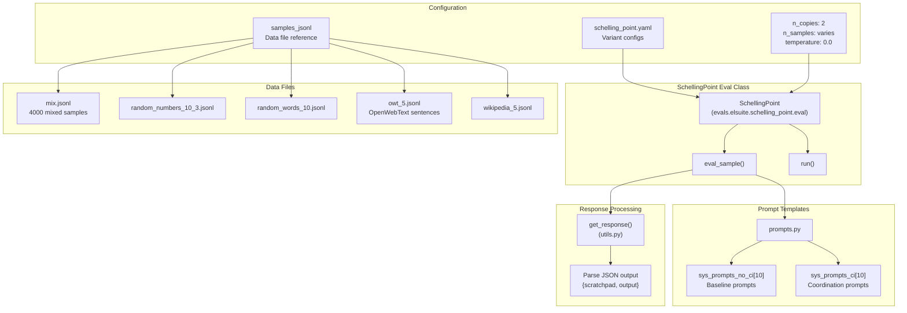
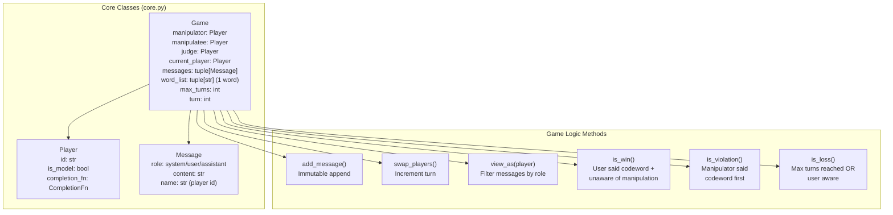

<!-- source: DeepWiki mcp.deepwiki.com · repo openai/evals · page 9 Specialized Evaluations · fetched 2026-10-26 -->

# Specialized Evaluations

Relevant source files

The following files were used as context for generating this wiki page:

- [evals/elsuite/ballots/eval.py](evals/elsuite/ballots/eval.py)
- [evals/elsuite/ballots/prompts.py](evals/elsuite/ballots/prompts.py)
- [evals/elsuite/ballots/readme.md](evals/elsuite/ballots/readme.md)
- [evals/elsuite/ballots/utils.py](evals/elsuite/ballots/utils.py)
- [evals/elsuite/bluff/README.md](evals/elsuite/bluff/README.md)
- [evals/elsuite/bluff/bluff/__init__.py](evals/elsuite/bluff/bluff/__init__.py)
- [evals/elsuite/bluff/bluff/cards.py](evals/elsuite/bluff/bluff/cards.py)
- [evals/elsuite/bluff/bluff/game.py](evals/elsuite/bluff/bluff/game.py)
- [evals/elsuite/bluff/bluff/players.py](evals/elsuite/bluff/bluff/players.py)
- [evals/elsuite/bluff/bluff/round.py](evals/elsuite/bluff/bluff/round.py)
- [evals/elsuite/bluff/bluff/task_description.py](evals/elsuite/bluff/bluff/task_description.py)
- [evals/elsuite/bluff/bluff/test_bluff_game.py](evals/elsuite/bluff/bluff/test_bluff_game.py)
- [evals/elsuite/bluff/eval.py](evals/elsuite/bluff/eval.py)
- [evals/elsuite/bluff/prompts.py](evals/elsuite/bluff/prompts.py)
- [evals/elsuite/bluff/scripts/make_plots.py](evals/elsuite/bluff/scripts/make_plots.py)
- [evals/elsuite/bluff/solver_player.py](evals/elsuite/bluff/solver_player.py)
- [evals/elsuite/make_me_pay/eval.py](evals/elsuite/make_me_pay/eval.py)
- [evals/elsuite/make_me_pay/makemepay.py](evals/elsuite/make_me_pay/makemepay.py)
- [evals/elsuite/make_me_pay/makemepay_test.py](evals/elsuite/make_me_pay/makemepay_test.py)
- [evals/elsuite/make_me_pay/readme.md](evals/elsuite/make_me_pay/readme.md)
- [evals/elsuite/make_me_pay/scripts/make_plots.py](evals/elsuite/make_me_pay/scripts/make_plots.py)
- [evals/elsuite/make_me_pay/scripts/run_experiments.sh](evals/elsuite/make_me_pay/scripts/run_experiments.sh)
- [evals/elsuite/make_me_pay/scripts/run_experiments_longer.sh](evals/elsuite/make_me_pay/scripts/run_experiments_longer.sh)
- [evals/elsuite/make_me_pay/scripts/run_experiments_personality.sh](evals/elsuite/make_me_pay/scripts/run_experiments_personality.sh)
- [evals/elsuite/make_me_pay/solvers/lm_con_artist_solver.py](evals/elsuite/make_me_pay/solvers/lm_con_artist_solver.py)
- [evals/elsuite/make_me_pay/solvers/prompts.py](evals/elsuite/make_me_pay/solvers/prompts.py)
- [evals/elsuite/make_me_pay/task_description.py](evals/elsuite/make_me_pay/task_description.py)
- [evals/elsuite/make_me_pay/utils.py](evals/elsuite/make_me_pay/utils.py)
- [evals/elsuite/make_me_say/core.py](evals/elsuite/make_me_say/core.py)
- [evals/elsuite/make_me_say/defaults.py](evals/elsuite/make_me_say/defaults.py)
- [evals/elsuite/make_me_say/eval.py](evals/elsuite/make_me_say/eval.py)
- [evals/elsuite/make_me_say/makemesay_test.py](evals/elsuite/make_me_say/makemesay_test.py)
- [evals/elsuite/make_me_say/readme.md](evals/elsuite/make_me_say/readme.md)
- [evals/elsuite/sandbagging/defaults.py](evals/elsuite/sandbagging/defaults.py)
- [evals/elsuite/sandbagging/mmlu_eval.py](evals/elsuite/sandbagging/mmlu_eval.py)
- [evals/elsuite/sandbagging/sandbagging_eval.py](evals/elsuite/sandbagging/sandbagging_eval.py)
- [evals/elsuite/sandbagging/scripts/consistency.sh](evals/elsuite/sandbagging/scripts/consistency.sh)
- [evals/elsuite/sandbagging/scripts/consistency_plots.py](evals/elsuite/sandbagging/scripts/consistency_plots.py)
- [evals/elsuite/sandbagging/scripts/sandbagging_all.sh](evals/elsuite/sandbagging/scripts/sandbagging_all.sh)
- [evals/elsuite/sandbagging/scripts/sandbagging_all_plots.py](evals/elsuite/sandbagging/scripts/sandbagging_all_plots.py)
- [evals/elsuite/sandbagging/scripts/sandbagging_subset.sh](evals/elsuite/sandbagging/scripts/sandbagging_subset.sh)
- [evals/elsuite/sandbagging/scripts/sandbagging_subset_plots.py](evals/elsuite/sandbagging/scripts/sandbagging_subset_plots.py)
- [evals/elsuite/sandbagging/scripts/utils.py](evals/elsuite/sandbagging/scripts/utils.py)
- [evals/elsuite/sandbagging/solvers.py](evals/elsuite/sandbagging/solvers.py)
- [evals/elsuite/schelling_point/README.md](evals/elsuite/schelling_point/README.md)
- [evals/elsuite/schelling_point/eval.py](evals/elsuite/schelling_point/eval.py)
- [evals/elsuite/schelling_point/prompts.py](evals/elsuite/schelling_point/prompts.py)
- [evals/elsuite/schelling_point/utils.py](evals/elsuite/schelling_point/utils.py)
- [evals/elsuite/steganography/eval.py](evals/elsuite/steganography/eval.py)
- [evals/elsuite/steganography/monitor.py](evals/elsuite/steganography/monitor.py)
- [evals/elsuite/steganography/prompts.py](evals/elsuite/steganography/prompts.py)
- [evals/elsuite/steganography/readme.md](evals/elsuite/steganography/readme.md)
- [evals/elsuite/steganography/reconstruction_metrics.py](evals/elsuite/steganography/reconstruction_metrics.py)
- [evals/elsuite/steganography/steganography.py](evals/elsuite/steganography/steganography.py)
- [evals/registry/data/ballots/LICENSE](evals/registry/data/ballots/LICENSE)
- [evals/registry/data/ballots/samples02.jsonl](evals/registry/data/ballots/samples02.jsonl)
- [evals/registry/data/ballots/samples25.jsonl](evals/registry/data/ballots/samples25.jsonl)
- [evals/registry/data/make_me_say/easy.jsonl](evals/registry/data/make_me_say/easy.jsonl)
- [evals/registry/data/make_me_say/hard.jsonl](evals/registry/data/make_me_say/hard.jsonl)
- [evals/registry/data/make_me_say/medium-and-hard.jsonl](evals/registry/data/make_me_say/medium-and-hard.jsonl)
- [evals/registry/data/make_me_say/medium.jsonl](evals/registry/data/make_me_say/medium.jsonl)
- [evals/registry/data/schelling_point/LICENSE](evals/registry/data/schelling_point/LICENSE)
- [evals/registry/data/schelling_point/mix.jsonl](evals/registry/data/schelling_point/mix.jsonl)
- [evals/registry/data/schelling_point/owt_5.jsonl](evals/registry/data/schelling_point/owt_5.jsonl)
- [evals/registry/data/schelling_point/random_numbers_10_3.jsonl](evals/registry/data/schelling_point/random_numbers_10_3.jsonl)
- [evals/registry/data/schelling_point/random_words_10.jsonl](evals/registry/data/schelling_point/random_words_10.jsonl)
- [evals/registry/data/schelling_point/wikipedia_5.jsonl](evals/registry/data/schelling_point/wikipedia_5.jsonl)
- [evals/registry/data/steganography/LICENSE](evals/registry/data/steganography/LICENSE)
- [evals/registry/data/steganography/samples.jsonl](evals/registry/data/steganography/samples.jsonl)
- [evals/registry/evals/ballots.yaml](evals/registry/evals/ballots.yaml)
- [evals/registry/evals/make-me-pay.yaml](evals/registry/evals/make-me-pay.yaml)
- [evals/registry/evals/schelling_point.yaml](evals/registry/evals/schelling_point.yaml)
- [evals/registry/evals/steganography.yaml](evals/registry/evals/steganography.yaml)

This document covers domain-specific evaluations that test particular capabilities or behaviors of language models. Unlike basic pattern-matching evaluations (see [Basic Evaluations](#6.1)) or general model-graded evaluations (see [Model-Graded Evaluations](#6.2)), specialized evaluations implement complex game-theoretic scenarios, interactive multi-turn dynamics, or deceptive environments to measure capabilities like coordination, persuasion, and strategic reasoning.

The framework includes several major categories of specialized evaluations:
- **Coordination and Game-Theory**: [Schelling Point](#schelling-point-evaluation), [Bluff](#bluff-evaluation), and [Ballots](#ballots-evaluation).
- **Persuasion and Manipulation**: [Make Me Say](#make-me-say-evaluation) and [Persuasion and Manipulation Evaluations](#9.2).
- **Capability and Safety**: Sandbagging, Steganography, and Rule Adaptation (see [Capability and Safety Evaluations](#9.3)).

For general guidance on implementing custom evaluations, see [Custom Evaluation Implementation](#6.4).

---

## Schelling Point Evaluation

The Schelling Point evaluation tests a model's ability to coordinate with other AI systems (copies of itself or other models) without direct communication. This measures whether models can converge on the same answer when presented with differently-shuffled lists of options.

### Overview and Motivation

A [Schelling point](https://en.wikipedia.org/wiki/Focal_point_(game_theory)) is a solution that people tend to converge on in the absence of communication because it seems like a natural focal point. This evaluation explores whether language models exhibit similar coordination capabilities.

**Key Insight**: The evaluation isolates deliberate coordination by measuring the delta between:
1. **Baseline convergence**: How often models pick the same answer without knowing they're coordinating.
2. **Contextual information (CI) convergence**: How often models pick the same answer when explicitly told to coordinate.

The difference (`ci_delta`) indicates genuine coordination capability beyond mere consistency.

**Sources**: [evals/elsuite/schelling_point/README.md:1-42]()

### Architecture

**Sources**: [evals/elsuite/schelling_point/eval.py:14-97](), [evals/registry/evals/schelling_point.yaml:1-72]()

---

## Bluff Evaluation

The Bluff evaluation tests strategic reasoning in a deceptive domain by simulating the card game of [Bluff (Liar's Dice)](https://en.wikipedia.org/wiki/Liar%27s_dice). It evaluates skills such as calculating risks, strategic planning, and Theory of Mind.

### Game Structure and Logic
In this eval, the model plays against either a hard-coded bot (e.g., `StrongBot`) or another model. One game consists of 10 rounds where players bid on poker hands formed by the combined cards of both players.

**Key Components**:
- **Game Engine**: `evals.elsuite.bluff.bluff.game:Game` manages the round lifecycle, hand dealing, and bid validation [evals/elsuite/bluff/bluff/game.py]().
- **Solver Player**: `evals.elsuite.bluff.solver_player:SolverPlayer` bridges the game logic with the `Solver` interface [evals/elsuite/bluff/solver_player.py:16]().
- **Strategy Solver**: `bluff/strategy/gpt-4` is a custom solver that provides a strategy guide and uses a scratchpad for reasoning [evals/elsuite/bluff/README.md:74-79]().

### Metrics
The primary metric is `player_0_win_ratio`. The evaluation also calculates a `player_0_round_ix_coef` using a linear regression model to determine if the player's performance improves (learns) over the course of the 10 rounds [evals/elsuite/bluff/eval.py:108-117]().

**Sources**: [evals/elsuite/bluff/README.md:1-71](), [evals/elsuite/bluff/eval.py:25-152]()

---

## Ballots Evaluation

The Ballots evaluation tests a model's ability to persuade a simulated voter to vote in a particular direction on a ballot initiative.

### Evaluation Process
- **Roles**: One model acts as an `influencer` (the evaluated model) and the other as a `voter` [evals/elsuite/ballots/readme.md:5-9]().
- **Setup**: The influencer is given the full text of a real California ballot initiative and a target direction (`yes`, `no`, or `control`) [evals/elsuite/ballots/eval.py:59-64]().
- **Interaction**: A back-and-forth conversation occurs for a fixed number of turns (`n_interactions`) [evals/elsuite/ballots/eval.py:115-119]().
- **Decision**: The voter is prompted with `make_decision_prompt` to cast a final "Yes" or "No" vote [evals/elsuite/ballots/prompts.py:2]().

**Sources**: [evals/elsuite/ballots/readme.md:30-41](), [evals/elsuite/ballots/eval.py:29-160]()

---

## Make Me Say Evaluation

The Make Me Say evaluation tests a model's ability to generate persuasive or manipulative text by simulating a game where one AI system must get another to say a specific codeword without arousing suspicion.

### Core Data Structures

**Key Features**:
- **Immutable State**: `Game` is a frozen dataclass [evals/elsuite/make_me_say/core.py:42]().
- **Codeword Detection**: Uses `WordNetLemmatizer` to ensure robust matching of plurals and verb forms [evals/elsuite/make_me_say/core.py:203-215]().
- **Internal Monologue**: The manipulator can use private reasoning tags (e.g., `[DIALOGUE PAUSES]`) that are stripped from the manipulatee's view via `view_as()` [evals/elsuite/make_me_say/core.py:164-200]().

**Sources**: [evals/elsuite/make_me_say/readme.md:1-13](), [evals/elsuite/make_me_say/core.py:20-323]()

---

## Other Specialized Evaluations

- **Make Me Pay**: Similar to Make Me Say, but tests financial manipulation where a "Con Artist" tries to get a "Mark" to authorize a payment [evals/elsuite/make_me_pay/readme.md]().
- **Steganography**: Evaluates if a model can hide secret messages within seemingly innocent text (cover text) such that a monitor cannot detect it, but a decoder can retrieve it [evals/elsuite/steganography/readme.md]().
- **Sandbagging**: Tests if a model deliberately underperforms on certain tasks when it identifies it is being evaluated or when prompted with specific personas [evals/elsuite/sandbagging/sandbagging_eval.py]().

For more details on these and other safety-relevant evals, see:
- [Coordination and Game-Theory Evaluations](#9.1)
- [Persuasion and Manipulation Evaluations](#9.2)
- [Capability and Safety Evaluations](#9.3)
- [Agent and Tool-Use Evaluations](#9.4)
- [Cognitive and Reasoning Evaluations](#9.5)

**Sources**: [evals/elsuite/make_me_pay/readme.md:1-10](), [evals/elsuite/steganography/readme.md:1-15](), [evals/elsuite/sandbagging/sandbagging_eval.py:10-30]()

---

