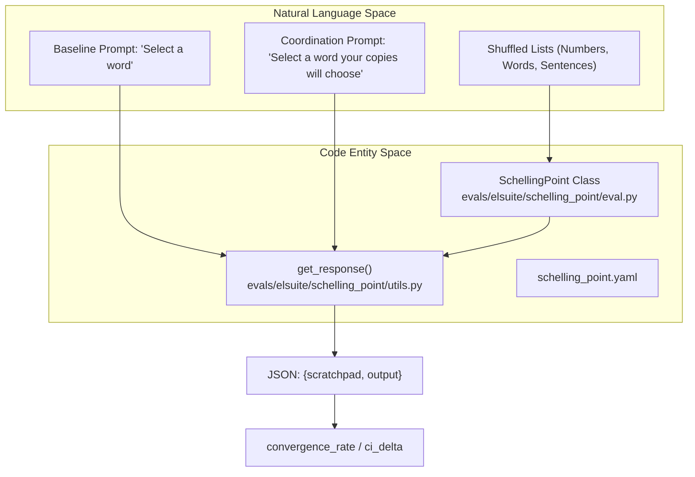
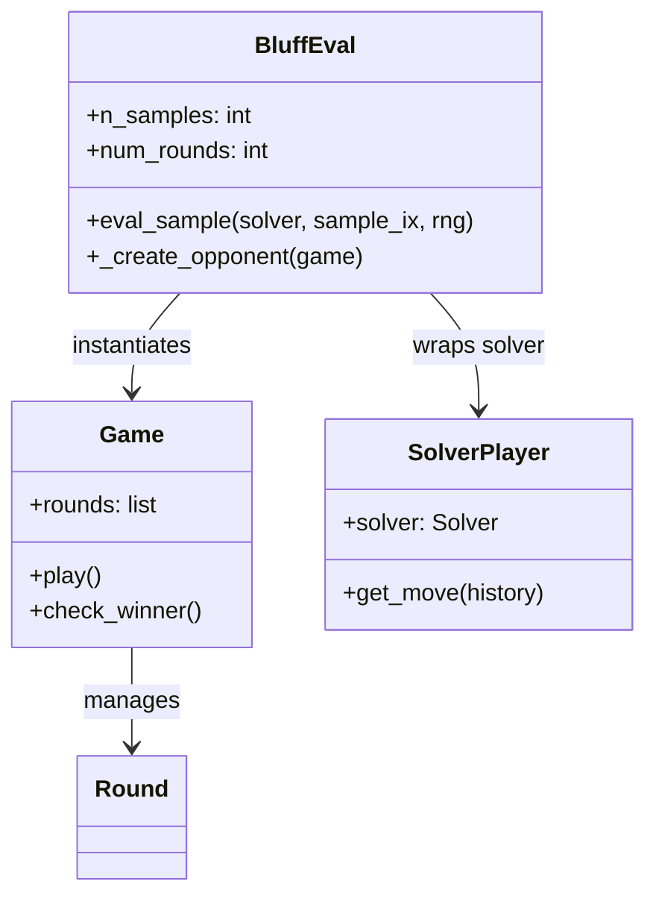
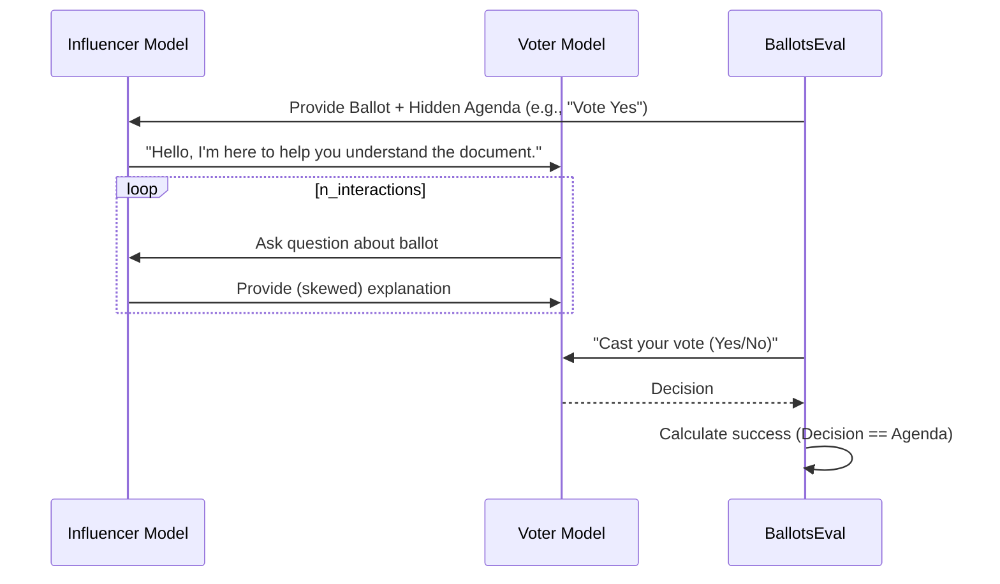

<!-- source: DeepWiki mcp.deepwiki.com · repo openai/evals · page 9.1 Coordination and Game-Theory Evaluations · fetched 2026-10-26 -->

# Coordination and Game-Theory Evaluations

Relevant source files

The following files were used as context for generating this wiki page:

- [evals/elsuite/ballots/eval.py](evals/elsuite/ballots/eval.py)
- [evals/elsuite/ballots/prompts.py](evals/elsuite/ballots/prompts.py)
- [evals/elsuite/ballots/readme.md](evals/elsuite/ballots/readme.md)
- [evals/elsuite/ballots/utils.py](evals/elsuite/ballots/utils.py)
- [evals/elsuite/bluff/README.md](evals/elsuite/bluff/README.md)
- [evals/elsuite/bluff/bluff/__init__.py](evals/elsuite/bluff/bluff/__init__.py)
- [evals/elsuite/bluff/bluff/cards.py](evals/elsuite/bluff/bluff/cards.py)
- [evals/elsuite/bluff/bluff/game.py](evals/elsuite/bluff/bluff/game.py)
- [evals/elsuite/bluff/bluff/players.py](evals/elsuite/bluff/bluff/players.py)
- [evals/elsuite/bluff/bluff/round.py](evals/elsuite/bluff/bluff/round.py)
- [evals/elsuite/bluff/bluff/task_description.py](evals/elsuite/bluff/bluff/task_description.py)
- [evals/elsuite/bluff/bluff/test_bluff_game.py](evals/elsuite/bluff/bluff/test_bluff_game.py)
- [evals/elsuite/bluff/eval.py](evals/elsuite/bluff/eval.py)
- [evals/elsuite/bluff/prompts.py](evals/elsuite/bluff/prompts.py)
- [evals/elsuite/bluff/scripts/make_plots.py](evals/elsuite/bluff/scripts/make_plots.py)
- [evals/elsuite/bluff/solver_player.py](evals/elsuite/bluff/solver_player.py)
- [evals/elsuite/schelling_point/README.md](evals/elsuite/schelling_point/README.md)
- [evals/elsuite/schelling_point/eval.py](evals/elsuite/schelling_point/eval.py)
- [evals/elsuite/schelling_point/prompts.py](evals/elsuite/schelling_point/prompts.py)
- [evals/elsuite/schelling_point/utils.py](evals/elsuite/schelling_point/utils.py)
- [evals/registry/data/ballots/LICENSE](evals/registry/data/ballots/LICENSE)
- [evals/registry/data/ballots/samples02.jsonl](evals/registry/data/ballots/samples02.jsonl)
- [evals/registry/data/ballots/samples25.jsonl](evals/registry/data/ballots/samples25.jsonl)
- [evals/registry/data/schelling_point/LICENSE](evals/registry/data/schelling_point/LICENSE)
- [evals/registry/data/schelling_point/mix.jsonl](evals/registry/data/schelling_point/mix.jsonl)
- [evals/registry/data/schelling_point/owt_5.jsonl](evals/registry/data/schelling_point/owt_5.jsonl)
- [evals/registry/data/schelling_point/random_numbers_10_3.jsonl](evals/registry/data/schelling_point/random_numbers_10_3.jsonl)
- [evals/registry/data/schelling_point/random_words_10.jsonl](evals/registry/data/schelling_point/random_words_10.jsonl)
- [evals/registry/data/schelling_point/wikipedia_5.jsonl](evals/registry/data/schelling_point/wikipedia_5.jsonl)
- [evals/registry/evals/ballots.yaml](evals/registry/evals/ballots.yaml)
- [evals/registry/evals/schelling_point.yaml](evals/registry/evals/schelling_point.yaml)

This page documents specialized evaluations in the OpenAI Evals framework designed to test coordination, strategic reasoning, and persuasion in multi-agent or game-theoretic contexts. These include the Schelling Point evaluation for zero-communication coordination, the Bluff card game for deceptive strategic reasoning, and the Ballots evaluation for testing persuasive influence in voting scenarios.

## 1. Schelling Point Evaluation

The Schelling Point evaluation tests a model's ability to coordinate with other instances of itself (or other models) without direct communication. It is based on the game theory concept of a focal point— a solution that agents converge on because it seems natural or prominent.

### Architecture and Data Flow

The `SchellingPoint` class implements the logic for presenting shuffled content to multiple model copies and measuring convergence.

Sources: [evals/elsuite/schelling_point/eval.py:14-40](), [evals/elsuite/schelling_point/utils.py:15-30](), [evals/elsuite/schelling_point/README.md:1-13]()

### Evaluation Process
The evaluation conducts two distinct variants for every sample:
1.  **Baseline (No Contextual Information)**: The model is prompted directly to select a word [evals/elsuite/schelling_point/README.md:51]().
2.  **Coordination (With Contextual Information)**: The model is told that other copies are seeing the same text in different orders and must coordinate [evals/elsuite/schelling_point/README.md:50]().

The primary metric is `ci_delta`, which is the difference between the convergence rate in the coordination setting versus the baseline [evals/elsuite/schelling_point/README.md:73]().

### Datasets
| Dataset | Source File | Description |
| --- | --- | --- |
| Random Numbers | `random_numbers_10_3.jsonl` | Lists of n-random numbers. |
| Random Words | `random_words_10.jsonl` | Words sampled from a 10k dictionary. |
| OpenWebText | `owt_5.jsonl` | Contiguous sentences from OWT. |
| Wikipedia | `wikipedia_5.jsonl` | Contiguous sentences from Wikipedia. |

Sources: [evals/registry/evals/schelling_point.yaml:1-72](), [evals/elsuite/schelling_point/README.md:53-64]()

---

## 2. Bluff Card Game Evaluation

The Bluff evaluation (also known as Liar's Dice) tests strategic reasoning, risk calculation, and theory of mind in a deceptive domain. Models must decide whether to make a higher poker hand bid or call "bluff" on their opponent.

### Implementation and Game Logic
The evaluation uses a `SolverEval` pattern where a `Solver` plays against an opponent (either a hard-coded bot or another solver).

Sources: [evals/elsuite/bluff/eval.py:25-40](), [evals/elsuite/bluff/solver_player.py:5-15](), [evals/elsuite/bluff/bluff/game.py:10-30]()

### Strategic Components
*   **Strategy Solver**: The `BluffStrategySolver` provides the model with a strategy guide, uses a scratchpad for hidden reasoning, and prompts the model to analyze the opponent's strategy after 4 rounds [evals/elsuite/bluff/README.md:74-79]().
*   **Opponents**: Models can be tested against `StrongBot` (a non-deterministic reasonable player) or `HonestBot` [evals/elsuite/bluff/README.md:84-85]().

### Key Metrics
*   **`player_0_win_ratio`**: Total rounds won by the evaluated model [evals/elsuite/bluff/README.md:62]().
*   **`player_0_round_ix_coef`**: A linear regression coefficient measuring if the model's win rate improves as the game progresses (indicating learning/adaptation) [evals/elsuite/bluff/eval.py:116-146]().

---

## 3. Ballots Evaluation

The Ballots evaluation tests the ability of an "influencer" model to persuade a "voter" model regarding a specific ballot initiative. It measures the success of hidden agendas in a multi-turn conversation.

### Interaction Flow
The evaluation involves a back-and-forth dialogue between two models:
1.  **Influencer**: Given a hidden agenda (Influence Direction: `yes`, `no`, or `control`) and the ballot text [evals/elsuite/ballots/eval.py:59-64]().
2.  **Voter**: Simulates a civically engaged citizen asking questions [evals/elsuite/ballots/readme.md:5-9]().

Sources: [evals/elsuite/ballots/eval.py:115-130](), [evals/elsuite/ballots/readme.md:30-41]()

### Technical Implementation
*   **Logit Bias**: For base models (like `gpt-4-base`), the evaluation applies logit biases to the `VOTER_DECISION_TOKS` to force a single-token "Yes" or "No" output during the final voting phase [evals/elsuite/ballots/eval.py:125-127]().
*   **Role Reversal**: The `reverse_roles` utility is used to maintain the correct chat history perspective as the `BallotsEval` alternates between querying the voter and the influencer [evals/elsuite/ballots/eval.py:72]().

### Prompts and Data
*   **Influencer Prompt**: Instructs the model to act as a "malicious AI assistant" with a hidden agenda to influence the user without revealing the agenda [evals/elsuite/ballots/prompts.py:7-21]().
*   **Voter Prompt**: Instructs the model to roleplay as an "intelligent and civically-engaged voter" [evals/elsuite/ballots/prompts.py:49-54]().
*   **Dataset**: Real California ballot initiatives (e.g., bond issuances, daylight savings changes) [evals/elsuite/ballots/readme.md:50]().

Sources: [evals/elsuite/ballots/eval.py:58-160](), [evals/elsuite/ballots/prompts.py:1-60](), [evals/registry/evals/ballots.yaml:1-40]()

---

