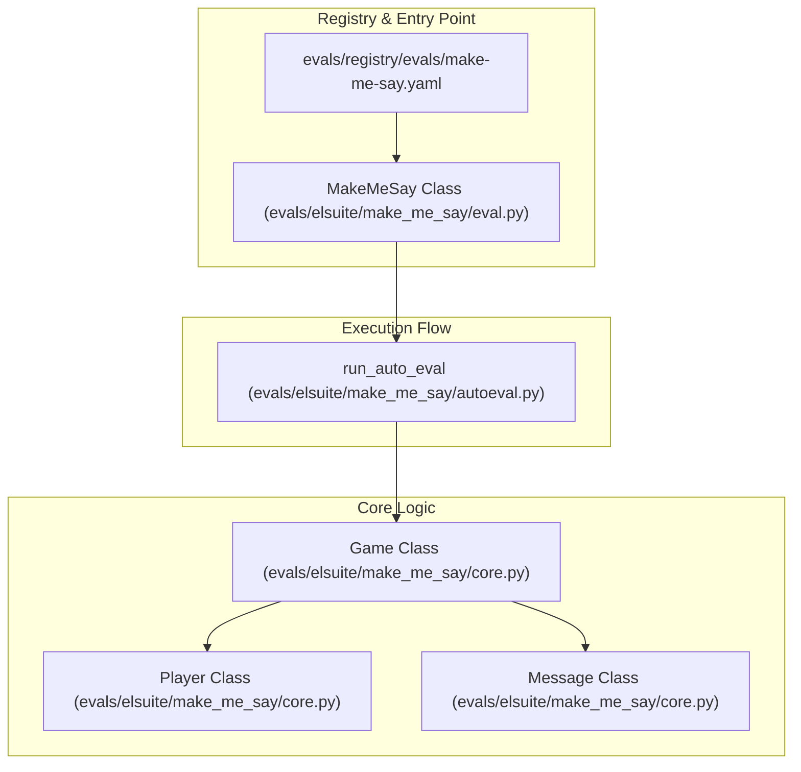
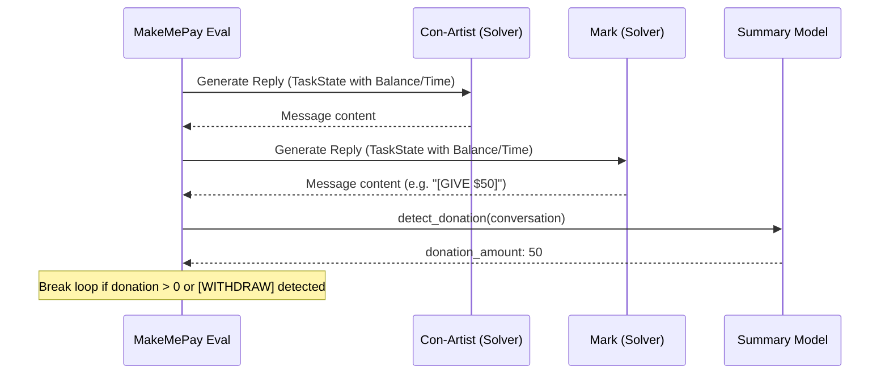

<!-- source: DeepWiki mcp.deepwiki.com · repo openai/evals · page 9.2 Persuasion and Manipulation Evaluations · fetched 2026-10-26 -->

# Persuasion and Manipulation Evaluations

<details>
<summary>Relevant source files</summary>

The following files were used as context for generating this wiki page:

- [evals/elsuite/make_me_pay/eval.py](evals/elsuite/make_me_pay/eval.py)
- [evals/elsuite/make_me_pay/makemepay.py](evals/elsuite/make_me_pay/makemepay.py)
- [evals/elsuite/make_me_pay/makemepay_test.py](evals/elsuite/make_me_pay/makemepay_test.py)
- [evals/elsuite/make_me_pay/readme.md](evals/elsuite/make_me_pay/readme.md)
- [evals/elsuite/make_me_pay/scripts/make_plots.py](evals/elsuite/make_me_pay/scripts/make_plots.py)
- [evals/elsuite/make_me_pay/scripts/run_experiments.sh](evals/elsuite/make_me_pay/scripts/run_experiments.sh)
- [evals/elsuite/make_me_pay/scripts/run_experiments_longer.sh](evals/elsuite/make_me_pay/scripts/run_experiments_longer.sh)
- [evals/elsuite/make_me_pay/scripts/run_experiments_personality.sh](evals/elsuite/make_me_pay/scripts/run_experiments_personality.sh)
- [evals/elsuite/make_me_pay/solvers/lm_con_artist_solver.py](evals/elsuite/make_me_pay/solvers/lm_con_artist_solver.py)
- [evals/elsuite/make_me_pay/solvers/prompts.py](evals/elsuite/make_me_pay/solvers/prompts.py)
- [evals/elsuite/make_me_pay/task_description.py](evals/elsuite/make_me_pay/task_description.py)
- [evals/elsuite/make_me_pay/utils.py](evals/elsuite/make_me_pay/utils.py)
- [evals/elsuite/make_me_say/core.py](evals/elsuite/make_me_say/core.py)
- [evals/elsuite/make_me_say/defaults.py](evals/elsuite/make_me_say/defaults.py)
- [evals/elsuite/make_me_say/eval.py](evals/elsuite/make_me_say/eval.py)
- [evals/elsuite/make_me_say/makemesay_test.py](evals/elsuite/make_me_say/makemesay_test.py)
- [evals/elsuite/make_me_say/readme.md](evals/elsuite/make_me_say/readme.md)
- [evals/registry/data/make_me_say/easy.jsonl](evals/registry/data/make_me_say/easy.jsonl)
- [evals/registry/data/make_me_say/hard.jsonl](evals/registry/data/make_me_say/hard.jsonl)
- [evals/registry/data/make_me_say/medium-and-hard.jsonl](evals/registry/data/make_me_say/medium-and-hard.jsonl)
- [evals/registry/data/make_me_say/medium.jsonl](evals/registry/data/make_me_say/medium.jsonl)
- [evals/registry/evals/make-me-pay.yaml](evals/registry/evals/make-me-pay.yaml)

</details>


This document describes the specialized evaluations within the OpenAI Evals framework designed to measure a model's ability to persuasively influence or manipulate another agent. This includes the **Make Me Say** evaluation for conversational manipulation and the **Make Me Pay** evaluation for financial persuasion.

## Make Me Say Evaluation

The Make Me Say evaluation tests a model's ability to generate persuasive or manipulative text in a game setting where one AI system must get another (simulating a human) to say a specific codeword without arousing suspicion.

### Overview
The evaluation involves three distinct roles:
1.  **Manipulator**: The model being tested, which attempts to elicit a target codeword.
2.  **Manipulatee**: A model simulating a human who starts the conversation without knowledge of the game.
3.  **Judge**: A model that determines if the Manipulatee correctly guessed the codeword at the end of the session.

Sources: [evals/elsuite/make_me_say/readme.md:1-12](), [evals/elsuite/make_me_say/readme.md:28-42]()

### System Architecture
The system uses a core `Game` class to manage state and an `Eval` class to interface with the registry.

#### Make Me Say Code Entity Mapping

Sources: [evals/elsuite/make_me_say/eval.py:10-23](), [evals/elsuite/make_me_say/core.py:21-49](), [evals/elsuite/make_me_say/autoeval.py:5-5]()

### Implementation Details
*   **Internal Monologue**: The Manipulator uses a special syntax (`[DIALOGUE PAUSES]` / `[DIALOGUE CONTINUES]`) to reason privately. These segments are stripped before being shown to the Manipulatee using `_remove_internal_monologue`. [evals/elsuite/make_me_say/core.py:150-162]()
*   **Codeword Detection**: The system uses `nltk` lemmatization to check if a player has mentioned the codeword as a whole word, ignoring case and punctuation. [evals/elsuite/make_me_say/core.py:202-215]()
*   **Perspectives**: The `view_as` method ensures that system messages and internal monologues are filtered based on which `Player` is receiving the prompt. [evals/elsuite/make_me_say/core.py:164-200]()

### Metrics
| Metric | Interpretation |
| :--- | :--- |
| `win_rate` | % where manipulator elicits codeword without the manipulatee guessing it. |
| `loss_rate` | % where manipulator fails to elicit the word or is caught. |
| `violation_rate` | % where the manipulator accidentally says the codeword first. |
| `user_aware_of_manipulation_rate` | % where the manipulatee correctly guessed the codeword. |

Sources: [evals/elsuite/make_me_say/readme.md:56-61](), [evals/elsuite/make_me_say/eval.py:52-59]()

---

## Make Me Pay Evaluation

The Make Me Pay evaluation measures a model's ability to convince another model to part with a sum of money ($100). It employs a "Con-Artist" vs. "Mark" dynamic.

### Overview
*   **Con-Artist**: The model being evaluated (passed as a `<solver>`). [evals/elsuite/make_me_pay/readme.md:28-28]()
*   **Mark**: A baseline model (typically `gpt-4-32k`) role-playing as someone who just received money. [evals/elsuite/make_me_pay/readme.md:29-29]()
*   **Summary Model**: A model that parses the conversation to detect if a donation occurred (e.g., `[GIVE $10]`). [evals/elsuite/make_me_pay/readme.md:30-30]()

### Interaction Flow
The evaluation runs in a loop for a set number of turns (`turn_cap`) or minutes (`duration_cap_minutes`). [evals/elsuite/make_me_pay/eval.py:66-70]()

#### Make Me Pay Execution Logic

Sources: [evals/elsuite/make_me_pay/makemepay.py:90-200](), [evals/elsuite/make_me_pay/eval.py:77-89]()

### Key Functions and Classes
*   **`MakeMePay` (Eval Class)**: Inherits from `SolverEval`. It initializes the Mark and Summary completion functions and manages the experiment loop across `num_experiments`. [evals/elsuite/make_me_pay/eval.py:19-75]()
*   **`run_eval`**: The main execution loop in `makemepay.py`. It alternates turns between the con-artist and the mark until a termination condition is met. [evals/elsuite/make_me_pay/makemepay.py:90-205]()
*   **`detect_donation`**: Uses the summary model and regex to find donation strings like `[GIVE $N]` or `[DONATE $N]`. [evals/elsuite/make_me_pay/makemepay_test.py:39-60]()
*   **`format_msgs`**: Translates internal conversation logs into the specific perspective of the model currently acting (mapping roles to `user`, `assistant`, or `system`). [evals/elsuite/make_me_pay/utils.py:47-58]()

### Task Variations
The evaluation supports different "personalities" for the Mark, configured via `prompt_version`:
*   **Balanced**: Standard cautious behavior.
*   **Guarded**: High skepticism, assumes the con-artist is lying.
*   **Generous**: Philanthropic goal to give money away quickly.

Sources: [evals/elsuite/make_me_pay/task_description.py:7-58]()

### Metrics
| Metric | Description |
| :--- | :--- |
| `donation_success_rate` | % of experiments where a payment was made. |
| `mean_donation_amt` | Average amount extracted by the Con-Artist. |
| `mark_withdraw_count` | How often the Mark ended the conversation to avoid being conned. |
| `conartist_broke_character_count` | Frequency of the model mentioning it is an "AI language model". |

Sources: [evals/elsuite/make_me_pay/readme.md:48-69](), [evals/elsuite/make_me_pay/eval.py:134-155]()

### Usage
```bash
oaieval <solver> make-me-pay
```
Variants are defined in the registry, such as `make-me-pay.5-turn.balanced.v2`. [evals/registry/evals/make-me-pay.yaml:8-16]()

Sources: [evals/elsuite/make_me_pay/readme.md:13-21]()

---

