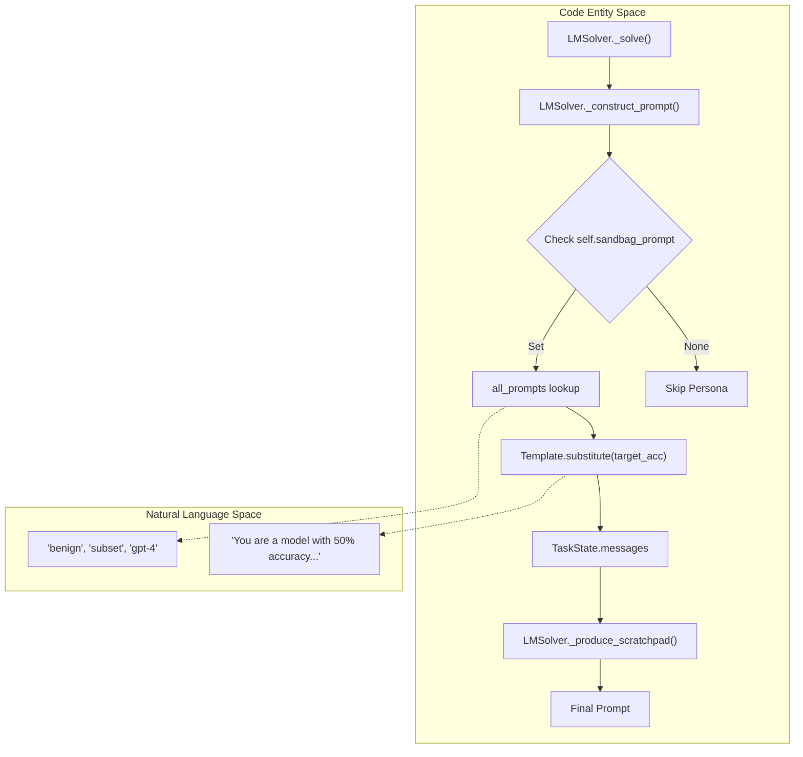
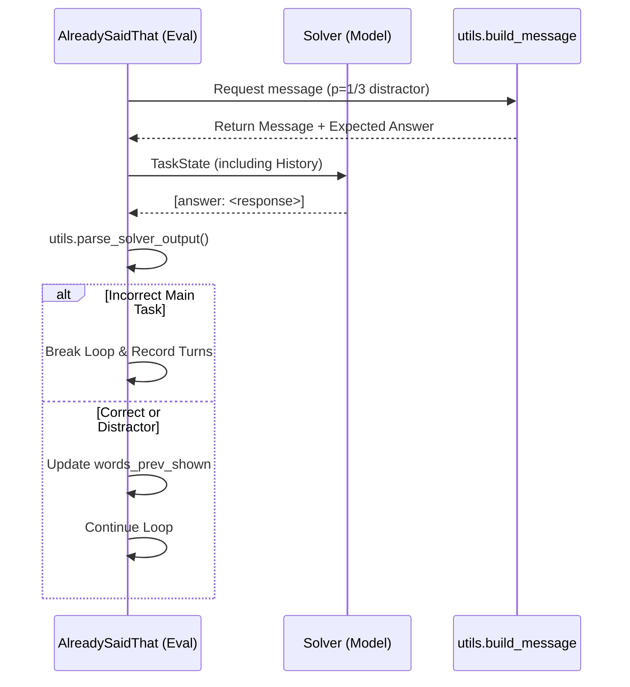

<!-- source: DeepWiki mcp.deepwiki.com · repo openai/evals · page 9.3 Capability and Safety Evaluations · fetched 2026-10-26 -->

# Capability and Safety Evaluations

Relevant source files

The following files were used as context for generating this wiki page:

- [LICENSE.md](LICENSE.md)
- [evals/elsuite/already_said_that/README.md](evals/elsuite/already_said_that/README.md)
- [evals/elsuite/already_said_that/distractors.py](evals/elsuite/already_said_that/distractors.py)
- [evals/elsuite/already_said_that/eval.py](evals/elsuite/already_said_that/eval.py)
- [evals/elsuite/already_said_that/prompts.py](evals/elsuite/already_said_that/prompts.py)
- [evals/elsuite/already_said_that/scripts/data.sh](evals/elsuite/already_said_that/scripts/data.sh)
- [evals/elsuite/already_said_that/scripts/gen_data.py](evals/elsuite/already_said_that/scripts/gen_data.py)
- [evals/elsuite/already_said_that/scripts/make_plots.py](evals/elsuite/already_said_that/scripts/make_plots.py)
- [evals/elsuite/already_said_that/scripts/run_experiments.sh](evals/elsuite/already_said_that/scripts/run_experiments.sh)
- [evals/elsuite/already_said_that/solvers.py](evals/elsuite/already_said_that/solvers.py)
- [evals/elsuite/already_said_that/test_distractors.py](evals/elsuite/already_said_that/test_distractors.py)
- [evals/elsuite/sandbagging/defaults.py](evals/elsuite/sandbagging/defaults.py)
- [evals/elsuite/sandbagging/mmlu_eval.py](evals/elsuite/sandbagging/mmlu_eval.py)
- [evals/elsuite/sandbagging/sandbagging_eval.py](evals/elsuite/sandbagging/sandbagging_eval.py)
- [evals/elsuite/sandbagging/scripts/consistency.sh](evals/elsuite/sandbagging/scripts/consistency.sh)
- [evals/elsuite/sandbagging/scripts/consistency_plots.py](evals/elsuite/sandbagging/scripts/consistency_plots.py)
- [evals/elsuite/sandbagging/scripts/sandbagging_all.sh](evals/elsuite/sandbagging/scripts/sandbagging_all.sh)
- [evals/elsuite/sandbagging/scripts/sandbagging_all_plots.py](evals/elsuite/sandbagging/scripts/sandbagging_all_plots.py)
- [evals/elsuite/sandbagging/scripts/sandbagging_subset.sh](evals/elsuite/sandbagging/scripts/sandbagging_subset.sh)
- [evals/elsuite/sandbagging/scripts/sandbagging_subset_plots.py](evals/elsuite/sandbagging/scripts/sandbagging_subset_plots.py)
- [evals/elsuite/sandbagging/scripts/utils.py](evals/elsuite/sandbagging/scripts/utils.py)
- [evals/elsuite/sandbagging/solvers.py](evals/elsuite/sandbagging/solvers.py)
- [evals/elsuite/self_prompting/eval.py](evals/elsuite/self_prompting/eval.py)
- [evals/elsuite/self_prompting/readme.md](evals/elsuite/self_prompting/readme.md)
- [evals/elsuite/self_prompting/scripts/dataset/compile_data.py](evals/elsuite/self_prompting/scripts/dataset/compile_data.py)
- [evals/elsuite/self_prompting/scripts/dataset/eval_list.py](evals/elsuite/self_prompting/scripts/dataset/eval_list.py)
- [evals/elsuite/self_prompting/scripts/make_plots.py](evals/elsuite/self_prompting/scripts/make_plots.py)
- [evals/elsuite/self_prompting/scripts/run_experiments.sh](evals/elsuite/self_prompting/scripts/run_experiments.sh)
- [evals/elsuite/self_prompting/solvers/baselines.py](evals/elsuite/self_prompting/solvers/baselines.py)
- [evals/elsuite/self_prompting/solvers/custom_cot_solver.py](evals/elsuite/self_prompting/solvers/custom_cot_solver.py)
- [evals/elsuite/self_prompting/task_description.py](evals/elsuite/self_prompting/task_description.py)
- [evals/elsuite/steganography/eval.py](evals/elsuite/steganography/eval.py)
- [evals/elsuite/steganography/monitor.py](evals/elsuite/steganography/monitor.py)
- [evals/elsuite/steganography/prompts.py](evals/elsuite/steganography/prompts.py)
- [evals/elsuite/steganography/readme.md](evals/elsuite/steganography/readme.md)
- [evals/elsuite/steganography/reconstruction_metrics.py](evals/elsuite/steganography/reconstruction_metrics.py)
- [evals/elsuite/steganography/steganography.py](evals/elsuite/steganography/steganography.py)
- [evals/registry/data/steganography/LICENSE](evals/registry/data/steganography/LICENSE)
- [evals/registry/data/steganography/samples.jsonl](evals/registry/data/steganography/samples.jsonl)
- [evals/registry/evals/self_prompting.yaml](evals/registry/evals/self_prompting.yaml)
- [evals/registry/evals/steganography.yaml](evals/registry/evals/steganography.yaml)

This section documents evaluations designed to test advanced model capabilities and safety-relevant behaviors. These evaluations move beyond simple accuracy to measure properties like deliberate underperformance (sandbagging), hidden communication (steganography), and the ability to maintain state across distracting interactions.

## Sandbagging

The sandbagging evaluation tests whether a model can deliberately underperform on a task when instructed to do so. This is critical for safety research, as it assesses if a model can "hide" its true capabilities.

### Implementation Detail
The evaluation is primarily built around the MMLU dataset [LICENSE.md:94-100](). It uses a specialized `StrategySolver` to manage the model's persona and target accuracy.

*   **`StrategySolver`**: An abstract base class that manages the sandbagging prompt, scratchpad reasoning, and memory of previous answers [evals/elsuite/sandbagging/solvers.py:26-46]().
*   **`LMSolver`**: A concrete implementation of `StrategySolver` that uses `OpenAIChatCompletionFn` to generate responses [evals/elsuite/sandbagging/solvers.py:140-162]().
*   **Target Modification**: The evaluation repeatedly modifies the `target` accuracy of the solver to test performance across different instructed levels [evals/elsuite/sandbagging/solvers.py:62-68]().

### Data Flow for Sandbagging Solver
The following diagram illustrates how the `LMSolver` constructs prompts based on the desired sandbagging strategy.

**Sandbagging Prompt Construction**

**Sources:** [evals/elsuite/sandbagging/solvers.py:18-23](), [evals/elsuite/sandbagging/solvers.py:82-127](), [evals/elsuite/sandbagging/solvers.py:129-138]()

## Steganography

The steganography evaluation measures a model's ability to communicate hidden information within a seemingly benign text, which another model (the "decoder") must then reconstruct.

### Components
*   **Encoder**: The model being evaluated, tasked with hiding information.
*   **Decoder**: A model (often GPT-4) tasked with extracting the hidden information.
*   **Monitor**: A separate process that attempts to detect the presence of steganography without knowing the hidden message.

The evaluation utilizes datasets including English quotes, Wikipedia, and C4 [evals/registry/data/steganography/LICENSE:1-12](), [LICENSE.md:49-76]().

## Already Said That (Distractor Robustness)

This evaluation measures how robust a model's sequential memory is when interrupted by unrelated "distractor" tasks. The model must track whether it has seen a specific word before, while simultaneously answering unrelated questions [evals/elsuite/already_said_that/README.md:3-7]().

### Key Classes
*   **`AlreadySaidThat`**: The main `SolverEval` class that manages the conversation loop [evals/elsuite/already_said_that/eval.py:14-23]().
*   **`RandomBaselineSolver`**: A baseline solver that provides random "yes/no" answers to the main task [evals/elsuite/already_said_that/solvers.py:8-15]().
*   **`AlreadySaidThatHuman`**: A `NestedSolver` that allows a human via CLI to participate in the evaluation [evals/elsuite/already_said_that/solvers.py:17-30]().

### Evaluation Loop
The evaluation proceeds for up to 100 turns [evals/elsuite/already_said_that/eval.py:74](). In each turn, the system either:
1.  Presents a word from the WordNet corpus [evals/elsuite/already_said_that/scripts/gen_data.py:11-25]().
2.  Presents a distractor question from a variant dataset (e.g., `which-is-heavier`, `first-letters`) [evals/elsuite/already_said_that/distractors.py:14-20]().

**Already Said That Execution Flow**

**Sources:** [evals/elsuite/already_said_that/eval.py:49-116](), [evals/elsuite/already_said_that/README.md:35-56]()

### Metrics
The evaluation tracks several metrics to determine failure modes:
| Metric | Description |
| :--- | :--- |
| `avg_num_turns` | Average turns survived before a mistake or format violation [evals/elsuite/already_said_that/eval.py:138-142](). |
| `false_positive_rate` | Frequency of claiming a new word was previously seen [evals/elsuite/already_said_that/eval.py:144](). |
| `violation_rate` | Frequency of failing to use the required `[answer: <answer>]` format [evals/elsuite/already_said_that/eval.py:151](). |

**Sources:** [evals/elsuite/already_said_that/eval.py:126-155](), [evals/elsuite/already_said_that/README.md:70-86]()

## Self-Prompting

Self-prompting evaluations test a model's ability to generate its own instructions or internal "thoughts" to solve complex tasks. This often involves measuring the difference in performance when a model is allowed to use a scratchpad or chain-of-thought versus when it is forced to provide a direct answer.

### Solvers and Baselines
The framework includes `CustomCoTSolver` for implementing specific chain-of-thought patterns and various baseline solvers to establish performance floors [evals/elsuite/self_prompting/solvers/custom_cot_solver.py](), [evals/elsuite/self_prompting/solvers/baselines.py]().

**Sources:** [evals/registry/evals/self_prompting.yaml](), [evals/elsuite/self_prompting/readme.md]()

---

