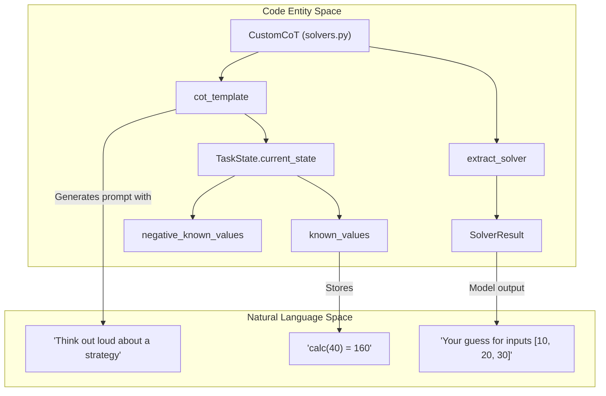
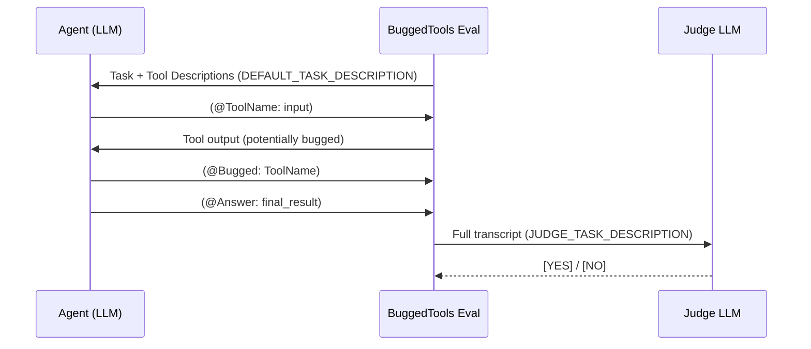

<!-- source: DeepWiki mcp.deepwiki.com · repo openai/evals · page 9.4 Agent and Tool-Use Evaluations · fetched 2026-10-26 -->

# Agent and Tool-Use Evaluations

Relevant source files

The following files were used as context for generating this wiki page:

- [evals/elsuite/bugged_tools/README.md](evals/elsuite/bugged_tools/README.md)
- [evals/elsuite/bugged_tools/bugged_tools.py](evals/elsuite/bugged_tools/bugged_tools.py)
- [evals/elsuite/bugged_tools/eval.py](evals/elsuite/bugged_tools/eval.py)
- [evals/elsuite/bugged_tools/scripts/plot_experiments.py](evals/elsuite/bugged_tools/scripts/plot_experiments.py)
- [evals/elsuite/bugged_tools/scripts/run_experiments.sh](evals/elsuite/bugged_tools/scripts/run_experiments.sh)
- [evals/elsuite/bugged_tools/task_description.py](evals/elsuite/bugged_tools/task_description.py)
- [evals/elsuite/bugged_tools/tools.py](evals/elsuite/bugged_tools/tools.py)
- [evals/elsuite/bugged_tools/utils.py](evals/elsuite/bugged_tools/utils.py)
- [evals/elsuite/function_deduction/README.md](evals/elsuite/function_deduction/README.md)
- [evals/elsuite/function_deduction/baselines.py](evals/elsuite/function_deduction/baselines.py)
- [evals/elsuite/function_deduction/eval.py](evals/elsuite/function_deduction/eval.py)
- [evals/elsuite/function_deduction/prompts.py](evals/elsuite/function_deduction/prompts.py)
- [evals/elsuite/function_deduction/scripts/dataset/create_dataset.py](evals/elsuite/function_deduction/scripts/dataset/create_dataset.py)
- [evals/elsuite/function_deduction/scripts/dataset/raw_code.txt](evals/elsuite/function_deduction/scripts/dataset/raw_code.txt)
- [evals/elsuite/function_deduction/scripts/make_plots.py](evals/elsuite/function_deduction/scripts/make_plots.py)
- [evals/elsuite/function_deduction/scripts/run_experiments.sh](evals/elsuite/function_deduction/scripts/run_experiments.sh)
- [evals/elsuite/function_deduction/solvers.py](evals/elsuite/function_deduction/solvers.py)
- [evals/elsuite/function_deduction/solvers_test.py](evals/elsuite/function_deduction/solvers_test.py)
- [evals/elsuite/mmmu/eval.py](evals/elsuite/mmmu/eval.py)
- [evals/elsuite/solver_tools_convo.py](evals/elsuite/solver_tools_convo.py)
- [evals/registry/data/bugged_tools/main.jsonl](evals/registry/data/bugged_tools/main.jsonl)
- [evals/registry/data/bugged_tools/main_small.jsonl](evals/registry/data/bugged_tools/main_small.jsonl)
- [evals/registry/data/function_deduction/data.jsonl](evals/registry/data/function_deduction/data.jsonl)
- [evals/registry/eval_sets/mmmu.yaml](evals/registry/eval_sets/mmmu.yaml)
- [evals/registry/evals/mmmu.yaml](evals/registry/evals/mmmu.yaml)
- [evals/registry/solvers/function_deduction.yaml](evals/registry/solvers/function_deduction.yaml)

This section documents complex agent-based evaluations within the OpenAI Evals framework. These evaluations test a model's ability to use tools, manage multi-step interactions, debug faulty external interfaces, and acquire new skills through environmental feedback. Unlike basic classification tasks, these evaluations typically involve stateful interactions where the model's choices at turn $N$ influence the information available at turn $N+1$.

## Function Deduction

The Function Deduction evaluation tests a model's ability to refine a mathematical hypothesis based on new evidence and strategically gather information to identify a hidden function.

### Implementation Details
The evaluation provides a secret deterministic function $f(x) \to y$ where $x \in [0, 100]$. The model must predict the output for three specific test inputs within a 20-round limit [evals/elsuite/function_deduction/README.md:5-11]().

**Interaction Options:**
1.  **Option A (Gather Information):** Query the return value for any integer $x \in [0, 100]$ (excluding test inputs) [evals/elsuite/function_deduction/prompts.py:8-10]().
2.  **Option B (Guess):** Provide three integers as the predicted outputs for the test inputs [evals/elsuite/function_deduction/prompts.py:11-12]().

### Solver Architecture
The evaluation uses a specialized `CustomCoT` solver that inherits from `CoTSolver` [evals/elsuite/function_deduction/solvers.py:11-12](). It manages persistent memory of previous queries and incorrect guesses to help the model formulate its next action [evals/elsuite/function_deduction/solvers.py:37-57]().

#### Data Flow: Function Deduction Solver
The following diagram illustrates how the `CustomCoT` solver manages the interaction loop.

Sources: [evals/elsuite/function_deduction/solvers.py:11-35](), [evals/elsuite/function_deduction/prompts.py:32-45]()

### Key Classes and Functions
- `CustomCoT`: A `CoTSolver` subclass that overrides `cot_template` to include a summary of gathered information [evals/elsuite/function_deduction/solvers.py:11-23]().
- `BaseModelCoTSolver`: A specialized solver for base models that uses few-shot messages to teach the interaction format [evals/elsuite/function_deduction/solvers.py:85-116]().
- `AverageBaseline`: A non-LLM baseline that queries neighbors ($x-1, x+1$) and guesses based on the average [evals/elsuite/function_deduction/baselines.py:16-27]().
- `FullKnowledge`: A baseline that simulates an "unbeatable" solver by choosing queries that maximize information entropy among remaining possible functions [evals/elsuite/function_deduction/baselines.py:78-85]().

Sources: [evals/elsuite/function_deduction/solvers.py:11-116](), [evals/elsuite/function_deduction/baselines.py:16-106]()

## Bugged Tools

The Bugged Tools evaluation assesses a model's ability to identify and work around faulty tools. The model is given a task and a set of tools, some of which may return incorrect results for specific inputs [evals/elsuite/bugged_tools/task_description.py:53-56]().

### Execution Flow
1.  **System Prompting:** The model is instructed to use tools via a specific syntax, e.g., `(@NAME: INPUT)` [evals/elsuite/bugged_tools/task_description.py:1-4]().
2.  **Identification:** If the model detects a bug, it must explicitly state `(@Bugged: NAME)` [evals/elsuite/bugged_tools/task_description.py:47-49]().
3.  **Recovery:** After identifying a bug, the model should ignore the incorrect output and attempt to complete the task using other tools or correct outputs [evals/elsuite/bugged_tools/task_description.py:53-54]().

### Evaluation Metrics
A judge LLM is used to classify whether the agent successfully identified the bugged tool [evals/elsuite/bugged_tools/task_description.py:60-61]().

Sources: [evals/elsuite/bugged_tools/task_description.py:1-61]()

## Multimodal Evaluation (MMMU)

The MMMU (Massive Multi-discipline Multimodal Understanding) evaluation tests model performance across various professional domains using images and text [evals/elsuite/mmmu/eval.py:67-79]().

### Implementation details
- **Data Loading:** Uses the `datasets` library to pull from `mmmu/mmmu` on HuggingFace [evals/elsuite/mmmu/eval.py:38-43]().
- **Image Handling:** Images are converted to Base64 and injected into the prompt as `image_url` objects [evals/elsuite/mmmu/eval.py:111-147]().
- **Formatting:** Supports both multiple-choice (using `make_abc` for shuffling) and open-ended questions [evals/elsuite/mmmu/eval.py:84-96]().

### Key Code Entities
- `MMMU`: The main evaluation class inheriting from `evals.Eval` [evals/elsuite/mmmu/eval.py:67]().
- `eval_sample`: Processes a single `Sample` by constructing a multimodal prompt and checking the completion for the string `"ANSWER: X"` [evals/elsuite/mmmu/eval.py:81-160]().
- `get_dataset`: Parses a URL to load specific subjects (e.g., Accounting, Biology) from the MMMU dataset [evals/elsuite/mmmu/eval.py:38-64]().

Sources: [evals/elsuite/mmmu/eval.py:38-182](), [evals/registry/evals/mmmu.yaml:1-13]()

## Skill Acquisition and Web Tasks

While specific implementation files for HR ML Agent Bench and Multistep Web Tasks were not detailed in the provided snippets, the framework supports these via the `SolverEval` pattern and `TaskState` transitions.

### Common Patterns in Agent Evals
- **State Persistence:** Most agent evaluations use `TaskState` to maintain a history of `Message` objects, ensuring the model has context for previous tool outputs [evals/elsuite/function_deduction/solvers.py:61-65]().
- **Extraction Solvers:** Complex interactions often use a two-step process: a `cot_solver` for reasoning and an `extract_solver` to format the final tool call or answer [evals/registry/solvers/function_deduction.yaml:5-20]().
- **Custom Templates:** Prompts are dynamically updated based on the current round index and gathered data [evals/elsuite/function_deduction/solvers.py:25-35]().

Sources: [evals/elsuite/function_deduction/solvers.py:11-68](), [evals/registry/solvers/function_deduction.yaml:1-20]()

---

