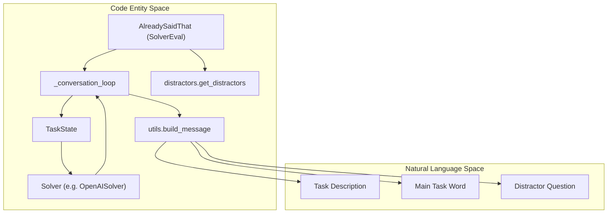
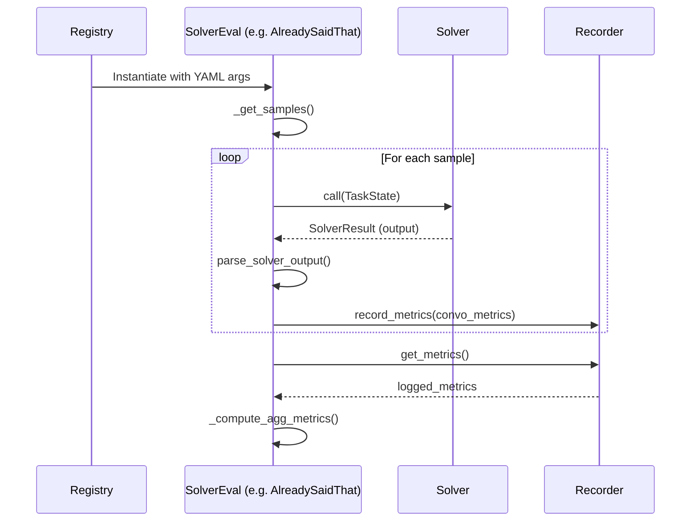

<!-- source: DeepWiki mcp.deepwiki.com · repo openai/evals · page 9.5 Cognitive and Reasoning Evaluations · fetched 2026-10-26 -->

# Cognitive and Reasoning Evaluations

Relevant source files

The following files were used as context for generating this wiki page:

- [LICENSE.md](LICENSE.md)
- [evals/elsuite/already_said_that/README.md](evals/elsuite/already_said_that/README.md)
- [evals/elsuite/already_said_that/distractors.py](evals/elsuite/already_said_that/distractors.py)
- [evals/elsuite/already_said_that/eval.py](evals/elsuite/already_said_that/eval.py)
- [evals/elsuite/already_said_that/prompts.py](evals/elsuite/already_said_that/prompts.py)
- [evals/elsuite/already_said_that/scripts/data.sh](evals/elsuite/already_said_that/scripts/data.sh)
- [evals/elsuite/already_said_that/scripts/gen_data.py](evals/elsuite/already_said_that/scripts/gen_data.py)
- [evals/elsuite/already_said_that/scripts/make_plots.py](evals/elsuite/already_said_that/scripts/make_plots.py)
- [evals/elsuite/already_said_that/scripts/run_experiments.sh](evals/elsuite/already_said_that/scripts/run_experiments.sh)
- [evals/elsuite/already_said_that/solvers.py](evals/elsuite/already_said_that/solvers.py)
- [evals/elsuite/already_said_that/test_distractors.py](evals/elsuite/already_said_that/test_distractors.py)
- [evals/elsuite/error_recovery/README.md](evals/elsuite/error_recovery/README.md)
- [evals/elsuite/error_recovery/defaults.py](evals/elsuite/error_recovery/defaults.py)
- [evals/elsuite/error_recovery/eval.py](evals/elsuite/error_recovery/eval.py)
- [evals/elsuite/error_recovery/scripts/dataset_creation.py](evals/elsuite/error_recovery/scripts/dataset_creation.py)
- [evals/elsuite/error_recovery/scripts/make_plots.py](evals/elsuite/error_recovery/scripts/make_plots.py)
- [evals/elsuite/error_recovery/scripts/run_experiments.sh](evals/elsuite/error_recovery/scripts/run_experiments.sh)
- [evals/elsuite/theory_of_mind/readme.md](evals/elsuite/theory_of_mind/readme.md)
- [evals/elsuite/theory_of_mind/scripts/data_generation.py](evals/elsuite/theory_of_mind/scripts/data_generation.py)
- [evals/elsuite/theory_of_mind/scripts/make_plots.py](evals/elsuite/theory_of_mind/scripts/make_plots.py)
- [evals/elsuite/theory_of_mind/scripts/run_experiments.sh](evals/elsuite/theory_of_mind/scripts/run_experiments.sh)
- [evals/elsuite/twenty_questions/eval.py](evals/elsuite/twenty_questions/eval.py)
- [evals/elsuite/twenty_questions/readme.md](evals/elsuite/twenty_questions/readme.md)
- [evals/elsuite/twenty_questions/scripts/make_plots.py](evals/elsuite/twenty_questions/scripts/make_plots.py)
- [evals/elsuite/twenty_questions/scripts/run_experiments.sh](evals/elsuite/twenty_questions/scripts/run_experiments.sh)
- [evals/elsuite/twenty_questions/test_utils.py](evals/elsuite/twenty_questions/test_utils.py)
- [evals/elsuite/twenty_questions/utils.py](evals/elsuite/twenty_questions/utils.py)
- [evals/registry/data/error_recovery/main.jsonl](evals/registry/data/error_recovery/main.jsonl)
- [evals/registry/data/error_recovery/medium.jsonl](evals/registry/data/error_recovery/medium.jsonl)
- [evals/registry/data/error_recovery/small.jsonl](evals/registry/data/error_recovery/small.jsonl)
- [evals/registry/data/theory_of_mind/.gitattributes](evals/registry/data/theory_of_mind/.gitattributes)
- [evals/registry/data/theory_of_mind/LICENSE](evals/registry/data/theory_of_mind/LICENSE)
- [evals/registry/data/theory_of_mind/socialiqa/license.md](evals/registry/data/theory_of_mind/socialiqa/license.md)
- [evals/registry/data/theory_of_mind/socialiqa/test.jsonl](evals/registry/data/theory_of_mind/socialiqa/test.jsonl)
- [evals/registry/data/theory_of_mind/tomi/license.md](evals/registry/data/theory_of_mind/tomi/license.md)
- [evals/registry/data/theory_of_mind/tomi/test.jsonl](evals/registry/data/theory_of_mind/tomi/test.jsonl)
- [evals/registry/data/twenty_questions/LICENSE](evals/registry/data/twenty_questions/LICENSE)
- [evals/registry/data/twenty_questions/dataset.jsonl](evals/registry/data/twenty_questions/dataset.jsonl)
- [evals/registry/data/twenty_questions/lexicon_nouns.jsonl](evals/registry/data/twenty_questions/lexicon_nouns.jsonl)
- [evals/registry/evals/error_recovery.yaml](evals/registry/evals/error_recovery.yaml)
- [evals/registry/evals/twenty_questions.yaml](evals/registry/evals/twenty_questions.yaml)
- [evals/registry/solvers/error_recovery.yaml](evals/registry/solvers/error_recovery.yaml)
- [evals/registry/solvers/twenty_questions.yaml](evals/registry/solvers/twenty_questions.yaml)

Cognitive and reasoning evaluations within the OpenAI Evals framework test high-level intellectual capabilities such as Theory of Mind, distractor robustness, error recovery, and logical deduction. These evaluations often employ multi-turn interactions and complex scoring logic to determine if a model can maintain state and reason across extended contexts.

## Theory of Mind (ToM)

This evaluation assesses a model's social intelligence and its ability to infer the mental states, beliefs, and motivations of others. It primarily utilizes two benchmarks: **ToMi** and **SocialIQA** [evals/elsuite/theory_of_mind/readme.md:1-2]().

### Implementation and Datasets
*   **ToMi**: Implements the Sally-Anne test to evaluate if a model can identify "false beliefs." It tests whether the model understands that a character will look for an object where they *think* it is, rather than where the model *knows* it is [evals/elsuite/theory_of_mind/readme.md:4-5]().
*   **SocialIQA**: A multiple-choice benchmark covering social scenarios, focusing on a person's wants, needs, and the perceived effects of actions [evals/elsuite/theory_of_mind/readme.md:6]().

The evaluation supports both simple direct solvers and Chain-of-Thought (CoT) solvers, with the latter significantly increasing token consumption (e.g., from ~250k to ~900k tokens for SocialIQA) [evals/elsuite/theory_of_mind/readme.md:12-13]().

**Sources:**
*   [evals/elsuite/theory_of_mind/readme.md:1-15]()
*   [LICENSE.md:101-110]()

## Already Said That (Distractor Robustness)

The `AlreadySaidThat` evaluation measures a model's robustness to distractors during a sequential memory task. The model must track whether it has seen a specific word before while simultaneously answering unrelated questions [evals/elsuite/already_said_that/README.md:3-7]().

### Logic Flow and Components
The evaluation loop alternates between the "Main Task" (word recognition) and "Distractor Tasks" (external reasoning questions).

1.  **Data Generation**: Words are sampled from the WordNet corpus using `nltk` [evals/elsuite/already_said_that/scripts/gen_data.py:18-30]().
2.  **Distractor Integration**: Distractors are pulled from other existing evaluations like `which-is-heavier` or `first-letters` [evals/elsuite/already_said_that/distractors.py:64-69]().
3.  **Conversation Loop**: The `AlreadySaidThat` class manages the state, tracking `words_prev_shown` and `words_not_shown` [evals/elsuite/already_said_that/eval.py:65-66]().

### Already Said That Architecture
The following diagram illustrates the interaction between the evaluation logic and the solver components.

**Entity Mapping: AlreadySaidThat Evaluation**

**Sources:**
*   [evals/elsuite/already_said_that/eval.py:14-116]()
*   [evals/elsuite/already_said_that/distractors.py:14-69]()
*   [evals/elsuite/already_said_that/README.md:35-55]()

## Twenty Questions

The `twenty_questions` evaluation tests a model's deductive reasoning through a game where one agent (the Solver) must guess a hidden object by asking "yes/no" questions to another agent (the Game Master).

### Solver Configurations
The evaluation utilizes specialized solvers defined in the registry to handle the reasoning required for the game:
*   **CoTSolver**: Uses a `cot_solver` for internal reasoning and an `extract_solver` to produce the final question or guess based on an `extract_template` [evals/registry/solvers/twenty_questions.yaml:3-14]().
*   **Game Master**: Typically uses a high-capability model (e.g., GPT-4) with `valid_answers` restricted to `["yes", "no", "skip"]` [evals/registry/solvers/twenty_questions.yaml:72-80]().

**Sources:**
*   [evals/registry/solvers/twenty_questions.yaml:1-80]()
*   [evals/registry/evals/twenty_questions.yaml]()

## Error Recovery

This evaluation tests a model's ability to recover from errors or continue a task after an interruption. It often employs a "continue" pattern where the model is prompted to pick up from the last assistant message.

### Registry Definitions
The solvers for error recovery are configured to test different recovery strategies:
*   **Standard Solver**: A basic `OpenAISolver` or `HHHSolver` [evals/registry/solvers/error_recovery.yaml:2-15]().
*   **Continue Solver**: Specifically sets `continue_last_assistant_msg: True`, forcing the model to resume a previous thought process or output stream [evals/registry/solvers/error_recovery.yaml:27-33]().

**Sources:**
*   [evals/registry/solvers/error_recovery.yaml:1-39]()
*   [evals/elsuite/error_recovery/eval.py]()

## Implementation Details: Track the Stat and Identifying Variables

While specific code for "Track the Stat" and "Identifying Variables" follows the general `SolverEval` pattern, they are characterized by their specialized `TaskState` management.

### Data Flow for Cognitive Evals
The following diagram shows how state is passed and metrics are recorded in these reasoning-heavy evaluations.

**System Data Flow: Reasoning Evaluations**

### Key Metrics for Reasoning
Reasoning evaluations typically track metrics beyond simple accuracy [evals/elsuite/already_said_that/eval.py:130-152]():
| Metric | Description |
| :--- | :--- |
| `avg_num_turns` | Longevity of the model in a stateful task before failure. |
| `violation_rate` | Frequency of failure to follow formatting instructions (e.g., `[answer: <answer>]`). |
| `false_positive_rate` | Specifically for memory tasks, claiming to have seen a new stimulus. |
| `distractor_accuracy` | Performance on side-tasks while maintaining the primary task state. |

**Sources:**
*   [evals/elsuite/already_said_that/eval.py:126-155]()
*   [evals/elsuite/already_said_that/README.md:70-85]()

---

