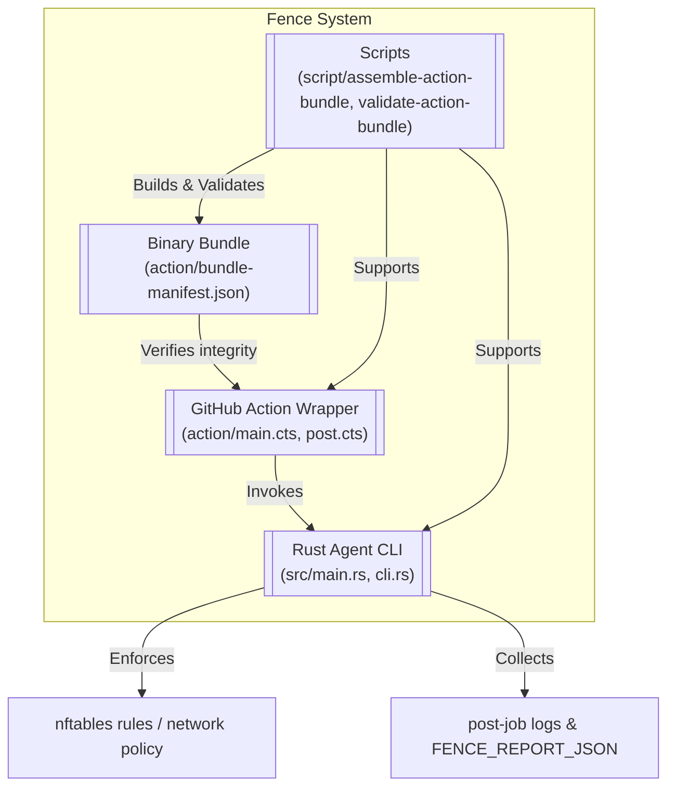
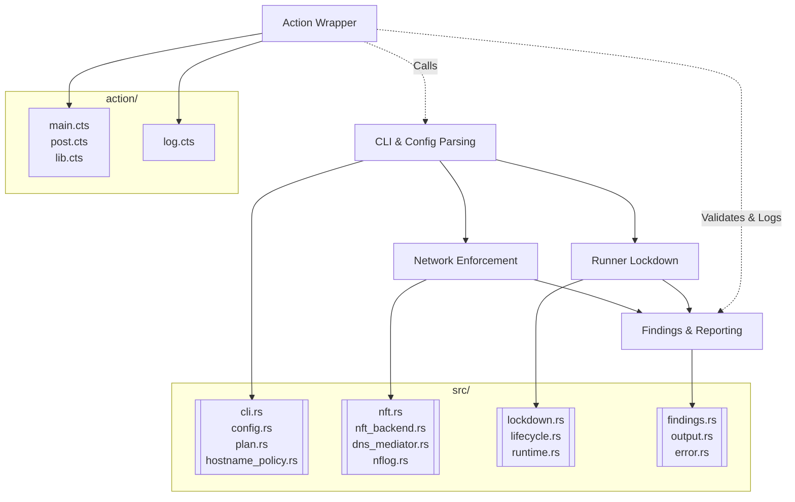

<!-- source: DeepWiki mcp.deepwiki.com · repo openai/fence · page 1 Overview · fetched 2026-10-26 -->

# Overview

Relevant source files

The following files were used as context for generating this wiki page:

- [AGENTS.md](AGENTS.md)
- [README.md](README.md)
- [docs/how-it-works.md](docs/how-it-works.md)
- [docs/v0.md](docs/v0.md)

This page provides a high-level introduction to Fence, a GitHub Action designed for egress filtering and runner lockdown. It outlines the core purpose of Fence, the top-level architecture of the project, and points to detailed child pages for specific topics.

---

## What is Fence?

Fence is a security-focused GitHub Action that enforces network egress restrictions and privileges lockdown on supported GitHub-hosted Linux runners. Specifically, it:

- Blocks outbound network connections except those explicitly required by GitHub Actions workflows or allowed through a user-defined allowlist.
- Disables passwordless `sudo` access.
- Disables Docker and container access by default.
- Monitors the job runtime to ensure protections remain intact.
- Produces reports on network activity as job summaries and structured logs.

Fence is optimized and audited for Ubuntu LTS x64 runners (e.g., `ubuntu-24.04` and `ubuntu-latest`), providing a hardened environment that reduces the risk of data exfiltration or privilege escalation from workflow steps.

Fence supports two operational modes:

- **Block Mode (default):** Actively blocks disallowed network connections and disables sudo/Docker.
- **Audit Mode:** Observes and reports on network activities without blocking or disabling features, ideal for building allowlists and troubleshooting.

Users configure Fence primarily through inputs to the GitHub Action, including the `allowlist` of permitted destinations, execution mode, container policy, and artifact upload settings.

For detailed usage, configuration, and examples, see the child page [Getting Started and Usage](#1.1).

**Sources:**  
`README.md:12-137`  
`docs/how-it-works.md:1-58`  
`AGENTS.md:1-49`  
`docs/v0.md:1-71`  

---

## Top-Level Architecture

The Fence codebase is structured to separate core enforcement logic, action wrapper logic, build tooling, and continuous integration workflows. The four primary code directories are:

### 1. `src/` — Rust CLI and Core Agent

- Implements the core enforcement engine as a Rust command-line application.
- Responsible for parsing configuration, building enforcement plans, managing nftables firewall rules, DNS mediation, network monitoring (via NFLOG), and runtime lifecycle functions such as lockdown and evidence validation.
- Acts as the policy authority and runtime monitor enforcing network restrictions and privilege lockdown on the runner.
  
### 2. `action/` — Node.js GitHub Action Wrapper

- Contains the Node TypeScript/CJS wrapper that invokes the Rust CLI binary.
- Handles setup, input parsing, binary verification, and post-job evidence validation.
- Implements logging, secret sanitization, and interaction with GitHub Actions environment.
- Bundles the Fence binary together with verification manifests, ensuring only audited binaries run.

### 3. `script/` — Build, Vendoring, and Utility Scripts

- Includes scripts to bootstrap development environments, build artifacts, assemble the action bundle, validate vendored dependencies, and more.
- Manages pinned Rust and other toolchains to support hermetic, offline reproducible builds.
- Supports release engineering tasks such as bundle validation and host classification.

### 4. `.github/workflows/` — CI Pipelines

- Defines GitHub Actions workflows for linting, testing (unit and acceptance), building, release automation, action acceptance, security auditing, and integration testing.
- Implements continuous validation of Fence builds, action bundles, and security compliance to maintain high code and supply chain integrity.

---

## Visualizing Fence's Core System and Code Entities

**Legend:**  
- `action/main.cts` & `post.cts`: Action wrapper entrypoints  
- `src/cli.rs` & `src/main.rs`: Rust CLI logic  
- `script/`: Build and validation scripts  
- `action/bundle-manifest.json`: Signed agent binary metadata  

Sources:  
`README.md:12-137`  
`docs/how-it-works.md:3-18`  
`AGENTS.md:1-14`  

---

## Placement of Major Code Responsibilities

This mermaid diagram connects main system concepts to key code entities in the source code:

Sources:  
`README.md:12-137`  
`AGENTS.md:1-20`  

---

## Available Child Pages for More Details

Fence separates detailed topics into dedicated pages:

| Child Page | Contents |
|------------|----------|
| [Getting Started and Usage](#1.1) | Installation, configuration, example workflows, allowlist syntax, operational modes (audit/block), troubleshooting tips. |
| [Project History and Documentation Map](#1.2) | Overview of docs/ directory, historical context, relationship of docs to source code, and project evolution. |

For an in-depth understanding of Fence usage, start with [Getting Started and Usage](#1.1). To understand the documentation sources and historical development, see [Project History and Documentation Map](#1.2).

---

This overview page should assist technical users and developers in understanding the purpose, architecture, and organization of the Fence project, and guide them to specialized documentation for further exploration.

---

**Sources:**  
`README.md:1-143`  
`docs/how-it-works.md:1-58`  
`AGENTS.md:1-49`  
`docs/v0.md:1-71`

---

