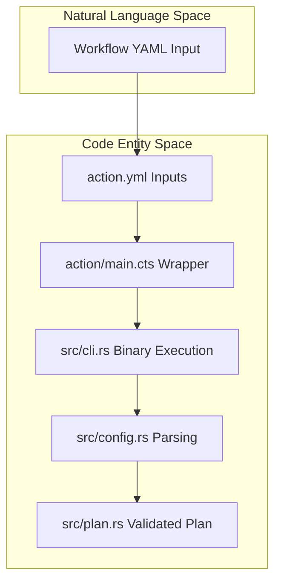
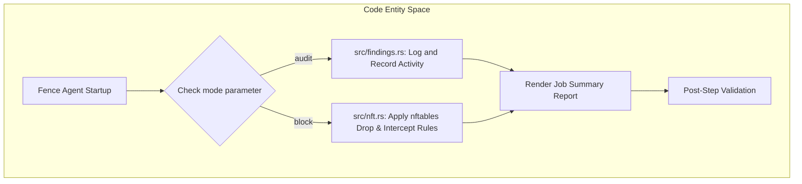
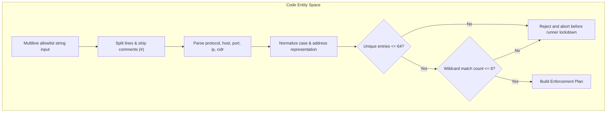

<!-- source: DeepWiki mcp.deepwiki.com · repo openai/fence · page 1.1 Getting Started and Usage · fetched 2026-10-26 -->

# Getting Started and Usage

<details>
<summary>Relevant source files</summary>

The following files were used as context for generating this wiki page:

- [action.yml](action.yml)
- [docs/allowlist.md](docs/allowlist.md)
- [docs/examples.md](docs/examples.md)
- [docs/getting-started.md](docs/getting-started.md)
- [docs/troubleshooting.md](docs/troubleshooting.md)

</details>


This page details how to integrate Fence into a GitHub Actions workflow, configure its inputs, interpret operating modes (audit vs. block), write valid allowlists, implement common patterns, and troubleshoot execution failures. Fence operates as a GitHub Action wrapper (`action.yml`) that launches a hardened Linux x64 Rust binary agent to enforce egress filtering and runner lockdown [action.yml:1-32](), [docs/getting-started.md:1-23]().

---

## Workflow Integration and Inputs

Fence must be added as the first step in a GitHub-hosted runner job (`ubuntu-24.04` or `ubuntu-latest`) so that subsequent steps execute within the restricted runtime environment [docs/getting-started.md:1-23](). 

The Action interface is defined in `action.yml`, accepting several inputs that control its behavior, enforcement mode, and allowed destinations [action.yml:3-27]():

| Input Name | Description | Required |
| :--- | :--- | :--- |
| `config` | Advanced inline strict JSON Fence configuration; overrides all other native inputs [action.yml:4-6](). | False |
| `mode` | Enforcement mode: either `block` or `audit` [action.yml:7-9](). | False |
| `invocation_id` | Lowercase slug override; defaults to `fence-${GITHUB_RUN_ID}-${GITHUB_RUN_ATTEMPT}` [action.yml:10-12](). | False |
| `container_policy` | Container handling in block mode: either `disable` or `unsafe_preserve` [action.yml:13-15](). | False |
| `platform_profile` | Platform profile override; supports `github_hosted_workflow_bootstrap_v5` [action.yml:16-18](). | False |
| `disable_broad_github_domains` | Removes broad GitHub domains and watchdog settings from the default profile [action.yml:19-21](). | False |
| `allow_github_artifacts` | Allows bounded GitHub artifact uploads in block mode [action.yml:22-24](). | False |
| `allowlist` | Multiline string of allowed destinations, hostnames, wildcards, ports, or CIDRs [action.yml:25-27](). | False |

### Action Input Processing Flow


**Sources:** `action.yml:1-33`, `docs/getting-started.md:1-23`

---

## Operating Modes: Audit vs. Block

Fence operates in one of two primary modes, set via the `mode` input or JSON configuration [action.yml:7-9](), [docs/examples.md:15-26](), [docs/getting-started.md:50-61]():

1. **Block Mode (Default)**:
   - Enforces strict network egress filtering via `nftables` and DNS mediation [docs/getting-started.md:24-34]().
   - Disables passwordless `sudo`, Docker, and container runtimes by default [docs/getting-started.md:24-34]().
   - Fails connections that do not match the built-in profile or explicit allowlist entries [docs/getting-started.md:24-34]().

2. **Audit Mode**:
   - Records all attempted outbound network connections without blocking traffic [docs/getting-started.md:50-61]().
   - Does not disable `sudo` or container runtimes, though it may restore root ownership of system directories like `/etc` and `/usr` [docs/getting-started.md:50-61]().
   - Emits findings to the GitHub job summary to assist developers in building an accurate allowlist [docs/getting-started.md:50-61]().

### Mode Execution Lifecycle


**Sources:** `docs/getting-started.md:24-61`, `docs/examples.md:15-26`

---

## Allowlist Syntax and Limits

Allowlists specify permitted network destinations using a line-oriented text format [docs/allowlist.md:1-15](). Fence ignores blank lines and comments prefixed with `#` [docs/allowlist.md:14]().

### Supported Destination Formats

```text
# HTTPS hostname (defaults to TCP port 443)
example.com

# Hostname with custom ports or explicit protocols
example.com:8443
tcp://example.com:443
udp://dns.example.com:53

# Explicit hostname syntax
hostname example.com tcp 443

# Wildcard patterns (matching exact depth)
*.example.com
*.*.example.com

# IP addresses and CIDR networks
ip 192.0.2.10 tcp 443
cidr 192.0.2.0/24 udp 123
```
*Sources: [docs/allowlist.md:18-43]()*

### Limits and Constraints
- **Entry Limit**: An allowlist can contain a maximum of **64 unique entries** [docs/allowlist.md:47-51](). Normalization deduplicates capitalization and formatting equivalents, but distinct ports, protocols, and destination types count separately [docs/allowlist.md:47-51](). The 65th entry causes validation failure before runner modification [docs/allowlist.md:51]().
- **Wildcard Constraints**: Each `*` matches exactly one domain label (e.g., `*.example.com` matches `api.example.com` but not `example.com` or `one.two.example.com`) [docs/allowlist.md:56-64](). Across an entire job, wildcard entries can match at most **eight unique hostnames** [docs/allowlist.md:65]().
- **CIDR Validation**: CIDR ranges must start at the network address; entries with host bits set are rejected during validation [docs/allowlist.md:67-79]().

### Allowlist Parsing and Validation Pipeline


**Sources:** `docs/allowlist.md:1-88`

---

## Configuration Examples

Workflows invoke Fence by referencing a pinned commit SHA and release version [docs/examples.md:1-4]().

### Default Block Mode
```yaml
steps:
  - uses: openai/fence@<commit-sha> # pin@vX.Y.Z
```
*Sources: [docs/examples.md:5-12]*

### Audit Mode Workflow
```yaml
steps:
  - uses: openai/fence@<commit-sha> # pin@vX.Y.Z
    with:
      mode: audit
```
*Sources: [docs/examples.md:15-24]*

### Comprehensive Allowlist with Custom Ports
```yaml
steps:
  - uses: openai/fence@<commit-sha> # pin@vX.Y.Z
    with:
      allowlist: |
        registry.example.com:8443
        udp://dns.example.com:53
        cidr 192.0.2.0/24 udp 123
```
*Sources: [docs/examples.md:39-54]*

### Artifact Uploads and Container Handling
```yaml
steps:
  - uses: openai/fence@<commit-sha> # pin@vX.Y.Z
    with:
      allow_github_artifacts: true
      container_policy: unsafe_preserve
      allowlist: |
        auth.docker.io
```
*Sources: [docs/examples.md:58-97]*

---

## Troubleshooting

Common operational issues and diagnostic paths include:

- **Startup Failures & Unsupported Environments**: Fence requires a GitHub-hosted x64 runner running `ubuntu-24.04` or `ubuntu-latest` [docs/troubleshooting.md:5-8](). Self-hosted runners and non-x64 architectures are unsupported [docs/troubleshooting.md:7]().
- **Local Control Inventory Errors**: `local_control_inventory_unavailable` indicates Fence could not fully inspect local services or socket owners [docs/troubleshooting.md:11](). Fence retries acquisition within fixed limits but requires a complete inventory [docs/troubleshooting.md:11](). Enable `ACTIONS_STEP_DEBUG` set to `true` for detailed logs [docs/troubleshooting.md:13]().
- **Blocked Network Requests**: Temporary activation of `mode: audit` identifies unexpected endpoints requiring allowlist addition [docs/troubleshooting.md:15-28]().
- **Critical Drift**: Critical drift indicates a required security control or component was modified or terminated mid-job; Fence fails the run to preserve security guarantees [docs/troubleshooting.md:53-57]().
- **Direct Agent Execution**: Running the Rust binary directly (`fence run`) returns `trusted_launcher_required`; execution must be initiated via the GitHub Action wrapper [docs/troubleshooting.md:65-67]().

*Sources: [docs/troubleshooting.md:1-70]*

---

