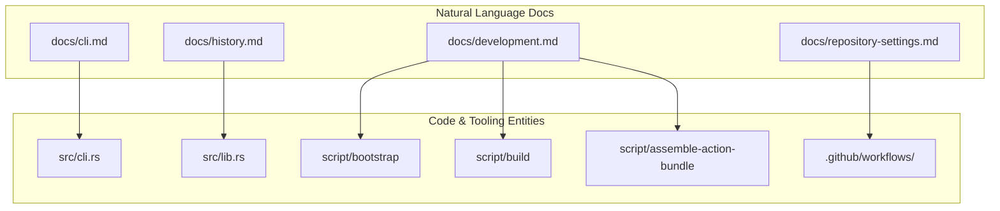
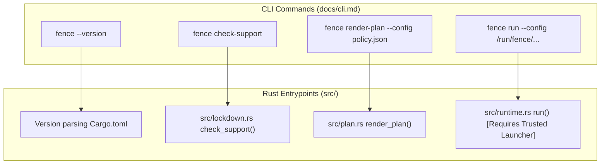

<!-- source: DeepWiki mcp.deepwiki.com · repo openai/fence · page 1.2 Project History and Documentation Map · fetched 2026-10-26 -->

# Project History and Documentation Map

Relevant source files

The following files were used as context for generating this wiki page:

- [LICENSE](LICENSE)
- [docs/cli.md](docs/cli.md)
- [docs/development.md](docs/development.md)
- [docs/history.md](docs/history.md)
- [docs/repository-settings.md](docs/repository-settings.md)

## Purpose and Scope
This page serves as a comprehensive tour of the repository's documentation directory (`docs/`), tracking the project's evolution, command-line interface, local development workflows, and repository governance settings. It bridges natural language specifications and system concepts to the underlying code entities, scripts, and configuration files.

---

## 1. Documentation Tour and Architecture
The `docs/` directory contains core reference guides detailing how Fence operates, how to develop locally, and the history of architectural decisions. These documents correlate directly with components in `src/`, `script/`, and `.github/workflows/`.

*Diagram 1: Bridging Documentation Files to Code and Script Entities.*

**Sources:** `docs/cli.md:1-45`, `docs/development.md:1-47`, `docs/history.md:1-61`, `docs/repository-settings.md:1-78`

---

## 2. Implementation History & Evolution
The project history documented in `docs/history.md` traces Fence from its inception as a Rust crate with pinned toolchains to a hardened, root-supervised GitHub Action.

### Major Milestone Evolution
- **Bootstrap & Policy:** Initiated with strict JSON configuration, typed allowlist entries, and bounded hostname resolution [docs/history.md:5-10]().
- **Native Network Evidence:** Adoption of dedicated `nftables` tables, atomic firewall updates, and safe-Rust NFLOG configuration writers [docs/history.md:12-16]() (replacing unmaintained netlink dependencies).
- **Resident Protection Lifecycle:** Integration with GitHub-hosted `ubuntu-24.04` x64 runner fingerprints, root-owned runtime files, `systemd` supervision, and mandatory rollback checks [docs/history.md:18-25]().
- **Hosted Workflow Compatibility:** Implementation of bounded DNS-mediated GitHub Actions policies, response-local CNAME chaining, and short-lived firewall rules [docs/history.md:27-31]().
- **One-PR Action Publication:** Transition from two-stage releases to a source-only `main` branch model authorized by signed distribution commits (`D`) generated from source commits (`M`) [docs/history.md:38-43]().

**Sources:** `docs/history.md:1-61`

---

## 3. CLI Reference and Execution Map
While Fence is primarily designed to run as a GitHub Action, its Rust agent exposes a CLI utility for inspection and validation [docs/cli.md:1-10]().

*Diagram 2: Mapping CLI Commands to Underlying Rust Functions.*

### Key CLI Operations
- `--version`: Prints agent version derived from `Cargo.toml` or `action/bundle-manifest.json` [docs/cli.md:12-18]().
- `check-support`: Inspects operating system architecture, backend availability, and reference runner profile via `src/lockdown.rs` [docs/cli.md:20-27]().
- `render-plan`: Validates JSON configuration and previews nftables firewall rules without applying them [docs/cli.md:28-34]().
- `run`: Initiates the enforcement runtime. Direct execution fails with `trusted_launcher_required` unless spawned by the authorized root-owned service wrapper [docs/cli.md:36-43]().

**Sources:** `docs/cli.md:1-45`

---

## 4. Local Development and Build Automation
Local development relies on offline-first scripts housed in `script/` that operate against vendored dependencies and pinned toolchains [docs/development.md:1-17]().

### Development Lifecycle Scripts
- `script/prepare-rust`: Downloads and verifies the pinned Rust toolchain (requires network access) [docs/development.md:8-15]().
- `script/bootstrap`, `script/test`, `script/lint`, `script/build`: Execute offline using checked-in lockfiles and vendor directories [docs/development.md:9-17]().
- `script/assemble-action-bundle`: Packages an existing agent binary and manifest into a GitHub Action bundle without downloading external artifacts [docs/development.md:33-36]().

> [!WARNING]
> Do not execute hosted-runner or lockdown tests on local developer machines or reusable runners, as they modify host-level security configurations intended exclusively for disposable GitHub-hosted runners [docs/development.md:43-45]().

**Sources:** `docs/development.md:1-47`

---

## 5. Repository Settings and Release Engineering
To maintain supply-chain integrity, Fence enforces strict GitHub repository settings, required status checks, branch protection rules, and CODEOWNERS boundaries [docs/repository-settings.md:1-60]().

### Required Branch Protection & CI Checks
- **Required Status Checks:** `lint`, `test`, `build`, `acceptance`, `action acceptance`, and `integration` must pass before merging to `main` [docs/repository-settings.md:5-15]().
- **CODEOWNERS Enforcement:** Sensitive paths—including `.github/workflows/**`, `action.yml`, `script/**`, `Cargo.toml`, and `vendor/**`—require explicit CODEOWNER review [docs/repository-settings.md:40-59]().
- **Immutable Releases:** The `release` environment requires source and distribution commit validation (`M -> D`), producing signed distribution commits tagged immutably [docs/repository-settings.md:60-68]().

**Sources:** `docs/repository-settings.md:1-78`

---

