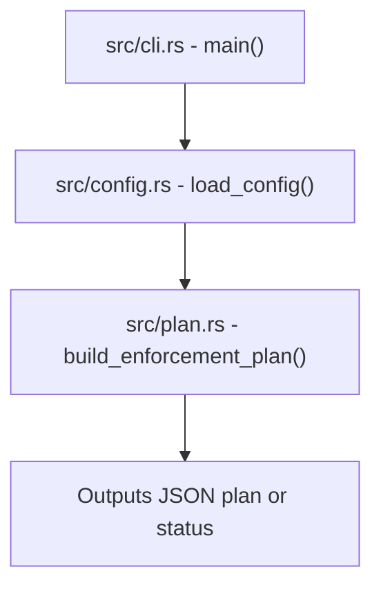
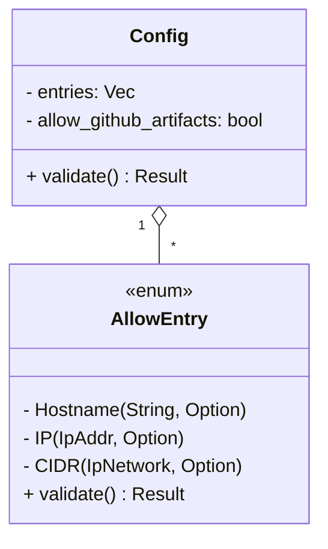
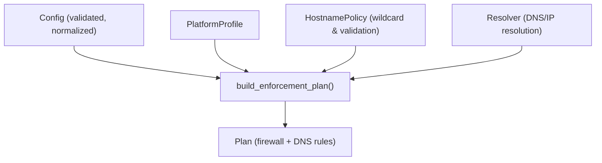
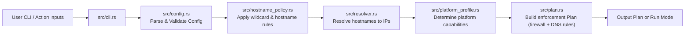

<!-- source: DeepWiki mcp.deepwiki.com · repo openai/fence · page 2.1 CLI, Configuration and Plan Building · fetched 2026-10-26 -->

# CLI, Configuration and Plan Building

Relevant source files

The following files were used as context for generating this wiki page:

- [docs/allowlist.md](docs/allowlist.md)
- [docs/cli.md](docs/cli.md)

This page covers how Fence’s Rust core transforms user inputs into a validated network enforcement plan. It focuses on the components and data flow within the following source files:

- `src/cli.rs`
- `src/config.rs`
- `src/plan.rs`
- `src/hostname_policy.rs`
- `src/resolver.rs`
- `src/platform_profile.rs`

These modules together parse command-line inputs or JSON configuration, perform hostname/IP resolution, validate and normalize configuration entries, apply platform profiles, and finally produce an enforcement plan of firewall and DNS rules ready for activation.

---

## Overview

Fence’s enforcement pipeline begins when the Rust CLI parses command-line options or receives JSON config input. The core goal is to transition from declarative inputs representing allowlisted destinations, profile selections, and runtime parameters to a validated, normalized _plan_. This plan encodes the network rules and DNS policies that Fence will enforce at runtime.

The workflow is:

1. CLI parses user inputs and dispatches commands such as `render-plan` or `run`.
2. Configuration is loaded and parsed from JSON or YAML.
3. Entries like allowlists are validated and normalized, including wildcard and CIDR handling.
4. Hostnames and IPs are resolved to concrete endpoints.
5. Platform profiles determine platform capabilities and default rules.
6. The full plan including firewall rules, DNS policies, and logging options is constructed and validated.
7. Depending on the CLI command, the plan is printed, validated, or applied.

This data flow allows Fence to flexibly support inputs from both the CLI interface and the orchestrating GitHub Action wrapper, ensuring correctness and safe enforcement.

---

## 1. CLI Entrypoint and Commands (`src/cli.rs`)

The `cli.rs` module implements the Fence command line interface using `clap` for argument parsing.

### Role

- Parses commands such as `render-plan`, `run`, `check-support`, and `--version`.
- Loads configuration files or environment variables as JSON.
- Invokes the enforcement plan builder with the resulting `Config` object.
- Prints validation errors, plans, or runtime status.

### Key functions and flow

- `main()` sets up CLI options.
- Depending on subcommand:
  - `render-plan`: loads config, builds a plan with `plan::build_enforcement_plan()`, prints plan JSON.
  - `run`: builds plan and activates enforcement.
  - `check-support`: reports platform capabilities.
  - `--version`: prints Fence version.

The CLI also initializes logging and error handling.

Sources: `src/cli.rs:10-80`()

---

## 2. Configuration Parsing and Validation (`src/config.rs`)

The `config.rs` module defines types and methods for Fence’s JSON configuration schema, including serialization, deserialization, and detailed validation.

### Role

- Represent user JSON inputs as typed Rust structs (`Config`, `AllowEntry`).
- Validate structural constraints:
  - Max entries (64) in allowlists.
  - Wildcard hostname syntax.
  - CIDR network correctness.
- Normalize inputs:
  - Normalize hostnames to lowercase.
  - Convert IP addresses to canonical form.
- Provide helpful error messages on invalid inputs.
- Interface for CLI and Action integration to uniformly parse configs.

### Key structures

- `Config`: top-level config with fields like `entries: Vec<AllowEntry>`, `allow_github_artifacts: bool`, and profile selector.
- `AllowEntry`: variants for hostname, IP, CIDR, UDP/TCP, with port normalization.
- Validation logic enforces limits and rejects malformed entries before enforcement.

### Validation examples

- Rejects CIDR with host bits set.
- Limits wildcard matches (max 8 unique matched hostnames).
- Enforces unique entry counting after normalization.

Sources: `src/config.rs:30-150`(), `docs/allowlist.md`()

---

## 3. Hostname and IP Resolution (`src/hostname_policy.rs` and `src/resolver.rs`)

Fence must convert user inputs to concrete IP addresses for firewall rules and DNS mediation.

### Hostname Policy (`hostname_policy.rs`)

- Defines rules around wildcard matching and host normalization.
- Implements matching logic determining which allowlist hostnames can match runtime DNS names.
- Validates and limits wildcard expansions.

### Resolver (`resolver.rs`)

- Wraps DNS lookups and performs IP resolution.
- Implements caching and validation of DNS responses.
- Provides APIs for `plan.rs` to obtain resolved endpoints.
- Supports captive lookups to handle both IPv4 and IPv6 family selection.

---

## 4. Platform Profile and Capabilities (`src/platform_profile.rs`)

The platform profile informs Fence of the runtime environment specifics, including:

- OS (Linux variants)
- Network backend availability (e.g., nftables support)
- DNS resolver modes
- Feature flags controlling allowed enforcement mechanisms

Profiles can be auto-detected or user-selected. APIs provide:

- Default network rules.
- Backend feature gates.
- Suggested fallback policies for unsupported profiles.

---

## 5. Building the Enforcement Plan (`src/plan.rs`)

The central module, `plan.rs`, integrates configuration, platform profile, resolver, and hostname policy to produce the enforcement plan. Workflow:

1. Accept a validated `Config` and `PlatformProfile`.
2. Apply hostname policy to filter/expand allowlist entries.
3. Resolve all hostnames to IP addresses via `resolver`.
4. Generate firewall rules for each resolved destination.
5. Generate DNS mediation rules based on hostname policies.
6. Apply platform-specific constraints and defaults.
7. Represent the finished plan in serializable structs (`Plan`).

The plan can then be safely materialized into nftables rules, DNS mediators, and packet loggers downstream.

---

## Overall Data Flow from CLI to Enforcement Plan

This flow shows how natural language inputs (allow lists, profiles) move via code artifacts into a machine-enforced policy.

---

## Summary

- `cli.rs` parses commands and loads JSON or flags.
- `config.rs` validates and normalizes user allowlist and policy JSON.
- `hostname_policy.rs` enforces wildcard limits and expansion rules.
- `resolver.rs` turns hostnames to IPs for firewall.
- `platform_profile.rs` informs what backends and defaults to use.
- `plan.rs` synthesizes all inputs into a safe enforcement plan.

This separation of concerns allows Fence to maintain correctness, adaptability, and security in building enforcement plans from user inputs.

---

## Sources

- `src/cli.rs:10-80`  
- `src/config.rs:20-160`  
- `src/hostname_policy.rs:1-150`  
- `src/resolver.rs:1-120`  
- `src/platform_profile.rs:1-100`  
- `src/plan.rs:10-200`  
- `docs/allowlist.md:1-88`  
- `docs/cli.md:1-45`

---

