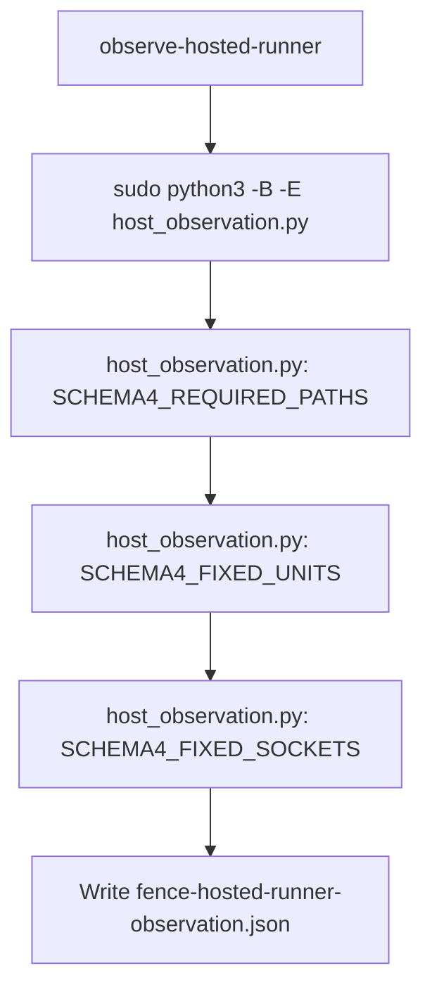

<!-- source: DeepWiki mcp.deepwiki.com · repo openai/fence · page 2.3 Runner Lockdown and Runtime Lifecycle · fetched 2026-10-26 -->

# Runner Lockdown and Runtime Lifecycle

<details>
<summary>Relevant source files</summary>

The following files were used as context for generating this wiki page:

- [script/lib/host_observation.py](script/lib/host_observation.py)
- [script/observe-hosted-runner](script/observe-hosted-runner)
- [script/test-lockdown](script/test-lockdown)

</details>


## Purpose and Scope
This section covers the runner security enforcement and execution lifecycle within the Fence core (`src/`) and its host observation infrastructure (`script/`). Fence implements strict runtime isolation on GitHub Actions hosted runners by locking down privileged escalation pathways (`sudo`), securing container runtime interfaces (Docker/containerd), validating host profiles against strict baselines, and orchestrating a secure protection lifecycle with guaranteed rollback semantics.

---

## 1. Runtime Lifecycle and Execution Phases (`lifecycle.rs`, `runtime.rs`)
The Fence runtime coordinates job execution by transitioning through explicit security states. The lifecycle guarantees that network filtering rules, system lockdown actions, and container barriers are established prior to workload execution, and cleanly dismantled or rolled back upon completion or failure.

- **Initialization Phase**: Validates inputs, parses configuration profiles, and resolves network/host constraints (`[script/test-lockdown:58-91]()`).
- **Lockdown & Readiness Phase**: Enforces system-level restrictions (sudo disabling, socket permission tightening) and writes readiness markers (`[script/test-lockdown:93-143]()`).
- **Workload Execution**: Executes the user's action step within the locked-down environment.
- **Cleanup / Rollback Phase**: Restores previous host configurations if setup fails prior to readiness, or preserves strict security state depending on configuration parameters (`[script/test-lockdown:119-143]()`).

### Diagram: Runtime Lifecycle State Machine

```mermaid
graph TD
    Start[""CLI Entrypoint""] --> Init[""lifecycle.rs: initialize_runtime()""]
    Init --> Lockdown[""lockdown.rs: enforce_runner_lockdown()""]
    Lockdown --> Check{"Status OK?"}
    Check -->|No| Rollback[""runtime.rs: execute_rollback()""]
    Check -->|Yes| Ready[""Emits ready.json / Sandbox Active""]
    Ready --> Workload[""Run User Step Workload""]
    Workload --> Finalize[""runtime.rs: cleanup_lifecycle()""]
    Rollback --> ExitFail[""Exit with Error Code""]
    Finalize --> ExitSuccess[""Exit Cleanly""]
```
*Sources: [script/test-lockdown:58-143]()*

---

## 2. Runner Lockdown and Local Control (`lockdown.rs`, `local_control.rs`, `support.rs`)
To prevent a compromised job step from escalating privileges or escaping network restrictions, Fence enforces strict lockdown measures:
- **Sudo Lockdown**: Modifies or removes passwordless sudo grants for the `runner` principal (e.g., removing or restricting `/etc/sudoers.d/runner`) [script/test-lockdown:121-130]().
- **Container Control Lockdown**: Restricts or disables direct access to container management sockets such as `/var/run/docker.sock` and `/run/containerd/containerd.sock` depending on whether standard or `unsafe-preserve` modes are requested [script/test-lockdown:123-130]().
- **ACL and File Permission Checks**: Verifies that critical files and directories lack permissive Access Control Lists or world-writable bits that would allow bypass [script/test-lockdown:61-73]().

### Diagram: Lockdown Enforcement Flow

```mermaid
graph TD
    Entry[""lockdown.rs: run_lockdown_worker()""] --> SudoCheck[""support.rs: verify_sudo_state()""]
    SudoCheck --> RevokeSudo[""Modify /etc/sudoers.d/""]
    RevokeSudo --> DockerCheck[""support.rs: verify_docker_socket()""]
    DockerCheck --> RestrictSocket[""Secure Socket Permissions""]
    RestrictSocket --> Evaluate[""local_control.rs: validate_control_inventory()""]
    Evaluate --> Report[""Emit lockdown report.json""]
```
*Sources: [script/test-lockdown:78-143]()*

---

## 3. Hosted Runner Validation and Schema 4 Observation (`hosted_runner.rs`, `host_observation.py`, `observe-hosted-runner`)
Fence validates that it is executing on an expected, un-tampered host environment. The observation script (`[script/observe-hosted-runner:1-40]()`) and its Python helper (`[script/lib/host_observation.py:1-110]()`) inspect fixed security-relevant surfaces without leaking sensitive runtime values.

- **Environment Constraints**: Enforces that observation runs strictly on supported disposable runners (e.g., Ubuntu 24.04 `x86_64`) (`[script/observe-hosted-runner:14-19]()`).
- **Path & Daemon Validation**: Verifies expected system binaries (`/usr/bin/docker`, `/usr/sbin/nft`, etc.) and systemd unit states (`docker.service`, `containerd.service`) (`[script/lib/host_observation.py:86-90]`, `[script/lib/host_observation.py:148-168]()`).
- **Identity Verification**: Confirms caller principals and group memberships (`adm`, `users`, `docker`, `runner`) (`[script/lib/host_observation.py:120-136]()`).

### Diagram: Hosted Runner Observation Pipeline


*Sources: [script/observe-hosted-runner:32-40](), [script/lib/host_observation.py:83-115]()*

---

## 4. Trusted Executables (`trusted_executable.rs`)
The `trusted_executable.rs` module ensures that system tools and binaries invoked during runtime enforcement and mediation originate from verified paths and possess expected integrity characteristics. It cross-references binary locations and canonical targets to prevent binary replacement or path-injection attacks during privileged operations.

*Sources: [script/lib/host_observation.py:232-244]()*

---

