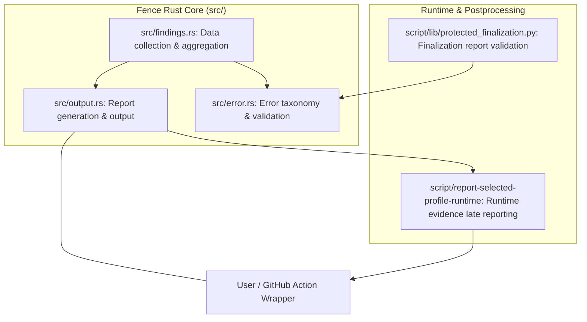
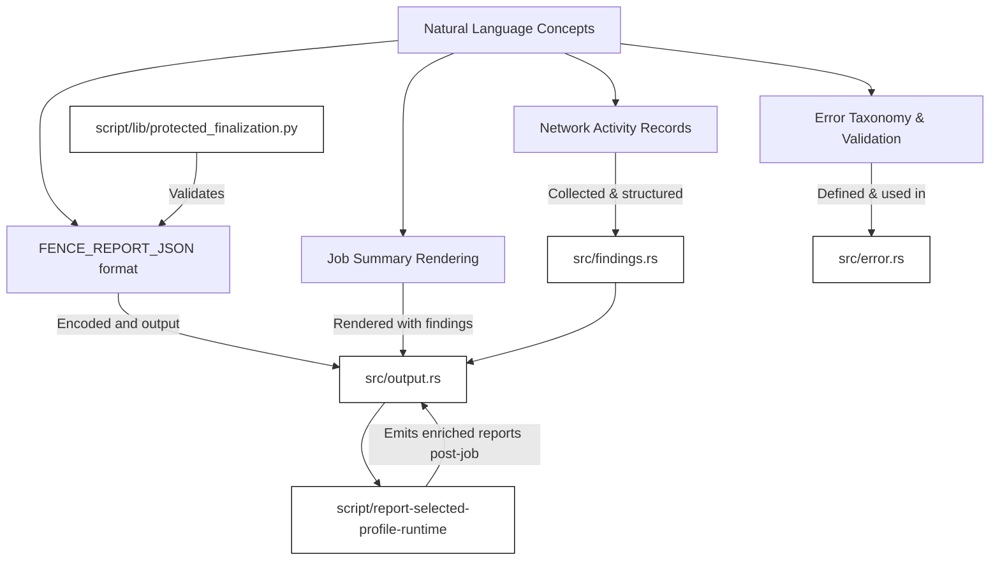

<!-- source: DeepWiki mcp.deepwiki.com · repo openai/fence · page 2.4 Findings, Reporting and Errors · fetched 2026-10-26 -->

# Findings, Reporting and Errors

Relevant source files

The following files were used as context for generating this wiki page:

- [script/lib/protected_finalization.py](script/lib/protected_finalization.py)
- [script/report-selected-profile-runtime](script/report-selected-profile-runtime)

This section covers the core mechanisms and code involved in generating, validating, and reporting findings and errors within the Fence Rust crate. It explains how network activity reports and job summaries are rendered and structured, how the FENCE_REPORT_JSON is produced, and details the error taxonomy used inside the system.

---

## 1. Purpose and Scope

Fence, as a GitHub Action for egress filtering and runner lockdown, relies on detailed findings and reporting infrastructure to communicate enforcement results, diagnostic information, and error states. This includes:

- Producing structured network activity evidence reports (`src/findings.rs`).
- Generating final output reports according to JSON schema expectations (`src/output.rs`).
- Defining error categories and validation logic throughout the system (`src/error.rs`).
- Special validation of "protected finalization" reports, ensuring evidence correctness and secure lifecycle completion.
- Support for a specialized JSON formatted report, recognized as `FENCE_REPORT_JSON`.

This page dives deep into implementation specifics, function roles, and data flows around these concerns.

---

## 2. Key Modules and Their Roles

| Module           | Primary Responsibility                                                   |
|------------------|--------------------------------------------------------------------------|
| `src/findings.rs`| Collects, stores, and prepares findings, i.e., network activity records.|
| `src/output.rs`  | Renders the final job summary and evidence output, handles format output.|
| `src/error.rs`   | Defines Fence error taxonomy, categorization, and helper traits.        |

---

## 3. Findings Data Flow and Reporting

The system collects network activity and enforcement evidence during runtime, formats this data into structured reports, and outputs them for use by the GitHub Action or subsequent analysis.

The core process involves:

- **Data Collection:** Network observations, rejected requests, and other controls are gathered.
- **Findings Aggregation:** Structured findings are collected in memory.
- **Summary Preparation:** A job summary including critical findings, warnings, and omissions is gathered.
- **Report Generation:** Results are serialized in JSON conforming to FENCE_REPORT_JSON schema.

This multi-stage processing pipeline ensures consistent enforcement feedback.

### 3.1 Protected Finalization Report Validation

The `script/lib/protected_finalization.py` contains the logic validating protected finalization reports which are critical security checkpoints in Fence’s lifecycle. It validates structure, contents, and timing of jobs that lock down the runner environment.

Important functions:

- `validate_action_finalization_report(report, job_name)`: Checks the report dictionary keys, schema version, mode (must be "block"), control flags and network evidence.
- `_timestamp(value, description)`: Parses and validates ISO8601 timestamps ensuring chronological order.
- `validate_finalization_jobs(document, job_set)`: Cross-validates a collection of job execution metadata, ensuring all expected finalization jobs completed successfully.

Validation verifies that:

- The report matches expected keys exactly.
- Warnings and omissions are stable and conform to quiet expectations if applicable.
- Network evidence rows do not exceed threshold limits.
- Job steps completed with success and correct timing sequences.

These checks guarantee trustworthy evidence production, uniquely securing Fence’s enforcement state.

### 3.2 Network Findings and Allowlist Suggestions

Validated reports include:

- Lists of network findings (up to a capped number for size control).
- Suggested allowlist entries derived from observed legitimate traffic.
- Warnings about materialization rejections (i.e., policy-driven denials).
  
This allows Fence to evolve enforcement policies iteratively by suggesting entries that users may whitelist.

---

## 4. Runtime Evidence Late Reporting Script

The file `script/report-selected-profile-runtime` is a specialized post-job shell+python script that:

- Runs only on disposable GitHub Actions Linux x86_64 runners.
- Sleeps between evidence collection attempts to allow gathering bounded late DNS mediated selected-profile evidence.
- Parses and validates JSON reports using strict predicates on fields such as `runtime_evidence_schema_version`, `network_verification_status`, and cryptographic hash formats.
- Merges runtime network counters, findings, and DNS mediated observations into a final summarized JSON blob.
- Ensures the final produced JSON does not exceed a 256KB limitation.

This script is geared towards **late reporting** of runtime evidence, important for full policy enforcement transparency after the active job is concluded.

---

## 5. Error Taxonomy and Validation

Errors in Fence are categorized and surfaced according to their origin and impact on the enforcement pipeline:

- Validation errors indicate malformed data (e.g., report schema mismatch).
- Runtime errors represent unexpected execution states (e.g., missing evidence).
- Domain-specific errors cover policy enforcement violations (e.g., hostname rejection).
  
By categorizing errors distinctly, Fence affords precise diagnostics and easier troubleshooting.

---

## 6. Diagram: System Overview for Findings & Reporting

**Explanation:**

- `src/findings.rs` collects runtime enforcement data.
- `src/output.rs` generates the final report visible to users.
- `src/error.rs` maintains error detection logic leveraged by core and scripts.
- The protected finalization validation runs as a safeguarded step verifying correctness of evidence.
- The shell+python script `script/report-selected-profile-runtime` emits late detailed reports following final job completion.
- The User or GitHub Action wrapper consumes these artifacts to complete workflow reporting.

Sources: `src/findings.rs`, `src/output.rs`, `src/error.rs`, `script/lib/protected_finalization.py:1-158`, `script/report-selected-profile-runtime:1-126`()

---

## 7. Technical Details: Protected Finalization Validation Walkthrough

Key validations by `validate_action_finalization_report()` in `protected_finalization.py` include:

| Validation Aspect           | Details                                                                             |
|----------------------------|-------------------------------------------------------------------------------------|
| Job Name Check             | Must be from expected finalization job list or a zero-input burst job.              |
| Report Schema              | Must be a dictionary with exact keys defined in `STRUCTURED_REPORT_FIELDS`.         |
| Schema Version             | Integer with value 1 for compatibility.                                            |
| Enforcement Mode           | Must be `"block"` indicating strict enforcement status.                            |
| Controls Matching          | Must match `PROTECTED_CONTROLS`, e.g., network verified, sudo and containers disabled.|
| Network Evidence           | A list of dictionaries with length ≤ 20 (each row a network observation).           |
| Warnings and Omissions     | Both dictionaries, conforming to expected quiet warnings and omissions sets.        |
| Suggested Allowlist        | Limited list with max 20 entries, often empty for quiet finalization reports.       |
| Result Field               | Matches `"warning"` if materialization rejections > 0, else `"healthy"`.           |

The pipeline also validates timestamps to ensure start and end times of execution steps are consistent and chronologically sound.

This validation pipeline is critical for ensuring Fence’s protected finalization steps produce secure, auditable evidence guaranteeing the integrity of the network lockdown lifecycle.

Sources: `script/lib/protected_finalization.py:68-117, 119-152`()

---

## 8. Example Output JSON Fields (From Late Reporting)

The late reporting script produces JSON with fields such as:

| Field                             | Description                                              |
|----------------------------------|----------------------------------------------------------|
| `schema_version`                 | Version of the report schema (integer).                  |
| `runtime_evidence_schema_version`| Versioning for runtime evidence format.                   |
| `status`                        | Reporting status string e.g., `"selected_profile_runtime_test_only"`.|
| `profile_realization_id`        | Identifier for applied profile realization.              |
| `platform_profile_id`            | Host platform profile identifier (e.g., hosted runner).  |
| `policy_hash`                   | SHA-256 hash of active enforcement policy.               |
| `network_counters`              | Collection of observed network behavior counters.        |
| `network_findings`              | Limited list of network enforcement findings.            |
| `critical_findings`             | Critical issues flagged during enforcement.              |
| `observations`                  | DNS-mediated runtime behavioral observations.            |
| `bounded_actions_suffix_authorizations` | Auxiliary authorization records for suffixes.         |
| `protection_available`          | Boolean flag if lockdown/protection is available.        |
| `limitations`                   | List of known operational limitations for the report.   |

The script ensures the size is limited to 256KB serialized for practical transport.

Sources: `script/report-selected-profile-runtime:31-122`()

---

## 9. Summary

- Fence’s findings and reporting subsystem is essential for transparent, verifiable enforcement feedback.
- The Rust modules `src/findings.rs`, `src/output.rs`, and `src/error.rs` collaborate to capture, assemble, and output detailed network activity and enforcement evidence.
- Strict validation of protected finalization reports ensures no evidence manipulation or lifecycle irregularities.
- The late runtime reporting script further refines evidence emission after job completion, especially on ephemeral hosted runners.
- These efforts support both audit and block modes of Fence and provide rich security telemetry.

---

## 10. Additional Diagram: From Natural Language to Code Entities for Reporting

This diagram maps real-world reporting terms to specific source files and code artifacts.

Sources: `src/findings.rs`, `src/output.rs`, `src/error.rs`, `script/lib/protected_finalization.py`, `script/report-selected-profile-runtime`()

---

# End of 2.4 Findings, Reporting and Errors

---

