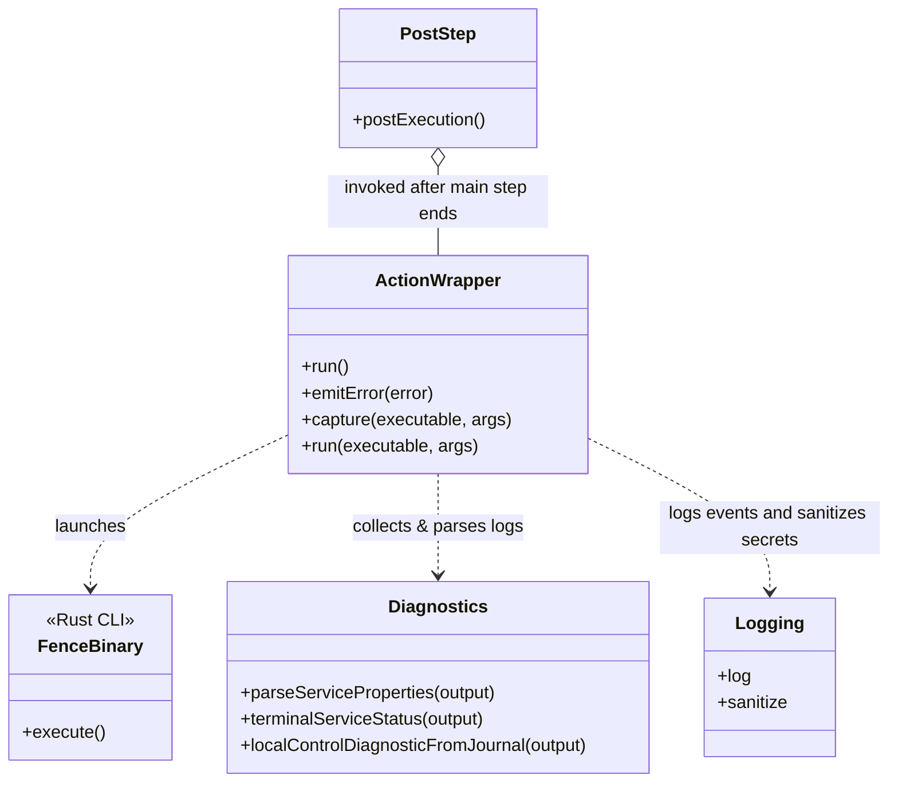

<!-- source: DeepWiki mcp.deepwiki.com · repo openai/fence · page 3 GitHub Action Wrapper · fetched 2026-10-26 -->

# GitHub Action Wrapper

<details>
<summary>Relevant source files</summary>

The following files were used as context for generating this wiki page:

- [action.yml](action.yml)
- [action/main.cts](action/main.cts)

</details>


The GitHub Action Wrapper serves as the interface between GitHub Actions workflows and the core Fence enforcement binary. It is responsible for installing, validating, and running the Fence Linux x64 agent on supported GitHub-hosted runners. This wrapper is implemented primarily in TypeScript/JavaScript using CommonJS modules contained within the `action/` directory, while the metadata for the GitHub Action itself is specified in `action.yml`. Together, they ensure that Fence is executed correctly within the GitHub Actions environment, handling configuration inputs, orchestration of service lifecycle, diagnostics, and secure runtime validation.

This page provides a high-level overview of how the GitHub Action wrapper is structured and functions. Technical details and in-depth explanations for each part are delegated to the linked child pages:

- [Main and Post Steps](#3.1) — Covers setup, launching Fence, binary verification, invocation, and post-job evidence validation implemented in `action/main.cts`, `action/post.cts`, and `action/lib.cts`.
- [Logging and Sanitization](#3.2) — Describes log formatting, secret sanitization, and the testing harness in `action/log.cts` and test files.
- [Action Bundle Assembly and Host Classification](#3.3) — Details bundling scripts, host classification, and release-related metadata managed by various scripts under `script/` and Python helpers.

---

## Overview of `action.yml`

The `action.yml` file is the entrypoint configuration expressing how Drone/GitHub Actions interact with the Fence wrapper. It declares:

- **Inputs**: Configuration parameters like `config` (inline JSON config), `mode` (`block` or `audit`), `invocation_id`, platform profiles, and allowlist entries.
- **Runtime**: Specifies the wrapper runs using Node 24 (`node24`) as the runtime.
- **Main and Post Steps**: Hooks `action/main.cts` as the main entrypoint script and `action/post.cts` as the cleanup or post job handler, which always runs even if the main step fails.

This YAML metadata defines the contract and user inputs for the Fence action and delegates actual execution logic to the Node scripts.

```yaml
name: Fence
description: Launch the bundled Fence Linux x64 agent on a supported GitHub-hosted runner
inputs:
  config:
    description: Advanced inline strict JSON Fence configuration; if set, no other Fence config inputs may be used
    required: false
  mode:
    description: Fence mode, either block or audit
    required: false
  invocation_id:
    description: Optional lowercase slug override; omission derives fence-${GITHUB_RUN_ID}-${GITHUB_RUN_ATTEMPT}
    required: false
  ...
runs:
  using: node24
  main: action/main.cts
  post: action/post.cts
  post-if: always()
```

Sources: `action.yml:1-32`()

---

## TypeScript/CJS Wrapper in `action/`

The core logic that runs the Fence binary resides primarily in several `.cts` files under the `action/` directory, with `main.cts` orchestrating the launch and lifecycle inside the GitHub runner environment.

### Key Roles and Flow in `main.cts`

- **Setup and Initialization**: Establishes runtime directories, verifies bundle integrity, and prepares environment variables.
- **Binary Validation and Execution**: Ensures the Fence binary is authentic and fully validated before spawning it with safe environment and timeout settings.
- **Status and Diagnostic Collection**: Monitors Fence's startup and runtime status using systemd/journal diagnostic output parsing to detect failures or readiness.
- **Service Invocation API**: Wraps calls to Fence via synchronous `spawnSync` for setup commands and status checks, enforcing timeouts and capturing logs.
- **Error Handling**: Logs detailed errors including binary launch issues and Fence service errors, reporting structured diagnostics.

This wrapper is structured to ensure robust execution with timely diagnostics and safe termination to properly support Fence's network enforcement and lockdown capabilities within runner workflows.

```mermaid
flowchart TD
  subgraph Natural Language Space
    UserInput["Action Inputs\n(config, mode, allowlist, etc.)"]
    Runner["GitHub Runner\n(execution environment)"]
    FenceAgent["Fence Binary\n(Linux x64 agent)"]
  end

  subgraph Code Entity Space
    ActionYML[action.yml\n(metadata & inputs)]
    MainCTS["action/main.cts\n(wrapper main entry)"]
    PostCTS["action/post.cts\n(post job cleanup)"]
    LibCTS["action/lib.cts\n(helper functions)"]
    LogCTS["action/log.cts\n(logging & sanitization)"]
  end

  UserInput -->|Provided Config & Mode| ActionYML
  ActionYML --> |Triggers| MainCTS
  Runner --> |Executes| MainCTS
  MainCTS --> |Validates & Spawns| FenceAgent
  MainCTS --> |Uses Helpers| LibCTS
  MainCTS --> |Reports Logs| LogCTS
  MainCTS --> |Runs Post| PostCTS
```

Sources: `action/main.cts:1-123`, `action.yml:1-32`()

---

## Relationships Between Wrapper Components and Subsystems

The wrapper coordinates a complex interplay between configuration inputs, bundle verification, runtime environment preparation, Fence service execution, and post-job evidence validation.



The wrapper uses helper utilities to validate the integrity of the action bundle, perform input validation, and enforce security constraints such as guarded mount validations. It also carefully controls the environment variables and buffer sizes when invoking Fence to prevent runaway resource usage or leaking secrets.

---

## How This Fits Into the Overall Fence Project

Within the overall Fence architecture:

- The **Rust CLI** in `src/` implements the enforcement pipeline and core runner lockdown.
- The **action wrapper** in `action/` is the GitHub Actions integration layer invoking the Rust binary securely.
- The **build and vendoring scripts** in `script/` prepare a hermetic offline action bundle.
- The **CI workflows** in `.github/workflows` orchestrate tests, builds, and releases.

Together, these parts enable Fence to serve as a drop-in egress filtering and runner lockdown tool within GitHub workflows.

---

## Child Page Links for Details

The following child pages cover specific parts of the wrapper:

- [Main and Post Steps](#3.1) — Detailed implementation of `main.cts`, `post.cts`, and `lib.cts` focused on runtime setup, verification, and controlled Fence invocation.
- [Logging and Sanitization](#3.2) — Covers `log.cts` handling of log formatting, secret redaction, and test harnesses for the action wrapper environment.
- [Action Bundle Assembly and Host Classification](#3.3) — Explains scripts and logic assembling the runner bundle, validating provenance, and classifying the hosted runner environment.

For comprehensive knowledge of the GitHub Action wrapper lifecycle and behavior, these child pages should be reviewed next.

---

# Summary

The GitHub Action Wrapper is a critical integration layer that intercepts user inputs via `action.yml`, prepares and validates the runtime environment, safely launches and monitors the Fence enforcement binary, and manages logs and diagnostics. It provides a secure, robust, and configurable bridge from GitHub Actions workflows to Fence's network enforcement and lockdown capabilities.

---

Sources:  
- `action.yml:1-32`  
- `action/main.cts:1-141` (partial view covering key functions and constants)

---

