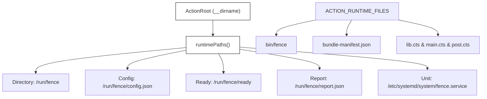
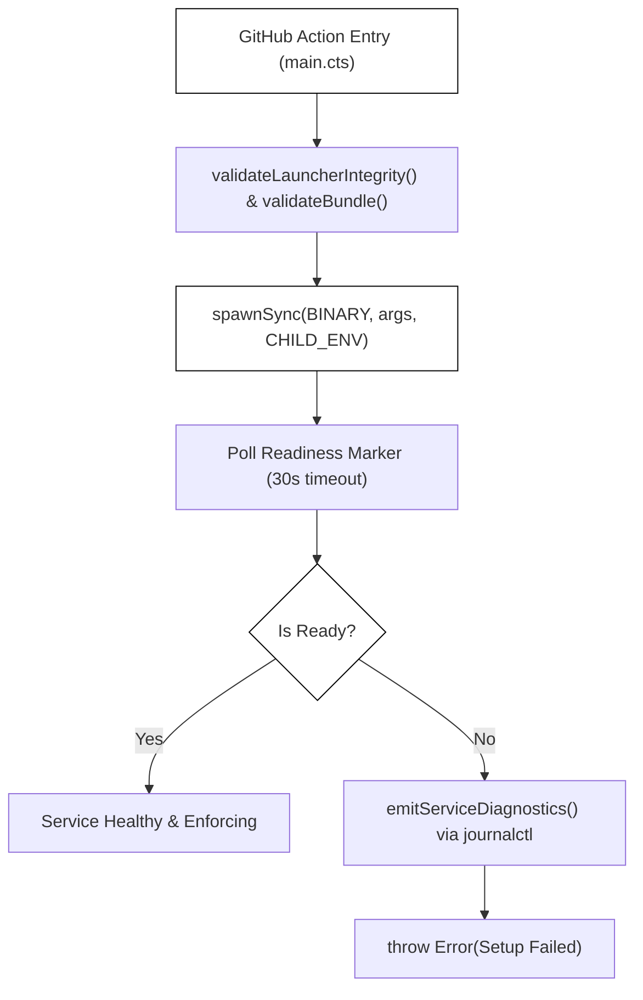
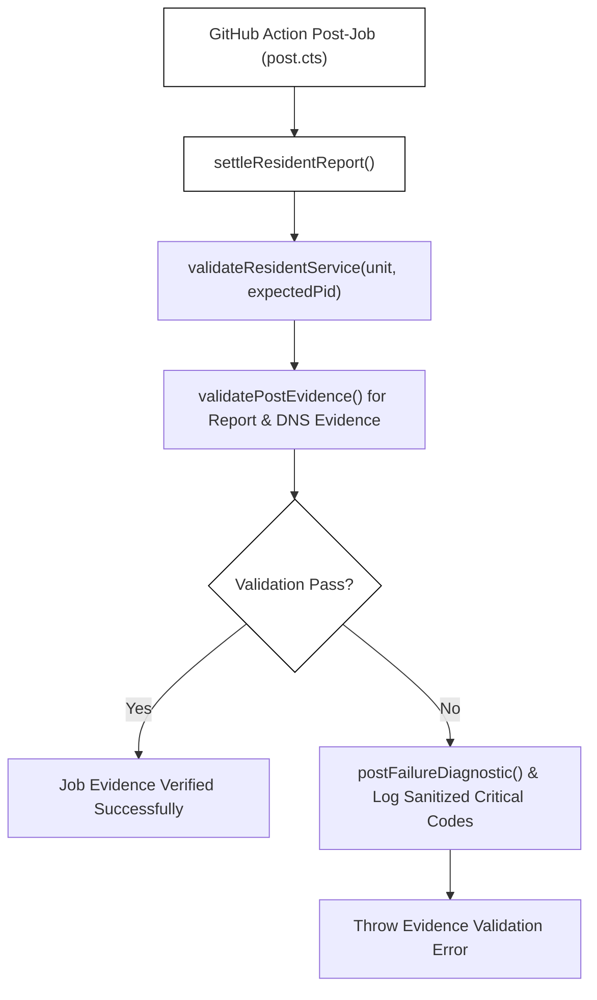

<!-- source: DeepWiki mcp.deepwiki.com · repo openai/fence · page 3.1 Main and Post Steps · fetched 2026-10-26 -->

# Main and Post Steps

Relevant source files

The following files were used as context for generating this wiki page:

- [action/lib.cts](action/lib.cts)
- [action/main.cts](action/main.cts)
- [action/post.cts](action/post.cts)

### Purpose and Scope
This page details the implementation of the GitHub Action wrapper's core execution phases found in `action/main.cts`, `action/post.cts`, and supporting utility functions in `action/lib.cts`. These modules manage the secure setup, binary and bundle verification, service invocation, and post-job evidence validation of Fence on GitHub Actions runners.

---

## 1. Runtime Architecture and Path Resolution (`action/lib.cts`)
The wrapper establishes strict path isolation and state boundaries using predefined runtime root directories (`/run/fence` and `/run/fence-launcher`) [action/lib.cts:182-183](). The `RuntimePaths` type and `runtimePaths()` function define structured paths for configuration, readiness markers, enforcement reports, DNS reports, and systemd units [action/lib.cts:9-19](). 

Files required for action execution are explicitly declared in `ACTION_RUNTIME_FILES`, ensuring that any unauthorized modification or foreign file present in the action bundle causes validation to fail [action/lib.cts:184-191]().

*Diagram 1: Runtime Paths and Action Manifest Validation Mapping*

Sources: [action/lib.cts:9-19](), [action/lib.cts:182-191]()

---

## 2. Setup and Execution Pipeline (`action/main.cts`)
The main step execution begins when GitHub Actions invokes `action/main.cts`. The script initializes environment constraints, validates launcher integrity (`validateLauncherIntegrity`), and inspects the bundle manifest (`validateBundle`) [action/main.cts:31-50]().

The core setup loop performs the following operations:
1. **Environment and Input Parsing**: Native inputs are read from the environment via `nativeInputsFromEnvironment` and validated [action/main.cts:15]().
2. **Binary Invocation**: The Fence binary (`bin/fence`) is executed via `spawnSync` with constrained environment variables (`CHILD_ENV`) to configure nftables, setup the DNS mediator, and lock down the runner [action/main.cts:32](), [action/main.cts:65]().
3. **Readiness Polling**: `main.cts` polls the readiness path (`READY_TIMEOUT_MS = 30 * 1000`) to confirm that resident workers (`host_tcp_dns`, `host_udp_dns`, `process_attribution`) have successfully initialized [action/lib.cts:170-174](), [action/main.cts:34]().
4. **Diagnostic Fallbacks**: If service startup fails, `emitError` captures journal entries using `fenceErrorCodeFromJournal` and `localControlDiagnosticFromJournal` to output actionable error codes [action/main.cts:52](), [action/main.cts:166](), [action/main.cts:190]().

*Diagram 2: Main Step Setup and Readiness Verification Flow*

Sources: [action/main.cts:31-50](), [action/main.cts:58-81](), [action/main.cts:166-213]()

---

## 3. Post-Job Evidence Validation (`action/post.cts`)
When a workflow job completes, GitHub Actions executes `action/post.cts`. The post step collects, settles, and validates runtime evidence to guarantee that no unauthorized egress bypasses occurred during job execution.

Key components of `action/post.cts`:
- **Evidence Settling**: `settleResidentReport()` reads and settles resident enforcement reports over a bounded retry loop (`EVIDENCE_SETTLE_MAX_READS = 4`) to account for in-flight audit events [action/post.cts:39-42](), [action/post.cts:189-194]().
- **Service Status Verification**: `validateResidentService()` executes `/usr/bin/systemctl show` to assert that the `fence` systemd unit maintained an active PID and healthy state throughout the job [action/post.cts:137-161]().
- **Post Evidence Validation**: `validatePostEvidence()` evaluates resident and DNS evidence against strict schema rules, intercepting anomalies and logging sanitized diagnostics via `postFailureDiagnostic()` if critical errors are present [action/post.cts:95-130]().

*Diagram 3: Post-Job Evidence Settling and Validation Sequence*

Sources: [action/post.cts:37-48](), [action/post.cts:95-130](), [action/post.cts:137-161]()

---

## 4. Error Taxonomy and Diagnostics
Both `action/main.cts` and `action/post.cts` implement strict error bounds to prevent raw system data from leaking into workflow logs. 

- **Failure Critical Codes**: `post.cts` maintains a closed set (`FAILURE_CRITICAL_CODES`) covering worker panics, routing drifts, nflog failures, and attribution channel disconnections [action/post.cts:51-91]().
- **Sanitized Diagnostics**: When evidence validation fails, `postFailureDiagnostic()` projects only recognized critical codes and bounded metadata, avoiding unstructured stack dumps [action/post.cts:95-117]().

Sources: [action/post.cts:51-117]()

---

