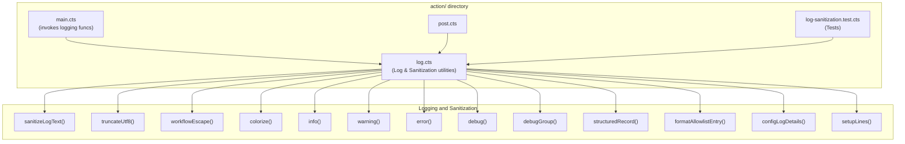
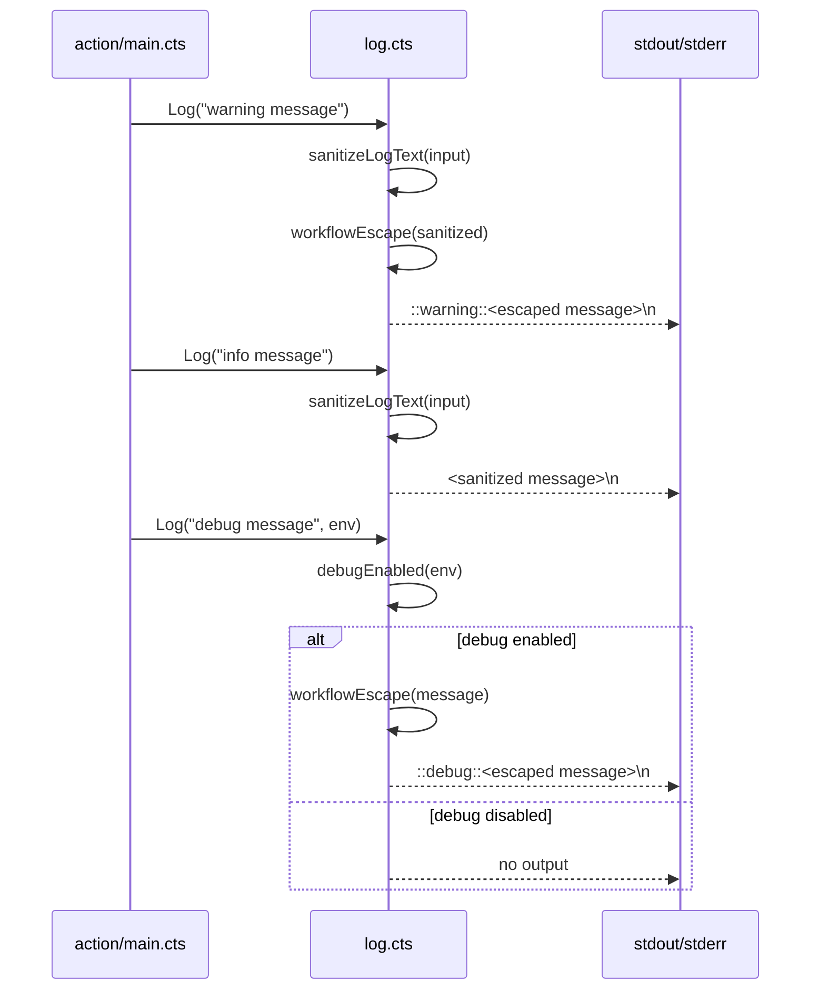

<!-- source: DeepWiki mcp.deepwiki.com · repo openai/fence · page 3.2 Logging and Sanitization · fetched 2026-10-26 -->

# Logging and Sanitization

Relevant source files

The following files were used as context for generating this wiki page:

- [action/log-sanitization.test.cts](action/log-sanitization.test.cts)
- [action/log.cts](action/log.cts)
- [action/test.cts](action/test.cts)

This page documents the logging and sanitization functionality implemented in the GitHub Action wrapper of the Fence project, located primarily in `action/log.cts` along with its associated tests in `action/log-sanitization.test.cts`. This code is responsible for formatting log messages, enforcing consistent secret sanitization and escaping rules for GitHub Actions workflow logs, and providing a test harness for validating these logging behaviors.

---

## Purpose and Scope

The logging layer in the Fence GitHub Action wrapper:

- Formats logs consistently for various output types including info, warning, error, debug, and structured JSON records.
- Sanitizes log messages by removing control characters and truncating overly long strings to maintain readability and prevent log injection or corruption.
- Implements GitHub Actions workflow commands escaping to safely surface dynamic content as workflow commands (like `::error::`).
- Supports colorized output contingent on environment variables to optionally enhance readability.
- Provides test coverage asserting correct sanitization and message handling.

This layer is strictly an *action-side* utility; it does not implement enforcement or business logic but rather supports safe and structured output during action execution.

---

## Overview of Implementation

### Constants and Limits

- `MAX_LOG_LINE_BYTES` (2048 bytes) restricts maximum byte-length of standard log lines.
- `MAX_DEBUG_LINE_BYTES` (4096 bytes) restricts debug message lengths.
- `STRUCTURED_REPORT_PREFIX = "FENCE_REPORT_JSON="` is the mandatory prefix for structured JSON report lines.
- `MAX_STRUCTURED_REPORT_BYTES` (from `lib.cts`) limits JSON report length to prevent excessive output.

These limits ensure logs remain reasonably sized and prevent runaway outputs.

### Sanitization Functions

- **`sanitizeLogText(value, maximumBytes = MAX_LOG_LINE_BYTES): string`**  
  Converts the input to string and replaces all C0 and C1 control characters (`\u0000`-`\u001F` and `\u007F`-`\u009F`), as well as Unicode line separators (`\u2028`, `\u2029`), with underscores (`_`).  
  Newlines (`\r`, `\n`) get replaced by spaces, flattening multi-line inputs to a single line.  
  If the sanitized string starts with `::` (GitHub Actions workflow commands), it prepends an underscore to avoid unwanted command parsing.  
  The output is truncated to the max configured UTF-8 byte length.

- **`workflowEscape(value): string`**  
  Builds on `sanitizeLogText`, additionally escaping:  
  `%` → `%25`  
  `\r` → `%0D`  
  `\n` → `%0A`  
  This allows safe embedding of arbitrary text inside GitHub Actions "workflow commands" such as `::error::` or `::warning::`.

- **`truncateUtf8(value, maximumBytes)`**  
  Truncates the UTF-8 string at a byte boundary so total byte length fits within `maximumBytes`, appending `...[truncated]` suffix if truncation occurred.

These sanitizations prevent log injection, malformed outputs, or misinterpretation by the Actions runner.

### Color Support and Environment Flags

- Colors are implemented using ANSI escape codes mapped by name (`highlight`, `info`, `success`, `warning`, `error`).
- The `colorize(value, color, environment)` function wraps a string with the appropriate ANSI codes unless environment variables `NO_COLOR` or similar disable colors.
- Debug output is gated by environment variables `RUNNER_DEBUG` or `ACTIONS_STEP_DEBUG`, enabling trace-level logs only when requested.

### Log Output Functions

Fence defines distinct helpers for common logging scenarios:

| Function  | Behavior                                                                    |
| --------- | --------------------------------------------------------------------------- |
| `info`    | Prints sanitized informational messages to stdout                           |
| `success` | As `info`, but colorizes output green when colors enabled                   |
| `warning` | Prints warnings as GitHub Actions warning commands (::warning::...)          |
| `error`   | Prints errors as GitHub Actions error commands (::error::...)               |
| `debug`   | Prints debug commands (gated by debug env vars) (::debug::...)               |
| `debugGroup` | Groups debug lines with `::group::` and `::endgroup::` markers, gated by debug mode |
| `structuredRecord` | Writes validated structured report JSON lines with mandatory prefix, verifying UTF-8 bounds, JSON validity, and schema |

These helpers ensure consistent and safe logging semantics during the action runtime.

### Formatting Helpers

- **`formatAllowlistEntry`** formats allowlist entries into colon-separated strings with fields `destination_type:destination:protocol:port`.
- **`configLogDetails`** parses a JSON config string and extracts key configuration details for logging (mode, source, policy, allowlist counts, flags).
- **`setupLines`** creates the basic startup banner lines including version, mode icon (`👀` or `🔒`), and allowlist summary.

---

## Data Flow and Usage

Typical usage within the Fence action involves:

1. Parsing raw action input or configuration to JSON.
2. Sanitizing and formatting log lines before output to `stdout` or `stderr`.
3. Conditional colorizing or debug gating depending on environment.
4. Emitting structured JSON reports with strict validation.
5. Tests trigger these utilities with crafted inputs confirming correct sanitization (e.g., replacing Unicode line separators, control codes) and length handling.

The logs flow from the action wrapper code (`action/main.cts`) through these utilities and terminate in GitHub Actions virtual console output.

---

## Key Code Entities and Relationships

**Description:**

- The `action/main.cts` and `post.cts` steps call into `log.cts` for standardized logging.
- The `log.cts` module exports essential functions like `sanitizeLogText()`, `workflowEscape()`, and output helpers `info()`, `error()`, `debug()`.
- The tests in `log-sanitization.test.cts` directly exercise sanitization and escaping, confirming transformations and boundary truncation.

Sources: `action/log.cts:1-181`, `action/log-sanitization.test.cts:1-23`, `action/test.cts:1-194`()

---

## Sanitization and Escaping Rules in Detail

Fence must guard against problems caused by control characters inside log messages:

- Unprintable C0 controls (e.g., `\u0000`–`\u001F` except `\r`, `\n`) and C1 controls (`\u0080`-`\u009F`) are replaced with `_`.
- Unicode line separators `\u2028` and `\u2029` become `_` to prevent breaking JSON or logs.
- Newline characters become spaces in `sanitizeLogText()` to keep all log lines single-line, which helps prevent log injection or corrupted multi-line logs.
- Messages beginning with `::` are prefixed with `_` to prevent unintentional GitHub Actions workflow command injection.
- In `workflowEscape()`, `%` characters are percent-encoded to `%25`, and `\r`, `\n` become `%0D` and `%0A` for embedding inside GitHub workflow commands.
- All outputs truncated at configured byte limits to prevent excessive log sizes.

These rules ensure logs remain clearly visible and correctly parsed by GitHub runners without accidental command execution or ill-formatted output.

### Test Coverage Example

The test `sanitizes C1 controls and Unicode line separators` shows:

- Control characters injected in a string get replaced by `_`.
- Unicode line separators are replaced by underscores.
- Workflow command characters like `%` are escaped properly.
- The debug line maximum byte length (4096) is respected, truncating appended `%` signs and adding `...[truncated]` suffix.

This test ensures robust sanitization and escaping behavior is maintained.

Sources: `action/log.cts:43-56`, `action/log-sanitization.test.cts:7-22`()

---

## Structured JSON Report Validation

Fence defines structured report lines prefixed with `FENCE_REPORT_JSON=` that contain canonical JSON payloads representing enforcement reports or diagnostics.

The `structuredRecord(line)` function verifies:

- The line starts with `FENCE_REPORT_JSON=`.
- The line does not include control characters or newlines, ensuring a single-line JSON string.
- Byte length is below `MAX_STRUCTURED_REPORT_BYTES` (max 16 KiB).
- The JSON parses successfully.
- The JSON object is not `null` or an array.
- The `schema_version` field equals 1.
- The re-stringified JSON exactly matches the original line suffix, enforcing canonical JSON formatting.

Upon passing validation, the line is safely written as a log line.

This strict validation prevents malformed or corrupted structured log data that downstream consumers might fail to parse.

Sources: `action/log.cts:73-101`()

---

## Logging Output Functions

Fence differentiates logging by semantic level with dedicated functions:

| Function       | Output Stream | GitHub Command Format       | Color    | Debug Gated |
|----------------|---------------|-----------------------------|----------|-------------|
| `info()`       | stdout        | plain sanitized string       | no       | no          |
| `success()`    | stdout        | plain sanitized string       | green    | no          |
| `warning()`    | stdout        | `::warning::<escaped message>` | no       | no          |
| `error()`      | stderr        | `::error::<escaped message>`  | no       | no          |
| `debug()`      | stdout        | `::debug::<escaped message>`  | no       | yes         |
| `debugGroup()` | stdout        | `::group::<title>` ... `::endgroup::` | no       | yes         |

- `info()` and `success()` sanitize and write lines with optional ANSI colors.
- `warning()` and `error()` use GitHub Actions annotations to mark problems inline in the workflow UI.
- `debug()` and `debugGroup()` only output if debug mode is enabled via env `RUNNER_DEBUG` or `ACTIONS_STEP_DEBUG`.
- `success()` applies green color unless `NO_COLOR` disables it.

This separation of concerns ensures logs are properly categorized, and debugging output is quiet by default.

Sources: `action/log.cts:58-131`()

---

## Configuration Summary Logging

The function `configLogDetails(rawConfig: string, usingDefault: boolean): ConfigLogDetails`:

- Parses a raw JSON string representing Fence's configuration.
- Extracts fields like mode (`audit` or `block`), container policy, platform profile, flags to disable wide GitHub domain coverage or enable GitHub artifacts.
- Counts and formats allowlist entries for logging.
- Returns a structured object used to generate human-readable startup summary logs.

This summary config info is surfaced in logs to assist operators in understanding the Fence runtime behavior.

Sources: `action/log.cts:144-164`()

---

## Summary: Logging Flow

This shows how different log message categories are processed through sanitization, escaping, and conditional output.

Sources: `action/log.cts:43-131`()

---

# Summary

The Fence GitHub Action wrapper's logging and sanitization module provides essential utilities to cleanly format, sanitize, escape, and emit logs for the action runtime. It confines output sizes, ensures safe encoding of control characters and workflow commands, supports colorized and structured JSON reporting, and gates verbose debug logs by environment flags. The test suite validates these properties rigorously. This module ensures the Fence action communicates critical information and diagnostics safely and clearly through GitHub Actions workflows.

---

Sources:  
`action/log.cts:1-181`  
`action/log-sanitization.test.cts:1-23`  
`action/test.cts:1-194`

---

