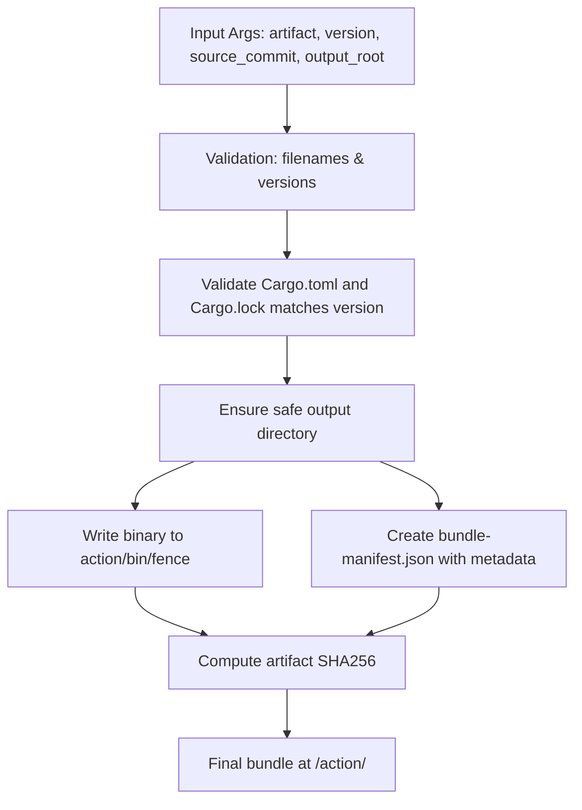
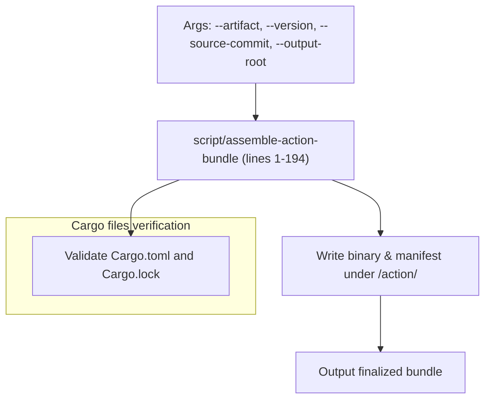
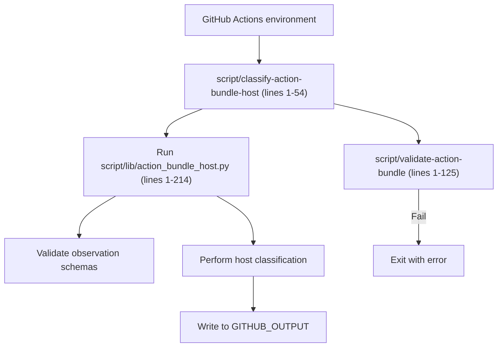

<!-- source: DeepWiki mcp.deepwiki.com · repo openai/fence · page 3.3 Action Bundle Assembly and Host Classification · fetched 2026-10-26 -->

# Action Bundle Assembly and Host Classification

<details>
<summary>Relevant source files</summary>

The following files were used as context for generating this wiki page:

- [.github/action-bundle-host-transitions.json](.github/action-bundle-host-transitions.json)
- [script/assemble-action-bundle](script/assemble-action-bundle)
- [script/classify-action-bundle-host](script/classify-action-bundle-host)
- [script/lib/action_bundle_host.py](script/lib/action_bundle_host.py)
- [script/lib/action_release.py](script/lib/action_release.py)
- [script/validate-action-bundle](script/validate-action-bundle)

</details>


This section covers the detailed mechanisms behind the assembly, validation, and host classification of the Fence GitHub Action bundle. It explains how Fence's executable binary and metadata are packaged into a coherent release artifact and how the hosted runner environment is classified to verify compatibility and security posture.

---

## Purpose and Scope

Fence integrates a Rust-based network egress filtering CLI with a GitHub Action wrapper. The resulting "Action bundle" contains the Fence binary and a signed metadata manifest, assembled and validated using supporting scripts. Additionally, the host environment (typically a GitHub hosted runner) is classified to ensure the bundle runs on a trusted platform profile.

This page details:

- The assembly process producing the final action bundle artifact.
- Validation steps enforcing artifact integrity and schema compliance.
- Host classification logic analyzing platform observations against known runner fingerprints.
- Key implementation details in the supporting scripts and libraries.
- Relevant data flows and verification steps modularized across scripts.

---

## 1. Action Bundle Assembly (`script/assemble-action-bundle`)

The `script/assemble-action-bundle` Bash script is the entrypoint for producing a finalized Fence GitHub Action bundle release artifact.

### Inputs

- `--artifact <path>`: Path to the Fence binary artifact to bundle.
- `--version <X.Y.Z[-prerelease]>`: SemVer version string of the release.
- `--source-commit <sha>`: Full 40-character git commit SHA corresponding to the release source.
- `--output-root <path>`: Absolute directory path to write the bundle output.

### Process Overview

- Validates script requirements and inputs.
- Checks that the artifact filename matches the expected pattern for the version (e.g., `fence_v1.2.3_linux-amd64`).
- Parses Cargo manifest (`Cargo.toml`) and lockfile (`Cargo.lock`) in the repository root to verify version consistency with supplied release version.
- Ensures output root fits within allowed directories to avoid unsafe symlink or directory traversal risks.
- Writes the bundle contents atomically inside `<output-root>/action/`, including:
  - The Fence binary at `action/bin/fence`.
  - A signed manifest JSON file describing the release metadata.
- Computes and includes SHA256 hashes of the binary data.
- Outputs the action directory tree ready for packaging or direct use by GitHub Actions.

### Data Flow Diagram: Action Bundle Assembly



**Sources:** `script/assemble-action-bundle:1-194`()

---

## 2. Action Bundle Validation (`script/validate-action-bundle`)

Before use or release, an action bundle is verified for consistency and integrity by the `script/validate-action-bundle` script.

### Validation Steps

- Requires presence of both `action/bin/fence` and `action/bundle-manifest.json` files; neither can be missing or symlinked.
- Checks filesystem safety of directories and files (no symlinks, ensure standard file types).
- Loads and parses the JSON manifest, verifying expected schema keys and fixed values:
  - Schema version (must be 4).
  - Repository name fixed to `"openai/fence"`.
  - Release tag is a valid SemVer tag with no trailing metadata.
  - Release channel matches tag pattern (`stable` or `prerelease`).
  - Source commit SHA format.
  - Artifact name matches expected pattern.
  - Checksums are valid hexadecimal hashes of expected length.
  - Signing workflow references and digests match expectations.
- Computes SHA256 hash of binary and compares to manifest digest.
- Exits successfully only if all validations pass.

### Validation Flow Diagram: Action Bundle Verification

```mermaid
flowchart TD
  A[Check presence of manifest and binary] --> B[Check for unsafe symlinks or directory types]
  B --> C[Parse and validate JSON manifest schema]
  C --> D[Regex check on release_tag, commit SHAs, artifact names]
  D --> E[Compare computed SHA256 of binary with manifest]
  E --> F{All checks pass?}
  F -->|Yes| G[Print "Action bundle verified"]
  F -->|No| H[Exit failure with error message]
```

**Sources:** `script/validate-action-bundle:1-125`()

---

## 3. Host Classification (`script/classify-action-bundle-host` and `script/lib/action_bundle_host.py`)

Host classification determines if the current environment is trusted or recognized by Fence, based on a detailed runtime observation and the action bundle's support data.

### `script/classify-action-bundle-host` Bash Script

- Ensures it runs only inside GitHub Actions with `CI=true` and `GITHUB_ACTIONS=true`.
- Restricts platform to Linux x86_64 for compatibility.
- Confirms the presence of required files:
  - Observation JSON file from runtime at `$RUNNER_TEMP/fence-hosted-runner-observation.json`.
  - Support file from Fence CLI at `$RUNNER_TEMP/fence-action-bundle-support.json`.
  - The Fence binary inside the bundle.
  - Transitions JSON from the repository `.github/action-bundle-host-transitions.json`.
- Performs validation on the action bundle (calls `script/validate-action-bundle`).
- Creates a temporary protected directory and copies the Fence binary and manifest with safe permissions.
- Runs the Fence CLI binary's `check-support` command, writing output to support JSON.
- Invokes the Python classification library `script/lib/action_bundle_host.py` with the observation, support, transitions, and GitHub Actions outputs.

### `script/lib/action_bundle_host.py`

This Python module contains the core classification logic:

- Defines many validation functions verifying the shapes and data types of the observation JSON.
- Defines constants for known schemas and fingerprints related to Unix socket names, sudo policy digests, and test fixture digests.
- Validates fingerprint items with strict type and key presence checks.
- Provides helpers to index fingerprint items by key tuples for efficient lookups.
- Ensures SHA256 and Unix permission modes conform to expected formats.
- Checks the host's ownership, processes, socket listeners, containerization, and other metadata for consistency and trustworthiness.
- Raises `ClassificationError` if the observation does not meet reviewed profiles.
- Reads the observation and support JSON files.
- Uses host fingerprint and transition metadata to classify the host environment.
- Writes classification results to the `GITHUB_OUTPUT` file to be used by the calling GitHub Action or workflow.

### Data Flow Diagram: Host Classification

```mermaid
flowchart TD
  A[GitHub Action Platform (Linux x86_64 & CI=true)] --> B[Load Observation from fence-hosted-runner-observation.json]
  A --> C[Load Support Data from fence-action-bundle-support.json]
  A --> D[Fence Binary from action/bin/fence]
  A --> E[Read Transitions JSON from .github/action-bundle-host-transitions.json]

  B --> F[Python classify_action_bundle_host.py]
  C --> F
  D --> F
  E --> F

  F --> G[Validate schemas, fingerprints, and host properties]
  G --> H{Host matches known profile?}
  H -->|Yes| I[Write classification outcome to GITHUB_OUTPUT]
  H -->|No| J[Raise ClassificationError, exit failure]
```

### Classification Output

- The classification results influence conditional execution paths in workflows.
- It asserts that the host runtime matches reviewed and secure profiles before running Fence enforcement steps.

---

## 4. Release Metadata and Transitions (`script/lib/action_release.py`, `.github/action-bundle-host-transitions.json`)

- `action_release.py` handles detailed release metadata checks and formatting for semantic versioning, artifact naming, and compatibility with Git tags and published releases.
- `.github/action-bundle-host-transitions.json` currently contains an empty transitions list; it is designed to encode possible state or profile transitions for classifier state machines but is unused at present.

---

## Summary Table of Key Scripts and Files

| Component                        | Purpose                                                  | Location                              |
|---------------------------------|----------------------------------------------------------|-------------------------------------|
| Assemble action bundle           | Combine Fence binary + manifest into distributable form | `script/assemble-action-bundle`     |
| Validate action bundle           | Validate artifact's safety, format, and integrity       | `script/validate-action-bundle`     |
| Host classification script      | Orchestrates observation and bundle support classification on runner | `script/classify-action-bundle-host`|
| Host classification logic       | Validates runner observation and classifies host        | `script/lib/action_bundle_host.py`  |
| Release metadata verification   | Semantic version validation and release metadata parsing| `script/lib/action_release.py`      |
| Transitions description         | Declares recognized host state transitions (empty now)  | `.github/action-bundle-host-transitions.json` |

---

# Summary Diagrams Bridging Natural Language to Code Entities

### Diagram 1: Action Bundle Assembly Workflow with Code Reference



### Diagram 2: Host Classification and Validation with Code Components



---

# Conclusion

This section details the complete lifecycle from assembling Fence's GitHub Action runtime bundle, validating it thoroughly for security and integrity, to classifying the hosting environment to ensure compatibility and trust. Together, these components safeguard Fence operation within CI workflows and prevent misuse or execution on untrusted hosts.

For implementation, see each script noted for exact line references and code behavior.

---

**Sources:**  
- `script/assemble-action-bundle:1-194`  
- `script/validate-action-bundle:1-125`  
- `script/classify-action-bundle-host:1-54`  
- `script/lib/action_bundle_host.py:1-214`  
- `script/lib/action_release.py:1-192`  
- `.github/action-bundle-host-transitions.json:1-4`

---

