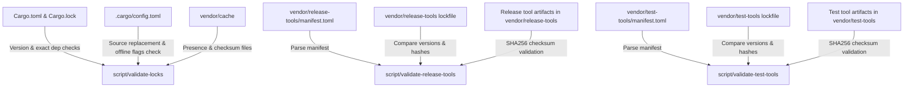
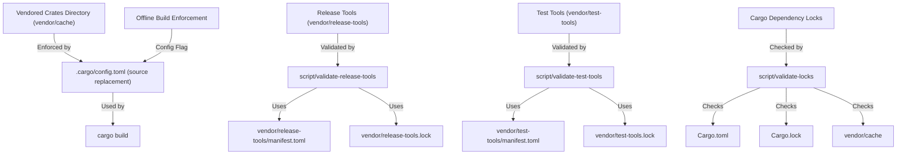
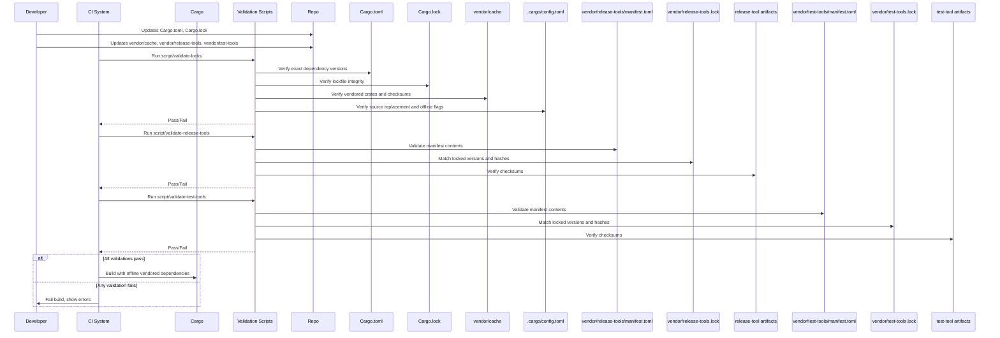

<!-- source: DeepWiki mcp.deepwiki.com · repo openai/fence · page 4.2 Vendor Directory and Offline Builds · fetched 2026-10-26 -->

# 4.2 Vendor Directory and Offline Builds

<details>
<summary>Relevant source files</summary>

The following files were used as context for generating this wiki page:

- [.cargo/config.toml](.cargo/config.toml)
- [Cargo.lock](Cargo.lock)
- [script/validate-locks](script/validate-locks)
- [script/validate-release-tools](script/validate-release-tools)
- [script/validate-rust-toolchain](script/validate-rust-toolchain)
- [script/validate-test-tools](script/validate-test-tools)
- [script/validate-update-tools](script/validate-update-tools)

</details>


This section details Fence's approach to vendoring Rust crate sources and build/test tooling to achieve fully hermetic offline builds. It covers the structure and purpose of the vendor directories, the Cargo configuration enforcing offline usage and source replacement, and the validation scripts that verify lockfile integrity and vendor consistency. This ensures reproducible, secure builds without network dependencies during CI or developer build runs.

---

## 4.2.1 Vendoring Crate Sources and Build Tools

Fence uses a vendoring strategy to package all third-party Rust dependencies, release tools, and test tools inside the repository. This minimizes external network access, improves build repeatability, and reduces supply chain risks.

- **Vendored Crate Sources**:  
  All Rust crate source code is cached under `vendor/cache`. This directory contains the exact versions of all crates specified by `Cargo.lock`. Cargo is configured to use this directory in place of crates.io, enabling offline compilation.

- **Vendored Release Tools**:  
  Release-related tools (like Zig compiler distributions and cargo-zigbuild) are stored in `vendor/release-tools`. These are packaged in archives referenced by a `manifest.toml` and locked to exact versions/hashes.

- **Vendored Test Tools**:  
  Test tooling binaries such as `cargo-llvm-cov` and its licenses are vendored under `vendor/test-tools`. These tools are also version-locked using manifest files and lockfiles.

This multi-directory vendoring scheme supports binary and source dependencies required to build, test, and release Fence. Changes to these vendored sources or tools are strictly controlled by corresponding manifest and lockfile updates.

---

## 4.2.2 Cargo Source Replacement and Offline Enforcement

To enforce use of vendored crate sources and prevent network access during builds, Fence leverages Cargo's source replacement and offline mode features configured in `.cargo/config.toml`:

```toml
[source.crates-io]
replace-with = "vendored-sources"

[source.vendored-sources]
directory = "vendor/cache"

[net]
offline = true
```

### Key Effects:

- The default crates.io registry source is replaced with `vendored-sources` pointing to `vendor/cache`.  
- Cargo operates in offline mode by default, which disallows any network access for dependency resolution or crate downloads.

This configuration enforces consistent builds that do not fetch dependencies from the network, but read all crates directly from the local vendored cache.

---

## 4.2.3 Validation Scripts for Vendoring Integrity

Fence includes several validation scripts executed in CI or manually to verify that vendoring remains consistent, complete, and locked.

These scripts perform checks such as:

- Ensuring `Cargo.toml` and `Cargo.lock` dependencies use exact versions (no ranges).  
- Verifying `.cargo/config.toml` contains the correct source replacement and offline flags.  
- Checking the vendor directories contain correct crate checksum files (`.cargo-checksum.json`) to ensure crates are intact.  
- Confirming vendored release and test tools match locked manifests and their SHA-256 checksums.  
- Enforcing that CI workflow files and GitHub actions use fully pinned commit SHAs or digest references.  
- Prohibiting direct commit of certain vendor subdirectories like `vendor/update-tools` which are managed differently.

The primary validation scripts are:

| Script                     | Purpose                                                                |
|----------------------------|------------------------------------------------------------------------|
| `script/validate-locks`    | Validates vendored crates and Cargo config for offline and exact deps. |
| `script/validate-release-tools` | Verifies `vendor/release-tools` manifest and lockfile consistency and artifact checksums. |
| `script/validate-test-tools`| Checks `vendor/test-tools` manifest and lockfile plus artifact hashes.  |

### Validation Data Flow



This strict validation pipeline guarantees that any change to vendored dependencies or tooling is intentional and verified, preserving offline build hermeticity.

---

## 4.2.4 Offline Build Enforcement and Supply Chain Safety

- The offline mode in `.cargo/config.toml` disallows network access during build time, blocking accidental crate fetches.
- Replace-with config ensures dependencies resolve only from `vendor/cache`.
- Lockfiles and manifests for release and test tools pin not only versions but also download URLs and SHA-256 checksums, preventing tampering or supply chain attacks.
- Validation scripts check that:
  - Only exact version dependencies are declared.
  - Bundled binaries and source archives checksum match asserted values.
  - CI workflows pin GitHub Actions to immutable commit SHAs or digests.
  - No unsafe or relative paths are introduced.

This cohesive system means Fence builds in a controlled environment with verified dependencies and tools, maintaining strong supply chain integrity.

---

## 4.2.5 Relevant Code and Files

### `.cargo/config.toml` [`.cargo/config.toml:1-9`]()  
Shows Cargo configuration for source replacement and offline mode enforcement.

### `Cargo.lock` [Cargo.lock:1-244 (partial)]()  
Locks all Rust crate dependencies with exact versions and checksums for vendoring.

### `script/validate-locks` [script/validate-locks:1-134]()  
Main script validating vendor cache, Cargo config, dependency versions, and CI workflow pinning.

### `script/validate-release-tools` [script/validate-release-tools:1-154 (partial)]()  
Validates release tools manifests, lockfiles, versions, and ZIP artifact checksums.

### `script/validate-test-tools` [script/validate-test-tools:1-118]()  
Validates test tools manifests, lockfiles, artifact checksums, and offline-only script behavior.

---

## 4.2.6 Diagram: From Natural Language Components to Key Code Entities



---

## 4.2.7 Diagram: Vendoring and Validation Workflow in CI



---

## Summary

Fence achieves hermetic offline builds and supply chain security through:

- A strict vendoring strategy for all Rust crates (`vendor/cache`) and build/test/release tooling (`vendor/release-tools`, `vendor/test-tools`).
- Cargo source replacement and offline mode configuration in `.cargo/config.toml`.
- Comprehensive validation scripts (`validate-locks`, `validate-release-tools`, `validate-test-tools`) to verify exact pinned versions, checksums, and manifest consistency.
- CI enforcement to avoid network usage and ensure reproducible builds that use only trusted vendored artifacts.

This architecture enables secure, repeatable Fence builds in both local and CI environments without exposing the build to external network dependencies or hostile supply chain alterations.

---

### Sources

- `.cargo/config.toml:1-9`
- `Cargo.lock:1-244 (partial)`
- `script/validate-locks:1-134`
- `script/validate-release-tools:1-154 (partial)`
- `script/validate-test-tools:1-119`

---

