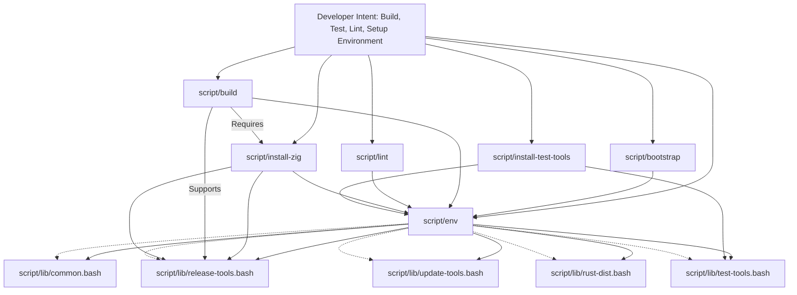
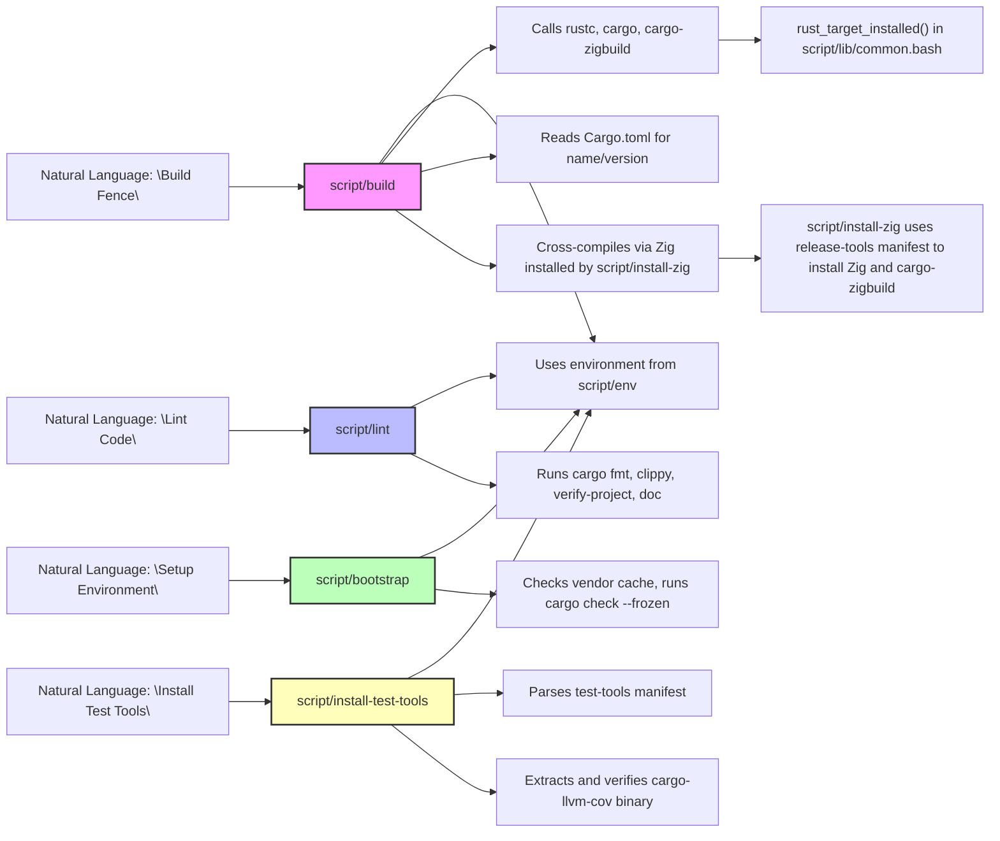

<!-- source: DeepWiki mcp.deepwiki.com · repo openai/fence · page 4.3 Developer Scripts · fetched 2026-10-26 -->

# Developer Scripts

Relevant source files

The following files were used as context for generating this wiki page:

- [rustfmt.toml](rustfmt.toml)
- [script/bootstrap](script/bootstrap)
- [script/build](script/build)
- [script/env](script/env)
- [script/install-test-tools](script/install-test-tools)
- [script/install-zig](script/install-zig)
- [script/lib/common.bash](script/lib/common.bash)
- [script/lib/release-tools.bash](script/lib/release-tools.bash)
- [script/lib/rust-dist.bash](script/lib/rust-dist.bash)
- [script/lib/test-tools.bash](script/lib/test-tools.bash)
- [script/lib/update-tools.bash](script/lib/update-tools.bash)
- [script/lint](script/lint)
- [script/prepare-rust](script/prepare-rust)
- [script/server](script/server)
- [script/test](script/test)
- [script/update](script/update)

This section details the developer-oriented scripts found under the `script/` directory of the Fence repository. These scripts serve as entrypoints for common developer workflows such as bootstrapping the environment, building the project, linting, testing, running a local server, updating dependencies, preparing Rust toolchains, installing Zig, and installing test-specific tools. They rely on shared bash helper libraries for common tasks such as version management, path validation, and vendored tool installation.

---

## 1. Overview

The developer scripts provide convenient, standardized ways to bootstrap the development environment, compile Fence, ensure code quality, run tests, and manage vendored tool dependencies. Each script is a bash executable that:

- Sources a common environment loading script (`script/env`), which sets shell options, environment variables, colors, directories, and utility functions.
- Validates prerequisites such as Rust toolchain presence or vendored cache integrity.
- Implements task-specific logic using bash functions and helpers.
- Extensively uses version pinning and checksum validation to ensure reproducible builds and tool installs.

The scripts are arranged roughly as follows:

| Script               | Purpose                                                                                              |
|----------------------|----------------------------------------------------------------------------------------------------|
| `bootstrap`          | Ensures Rust toolchain setup, required commands, and vendor cache presence to enable builds.       |
| `build`              | Builds the Rust project with optional flags for release, target triples, distribution directory.   |
| `env`                | Defines the environment, exports variables, sets colors, loads helper functions, and validates tooling versions.               |
| `lint`               | Runs formatting checks, Clippy linting (with warnings as errors), project verification, and builds documentation.                |
| `test`               | Runs the test suite, including unit, integration, and privileged tests (not shown fully here).      |
| `server`             | Runs a local testing server (less detailed here).                                                  |
| `update`             | Runs update workflows for locked dependencies (not shown fully).                                  |
| `prepare-rust`       | Sets up Rust toolchains and targets as pinned in the repo (not shown fully).                       |
| `install-zig`        | Installs the vendored Zig compiler and the cargo-zigbuild tool in an offline, reproducible manner. |
| `install-test-tools` | Installs pinned test tools, e.g., cargo-llvm-cov, validating against vendored manifests.           |

Common helper functions reside in `script/lib/` sub-scripts like `common.bash`, `release-tools.bash`, `rust-dist.bash`, `test-tools.bash`, and `update-tools.bash`. They provide functions for version reading, checksum verification, archive extraction, path safety checks, vendored artifact validation, and platform detection.

---

## 2. Environment Setup: `script/env`

The foundation of all scripts is `script/env`, which sets:

- Shell strict mode flags (`set -euo pipefail`).
- Color escape sequences for formatted output.
- Environment variables for offline Cargo behavior to prevent unintended network accesses.
- The repository root directory path (`DIR`).
- Imports `script/lib/common.bash`.
- Variables pointing to version lockfiles and vendor directories under `.cargo/tooling/`.
- Functions to read first-line version files.
- Derives the Rust toolchain version pinned in `rust-toolchain.toml` and the host target triple via OS detection.
- Sets default temporary directories in non-CI environments (`RUNNER_TEMP` and `TMPDIR`).
- Detects and exports platform, OS version, and architecture.
- Sets up the Zig compiler root path and caches if vendored Zig is present.
- Sets paths for cargo-zigbuild, cargo-llvm-cov, cargo-audit, and cargo-deny tools if their versions are specified.
- Defines utility functions:
  - `die`, `warn` for error and warning output.
  - `require_cmd` to ensure required commands exist.
  - `ensure_rust_toolchain` checks the Rust version matches the pinned toolchain.
  
This environment script centralizes all reusable environment preparation logic, ensuring consistent behavior across developer scripts.

Sources: `script/env:1-237`, `script/lib/common.bash:1-185` 

---

## 3. Bootstrap Script: `script/bootstrap`

`script/bootstrap` prepares the development environment to a state ready for a build:

- Sources `script/env`.
- Ensures the Rust toolchain is installed and matches the pinned version (`ensure_rust_toolchain`).
- Verifies the presence of the `cargo` command (`require_cmd cargo`).
- Prints the detected Rust version.
- Ensures the vendor cache directory is present with required dependencies (`ensure_vendor_cache`).
- Finally, runs `cargo check --frozen` to verify all dependencies (offline, frozen Cargo lock).
- Checks the git working tree is clean to avoid building from dirty state (`require_clean_git`).

This script provides a fast environment validation step suitable for new developer setups or continuous integration to ensure tooling and vendoring are in order.

Sources: `script/bootstrap:1-18`

---

## 4. Build Script: `script/build`

The `build` script is a configurable Rust compilation helper:

- Sources `script/env`.
- Validates Rust toolchain.
- Supports parameters:
  - `--release`: build release mode.
  - `--target <triple>`: build a single target triple (can be repeated).
  - `--targets <comma-separated list>`: build multiple targets.
  - `--dist-dir <dir>`: output distribution directory (default `dist`).
  - `--universal-darwin`: build universal (fat) binaries for macOS.
- Defaults to building for the host target if no targets specified.
- Extracts package name and version from `Cargo.toml`.
- Determines build version from environment variables (such as GitHub ref name or git tags).
- Verifies that required Rust targets are installed locally or suggests running preparation script.
- Supports cross-compilation using `cargo-zigbuild` and the vendored Zig compiler for non-host targets.
- Builds each target accordingly.
- Clears the distribution directory prior to build output.
- Upon successful local host build, reports the binary path and size.
- For cross-compilation, ensures that `cargo-zigbuild` and `zig` binaries are correct versions, else fails early.
- Supports appending the `*.exe` suffix on Windows.

Key helper functions inside include:

- `first_match` searches for the first matching line in a file.
- `target_exe_suffix` returns `.exe` for Windows.
- `target_os` and `target_arch` correspond to target triple properties.
- `build_date_utc` produces reproducible ISO timestamps, honoring `SOURCE_DATE_EPOCH`.
- `rust_target_installed` validates if a Rust target triple is installed locally.

The script safeguards hermetic builds with offline flags, frozen lockfiles, and vendored dependencies.

Sources: `script/build:1-252` (partial snippet)

---

## 5. Lint Script: `script/lint`

`script/lint` performs code quality checks:

- Sources `script/env`.
- Ensures Rust toolchain.
- Supports `--auto-fix` flag to run `cargo fmt` for automatic formatting fixes, or else checks formatting correctness.
- Runs `cargo clippy` to perform linting on all targets/features with warnings treated as errors.
- Runs `cargo verify-project` to validate project workspace.
- Generates documentation with `cargo doc` including private items for full doc coverage.

This script enforces a high code quality bar and is intended to be run locally or in CI to catch style/lint regressions early.

Sources: `script/lint:1-38`

---

## 6. Installing Vendored Release Tools: `script/install-zig`

Fence leverages vendored builds of Zig and cargo-zigbuild to cross-compile Rust code reproducibly and offline.

The `install-zig` script:

- Sources `script/env` and `script/lib/release-tools.bash` helper functions.
- Ensures Rust toolchain presence.
- Reads the vendored release tool manifest `vendor/release-tools/manifest.toml`.
- Validates the manifest is present, failing if missing.
- Reads pinned Zig version and cargo-zigbuild version from version files and manifest.
- Validates version consistency.
- Detects platform triple for Zig binary from uname (mapping Darwin → macos, etc.).
- Finds the matching Zig tarball and checksum entry from the manifest.
- Validates the Zig tarball exists and sha256 checksum matches.
- Validates tarball entries for unsafe paths.
- Extracts Zig tarball under a dedicated `$RUNNER_TEMP` directory for temporary usage.
- Moves and installs Zig in a dedicated persistent path.
- Adds Zig binary to PATH (and GitHub action path if applicable).
- Similarly installs cargo-zigbuild offline by unpacking vendored crate sources, source archives, and vendor directories.
- Runs `cargo install` with offline flags, locked Cargo.toml, and vendor source replacement.
- Checks version correctness of installed cargo-zigbuild binary.

This script ensures that the exact Zig compiler and tooling the project expects are installed without requiring external network access.

Sources: `script/install-zig:1-177`, `script/lib/release-tools.bash:1-90`

---

## 7. Installing Vendored Test Tools: `script/install-test-tools`

To produce reliable test coverage reports, Fence vendors `cargo-llvm-cov` and related test tooling.

The `install-test-tools` script:

- Sources `script/env` and `script/lib/test-tools.bash`.
- Ensures Rust toolchain.
- Validates vendored test tools manifest (`vendor/test-tools/manifest.toml`) presence.
- Reads host platform triple for the test tools using `test_tools_host_platform`.
- Checks manifest versions, especially for `cargo-llvm-cov`.
- Looks up the vendored `cargo-llvm-cov` artifact path and sha256 checksum in the manifest based on host platform.
- Validates the artifact exists and has a matching checksum.
- Verifies archive entries safety.
- Extracts the artifact into a temporary directory.
- Moves the binary and installs into a dedicated directory under `$RUNNER_TEMP`.
- Updates `PATH` and GitHub action path accordingly.
- Verifies that the binary version matches the expected pinned version.

This ensures hermetic test tooling aligned with the pinned dependencies for consistent CI execution.

Sources: `script/install-test-tools:1-77`, `script/lib/test-tools.bash:1-110`

---

## 8. Shared Bash Helper Libraries: `script/lib/`

To avoid duplication and provide robust utilities, multiple helper bash libraries are used:

### 8.1 `lib/common.bash`

- Defines color codes for shell output.
- Implements essential functions:
  - `sha256_file`, `sha256_stdin`: Computes SHA256 checksums using `shasum` or `sha256sum`.
  - `fetch`: Downloads a file with `curl`.
  - `toml_value`: Extracts string values from toml files.
  - `toml_array`: Formats an array as a toml array literal.
  - `reject_unsafe_relative_path`: Rejects unsafe paths with relative components or rooted at `/`.
  - `validate_tar_entries`: Ensures tar archive entries don't contain unsafe paths.
  - `archive_contains`: Checks if a tar archive contains a specific file entry.
  - `make_temp_dir`: Creates a temporary directory with prefix under a root.
  - `generated_path_allowed`, `require_generated_path`, `remove_generated_path`, `clear_generated_dir`: Validate paths to control code-generated or cache directories and safely delete or clear them.
  - `rust_target_installed`: Checks if a Rust target triple is installed locally.
  - `assert_tool_version`: Verifies that a tool's version matches the expected one from a pinned file.
  
This library is the pillar for path safety, checksum verification, and generic file manipulation used throughout scripts.

### 8.2 `lib/release-tools.bash`

- Parses the release tools TOML manifest.
- Extracts specific entries for Zig releases and cargo-zigbuild tool.
- Detects host platform arch and OS compatible with release tool artifacts.
- Implements a deterministic `.tar.gz` archive creation helper script in embedded Python to produce reproducible archives.

This library is essential for controlled offline installation of release tools with exact versions.

### 8.3 `lib/test-tools.bash`

- Parses the vendored test tools manifest.
- Extracts entries for cargo-llvm-cov and its licenses.
- Detects the host platform compatible with vendored test tools.
- Used in `install-test-tools` script.

### 8.4 `lib/update-tools.bash` (partial)

- Provides helpers for managing update-path Cargo tools.
- Parses the `update-tools.lock.toml` file to extract tool entries with checksum and version details.
- Implements safe download, verification, extraction, and installation of Rust crates for update tools.
- Used by `script/update` (not shown here).

### 8.5 `lib/rust-dist.bash` (partial)

- Cleanup and preparation helpers for Rust distribution mirrors.
- Validates locked Rust artifacts, fetches verified Rust distribution components.
- Used by toolchain preparation scripts.

---

## 9. Data Flow and Script Interrelations

Here is a high-level data flow and relationship diagram capturing the natural language intents, scripts, environment, and libraries:

_Sources: files `script/*.sh`, `script/lib/*.bash` summarized above_

---

## 10. Detailed Script Invocation Mapping

| User Action               | Script Invoked          | Role / Effect                                  |
|--------------------------|------------------------|-----------------------------------------------|
| Setup environment         | `script/bootstrap`      | Validates Rust toolchain, vendors, git clean  |
| Build Fence               | `script/build`          | Builds binaries for one/multiple targets       |
| Run code lint and format  | `script/lint`           | Runs format check, clippy, verification, docs  |
| Install Zig + cargo-zigbuild | `script/install-zig`  | Installs vendored Zig & cross-compile tool     |
| Install test coverage tools | `script/install-test-tools` | Installs cargo-llvm-cov and tools for testing |
| Run tests and CI          | `script/test` (not detailed) | Executes test suite                            |

---

## 11. Summary

Developer scripts in the Fence repo form a cohesive suite of bash entrypoints backed by robust shared helper libraries to ensure:

- Hermetic, reproducible builds with vendored dependencies and strict version pinning.
- Offline-capable tooling (Rust toolchain, Zig compiler, cargo-zigbuild, cargo-llvm-cov).
- Safety in path handling and artifact verification.
- Ease of use and consistency in developer and CI workflows.

Understanding these scripts and their interplay with the environment and helper libs is key to extending, debugging, or customizing Fence's build and development process.

---

# Appendix: Key Functions and Files

| File                         | Key Functions / Role                                                  |
|------------------------------|----------------------------------------------------------------------|
| `script/env`                 | Environment bootstrap, version pinning, platform detection          |
| `script/bootstrap`           | Ensures readiness for building: rust toolchain, vendor cache, git clean |
| `script/build`               | Flexible multi-target Rust build, release builds, cross-compilation  |
| `script/lint`                | Rust fmt checks, clippy linting, docgen                             |
| `script/install-zig`         | Vendored Zig & cargo-zigbuild offline install and verification      |
| `script/install-test-tools`  | Vendored cargo-llvm-cov install, verification, and PATH setup        |
| `script/lib/common.bash`     | Helpers for checksums, safe paths, temp dirs, tool version assertion |
| `script/lib/release-tools.bash` | Parses manifest of release tools, platform detection, deterministic archiving |
| `script/lib/test-tools.bash` | Parses vendored test tool manifests, host platform helpers           |
| `script/lib/update-tools.bash` | Handles update-tool crates fetch, verify, extract, install (partial)|
| `script/lib/rust-dist.bash` | Rust distribution lockfile validation and artifact fetching (partial)|

---

# Developer Scripts Concept to Code Mermaid Diagram

---

# References

- Files cited by line ranges:
  - `script/env:1-237`
  - `script/bootstrap:1-18`
  - `script/build:1-252`
  - `script/lint:1-38`
  - `script/install-zig:1-177`
  - `script/install-test-tools:1-77`
  - `script/lib/common.bash:1-185`
  - `script/lib/release-tools.bash:1-90`
  - `script/lib/test-tools.bash:1-110`
  - `script/lib/update-tools.bash:1-185` (partial)
  - `script/lib/rust-dist.bash:1-234` (partial)

---

This completes the detailed documentation for the Developer Scripts (Section 4.3) in the Fence codebase.

---

