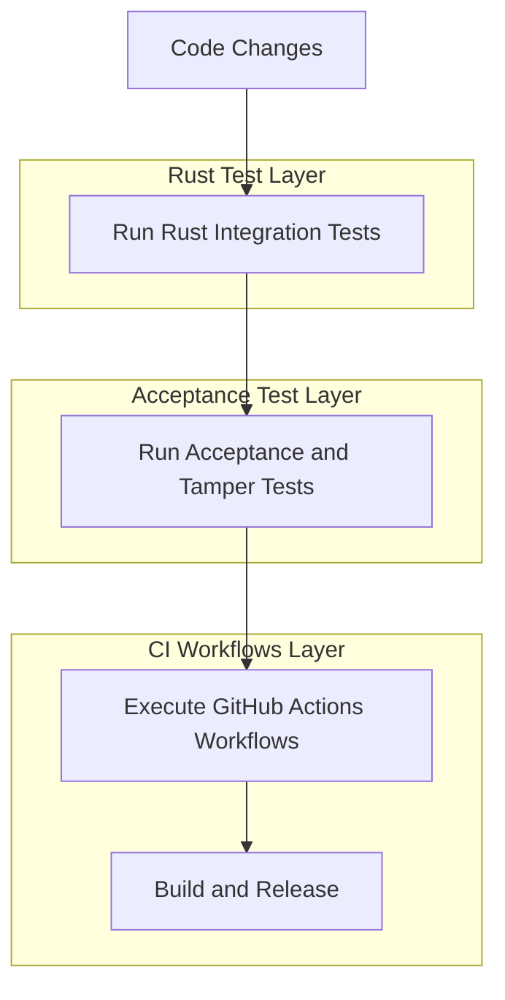
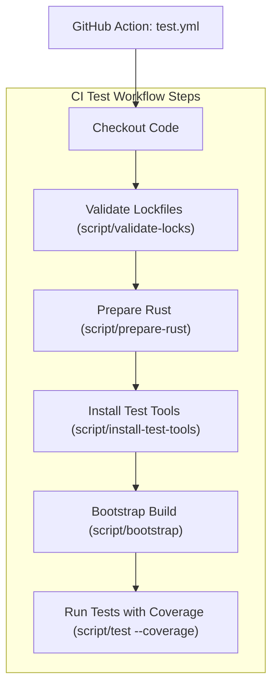
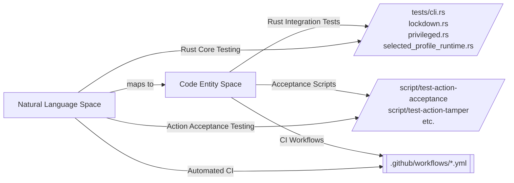

<!-- source: DeepWiki mcp.deepwiki.com · repo openai/fence · page 5 Testing and CI · fetched 2026-10-26 -->

# Testing and CI

Relevant source files

The following files were used as context for generating this wiki page:

- [.github/workflows/test.yml](.github/workflows/test.yml)
- [docs/development.md](docs/development.md)
- [script/test](script/test)

This section provides a high-level overview of the testing strategy and continuous integration (CI) practices used in the Fence repository. Fence employs a combination of Rust integration tests, acceptance scripts, and GitHub Actions workflows to ensure code quality, functionality, and security. Detailed technical aspects of each testing area are covered in their respective child pages.

---

## Test Strategy Overview

Fence's testing strategy encompasses three main layers to achieve comprehensive coverage and verification:

1. **Rust Integration and Privileged Tests:**  
   These tests focus on the Rust core components, including the command-line interface (CLI), lockdown mechanisms, and runtime behavior. They validate internal logic and privileged operations of Fence, often requiring specific system conditions or elevated permissions. The tests reside in the `tests/` directory and utilize various Rust test fixtures and scripts for setup.

2. **Acceptance and Tamper Tests for the GitHub Action:**  
   This layer tests the Node.js action wrapper, its interaction with the Fence binary, and the action's lifecycle under different conditions—including failure modes, tampering attempts, and release validation. It uses a set of acceptance scripts and helpers primarily under the `script/` directory.

3. **GitHub Actions Workflows:**  
   Automated CI workflows defined in `.github/workflows/` orchestrate builds, linting, testing, acceptance runs, and releases. These workflows ensure that all code changes are vetted before merging and that the released artifacts meet quality standards.

The testing hierarchy and flow can be summarized as:

Sources:  
`.github/workflows/test.yml:1-50`  
`script/test:1-80`  
`docs/development.md:1-47`  

---

## Rust Integration and Privileged Tests

Fence uses Rust integration tests to verify low-level components and privileged operations such as lockdown and runtime enforcement. Key test files include:

- `tests/cli.rs`
- `tests/lockdown.rs`
- `tests/privileged.rs`
- `tests/selected_profile_runtime.rs`
- Fixtures in `tests/fixtures/acceptance`

Supporting scripts automate these tests with commands like `script/test-privileged`, `script/test-lockdown`, and `script/test-selected-profile-runtime`. These tests ensure Fence's Rust components are correct, handle edge cases, and safely interact with underlying host systems (e.g. via sudo or Docker).

For detailed insights, see the child page: [Rust and Privileged Tests](#5.1).

---

## Action Acceptance and Tamper Tests

The Fence GitHub Action wrapper, implemented with Node.js and TypeScript in the `action/` directory, is tested for functional correctness and robustness against tampering or setup failures. Acceptance test scripts include:

- `script/test-action-acceptance`
- `script/test-action-wrapper`
- `script/test-action-release`
- `script/test-action-setup-failure`
- `script/test-action-tamper`
- `script/test-action-bundle-provenance`
- `script/test-protected-run`
- `script/test-rust-toolchain-preparation`

These scripts validate the action lifecycle: installation, execution, release validation, and recovery from misconfigurations or malicious tampering attempts. They help ensure that the Fence action runs securely and reliably across different CI environments.

For comprehensive details, see the child page: [Action Acceptance and Tamper Tests](#5.2).

---

## GitHub Actions Workflows

Multiple GitHub Actions workflows automate Fence’s CI/CD pipeline. Workflows manage:

- **Linting:** Code style and formatting checks.
- **Testing:** Runs Rust tests, acceptance scripts, and coverage assessments.
- **Build and Assembly:** Produces the Fence binaries and action bundles.
- **Acceptance Runs:** Validates the assembled GitHub Action on Ubuntu runners.
- **Release Processes:** Automates tagging, bundling, and publishing Fence releases.
- **Drift Canary and Integration:** Detects environmental changes impacting Fence.

The test workflow (`.github/workflows/test.yml`) triggers on pushes and pull requests to the main branch. It performs the following steps:

1. Checks out the repository.
2. Validates lockfiles for dependencies.
3. Prepares the Rust toolchain (`script/prepare-rust`).
4. Installs test tools (`script/install-test-tools`).
5. Bootstraps the repository build environment (`script/bootstrap`).
6. Runs tests with coverage enabled (`script/test --coverage`).

This process runs in a hermetic, offline mode once the toolchain is prepared, ensuring reproducibility and security.

Additional workflows and configuration files are responsible for linting, integration testing, action acceptance across OS versions, drift detection, and release automation in the repository.

For a deep dive, see the child page: [GitHub Actions Workflows](#5.3).

Sources:  
`.github/workflows/test.yml:1-50`  
`script/test:1-80`  

---

# Summary Diagram: Natural Language Concepts vs Code Entities

Sources:  
`tests/cli.rs, lockdown.rs, privileged.rs, selected_profile_runtime.rs`  
`script/test-action-acceptance` et al.  
`.github/workflows/test.yml`  

---

# Summary

Fence's test suite and CI workflows form a layered approach to validate its core Rust library, the GitHub Action wrapper, and operational environment integration. This ensures Fence's egress filtering and runner lockdown features operate securely and reliably in GitHub-hosted workflows.

- **Rust and Privileged Tests** validate core functionality and privileged host interactions.  
- **Action Acceptance and Tamper Tests** verify action installation, execution, and resistance to tampering.  
- **GitHub Actions Workflows** automate testing, linting, and release preparation in a reproducible, hermetic environment.

Explore the child pages for detailed implementation and usage of each testing component:

- [Rust and Privileged Tests](#5.1)  
- [Action Acceptance and Tamper Tests](#5.2)  
- [GitHub Actions Workflows](#5.3)

---

