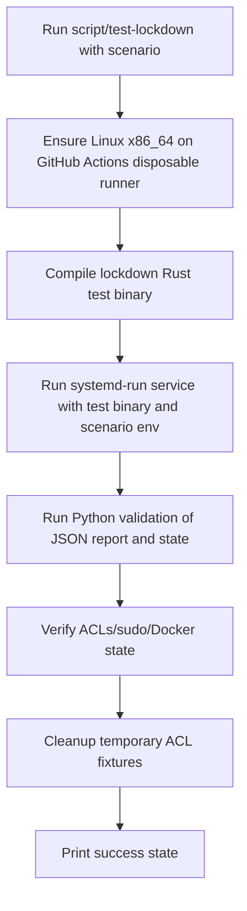
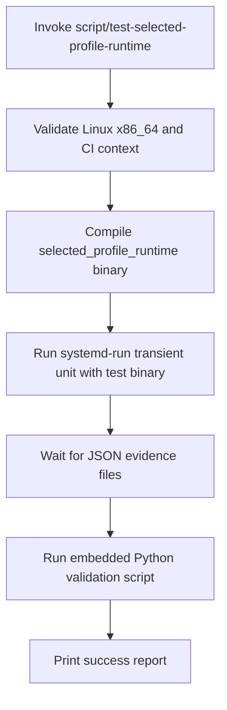
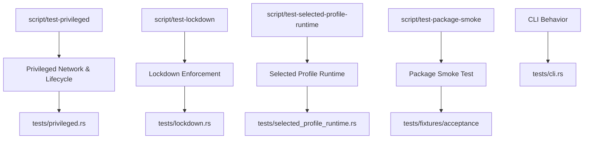

<!-- source: DeepWiki mcp.deepwiki.com · repo openai/fence · page 5.1 Rust and Privileged Tests · fetched 2026-10-26 -->

# 5.1 Rust and Privileged Tests

<details>
<summary>Relevant source files</summary>

The following files were used as context for generating this wiki page:

- [script/test](script/test)
- [script/test-lockdown](script/test-lockdown)
- [script/test-package-smoke](script/test-package-smoke)
- [script/test-privileged](script/test-privileged)
- [script/test-selected-profile-runtime](script/test-selected-profile-runtime)

</details>


This section covers the implementation and execution of Fence's core tests involving Rust integration, privileged runtime scenarios, lockdown enforcement, and selected profile runtime validation. These tests are essential for verifying Fence's behavior in controlling network egress, lockdown mechanisms, and runtime profile application, especially when elevated permissions or system-level interactions are required. The covered tests reside in Rust test binaries located under `tests/`, acceptance fixtures, and orchestration shell scripts placed in the `script/` directory.

---

## Overview and Purpose

Fence relies heavily on Rust integration tests to ensure correctness of its enforcement logic and runtime lifecycle under various controlled conditions. Some scenarios exercise privileged operations — such as applying nftables rules, manipulating sudo policies, or running inside Linux network namespaces — necessitating elevated permissions and system-level isolation.

Rust test files corresponding to specific features include:

- `tests/cli.rs`: Tests core CLI behavior and command handling.
- `tests/lockdown.rs`: Tests lockdown enforcement functionality.
- `tests/privileged.rs`: Exercises privileged network rules and lifecycle aspects.
- `tests/selected_profile_runtime.rs`: Validates the dynamic application of selected platform profiles at runtime.
- Fixture files under `tests/fixtures/acceptance`: Provide policy and environment input for acceptance tests.

Shell scripts in `script/` coordinate these tests holistically, including:

- `script/test-privileged`
- `script/test-lockdown`
- `script/test-selected-profile-runtime`
- `script/test-package-smoke`

These scripts prepare the environment, compile the tests with Cargo, ensure required tools and permissions, execute tests inside isolated contexts (systemd services, network namespaces, containers), and verify post-conditions and evidence files.

---

## Key Test Areas and Data Flow

### Privileged Tests (`tests/privileged.rs` and `script/test-privileged`)

The privileged tests verify Fence's handling of network namespace isolation, nftables rule injection, netlink interactions, and lifecycle management of resident enforcement and reporting services.

- The `script/test-privileged` sets up a dedicated network namespace (`fence-probe-$$`), activates a systemd transient service unit (`fence-evidence-probe-$$.service`) to run test code, and crafts nftables rules with bounded NFLOG groups for packet logging.
- The Cargo environment is prepared to build the `privileged` integration test binary and then run it under `sudo` in a single thread and ignored tests context.
- Cleanup removes the network namespace and evidence directory.
- Successful completion prints a verification message.

```mermaid
flowchart TB
  subgraph Script Environment Setup
    EnvPrepare[Prepare env vars and directories]
    Namespace[Create network namespace "fence-probe-$$"]
    SystemdRun[Run systemd transient unit fence-evidence-probe service]
    NFTables[Inject nftables rules into namespace]
  end

  subgraph Rust Integration Test
    Build[Build 'privileged' test binary with Cargo]
    Run[Run test binary via sudo in namespace]
    Verify[Collect and verify evidence post-test]
  end

  EnvPrepare --> Namespace --> NFTables --> SystemdRun
  SystemdRun --> Run
  Build --> Run
  Run --> Verify
```

This flow ensures that Fence's privileged operations interact correctly with the underlying Linux kernel features it orchestrates for egress filtering.

---

### Lockdown Tests (`tests/lockdown.rs` and `script/test-lockdown`)

Lockdown tests probe Fence's locking down of sudo policies, Docker daemon access, and ACL permissions on hosted runners to restrict network egress when required.

- `script/test-lockdown` takes a scenario argument (e.g., `acl-reject`, `audit`, `standard`) and verifies execution only on disposable Linux x86_64 GitHub Actions runners.
- It builds the `lockdown` test binary, then runs it as a systemd transient service with environment variables describing the scenario.
- Post execution, it runs a Python inline validator to inspect generated JSON reports, confirming expected evidence fields and lockdown effects (e.g., sudo disabled or preserved).
- It additionally verifies system-level effects such as ACL directory permissions or Docker daemon inaccessibility as required per scenario.
- A cleanup step restores or removes temporary fixtures.
  


This mechanism verifies the effect of lockdown modes on the hosted runner's execution environment.

---

### Selected Profile Runtime Tests (`tests/selected_profile_runtime.rs` and `script/test-selected-profile-runtime`)

These tests exercise Fence's dynamic application of network egress filters derived from the "selected profile" concept, primarily mediated via a DNS-based mechanism.

- The shell script runs only on Linux x86_64 GitHub runners with required tools like `mount`, `systemd-run`, `nft`, et al.
- It builds the `selected_profile_runtime` Rust test binary and runs it similarly as a systemd service with environment setup for different scenarios (`healthy`, `worker-failure`, `local-control-drift`).
- The Rust test applies a profile selected by a planner under controlled conditions and leaves controls resident for production verification.
- The script waits for JSON evidence report files, which are then validated in an embedded Python script. This checks network application and verification status, sudo and container lockdown validation, rule hash matching, and DNS report contents.
- It also tests injected failure scenarios like worker thread failure or control drift.



This ensures Fence's runtime enforcement adapts correctly per profile selection and DNS mediation.

---

### CLI and Smoke Tests (`tests/cli.rs`, `script/test-package-smoke`)

The CLI tests verify general command behavior, version output, support checks, and policy loading correctness. The package smoke test validates the built Fence binary against a known accept-list policy fixture in an environment with nftables installed.

- `script/test-package-smoke` runs on Linux x86_64 and verifies `nft` is available.
- It validates the binary version reported matches `Cargo.toml` package version.
- Runs Fence commands like version and support to verify correct JSON schema and reported capability flags.
- Checks no residual runtime state or fence nftables tables exist before and after.
- Executes commands with known fixtures and verifies exit codes and output correctness.

---

## Important Rust Test Functions and Concepts

Several critical Rust test hooks and functions underpin these tests:

- **Test Units and `cargo test --test` binaries**: Custom integration test crates such as `privileged.rs`, `lockdown.rs`, and `selected_profile_runtime.rs` include test functions to exercise Fence components, invoking internal modules like `lockdown` and runtime lifecycle structs.
- **Environment Variables for Test Behavior**: Tests rely on environment variables set by the scripts (`FENCE_PRIVILEGED_TEST_ROOT`, `FENCE_LOCKDOWN_SCENARIO`, etc.) to switch behavior and simulate failure or control states.
- **Systemd Transient Services**: Many tests run as systemd service units, providing better lifecycle control and system resource isolation. This approach mimics real runtime launches and benefits from the sandboxed service environment.

---

## Relationships Between Tests, Scripts, and Codebase

This diagram maps natural language concepts of tests and scenarios to specific code entities and files:



This visualization clarifies how test types relate to Rust test sources and orchestration scripts.

---

## Summary Table of Scripts and Test Files

| Script/Test File                | Purpose                                         | Key Components                                | Platform Requirements              |
|-------------------------------|-------------------------------------------------|-----------------------------------------------|----------------------------------|
| `script/test-privileged`       | Run privileged network and lifecycle tests       | Setup network namespace, systemd units, run `privileged` tests | Linux x86_64, root, nftables    |
| `script/test-lockdown`          | Run lockdown scenario evidence tests             | Scenario-driven systemd-run with `lockdown` tests | Linux x86_64, hosted runner GitHub Actions |
| `script/test-selected-profile-runtime` | DNS-mediated profile enforcement tests            | Run `selected_profile_runtime` tests, validate JSON reports | Linux x86_64, Hosted GitHub Runner|
| `script/test-package-smoke`     | Simple Fence binary contract and CLI smoke test  | Validate version, nftables rules, CLI commands | Linux x86_64, nftables installed |
| `tests/cli.rs`                 | CLI command and output validation                 | CLI parsing, JSON output schema                | Rust integration tests            |
| `tests/lockdown.rs`             | Lockdown feature tests                            | Lockdown mode effects                          | Rust integration tests            |
| `tests/privileged.rs`           | Privileged namespace and lifecycle tests        | Network namespace, nftables, systemd           | Rust integration tests            |
| `tests/selected_profile_runtime.rs` | Selected profile application and runtime checks | Runtime profile enforcement, DNS mediation validation | Rust integration tests |

---

## Conclusion

The Rust and privileged tests form a robust suite verifying Fence's core enforcement and lockdown capabilities across multiple important runtime and privileged scenarios. The tightly integrated orchestration scripts and Rust test binaries enable execution on disposable CI runner environments with precise environment control and detailed evidence validation. This structure protects Fence's security guarantees and ensures consistent behavior in real-world deployment contexts.

---

### Sources

- `script/test-privileged:1-75`()
- `script/test-lockdown:1-171`()
- `script/test-selected-profile-runtime:1-172`()
- `script/test-package-smoke:1-211`()
- `script/test:1-80`()
- Reference to Rust test files in `tests/` directory as described in above scripts and implied by test binary build and execution calls.

---

