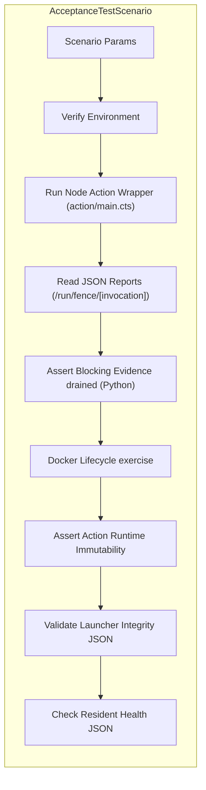
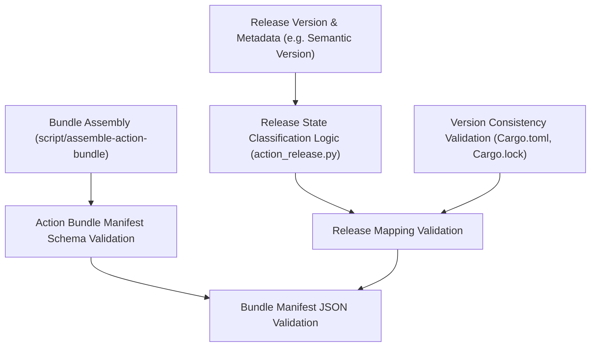
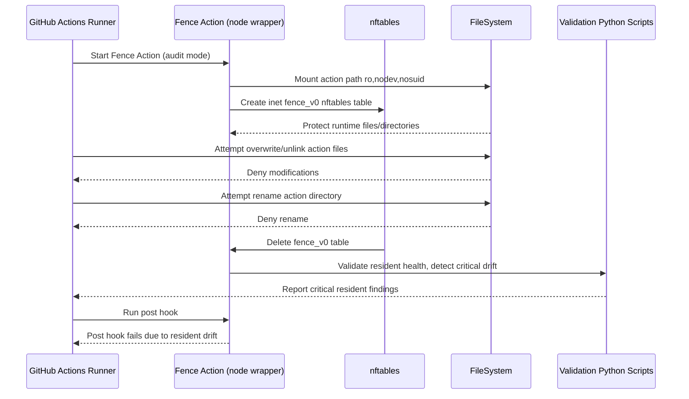

<!-- source: DeepWiki mcp.deepwiki.com · repo openai/fence · page 5.2 Action Acceptance and Tamper Tests · fetched 2026-10-26 -->

# 5.2 Action Acceptance and Tamper Tests

<details>
<summary>Relevant source files</summary>

The following files were used as context for generating this wiki page:

- [script/test-action-acceptance](script/test-action-acceptance)
- [script/test-action-bundle-provenance](script/test-action-bundle-provenance)
- [script/test-action-release](script/test-action-release)
- [script/test-action-setup-failure](script/test-action-setup-failure)
- [script/test-action-tamper](script/test-action-tamper)
- [script/test-action-wrapper](script/test-action-wrapper)
- [script/test-protected-run](script/test-protected-run)
- [script/test-rust-toolchain-preparation](script/test-rust-toolchain-preparation)

</details>


This section details the comprehensive suite of acceptance and tamper-resistance tests employed to validate the Fence GitHub Action wrapper and runtime environment. These tests exercise various configurations, lifecycle behaviors, and security properties of the Fence Action and its lockdown mechanisms in disposable GitHub Actions runners on supported platforms (Linux x86_64). Through a combination of automated shell scripts and Python assertions, they verify correctness, immutability, provenance, failure handling, and runtime protection.

---

## Purpose and Scope

The Fence GitHub Action enforces egress filtering and lockdown on self-hosted or hosted runners to prevent unauthorized network activity during CI runs. The acceptance and tamper tests ensure the Action's installation, runtime, configuration, and release bundles:

- Behave as expected under multiple scenarios and configurations.
- Are resistant to unauthorized modifications or tampering.
- Accurately produce evidence reports describing enforcement outcomes.
- Observe correct container and network lockdown policies.
- Validate the integrity and provenance of the distributed binaries.
- Handle error conditions and boundary cases securely.
- Work with pinned Rust toolchains required for action builds.

These tests leverage the Action wrapper scripts (`action/main.cts`, `action/post.cts`, `action/lib.cts`), Rust binary artifacts, and utility scripts under `script/` to establish and validate Fence operation in ephemeral disposable runners within the CI environment.

---

## 1. Acceptance Test Execution (`script/test-action-acceptance`)

The entrypoint acceptance test script evaluates Fence runs for various workflow scenarios:

- `standard` — typical block mode with container policy disabled.
- `standard-opt-out` — disables broader GitHub domains during enforcement.
- `unsafe-preserve` — preserves container policy unsafely (less restrictive).
- `wildcard-docker` — allows docker.io hostname wildcard access.
- `github-artifacts` — tests with GitHub artifacts setup.
- `audit` — audit-only mode that allows all traffic but records evidence.

### Inputs and Environment

- Only runs on disposable runners in CI (`CI=true` and `GITHUB_ACTIONS=true`).
- Requires Linux x86_64 platform.
- Docker binary is required for scenarios other than `standard` and `audit`.
- Expects utilities like `curl`, `findmnt`, `python3`, and `sudo`.

### Procedure Outline

1. **Prepare directories** for action runtime and reporting under `/run/fence` and `/run/fence-launcher`.
2. **Run Fence Action** with configured scenario-specific flags.
3. **Assert network access evidence**: checks blocking and draining of residual connections in the JSON reports using embedded Python validation.
4. **Docker lifecycle exercise** (for docker scenarios): constructs a minimal Docker root filesystem and runs a short lifecycle loop creating, starting, stopping, and removing containers to ensure container lockdown and network restrictions function properly.
5. **Validate action runtime immutability** by attempting to write, unlink, chmod, move, and overwrite critical action files and ensuring all attempts fail.
6. **Inspect launcher's integrity JSON** to ensure the registered files and path guards are intact with correct permissions.
7. **Verify resident health JSON** in reports to confirm the resident enforcement process is running and healthy with timely verification sequences.
8. Further checks on DNS report consistency and block evidence are also included.

### Key Functions

- `probe_https_once(url)`: Use `curl` to test HTTPS connectivity.
- `assert_block_evidence_drains(report_path)`: Python function in script to confirm blocked TCP connection evidence is drained.
- `exercise_docker_lifecycle()`: Builds minimal docker image and runs a creation-start-stop-remove loop to simulate docker lifecycle.
- `assert_action_runtime_immutable()`: Attempts all filesystem mutation operations on the mounted action runtime to confirm read-only enforcement.



Sources: `script/test-action-acceptance:1-174`()

---

## 2. Action Wrapper and Runtime Validity (`script/test-action-wrapper`)

The `test-action-wrapper` script verifies correctness of the Node.js wrapper code that installs and runs the Fence binary.

- Requires the `node` CLI.
- Runs Node.js tests on core libraries (`action/lib.cts`), main action (`action/main.cts`), post-job hook (`action/post.cts`).
- Also runs tests on action log sanitization (`action/log-sanitization.test.cts`) for secret redaction.
- Runs Python self-tests in helper libraries related to host observations and bundle host validation.
- Executes the action bundle provenance tests and other acceptance tests.

This test is more lightweight and ensures the JavaScript/CJS portions of the Action behave as expected before running heavier scenario tests.

Sources: `script/test-action-wrapper:1-14`()

---

## 3. Release and Bundle Provenance Validation (`script/test-action-release`, `script/test-action-bundle-provenance`)

Two complementary scripts validate the provenance and correctness of release bundles.

### `test-action-release`

- Validates semantic version parsing and release channel classification logic.
- Validates exact release tag state selection including draft, published, completed, or withdrawn.
- Ensures release ordering monotonicity.
- Validates Cargo.toml versus Cargo.lock version consistency.
- Validates release mapping integrity, ensuring consistent field values.
- Runs against sets of release states to verify classification correctness.
- Detects incorrect or conflicting release states.

### `test-action-bundle-provenance`

- Assembles Fence Action bundles from artifact and wrapper.
- Ensures reproducibility by comparing two independently assembled bundles.
- Validates the bundle manifest JSON schema against expected fields including artifact SHA256, release tags, workflows, and source commit references.
- Makes release identity state variants with stable and prerelease versions.
- Validates that source trees and partial bundles are rejected unless explicitly allowed.
- Tests various invalid modifications and missing fields in the manifest to ensure detection of invalid manifests or bundles.



Sources: `script/test-action-release:1-163`(), `script/test-action-bundle-provenance:1-174`()

---

## 4. Setup Failure Handling Tests (`script/test-action-setup-failure`)

This script evaluates Fence Action's behavior when given invalid configuration inputs or violating policy limits.

- Validates that invalid `invocation_id` values (disallowed by Fence's lowercase slug grammar) cause the setup to fail cleanly without creating side effects.
- Tests that unbounded wildcard hostnames in allowlists are rejected properly.
- Rejects CIDR allowlist entries that include host bits rather than canonical network addresses.
- Enforces unique allowlist entry limits (no more than 64 entries) with proper failure handling.
- Verifies that invalid artifacts or configurations cause a clean rejection.
- Confirms that no residual nftables rules or runtime directories remain after failure.

The test covers many boundary and error cases for the action setup phase, preventing unsafe or misconfigured enforcement.

Sources: `script/test-action-setup-failure:1-173`()

---

## 5. Tamper Resistance Tests (`script/test-action-tamper`)

These tests verify Fence's resilience against runtime tampering attempts targeting the installed Action runtime files and enforcement mechanisms.

### Test Highlights

- Starts with a clean environment with no existing fence tables or runtime directories.
- Launches Fence Action in audit mode with an empty allowlist and verifies creation of runtime directories and nftables presence.
- Confirms the action runtime path is mounted read-only with `ro,nodev,nosuid` options.
- Attempts to overwrite or unlink critical action files like `post.cts`, failing as expected.
- Reads the launcher's integrity JSON to fetch path guard records which include the protected directory path, device, and inode numbers.
- Ensures the mount points for the path guard directory exist and checks for unwanted writable flags.
- Attempts to rename/move the protected action runtime directory and confirms this operation is denied by the file system.
- Deletes nftables table to simulate enforcement break and checks that Fence generates a critical drift detection in a JSON report.
- Runs the post-job hook and confirms it fails on detecting critical resident drift.
- Overall, verifies that critical runtime files and directories cannot be tampered with or eliminated, preserving enforcement integrity.



Sources: `script/test-action-tamper:1-177`()

---

## 6. Protected Run Integration Tests (`script/test-protected-run`)

These tests simulate a full end-to-end protected fence run including the building of the Fence binary, configuration generation, and deployment as a systemd service with lockdown.

- Accepts scenarios including `standard`, `standard-finalization`, `standard-opt-out`, `unsafe-preserve`, `wildcard-docker`, `malformed-wildcard`, `audit`.
- Compiles the Fence binary via `cargo build --release`.
- Writes JSON config objects specifying mode, invocation, and allowlist per scenario.
- Installs runtime configuration and service unit under `/run/fence` directories as root.
- Starts the fence systemd transient service enforcing lockdown.
- Runs health, HTTPS probe, and network connection tests to validate enforcement behavior.
- Gathers and analyzes Fence reports for compliance and evidence of correct blocking or allowance.
- Exercises various container policy behaviors and allowlist wildcard validations.
- Uses embedded Python scripts to parse, verify, and report network activity diagnostics from Fence's output.

Sources: `script/test-protected-run:1-196`()

---

## 7. Rust Toolchain Preparation Tests (`script/test-rust-toolchain-preparation`)

To support hermetic Rust builds of Fence, a dedicated test prepares and verifies a pinned Rust toolchain mirror:

- Creates synthetic fixtures mimicking Rust distribution artifacts (e.g., tarballs for Rust compiler components, standard libraries).
- Generates a `rust-toolchain.lock.toml` with version, manifest URLs, checksums.
- Implements a shim `fetch()` method to copy local fixtures instead of real downloads.
- Runs `rust_dist_prepare_verified_mirror` to assemble a trusted local mirror of Rust components.
- Verifies presence of all expected files and manifests in the mirror with correct hashes.
- Tests rejection of unlisted Rust targets and tampered artifact failures.
- Runs a fake rustup replacement binary to capture command invocations, ensuring the pinned Rust toolchain installation flow is exercised without network access.
- Confirms that the rustup install sequence respects pinned versions and disables self-update.

This test ensures the toolchain environment necessary for building Fence is secure and reproducible.

Sources: `script/test-rust-toolchain-preparation:1-136`()

---

# Summary Diagram: Action Acceptance and Tamper Test Components Map

```mermaid
graph TD
  A[GitHub Actions Runner] -.-> B[Disposable CI Environment]
  B --> C[Fence Action Wrapper (Node.js)]
  C --> D[Fence Binary (Rust CLI)]
  C --> E[Post Job Hook (action/post.cts)]
  D --> F[Network Enforcement (nftables, lockdown)]
  D --> G[Evidence and Reporting (JSON reports)]
  E --> H[Closure and Integrity Validation]
  
  subgraph Acceptance Tests
    C
    D
    G
  end

  subgraph Tamper Tests
    E
    H
    FS[Filesystem Protection]
    NFT[nftables Table Checks]
    FS -->|Protect Runtime Files| E
    NFT -->|Enforce Lockdown| D  
  end

  subgraph Release and Bundle Provenance
    J[Bundle Assembly & Manifest Validation]
    K[Release Version and State Classification]
  end

  B --> Acceptance Tests
  B --> Tamper Tests
  B --> Release and Bundle Provenance
```

---

# Full Test Script Listing

| Test Script Name              | Description                                                | Key Files/Targets                    |
|------------------------------|------------------------------------------------------------|------------------------------------|
| `script/test-action-acceptance` | Comprehensive scenario acceptance tests for Fence action invocation, evidence validation, docker lifecycle exercise, runtime immutability checks | `action/main.cts`, `/run/fence/*` JSONs |
| `script/test-action-wrapper`      | Node.js wrapper code unit and integration tests along with auxiliary Python lib self-tests | `action/lib.cts`, `action/main.cts`, `action/post.cts` |
| `script/test-action-release`      | Semantic version parsing, release mapping validation, and release state classification | `script/lib/action_release.py`         |
| `script/test-action-bundle-provenance` | Assembly, reproducibility, and validation of Fence Action bundles and manifests | `script/assemble-action-bundle` and `script/validate-action-bundle`  |
| `script/test-action-setup-failure`| Tests invalid configuration inputs and enforces failure safety with no side effects | `action/main.cts`, `action/post.cts`    |
| `script/test-action-tamper`       | Runtime tamper resistance test attempts to modify action runtime files and directories, detecting protection enforcement | `action/main.cts`, `action/post.cts`, `/run/fence-launcher/*/integrity.json` |
| `script/test-protected-run`       | End-to-end protected execution integration tests with systemd units, config JSONs, binary builds | `src/bin/fence`, unit files, `/run/fence/*` |
| `script/test-rust-toolchain-preparation` | Verification of pinned Rust toolchain mirror, artifact checks, and mock rustup installation | `script/lib/rust-dist.bash` and generated fixtures |

---

# Additional Notes

- The acceptance and tamper tests only run in ephemeral CI environments to ensure no collateral damage or side effects.
- Tests are shell-script driven with embedded Python for JSON parsing and deep validation of Fence's evidence documents.
- Rigorous mount option checks (`ro,nodev,nosuid`) ensure action runtime immutability.
- Rust toolchain tests enforce offline reproducibility and integrity of build dependencies.
- Docker lifecycle tests simulate minimal container environments, relevant for checking container lockdown behaviors.
- Release and bundle provenance tests ensure that distributed Fence versions are valid, canonical, and cryptographically verifiable.

---

# References

- `script/test-action-acceptance` [script/test-action-acceptance:1-174]()
- `script/test-action-wrapper` [script/test-action-wrapper:1-13]()
- `script/test-action-release` [script/test-action-release:1-163]()
- `script/test-action-bundle-provenance` [script/test-action-bundle-provenance:1-174]()
- `script/test-action-setup-failure` [script/test-action-setup-failure:1-173]()
- `script/test-action-tamper` [script/test-action-tamper:1-177]()
- `script/test-protected-run` [script/test-protected-run:1-196]()
- `script/test-rust-toolchain-preparation` [script/test-rust-toolchain-preparation:1-135]()

---

