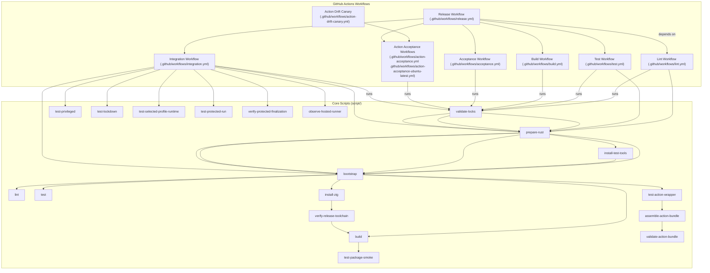

<!-- source: DeepWiki mcp.deepwiki.com · repo openai/fence · page 5.3 GitHub Actions Workflows · fetched 2026-10-26 -->

# GitHub Actions Workflows

<details>
<summary>Relevant source files</summary>

The following files were used as context for generating this wiki page:

- [.gitattributes](.gitattributes)
- [.github/CODEOWNERS](.github/CODEOWNERS)
- [.github/dependabot.yml](.github/dependabot.yml)
- [.github/workflows/acceptance.yml](.github/workflows/acceptance.yml)
- [.github/workflows/action-acceptance-ubuntu-latest.yml](.github/workflows/action-acceptance-ubuntu-latest.yml)
- [.github/workflows/action-acceptance.yml](.github/workflows/action-acceptance.yml)
- [.github/workflows/action-drift-canary.yml](.github/workflows/action-drift-canary.yml)
- [.github/workflows/build.yml](.github/workflows/build.yml)
- [.github/workflows/integration.yml](.github/workflows/integration.yml)
- [.github/workflows/lint.yml](.github/workflows/lint.yml)
- [.github/workflows/release.yml](.github/workflows/release.yml)
- [.github/workflows/test.yml](.github/workflows/test.yml)
- [.gitignore](.gitignore)

</details>


This section documents the continuous integration (CI) and automation workflows configured for the Fence project in GitHub Actions. These workflows implement essential development lifecycle tasks such as linting, testing, building, acceptance validation, integration testing, and software release procedures. Additionally, it covers the configuration files that govern automatic dependency updates and code ownership reviews.

The workflows are primarily defined under the `.github/workflows/` directory in YAML format and leverage a series of custom shell and Python scripts from `script/` to execute steps reliably. The benefit of this setup is rigorous enforcement of code quality and security checks, plus automated packaging and release of the Fence software and its GitHub Action wrapper.

---

## Workflow Overview and General Structure

Every workflow specifies trigger events such as `push` and `pull_request` on the `main` branch, sets necessary permissions (mostly read-only for repository contents), standardizes shell environments (bash), and configures concurrency and cancellation policies.

The workflows run almost exclusively on Ubuntu runners (`ubuntu-24.04` or `ubuntu-latest`) in GitHub-hosted environments.

A common pattern observed across workflows is the sequential execution of phases:

1. **Source Checkout**: Using the pinned `actions/checkout@v7.0.1` with `persist-credentials: false` to pull the exact source.
2. **Lock Validation**: Run `script/validate-locks --ci` to ensure dependency lockfiles are consistent and untampered.
3. **Rust Toolchain Preparation**: Execute the `script/prepare-rust` script that sets up the Rust environment pinned to specific toolchain versions.
4. **Bootstrap**: Run `script/bootstrap` to compile vendored dependencies and execute build preliminaries.
5. **Build**: For build workflows, use `script/build` with optional parameters for target platforms and release builds.
6. **Testing or Acceptance**: Run various scripted tests or acceptance suites.
7. **Artifact Packaging/Validation**: Build release artifacts, assemble action bundles, verify checksums and signatures.
8. **Release Preparation**: Check commit metadata, verify release conditions, and enumerate downstream release steps.

These standardized phases ensure hermetic builds, rigorous validation, and reproducibility.


---

## Detailed Workflow Descriptions

### 1. Lint Workflow (`.github/workflows/lint.yml`)

Purpose: Run lint checks on the Rust source code to enforce style and correctness prior to integration.

**Key Implementation Details:**
- On push or PR on main.
- Steps: checkout → validate locks → prepare Rust → bootstrap → run `script/lint` which runs the linter tools.
- Run on `ubuntu-24.04`.

This workflow guarantees code quality early in the pipeline.

**Sources:**  
`.github/workflows/lint.yml:1-45`  
`scripts/validate-locks` (invoked, not shown)  
`scripts/prepare-rust` (invoked, not shown)  
`scripts/bootstrap` (invoked, not shown)  
`scripts/lint` (invoked, not shown)  


---

### 2. Test Workflow (`.github/workflows/test.yml`)

Purpose: Execute unit and integration tests with coverage instrumentation on the Fence Rust crate.

**Implementation:**
- Triggered on push or PR to main.
- Steps include installing additional testing tools `script/install-test-tools`.
- Then runs `script/test --coverage` to run tests and collect code coverage.

This validates functional correctness and tracks coverage.

**Sources:**  
`.github/workflows/test.yml:1-48`  
`scripts/install-test-tools`  
`scripts/test`  


---

### 3. Build Workflow (`.github/workflows/build.yml`)

Purpose: Compile the core Fence Rust binary for Linux x64.

**Implementation:**
- Trigger: push or PR on main.
- Steps: checkout → validate locks → prepare Rust → bootstrap → run `script/build`.

This produces the compiled executable ready for further packaging.

**Sources:**  
`.github/workflows/build.yml:1-45`  
`scripts/build`  


---

### 4. Acceptance Workflow (`.github/workflows/acceptance.yml`)

Purpose: Integration-level acceptance tests on built Fence Linux x64 artifact to verify real-world behavior.

**Implementation:**
- Runs only on the main branch push or PR.
- Steps:
  - Checkout source.
  - Run `script/validate-locks --ci`.
  - Prepare Rust toolchain.
  - Bootstrap the build environment.
  - Install and verify cross-build tools.
  - Build release artifact into a temp directory with `script/build --release`.
  - Verify artifact checksum.
  - Run `script/test-package-smoke` to exercise contract compliance of the built binary.

This workflow validates the built artifact functions correctly on the Linux platform.

**Sources:**  
`.github/workflows/acceptance.yml:1-62`  
`scripts/validate-locks`  
`scripts/prepare-rust`  
`scripts/bootstrap`  
`scripts/build`  
`scripts/test-package-smoke`  


---

### 5. Action Acceptance Workflow (`.github/workflows/action-acceptance.yml` and `.github/workflows/action-acceptance-ubuntu-latest.yml`)

Purpose: Validate the Fence GitHub Action wrapper functionality under real runner conditions, including assembly and verification of the action bundle.

**Key points:**

- Works on main branch push or PR.
- Supports `workflow_call` inputs to specify the action commit SHA, candidate kind (`source` or `distribution`), and the runner image (`ubuntu-24.04` or `ubuntu-latest`).
- Prepares candidate by checking out the exact commit, validating that generated bundle files are absent for `source` candidates.
- Builds the Rust binary and assembles the action bundle for source candidates.
- Validates committed bundles for distribution candidates.
- Uploads assembled bundle artifacts for downstream jobs.
- The modular nature allows this workflow to be called by other workflows such as the `action-acceptance-ubuntu-latest.yml`.
- `action-acceptance-ubuntu-latest.yml` triggers nightly and PR tests that run this acceptance workflow specifically on `ubuntu-latest`, ensuring compatibility with the freshest GitHub-hosted runners.

This layered setup ensures the Fence action remains functional and compatible across GitHub-hosted environments and release candidates.

**Sources:**  
`.github/workflows/action-acceptance.yml:1-181`  
`.github/workflows/action-acceptance-ubuntu-latest.yml:1-28`  
`scripts/validate-locks`  
`scripts/prepare-rust`  
`scripts/bootstrap`  
`scripts/build`  
`scripts/test-action-wrapper`  
`scripts/assemble-action-bundle`  
`scripts/validate-action-bundle`  


---

### 6. Action Drift Canary Workflow (`.github/workflows/action-drift-canary.yml`)

Purpose: Periodic validation that the Fence action bundle remains functional despite potential upstream drift or changes in the GitHub runner environments, with a cadence every 6 hours.

**Core Behaviors:**
- Runs on cron schedule and manual trigger.
- Accepts an input action commit SHA.
- Resolves the immutable action commit to test, falling back to the latest mapped release if unspecified.
- Runs job matrix for combinations of `ubuntu-24.04` and `ubuntu-latest` runners and mode matrix of `block` and `audit`.
- Each matrix job runs a canonical acceptance test to detect regressions or drift early.

This workflow guards against unexpected environmental or code changes that might disrupt the Fence action.

**Sources:**  
`.github/workflows/action-drift-canary.yml:1-159`  
`scripts` invoked for acceptance testing (exact scripts invoked are fragmented here)  


---

### 7. Integration Workflow (`.github/workflows/integration.yml`)

Purpose: End-to-end integration testing pipeline running a variety of lockdown, selected profile runtime, protected run, and protected finalization scenarios.

**Key Highlights:**
- Triggered by push or PR on main.
- Consists of multiple jobs:
  - **Preflight**: Basic checkout and lock validation.
  - **Lockdown**: Tests evidence gathering and lockdown behaviors across several scenarios (`acl-reject`, `audit`, `rollback`, etc.) with matrix runs.
  - **Selected Profile Runtime**: Tests different runtime replicas with matrix scenarios.
  - **Protected Run and Finalization**: Runs protected invocation tests and finalization verification with multiple replicas.
  - **Integration**: Aggregate job that depends on all others, verifies terminal job success, check-run completions, and downloadable logs.
- Extensive use of custom scripts (`observe-hosted-runner`, `test-privileged`, `test-lockdown`, `test-selected-profile-runtime`, `test-protected-run`, `verify-protected-finalization`) to validate internal state and evidence artifacts.

This workflow ensures Fence behaves as expected in deployed and hardened scenarios, validating security enforcement and telemetry collectives.

**Sources:**  
`.github/workflows/integration.yml:1-221`  
`scripts/observe-hosted-runner`  
`scripts/test-privileged`  
`scripts/test-lockdown`  
`scripts/test-selected-profile-runtime`  
`scripts/test-protected-run`  
`scripts/verify-protected-finalization`  


---

### 8. Release Workflow (`.github/workflows/release.yml`)

Purpose: Orchestrate the release process for the Fence repository, including version determination, commit verification, and gating on protected checks.

**Process Steps:**
- Triggered on main branch pushes with changes to `Cargo.toml`.
- Preparation job:
  - Clone exact commit.
  - Validate that no generated action bundle files are committed on main.
  - Uses GitHub API to fetch commit metadata and verify the commit signature.
  - Compares previous and current versions to determine if a release is necessary.
  - Extracts SemVer version and release channel.
- Waits for all required protected checks (`lint`, `test`, `build`, `acceptance`, `action acceptance`, `integration`) to pass on the release commit.
- Subsequent release steps (not fully shown) presumably publish artifacts and update release metadata.

This workflow enforces a strict release gate grounded on proven integrity and test coverage for each release.

**Sources:**  
`.github/workflows/release.yml:1-180`  
`script/lib/action_release.py` (called from embedded python)  


---

## Code Ownership and Dependency Management

### CODEOWNERS (`.github/CODEOWNERS`)

- The entire repository, including all workflows (`.github/workflows/**`), dependabot config, action wrapper, scripts, vendor directory, and core Rust files are owned by a single primary maintainer `@GrantBirki`.
- This configuration ensures designated reviewers participate in pull requests affecting key parts of the codebase.

**Sources:**  
`.github/CODEOWNERS:1-25`  


### Dependabot Configuration (`.github/dependabot.yml`)

- Dependabot is configured to check monthly for updates on:
  - GitHub Actions usage dependencies in all workflows (`*`).
  - Rust toolchain version pinning files.
- There is a cooldown period of 45 days between updates to reduce noise.

This policy keeps tooling and action dependencies up-to-date systematically.

**Sources:**  
`.github/dependabot.yml:1-24`  


---

## System to Code Mapping Diagrams

Below are diagrams that relate natural-language workflow functions to the core scripts and files implementing them.



*Diagram: High-level relationship between Fence workflows and underlying scripts.*

---

```mermaid
classDiagram
class "GitHub Actions Workflows" {
  +lint.yml()
  +test.yml()
  +build.yml()
  +acceptance.yml()
  +action-acceptance.yml()
  +action-drift-canary.yml()
  +integration.yml()
  +release.yml()
}
class "Scripts in script/" {
  +validate-locks()
  +prepare-rust()
  +bootstrap()
  +build()
  +lint()
  +test()
  +test-package-smoke()
  +test-action-wrapper()
  +assemble-action-bundle()
  +validate-action-bundle()
  +test-privileged()
  +test-lockdown()
  +test-selected-profile-runtime()
  +test-protected-run()
  +verify-protected-finalization()
  +observe-hosted-runner()
  +install-test-tools()
  +install-zig()
  +verify-release-toolchain()
}

"GitHub Actions Workflows" --> "Scripts in script/": invokes multiple scripts for phases
```

*Diagram: Class-like abstraction showing workflows are implemented via script commands.*

---

## Summary Table of Workflows

| Workflow Name          | File Name                             | Trigger Events           | Runner Image      | Main Purpose                    |
|-----------------------|------------------------------------|-----------------------|-------------------|--------------------------------|
| Lint                  | `.github/workflows/lint.yml`       | push, pull_request on main | ubuntu-24.04      | Run Rust lint checks           |
| Test                  | `.github/workflows/test.yml`       | push, pull_request on main | ubuntu-24.04      | Run unit/integration tests with coverage |
| Build                 | `.github/workflows/build.yml`      | push, pull_request on main | ubuntu-24.04      | Compile Fence Rust binary      |
| Acceptance            | `.github/workflows/acceptance.yml` | push, pull_request on main | ubuntu-24.04      | Acceptance testing on built Linux artifact |
| Action Acceptance     | `.github/workflows/action-acceptance.yml` + `.github/workflows/action-acceptance-ubuntu-latest.yml` | push, pull_request on main, scheduled, manual | ubuntu-24.04, ubuntu-latest | Validate GitHub Action bundle and wrapper |
| Action Drift Canary   | `.github/workflows/action-drift-canary.yml` | Scheduled cron, manual | ubuntu-24.04, ubuntu-latest | Continuous validation of action bundle against environment drift |
| Integration           | `.github/workflows/integration.yml`| push, pull_request on main | ubuntu-24.04      | End-to-end integration and security tests |
| Release               | `.github/workflows/release.yml`    | push to main on Cargo.toml changes | ubuntu-24.04      | Release gate and version verification |

---

## Conclusion

The Fence GitHub repository contains a comprehensive suite of CI workflows configured in GitHub Actions that together cover static analysis, testing, build artifact creation, functional acceptance, integration testing, and rigorous release validation. These workflows depend on modular scripting utilities and standardize the environment for consistent results. Ownership and dependency automation policies further secure the development lifecycle.

The multi-layered CI/CD pipelines ensure Fence’s quality, security, and reliability for both the Rust binary and the GitHub Action integration. Understanding each workflow’s purpose and interdependencies allows contributors and maintainers to reason about the project’s automated validation and release process effectively.

---

**Sources:**  
`.github/workflows/lint.yml`  
`.github/workflows/test.yml`  
`.github/workflows/build.yml`  
`.github/workflows/acceptance.yml`  
`.github/workflows/action-acceptance.yml`  
`.github/workflows/action-acceptance-ubuntu-latest.yml`  
`.github/workflows/action-drift-canary.yml`  
`.github/workflows/integration.yml`  
`.github/workflows/release.yml`  
`.github/CODEOWNERS`  
`.github/dependabot.yml`

---

