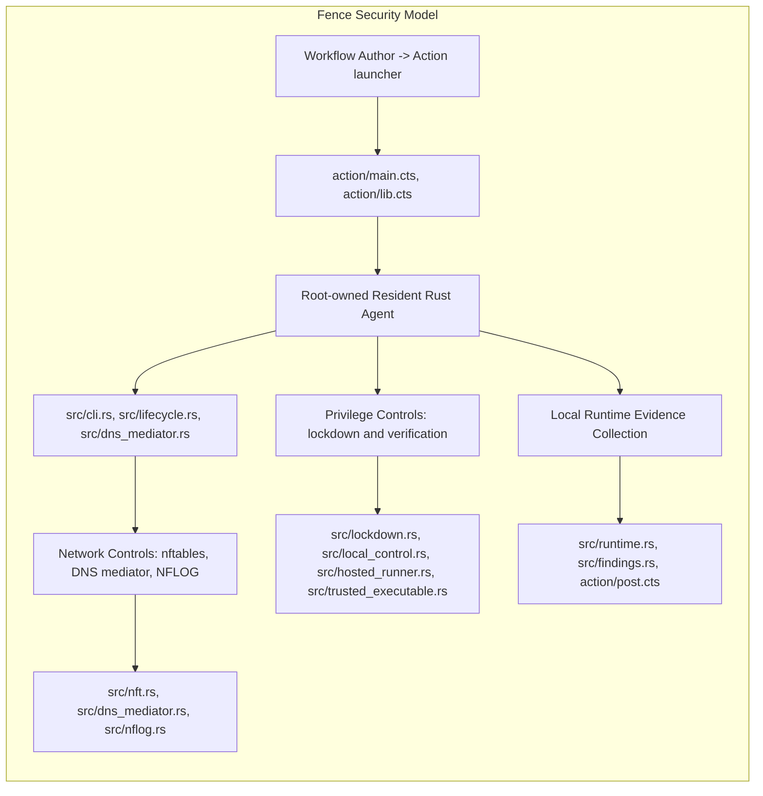
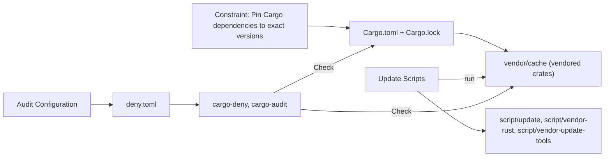

<!-- source: DeepWiki mcp.deepwiki.com · repo openai/fence · page 6 Security and Release Engineering · fetched 2026-10-26 -->

# Security and Release Engineering

Relevant source files

The following files were used as context for generating this wiki page:

- [SECURITY.md](SECURITY.md)
- [docs/security.md](docs/security.md)
- [docs/threat-model.md](docs/threat-model.md)

This section provides a high-level overview of the security posture and release engineering practices for the Fence project. It introduces the core themes of the threat model, supply-chain dependency policies, and the release provenance system. Each topic is covered succinctly here, with links to dedicated child pages for detailed information and technical specifics.

---

## Overview

Fence is a GitHub Action designed to enforce egress network filtering and lockdown of GitHub-hosted runners to improve workflow security. This section covers the foundational security design, supply-chain dependency controls, and how Fence’s releases are verified and attested to guarantee provenance and integrity.

Three main topics structure Fence’s security and release engineering:

- **Threat Model and Security Review**: Defines Fence’s trust assumptions, the space of protection provided, known limitations, and established security controls.
- **Dependency Policy and Audits**: Describes how dependencies are pinned, vendored, audited, and updated to minimize supply-chain risks.
- **Release Provenance and Evidence Observation**: Explains how Fence’s releases are built, signed, verified, and how runtime evidence from protected jobs is collected and analyzed.

Each topic is explored in its own child page linked below.

---

## 6.1 Threat Model and Security Review

Fence’s threat model lays out the precise scope of its protections and the assumptions about the environment it operates within. It protects outbound network egress from ephemeral GitHub-hosted runners (`ubuntu-24.04` and `ubuntu-latest`) by enforcing allowlists and disabling commonly exploited privilege escalation vectors like passwordless `sudo` and Docker access.

### Key Points:

- Fence runs as the very first workflow step before potentially untrusted job commands.
- It relies on the runner meeting baseline security conditions verified at runtime.
- Fence's protection includes network filtering via `nftables`, DNS mediation, privilege lockdown, and continuous runtime supervision.
- The main residual risks involve allowed destination hosts (e.g., GitHub and Azure services) that Fence cannot block or inspect further.
- Fence has no telemetry or remote control plane — all enforcement is local and self-contained.
- Runtime evidence generated by Fence validates that protections remained effective throughout the job.

The trust boundaries include the GitHub Actions service, the Linux kernel, and the ephemeral hosted runner image. Fence does not protect against a compromised host kernel or hypervisor, nor does it support self-hosted runners, containers, or other architectures.

By using verified native inputs and a locked-down, root-owned agent process, Fence tries to prevent privilege escalation, unauthorized network access, and DNS evasion.

For a complete and detailed description of these assurances, assumptions, and limitations, see the child page: [Threat Model and Security Review](#6.1).

### System Model Diagram: Natural Language to Code Entities

Sources: `docs/threat-model.md:1-65`, `docs/security.md:1-76`, `SECURITY.md:1-62`

---

## 6.2 Dependency Policy and Audits

Fence enforces a strict supply-chain policy to minimize risks from external code dependencies.

### Key Elements:

- All direct Cargo dependencies are pinned to exact versions.
- The `Cargo.lock` file and all vendored crates in `vendor/cache` are committed to the repository to enable offline builds and reproducibility.
- Updates to dependencies and Rust toolchains are performed using dedicated scripts like `script/update`, `script/vendor-rust`, and `script/vendor-update-tools`, ensuring consistent, audited upgrades.
- Routine builds and tests run offline after preparing the Rust toolchain with `script/prepare-rust` to eliminate network-based injection or downgrade risks.
- The `deny.toml` file governs dependency audits, preventing accidental high-risk crates or licenses from entering the build.

These supply-chain measures are strongly coupled to the release engineering pipeline to maintain build hermeticity and traceability.

For comprehensive details on these policies, tooling, and audit processes, see the dedicated child page: [Dependency Policy and Audits](#6.2).

### Dependency Management Diagram: Natural Language to Code Entities

Sources: `SECURITY.md:20-41`, `docs/security.md:11-32`

---

## 6.3 Release Provenance and Evidence Observation

Fence employs a rigorous release engineering process to provide trustworthy release artifacts and runtime evidence.

### Overview:

- Released versions include a signed, pinned source commit (`M`), an exact bundled Action commit (`D`), and a schema versioned manifest.
- Releases are built and signed via GitHub Actions workflows (`.github/workflows/release.yml`) that run acceptance tests and verify bundle integrity.
- The release artifacts include signed attestations and SHA-256 checksums, enabling users to cryptographically verify publication authenticity.
- Fence’s runtime agent and the GitHub Action wrapper perform post-job evidence validation to ensure protections remained effective throughout workflow execution.
- Observations from the hosted runner and agent processes are collected, signed, and incorporated into protected finalization.

This strict evidence model closes the loop on security guarantees from build to runtime execution.

For complete information on release workflows, artifact verification, and runtime evidence collection, see the child page: [Release Provenance and Evidence Observation](#6.3).

### Release Provenance Flow Diagram: Natural Language to Code Entities

```mermaid
flowchart LR
  A["Source commit (M)"] --> B["Signed distribution commit"]
  B --> C["script/assemble-action-bundle"]
  C --> D["GitHub Actions release.yml workflow"]
  D --> E["Acceptance Tests, Attestations, Checksums"]
  E --> F["Published Release Artifacts"]
  F --> G["Action Wrapper (action/main.cts)"]
  G --> H["Runtime Agent (src/cli.rs, src/lifecycle.rs)"]
  H --> I["Evidence Observation (script/observe-hosted-runner, action/post.cts)"]
  I --> J["Post-job report validation"]
```

Sources: `SECURITY.md:45-61`, `docs/release-provenance.md`, `.github/workflows/release.yml`, `script/assemble-action-bundle`, `action/main.cts`, `src/cli.rs`, `src/lifecycle.rs`

---

# Summary

This section defines Fence’s security and release engineering pillars:

| Topic                              | Purpose                                                                                                                        | Reference Child Page                     |
|-----------------------------------|--------------------------------------------------------------------------------------------------------------------------------|----------------------------------------|
| Threat Model and Security Review  | Defines trust boundaries, assumptions, known limitations, and architectural security controls                                   | [Threat Model and Security Review](#6.1) |
| Dependency Policy and Audits       | Describes pinning, vendoring, auditing, and update processes to secure the supply chain                                        | [Dependency Policy and Audits](#6.2)     |
| Release Provenance and Evidence Observation | Explains build reproducibility, artifact attestations, runtime evidence collection, and verification                           | [Release Provenance and Evidence Observation](#6.3) |

Together, these aspects form the foundation of Fence's trustworthy operation as a network isolation and lockdown solution for GitHub Actions workflows.

---

For full technical details, refer to each child page in this section.

---

# References

- [`docs/threat-model.md`](docs/threat-model.md)
- [`docs/security.md`](docs/security.md)
- [`SECURITY.md`](SECURITY.md)
- [`deny.toml`](deny.toml)
- [`script/assemble-action-bundle`](script/assemble-action-bundle)
- [`.github/workflows/release.yml`](.github/workflows/release.yml)
- [`action/main.cts`](action/main.cts)
- [`src/cli.rs`](src/cli.rs)
- [`src/lifecycle.rs`](src/lifecycle.rs)
- [`src/lockdown.rs`](src/lockdown.rs)
- [`src/dns_mediator.rs`](src/dns_mediator.rs)
- [`src/nft.rs`](src/nft.rs)
- [`src/findings.rs`](src/findings.rs)
- [`action/post.cts`](action/post.cts)
- [`script/observe-hosted-runner`](script/observe-hosted-runner)

Sources: All cited files above in respective sections

---

