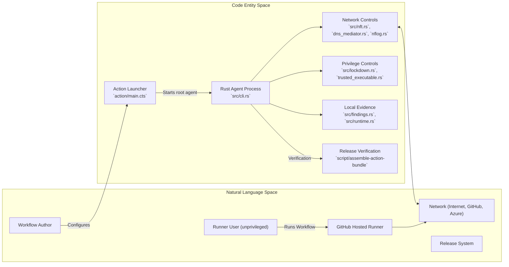
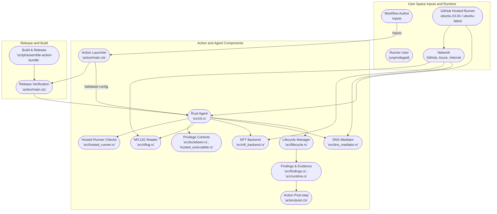

<!-- source: DeepWiki mcp.deepwiki.com · repo openai/fence · page 6.1 Threat Model and Security Review · fetched 2026-10-26 -->

# Threat Model and Security Review

Relevant source files

The following files were used as context for generating this wiki page:

- [SECURITY.md](SECURITY.md)
- [docs/security-review.md](docs/security-review.md)
- [docs/security.md](docs/security.md)
- [docs/threat-model.md](docs/threat-model.md)

This page presents a comprehensive technical overview of Fence's threat model, security assumptions, risk boundaries, and the detailed security review of the implementation. It consolidates information from Fence's security documentation to clarify what threats Fence defends against, its trust assumptions, protections in place, known limitations, and design rationale. The documentation serves workflow authors, maintainers, auditors, and security reviewers seeking an expert understanding of Fence's security posture.

---

## Purpose and Scope

Fence is a GitHub Action and Linux agent designed for egress filtering and runner lockdown on GitHub-hosted runners. It executes as an early workflow step to constrain outbound network connections, disable passwordless sudo and Docker access, and validate runtime integrity through local evidence and release provenance.

This document explains:

- **Threat model:** What attacker capabilities Fence considers, its trust and security assumptions, and what remains outside its protection scope.
- **Data flows and trust boundaries:** How inputs, configurations, and outputs move through Fence’s components and the host environment.
- **Known limitations:** Technical or operational constraints that affect Fence’s security guarantees.
- **Security review highlights:** Key implementation aspects, mitigation strategies, and addressed findings from an internal audit.

Fence supports GitHub-hosted x64 runners using the `ubuntu-24.04` or `ubuntu-latest` images and does not protect against compromised kernels, hypervisors, or self-hosted or containerized runners. It achieves measured isolation and runtime integrity but is not a sandbox.

---

## 1. Threat Model

### 1.1 Executive Summary

Fence enforces network egress policy and privilege lockdown for GitHub Actions jobs by intercepting run-time traffic and privilege changes early in the workflow. It is designed to:

- Limit outbound network connections strictly to required GitHub and Azure services plus user allowlists.
- Disable container runtimes (Docker/containerd) and passwordless sudo in block mode.
- Monitor and verify the runner’s privilege state and firewall state continuously.
- Produce local signed evidence post-job to show enforcement status.
- Use policy and runtime schema versions to tightly control compatibility.
- Verify its own release provenance and acceptance testing.

Any data sent to allowed destinations (e.g., GitHub services or user allowlists) is outside Fence's scope of confidentiality or integrity.

### 1.2 Scope and Assumptions

Fence covers:

- The action launcher and native input validation (`action/main.cts`, `action/lib.cts`).
- The resident Rust agent implementing policy enforcement and runtime supervision (`src/cli.rs`, `src/lifecycle.rs`, `src/dns_mediator.rs`, `src/nft.rs`, `src/lockdown.rs`, `src/hosted_runner.rs`).
- Network controls via `nftables`, DNS mediation, NFLOG packet attribution (`src/nft_backend.rs`, `src/nflog.rs`, `src/attribution.rs`).
- Privilege lockdown, trusted executable pinning, and sudo rollback (`src/trusted_executable.rs`, `src/local_control.rs`).
- Local evidence collection and post-job validation (`src/runtime.rs`, `src/findings.rs`, `action/post.cts`).
- Release verification via offline build, artifact attestation, and reproducible bundle validation (`script/assemble-action-bundle`, `.github/workflows/release.yml`).

Fence assumes:

- It runs before untrusted workflow steps and code checkout.
- The runner is ephemeral and GitHub-hosted on supported Ubuntu images.
- The kernel, hypervisor, GitHub platform, and actions service are trusted.
- The hosted runner image is verified and has not been tampered with before Fence startup.
- Later steps execute as an unprivileged `runner` user.
- Audit and unsafe container preservation modes reflect weaker isolation promises.

Fence does **not** protect against:

- Kernel, hypervisor, or GitHub infrastructure compromise.
- Malicious jobs sending sensitive data to allowed endpoints.
- Containerized job workloads or self-hosted runners.
- Attacks using allowed GitHub wildcard DNS or wildcard HTTPS domains.
- Process isolation gaps, side-channels, or sandbox escape.
- Malicious steps actively aborting their own jobs to avoid detection.

### 1.3 Key Trust Boundaries and Data Flows

Fence enforces strict trust boundaries:

- **Workflow Author** configures Fence via action inputs validated by the action wrapper.
- **Action Launcher** starts a root-owned Rust agent on the runner.
- **Rust Agent** applies network controls, privilege lockdown, and supervises the runtime.
- **Network Controls** enforce egress filtering using nftables and DNS mediation.
- **Privilege Controls** disable privileged access methods and container runtimes.
- **Local Evidence** records enforcement status and findings securely.
- **Release Verification** confirms the authenticity and integrity of the Fence release binary before execution.

### Sources:  
`docs/threat-model.md` lines 1-65,  
`docs/security.md` lines 1-76,  
`docs/security-review.md` lines 1-72,  
`SECURITY.md` lines 1-62.

---

## 2. Security Review Highlights

### 2.1 Supported Runners and Environments

Fence targets **GitHub-hosted runners**:

- x64 architecture
- Ubuntu 24.04 or Ubuntu latest images

Fence does **not** support:

- Self-hosted runners
- Container jobs
- Other OS/architectures (Windows, macOS, ARM)

This controlled environment ensures known runner properties Fence depends on, including standard sudo policies, container runtime presence, and Linux kernel behaviour.

### 2.2 Protection Modes

Fence offers the following modes:

| Mode       | Description                                                                                   |
|------------|-----------------------------------------------------------------------------------------------|
| Block      | Default mode: allows only required network connections plus configured allowlist. Disables passwordless sudo and container runtimes. |
| Audit      | Observes and reports connections that would be blocked but does not block or disable sudo.| 
| Preserved  | `container_policy: unsafe_preserve` keeps Docker/containerd running; network policy active but lesser isolation.|

Block mode achieves stringent isolation by revoking privileged capabilities and network egress. Audit and preserved modes provide visibility with weaker restrictions, meant for investigatory use.

### 2.3 Network Access and Filtering

Fence enforces a whitelist egress policy implemented primarily with:

- **`nftables` firewall rules** (`src/nft.rs`, `src/nft_backend.rs`): applies long-lived rules restricting outbound traffic by IP, port, and interface.
- **DNS Mediation** (`src/dns_mediator.rs`): intercepts DNS queries from job processes, validates responses, and applies corresponding `nftables` rules to permit only approved targets.
- **NFLOG packet auditing** (`src/nflog.rs`): logs outbound connections and attributes them to local processes for reporting.

Certain network endpoints are always allowed:

- GitHub services necessary for job operation (API, website, job reporting).
- Azure platform metadata services (IMDS 169.254.169.254:80 always reachable).
- WireServer 168.63.129.16 limited to root-owned host processes.

Allowlisting is controlled to prevent wildcard domain overbroadness; `disable_broad_github_domains` excludes optional GitHub APIs while retaining job report connectivity.

### 2.4 Privilege Controls and Runner Lockdown

Fence uses several layers to reduce runner privilege exposure:

- **Sudo Policy Pinning:** Captures and pins root-owned sudoers files on startup, disables all passwordless sudo grants in block mode after verifying initial state (`src/hosted_runner.rs`).
- **Trusted Executable Descriptor Pinning:** Opens and pins file descriptors for key privileged commands at startup, verifies during runtime execution, preventing replacement attacks (`src/trusted_executable.rs`).
- **Container Runtime Disablement:** Stops and disables Docker and containerd daemons in block mode preventing container breakout.
- **Local Root-Control Inventory:** Records root-owned listeners, containers, and privileged sockets before lockdown to detect unexpected privilege escalation vectors.
- **Effective Access Checking:** Uses actual file descriptor and ACL checks to confirm runner cannot execute root-only binaries or gain privileges otherwise (`src/local_control.rs`).
- **Bounded Command Execution:** Subprocess invocations (e.g., `sudo`, `nftables`) are executed with timeouts and bounded inputs to avoid hangs or command injection.

### 2.5 Runtime Integrity and Local Evidence

Fence supervises the runtime health and configuration:

- A resident Rust agent monitors its worker threads, DNS socket health, firewall state, and other runtime invariants continuously.
- On job exit, Fence creates detailed signed findings reports summarizing network findings with process attribution while preserving privacy (no command lines or sensitive info leaked).
- Evidence is compact and JSON formatted, includes only necessary metadata for incident investigation, and is validated by the action post-step.
- Fence never uploads telemetry or data remotely.

### 2.6 Release Provenance and Verification

Fence applies strict release controls to ensure integrity and reproducibility:

- Source code is stored on the protected `main` branch; builds are reproducible from exact reviewed commits.
- Release pipeline verifies and signs binary and manifest bundles as distribution commits separate from source commits.
- Release bundles include immutable checksums and GitHub artifact attestations checked at runtime.
- The action wrapper verifies the binary's checksum and manifest signature before startup.
- Block mode tests run on all supported environments for every release.
  
### 2.7 Known Limitations and Threats Outside Scope

Fence does not:

- Prevent data leakage to allowed destinations (content filtering/encryption inspection out of scope).
- Protect against a compromised kernel or hypervisor.
- Support self-hosted runners or jobs inside containers.
- Fully sandbox same-inode modifications on pinned executables after capture.
- Prevent malicious steps from aborting their own jobs to avoid detection.
- Impose network filtering on all outgoing TCP streams besides those permitted by `nftables`.

Run-time, Fence requires:

- The job to run as the first workflow step before any untrusted code.
- The runner environment to meet strict baseline assumptions validated on startup.

---

## 3. Detailed Data Flow and Code Entity Associations

This diagram maps key natural language concepts to core Fence code entities to help security reviewers locate and understand the components implementing each function.

- The **Action Launcher** reads and validates all inputs, ensures the agent binary is verified, and then starts the root-owned Rust agent.
- The **Rust Agent** (`src/cli.rs`) coordinates enforcement using lifecycle supervision (`src/lifecycle.rs`), DNS mediation (`src/dns_mediator.rs`), network enforcement (`src/nft_backend.rs`), NFLOG packet auditing (`src/nflog.rs`), privilege lockdown (`src/lockdown.rs`), and hosted runner verification (`src/hosted_runner.rs`).
- **Findings and evidence** are recorded and verified in the post-job action step.
- **Release pipelines and artifact attestations** secure the provenance and integrity of the deployed action and agent.

### Sources:  
`docs/threat-model.md` lines 50-65,  
`docs/security-review.md` lines 1-72,  
`docs/security.md` lines 1-76.

---

## 4. Threat Model Summary Table

| Category                | Details                                                                               |
|------------------------|---------------------------------------------------------------------------------------|
| **Target Environment** | GitHub-hosted runners, x64, Ubuntu 24.04 or latest images only                        |
| **Protection Goals**    | Restrict network egress, restrict sudo/container access, verify runtime integrity     |
| **Trust Assumptions**   | Trusted kernel, hypervisor, GitHub platform, ephemeral runner                         |
| **Scope Coverage**      | Action launcher, Rust agent, firewall rules, DNS mediation, privilege lockdown        |
| **Known Limitations**   | No sandbox, no packet content filtering, allowed destination confidentiality          |
| **Primary Attacker**    | Malicious job steps with unprivileged runner access                                  |
| **Non-covered Attacks** | Kernel/hypervisor rootkits, compromised images, container breakout, data leakage via allowed hosts |
| **Key Enforcement**     | nftables + DNS rules, sudo policy removal, container daemon shutdown, descriptor pinning |
| **Evidence Provided**   | Signed network and privilege state report with process attribution                    |

---

## 5. References and Further Reading

Fence projects these core security documents for detailed information:

- Threat Model: `docs/threat-model.md`
- Security Guide: `docs/security.md`
- Security Review and Audit Findings: `docs/security-review.md`
- Official Security Policy: `SECURITY.md`
- Release Provenance: `docs/release-provenance.md`

These docs collectively define Fence's security contract, describe limitations and assumptions, and detail continuous efforts to address risks identified through internal reviews.

---

# Appendix: Select Code Paths Related to Security

- Action Entrance and Input Validation: `action/main.cts` lines 10-70
- Agent Main and Lifecycle Management: `src/cli.rs` lines 50-200, `src/lifecycle.rs` lines 30-150
- NFTables Backend and Rule Generation: `src/nft_backend.rs` lines 10-130
- DNS Mediation and Firewall Enforcement: `src/dns_mediator.rs` lines 100-250
- NFLOG Packet Monitoring and Attribution: `src/nflog.rs` lines 20-90
- Privilege Lockdown and Trusted Executables: `src/lockdown.rs` lines 20-250, `src/trusted_executable.rs` lines 10-180
- Hosted Runner Security Checks: `src/hosted_runner.rs` lines 50-200
- Evidence Gathering and Reporting: `src/findings.rs` lines 5-100, `src/runtime.rs` lines 15-70
- Post Job Validation: `action/post.cts` lines 20-80
- Release Bundle Assembly and Validation Scripts: `script/assemble-action-bundle` lines 10-150

---

# Summary

Fence is architected with a defense-in-depth approach that leverages strict policy enforcement, runtime monitoring, and cryptographic release verification to improve GitHub Actions runner security by limiting network egress and privilege escalation paths. It is not a full sandbox but provides a practical containment layer for ephemeral jobs on designated hosted runner environments.

This detailed threat model and security review captures Fence’s security goals, assumptions, implementation mechanisms, operational constraints, and rigorous verification to give maintainers and users confidence in its protections.

---

Sources:  
`docs/threat-model.md` lines 1-65,  
`docs/security.md` lines 1-76,  
`docs/security-review.md` lines 1-72,  
`SECURITY.md` lines 1-62.

---

