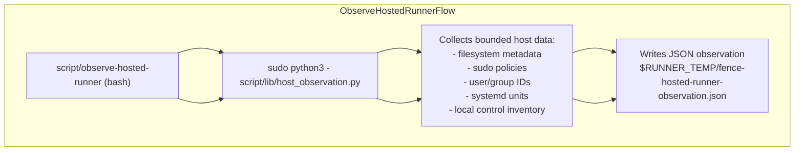
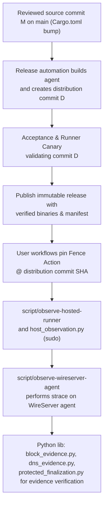

<!-- source: DeepWiki mcp.deepwiki.com · repo openai/fence · page 6.3 Release Provenance and Evidence Observation · fetched 2026-10-26 -->

# Release Provenance and Evidence Observation

<details>
<summary>Relevant source files</summary>

The following files were used as context for generating this wiki page:

- [.github/workflows/release.yml](.github/workflows/release.yml)
- [docs/release-provenance.md](docs/release-provenance.md)
- [script/lib/block_evidence.py](script/lib/block_evidence.py)
- [script/lib/dns_evidence.py](script/lib/dns_evidence.py)
- [script/lib/host_observation.py](script/lib/host_observation.py)
- [script/lib/protected_finalization.py](script/lib/protected_finalization.py)
- [script/observe-hosted-runner](script/observe-hosted-runner)
- [script/observe-wireserver-agent](script/observe-wireserver-agent)

</details>


This page (Section 6.3) documents Fence's **release provenance guarantees** and **evidence collection architecture** that underpin the supply chain security and runtime verification of the Fence GitHub Action and its Linux agent. It explains how releases are constructed from verified source commits, observed on disposable runners, and validated via purpose-built scripts and Python libraries. The key elements include the release workflows, the host and agent observation scripts (`script/observe-hosted-runner`, `script/observe-wireserver-agent`), and the evidence validation modules (`script/lib`) that collect, normalize, and sanity-check runtime data for integrity and security.

---

## 1. Release Provenance Concept and Workflow

Fence enforces supply chain integrity by strictly linking the **source commit** containing reviewed code to an immutable **distribution commit** that contains the built Linux agent and the GitHub Action bundle.

- **Trigger:**
  - A version bump merges into the protected `main` branch, as an explicitly signed commit `M`.
- **Build:**
  - Release automation builds the Linux agent binary **from commit M**, generating two release-only files:
    - `action/bin/fence` (the built Fence binary for the Action)
    - `action/bundle-manifest.json` (the manifest verifying the bundle contents)
  - These files are **never added to `main`** source branch.
- **Distribution Commit:**
  - A distribution commit `D` is created with exactly one parent, `M`.
  - This commit contains the two generated release files and is the source for GitHub Action users.
- **Release Verification:**
  - Acceptance tests and a runner canary job validate commit `D`.
  - The release workflow publishes the immutable release and verifies checksums, build attestations, and the signed relationship `D -> M`.
- **Use:**
  - Workflows **must pin** to the full SHA of the distribution commit when referencing the Fence Action, never to `main`.

This detailed provenance ensures that running Fence means running exactly the audited source at a particular code commit with no runtime fetching or surprises.

```mermaid
flowchart TB
  A[Source Commit M (Protected & Signed)] --> B[Build Linux agent binary & manifest]
  B --> C[Distribution Commit D (adds:\naction/bin/fence,\naction/bundle-manifest.json)]
  C --> D[Acceptance Tests & Runner Canary]
  D --> E[Publish Immutable Release & Verify]
  E --> F[User pins Fence Action to SHA of D]

  subgraph ReleaseSteps
    A --> B --> C --> D --> E
  end

  style A fill:#f9f,stroke:#333,stroke-width:2px
  style C fill:#ccf,stroke:#333,stroke-width:2px
```

**Sources:**  
`docs/release-provenance.md:1-44`  
`.github/workflows/release.yml:1-180`  

---

## 2. Release Workflow Implementation Details

The `.github/workflows/release.yml` file orchestrates the release process with several jobs:

### 2.1 Prepare Job

- Runs only on the official repository (`openai/fence`).
- Checks out the exact pushed commit `M` (`github.sha`) with full history.
- **Validates** the source state (`script/validate-locks --ci`) and fails if release binaries are pre-generated on `main`.
- **Determines release version and state:**
  - Loads commit metadata from the GitHub API.
  - Verifies that the commit is signed (`verification.verified == true`).
  - Reads prior Cargo manifest to detect version bumps.
  - Decides if a new release should be done (`should_release`) by comparing versions.
  - Validates release order against previous releases.
  - Emits release metadata outputs (`version`, `version_tag`, `release_channel`, `source_commit`).
- Outputs `source_date_epoch` for timestamping.

### 2.2 Wait for Required Checks Job

- Depends on `prepare` and runs only if `should_release == true`.
- Checks the GitHub commit status checks API for multiple **required checks**: `lint`, `test`, `build`, `acceptance`, `action acceptance`, `integration`.
- Waits with retry logic to ensure all required checks have succeeded on the exact source commit `M`.

---

### Summary of Outputs during Prepare:

| Output             | Description                                  |
|--------------------|----------------------------------------------|
| `version`          | Version string from Cargo manifest           |
| `version_tag`      | Version tag string prefixed with `v`         |
| `release_channel`  | Which channel to release on (stable/beta/dev)|
| `should_release`   | Boolean indicating if the version changed    |
| `source_commit`    | SHA of the audited source commit `M`         |
| `source_date_epoch`| Commit timestamp as Unix epoch                 |

```mermaid
flowchart LR
    Checkout[Checkout Commit M] --> ValidateSource[Validate source state\n(script/validate-locks)]
    ValidateSource --> DetermineRelease[Determine version bump\n& release state]
    DetermineRelease --> PublishOutputs[Set release metadata outputs]
    DetermineRelease --> WaitChecks[Wait for GitHub PR checks\n(lint, test, build, acceptance, integration)]

    subgraph prepare_job
        Checkout --> ValidateSource --> DetermineRelease --> PublishOutputs
    end

    WaitChecks --> Finished("Release Ready")
```

**Sources:**  
`.github/workflows/release.yml:21-180`  

---

## 3. Host Evidence Observation

Fence collects evidence about the runner environment to ensure that the runtime platform matches expectations and that no suspicious process or configuration drift has occurred.

### 3.1 `script/observe-hosted-runner`

This script:

- Runs **only on Linux x86_64 disposable GitHub Actions runners** (`CI == true` and `GITHUB_ACTIONS == true`).
- Uses `sudo` to invoke a Python 3 helper (`script/lib/host_observation.py`) to collect **bounded and sanitized data** on:
  - Required security-relevant filesystem paths and symlinks.
  - Sudo policies and policy ancestor directories.
  - User/group identity of the runner principal.
  - Systemd unit statuses and socket ownerships.
  - Local control inventory regarding system state.
- Writes this observation output as JSON to a runner-temporary file (`$RUNNER_TEMP/fence-hosted-runner-observation.json`).
- Disallows environment variables or mutable files apart from this evidence JSON.
- Does careful access permission checking and resolves canonical paths.
- Enforces caps on data sizes (`MAX_SCHEMA4_OUTPUT_BYTES`) and limits on enumerations such as processes and open fds.

The observation is structured into a **"schema4"** JSON format, including:

- Metadata about observed files and directories.
- Identity classification of owners and groups against reviewed "runner" principals.
- Systemd unit evidence identifying running Azure platform agents.
- Local control inventory observation for validation.



**Sources:**  
`script/observe-hosted-runner:1-183`  
`script/lib/host_observation.py:1-201` (partial)  

---

## 4. WireServer Agent Evidence Observation

Fence further observes the **Azure WireServer agent** to verify platform-level agent activities ensuring no silent or malicious network activity.

### 4.1 `script/observe-wireserver-agent`

Key behavior:

- Runs **only on the Linux x86_64 disposable GitHub Actions runner** environment.
- Takes two arguments:
  - `<host-observation-json>`: Observed host JSON output from the previous script.
  - `<output-json>`: Path to write the WireServer agent observation.
- Validates that host evidence is present and version matches expectations.
- Extracts Azure platform agent systemd control group info.
- Uses `strace` attached to all processes in the Azure agent cgroup.
- Monitors `connect()` syscalls with `AF_INET` sockets targeting the WireServer IP `168.63.129.16` on designated ports.
- Collects bounded trace lines, limits size and duration (15 seconds max).
- Aggregates and writes detailed observations to the output JSON file.
- Exits early with empty observations if validation fails or strace is unavailable.

```mermaid
flowchart TD
    Start["Run script/observe-wireserver-agent"]
    Start --> LoadHostObservation["Load host-observation.json"]
    LoadHostObservation --> ValidateHost["Validate schema version, agent status"]
    ValidateHost --> CheckStrace["Check strace executable availability"]
    CheckStrace --> AttachStrace["Attach strace to Azure agent cgroup PIDs"]
    AttachStrace --> MonitorConnects["Monitor connect() syscalls to WireServer IP"]
    MonitorConnects --> AggregateObservations["Aggregate and truncate if needed"]
    AggregateObservations --> WriteOutput["Write observation JSON file"]
    WriteOutput --> End

    subgraph ObserveWireServerAgentFlow
        Start --> LoadHostObservation --> ValidateHost --> CheckStrace --> AttachStrace --> MonitorConnects --> AggregateObservations --> WriteOutput --> End
    end
```



**Sources:**  
`script/observe-wireserver-agent:1-204`  

---

## 5. Evidence Validation Modules in `script/lib`

Fence uses specialized Python libraries to validate evidence JSON reports emitted by the observation scripts:

### 5.1 `block_evidence.py`

- Provides functions to verify **blocked network event evidence** correctness.
- Sends test UDP probes to known diagnostic IPs and ports.
- Waits for counters and firewall hashes to increment, verifying that blocked attempts are reported.
- Ensures that rejected packets' payloads are never retained in findings to avoid leaking info.
- Implements retries with timing limits.
- Includes unittest coverage with simulated reports.

### 5.2 `dns_evidence.py`

- Validates **DNS materialization rejection counts and reasons** reported by Fence.
- Checks total rejection counts vs. categorized reasons.
- Marks "firewall_update_failed" as fatal rejection error.
- Validates counters as integers within safe bounds.
- Provides unittests to check valid and invalid scenarios.

### 5.3 `protected_finalization.py`

- Validates **finalization reports** after Fence blocking runs.
- Checks structured report fields against exact expected sets.
- Validates timestamps and finalization step completion.
- Verifies warnings and omission counts match the expected quiet profiles.
- Includes logic for specialized zero-input burst action runs.
- Sanitizes against unknown or unexpected metadata fields.
- Provides unittests.

```mermaid
classDiagram
    class BlockEvidence:
        +assert_block_evidence_drains(report_path: Path) -> None

    class DnsEvidence:
        +validate_materialization_rejections(document: dict, public: bool) -> dict

    class ProtectedFinalization:
        +validate_action_finalization_report(report: dict, job_name: str) -> dict
        +validate_finalization_jobs(document: dict, job_set: str) -> None

    BlockEvidence <.. ProtectedFinalization : uses
    DnsEvidence <.. ProtectedFinalization : uses
```

**Sources:**  
`script/lib/block_evidence.py:1-170` (partial)  
`script/lib/dns_evidence.py:1-107` (full)  
`script/lib/protected_finalization.py:1-158` (partial)  

---

## 6. Data Flow and Integration Overview

Fence's **release provenance and observation** form a pipeline connecting the build-time release workflow to runtime evidence validation on GitHub Actions runners:



- The release workflow anchors the exact binary users run to commit `M`.
- The hosted runner observation collects immutable evidence about the runner host environment.
- The WireServer agent observation extends host insight into Azure platform agent syscalls.
- Evidence validation modules verify that runtime observations match Fence's security and network policy expectations.

---

# Summary

The Fence project implements a rigorous and transparent release provenance mechanism ensuring that every Fence GitHub Action run has a fully verified, immutable origin from reviewed source commits through the distribution commit that contains the built and attested binaries.

At runtime, specialized observation scripts running with bounded permissions gather detailed evidence about the host and platform agent processes, which is validated by Python evidence modules to enforce the correctness and security of the environment.

Together, these systems protect Fence’s supply chain and runtime network enforcement, providing strong guarantees for users deploying Fence in GitHub CI workflows.

---

# References

- `docs/release-provenance.md` — high-level provenance overview  
- `.github/workflows/release.yml` — CI release workflow steps and validation logic  
- `script/observe-hosted-runner` — host environment observation script invoking `host_observation.py`  
- `script/observe-wireserver-agent` — WireServer agent runtime syscall observation  
- `script/lib/block_evidence.py` — block evidence validation library  
- `script/lib/dns_evidence.py` — DNS materialization refusal validation  
- `script/lib/protected_finalization.py` — protected finalization report validation  

---

This page is a LEAF page in the Fence documentation hierarchy with no children.

---

