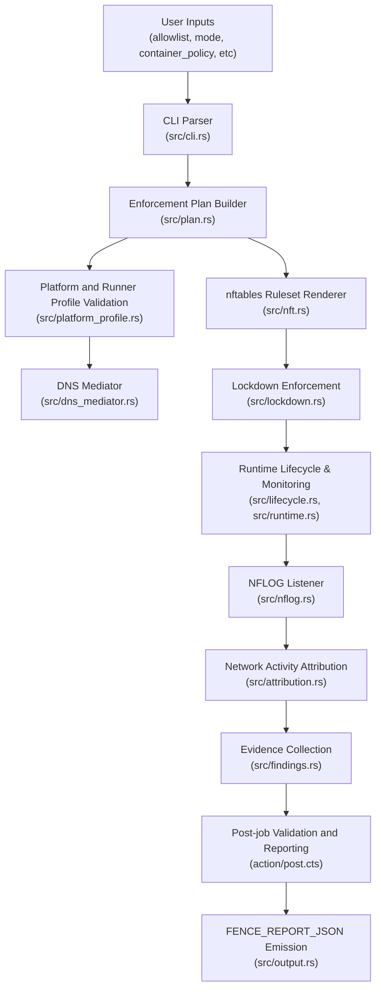

<!-- source: DeepWiki mcp.deepwiki.com · repo openai/fence · page 7 Glossary · fetched 2026-10-26 -->

# 7. Glossary

<details>
<summary>Relevant source files</summary>

The following files were used as context for generating this wiki page:

- [AGENTS.md](AGENTS.md)
- [README.md](README.md)
- [docs/allowlist.md](docs/allowlist.md)
- [docs/how-it-works.md](docs/how-it-works.md)
- [docs/v0.md](docs/v0.md)

</details>


This glossary page provides detailed definitions and explanations of Fence-specific terms and jargon that frequently appear throughout the codebase and documentation. Each entry includes references to relevant code files, critical classes or functions, and data flow explanations where applicable. Mermaid diagrams illustrate key conceptual mappings between domain concepts ("Natural Language Space") and precise code entities ("Code Entity Space") to aid navigation and comprehension of the Fence code.

---

## Allowlist Entry

**Definition**: An `allowlist entry` identifies a network destination (hostnames, IPs, CIDRs, ports, protocols) explicitly permitted for outbound connections by Fence.

**Implementation Details**:  
Allowlist entries are parsed and validated during plan building (`src/plan.rs`, starting line ~80) to create enforcement rules. Entries support formats like bare hostnames (defaulting TCP port 443), port-specified, protocol prefixes (`tcp://`, `udp://`), explicit IPs, CIDR networks, and one- or two-level hostname wildcards:

- Wildcards must match exactly one hostname segment per `*`
- Up to 64 unique entries are permitted, normalized for counting.

Validation logic exists in `src/plan.rs` and helper modules, ensuring proper normalization, wildcard bounds, and validity before enforcement plans are applied.

Usage examples reside in `docs/allowlist.md`.

**Key Classes/Functions**:  
- `Plan::from_allowlist` in `src/plan.rs` responsible for creating enforcement plans from allowlist entries.  
- Validation helper functions for wildcard matching and entry normalization.

Sources: `docs/allowlist.md`, `src/plan.rs:50-150`()

---

## Audit vs Block Mode

**Definition**: Fence operates in two primary modes:

- **Block Mode** (default): Actively enforces network restrictions by blocking disallowed outbound traffic, disables passwordless `sudo` and Docker/container access and claims containment.
- **Audit Mode**: Passive mode that observes all activity, logs what would be blocked but does *not* enforce blocking or lockdown features. Allows more permissive behavior to help build allowlists.

**Implementation Details**:  
Mode selection occurs in the CLI and enforcement plan building (`src/cli.rs`, `src/plan.rs`). The mode influences the resulting nftables rulesets (`src/nft.rs`), runtime lockdown behavior (`src/lockdown.rs`), and reporting (`src/findings.rs`, `src/output.rs`). Audit mode installs monitoring rules and DNS mediation without disabling sudo or Docker; block mode applies strict containment rules.  

Fence's runtime dip switches between modes through the verified transient systemd unit identity combined with configuration input. Post-job evidence collection verifies the mode adhered to during execution.

**Key Code Locations**:  
- Mode parsing: `src/cli.rs`  
- Enforcement decision: `src/plan.rs` functions deciding on `Mode::Block` or `Mode::Audit`.  
- Enforcement application: `src/nft.rs` and `src/lockdown.rs`.  
- Reporting mode in `src/findings.rs`.

Sources: `docs/how-it-works.md`, `src/cli.rs:20-80`, `src/plan.rs:150-220`, `src/nft.rs`, `src/lockdown.rs`, `src/findings.rs`()

---

## Lockdown

**Definition**: The lockdown phase is the process where Fence disables runner capabilities that could circumvent network protections, primarily passwordless `sudo` availability and Docker/container runtime access.

**Implementation Details**:  
Lockdown is enacted post-policy validation and nftables application in block mode. Key procedures include:

- Verifying runner capabilities and environment through system inventory and service inspection (`src/lifecycle.rs`).
- Disabling access paths for passwordless sudo either by pinning & removing sudoers rules (`src/lockdown.rs`).
- Disabling Docker and containerd socket access, usually by removing runner access or systemd service control (`src/lockdown.rs`).
- Planning considers `container_policy` inputs (`unsafe_preserve` allows maintaining container access at the cost of containment guarantees).

Lockdown validations are performed throughout runtime lifecycle to ensure protections remain intact.

**Key Classes/Functions**:  
- `Lockdown::enact` in `src/lockdown.rs`.  
- Runner inventory checks in `src/lifecycle.rs`.  
- Sudo policy capture and pinning components.

Sources: `docs/how-it-works.md`, `src/lockdown.rs`, `src/lifecycle.rs`()

---

## Hosted Runner Profile

**Definition**: The formally reviewed and accepted configuration profile that targets GitHub-hosted runners, specifying supported platform versions and security controls.

**Implementation Details**:  
Fence verifies the runner environment matches the `platform_profile`, typically `github_hosted_workflow_bootstrap_v5`. This profile is:

- Verified during plan building (`src/platform_profile.rs`) and runtime (`src/lifecycle.rs`).
- Encodes assumptions about binaries, service activation, root-owned configuration.
- Declares trusted kernel / service binaries hashes pinned in the source agent.
- Required for activating block or audit enforcement modes.

Profiles are strictly validated; unsupported profiles cause immediate rejection.

**Key Code Entities**:  
- `PlatformProfile` enum and validation in `src/platform_profile.rs`.  
- Runtime checks around the pinned `fence-<invocation_id>.service` transient unit in `src/lifecycle.rs`.

Sources: `AGENTS.md:10-30`, `src/platform_profile.rs`, `src/lifecycle.rs`()

---

## Platform Profile

**Definition**: Synonymous with Hosted Runner Profile in Fence’s context, it specifies the known-good runner fingerprint and runtime environment the Fence agent targets for policy enforcement.

**Implementation Details**:  
The platform profile determines:

- Which platform-specific behaviors, systemd service names, and filesystem inventory validations to perform.
- The trusted executable sets and sudoers policies.

The profile is bound within Fence's configuration and immutable during job execution.

Sources: See **Hosted Runner Profile** above.

---

## DNS Mediator

**Definition**: The component that intermediates DNS resolution within the Fence agent to ensure DNS queries from jobs are constrained by policy and traceably attributed.

**Implementation Details**:  
- Implemented in `src/dns_mediator.rs`.
- The mediator handles DNS queries routed through it, enforcing policy-defined allowable responses.
- It implements bounded query-label space, authorizes CNAME delegation, and respects TTL behavior as per the v0 spec.
- The DNS mediator is fundamental to the bounded DNS-mediated host-network policy.
- It also collects DNS query evidence for reporting and alerts if replies are suppressed by policy.

**Key Classes/Functions**:  
- `DnsMediator` struct and its `run` method.  
- DNS interception and query resolution pipelines.

Sources: `docs/v0.md:45-100`, `src/dns_mediator.rs`()

---

## NFLOG

**Definition**: A Netfilter kernel feature Fence uses to log network packet information non-disruptively; used as a data source for connection attribution and activity reporting.

**Implementation Details**:  
- The `src/nflog.rs` module configures NFLOG socket listeners to receive packet metadata from nftables rules.
- Packet logs include source/destination addresses, protocols, and ports.
- NFLOG provides fine-grained visibility into outbound activity without blocking.
- Logs are processed asynchronously and attributed to originating processes or actors.

**Key Code Components**:  
- NFLOG socket initialization and read loops in `src/nflog.rs`.  
- Integration with `src/attribution.rs` for mapping log entries to process identities.

Sources: `docs/how-it-works.md#network-reports`, `src/nflog.rs`, `src/attribution.rs`()

---

## Attribution

**Definition**: The mechanism by which Fence associates observed network activity or DNS queries back to specific runner processes or actors (like a command and its PID).

**Implementation Details**:  
- Centralized in `src/attribution.rs`.
- Uses extended kernel features (e.g., socket marks, process metadata) and NFLOG data to map network events to processes.
- Provides per-actor counts and labels used in enforcement reports and summaries.
- Attribution data forms part of evidence that the reported network activity matches policy expectations.

**Key Concepts**:  
- Runner processes are pinned (e.g., `Runner.Worker`) for trust.
- Attribution is bounded to scoped processes and their descendants as per the v0 specification.

Sources: `docs/v0.md:80-110`, `src/attribution.rs`, `src/nflog.rs`()

---

## Evidence

**Definition**: Data collected and verified by Fence at runtime to prove that protections (network rules, sudo lockdown, container restrictions) have been applied and not modified unexpectedly.

**Implementation Details**:  
- Evidence includes system inventories, service and socket ownership, captured sudo policies, active nftables rules, DNS mediator status, and NFLOG traffic.
- Collected and validated during the lifecycle in `src/lifecycle.rs` and `src/findings.rs`.
- Post-job validation in the Action wrapper (`action/post.cts`) confirms that the job ran with expected protections.
- Evidence forms the basis of trust for releasing the network protection claims and job summaries.

Sources: `AGENTS.md:6-20`, `src/lifecycle.rs`, `src/findings.rs`, `action/post.cts`()

---

## Protected Finalization

**Definition**: A post-job step where Fence validates the observed and collected evidence of enforcement to conclude the job with a trustworthy network activity report or fail if protections were deviated.

**Implementation Details**:  
- Implemented as the `post` step in the GitHub Action wrapper (`action/post.cts`).
- Verifies all local evidence (stored in bounded files and logs) matches expected schema and content.
- If evidence validation fails, the job is marked failed with diagnostics.
- On success, emits the `FENCE_REPORT_JSON=` single-line JSON report for consumption.

Sources: `action/post.cts`, `src/findings.rs`, `src/output.rs`()

---

## Action Bundle

**Definition**: A signed and versioned distribution artifact containing the Fence binary, manifest, and metadata files, used by the GitHub Action wrapper to run the Fence agent securely.

**Implementation Details**:  
- Created by build scripts in `script/assemble-action-bundle`.
- Manifest file `action/bundle-manifest.json` pins schema version, Fence binary checksum, runtime identifiers.
- The Action wrapper (`action/main.cts`) verifies the checksum before executing the Fence binary.
- Bundle classification is done to determine compatibility (`script/classify-action-bundle-host` and related helpers).

Sources: `script/assemble-action-bundle`, `action/main.cts`, `action/bundle-manifest.json`, `script/classify-action-bundle-host.py`()

---

## Drift Canary

**Definition**: A scheduled or continuous integration workflow that detects unintentional changes ("drift") in Fence's critical configuration, dependencies, or runtime environment.

**Implementation Details**:  
- Implemented via GitHub Actions workflows (`.github/workflows/action-drift-canary.yml`).
- Runs fence with known inputs and compares outputs, ensures vendored dependencies, lockfiles, toolchain pins, and runtime behaviors have not changed unexpectedly.

Sources: `.github/workflows/action-drift-canary.yml`, `docs/security.md` references, `script/validate-locks`()

---

## Vendored Sources

**Definition**: Complete copies of external Rust crates, tooling binaries, and test utilities stored inside the repository under the `vendor/` directory to enable fully offline, hermetic builds.

**Implementation Details**:  
- Vendoring is handled by `cargo vendor` and custom scripts in `script/`.
- Vendor directories: `vendor/cache` (crate sources), `vendor/release-tools`, and `vendor/test-tools`.
- `src/` crate and action wrapper build against these vendored dependencies as controlled by `.cargo/config.toml`.
- Lockfile pinning and strict vendoring ensure no implicit internet fetches post-bootstrap.

Sources: `README.md#Build-Tooling-Vendoring`, `script/bootstrap`, `script/validate-locks`, `vendor/*`()

---

## Lockfile Pinning

**Definition**: The practice of pinning exact versions of dependencies and tools via lockfiles and explicit Rust toolchain files to prevent accidental upgrades or changes.

**Implementation Details**:  
- Managed under `.cargo/tooling/` directory.
- Files include pinned Rust toolchain (`rust-toolchain.toml`), `cargo-zigbuild`, `cargo-llvm-cov`, `cargo-deny` versions.
- Scripts like `script/validate-locks` ensure consistency and verify locked versions.
- Enables reproducible builds offline when combined with vendored sources.

Sources: `script/validate-locks`, `.cargo/tooling/*`, `script/bootstrap`()

---

## FENCE_REPORT_JSON

**Definition**: A machine-readable JSON report emitted as a single-line prefixed with `FENCE_REPORT_JSON=` in Fence’s post-job log output describing job network activity, active protections, and warnings.

**Implementation Details**:  
- Constructed in `src/output.rs` from `src/findings.rs` data.
- Includes schema version, mode (audit/block), result status (healthy, warning), detailed destination activities, actor counts, and warnings.
- Emitted by the Action wrapper’s post step (`action/post.cts`) after evidence verification.
- Designed to be fetched via GitHub API for external automation.

**Report Example Snippet**:
```json
{
  "schema_version": 1,
  "mode": "audit",
  "result": "healthy",
  "network": [
    {
      "destination_kind": "hostname",
      "destination": "api.example.com",
      "decision": "would_block",
      "activities": [...],
      "count": 3
    }
  ],
  "warnings": {...},
  "suggested_allowlist": ["api.example.com"]
}
```

Sources: `docs/how-it-works.md#network-reports`, `src/findings.rs`, `src/output.rs`, `action/post.cts`()

---

# Diagrams

## Diagram 1: Mapping Natural Language Terms to Key Code Entities

```mermaid
flowchart TD
  NLAllowlist["Allowlist Entry"]
  NLAuditBlock["Audit vs Block Mode"]
  NLLockdown["Lockdown"]
  NLHostedProfile["Hosted Runner Profile"]
  NLPlatformProfile["Platform Profile"]
  NLDNSMediator["DNS Mediator"]
  NLNFLOG["NFLOG"]
  NLAttribution["Attribution"]
  NLEvidence["Evidence"]
  NLProtectedFinalization["Protected Finalization"]
  NLActionBundle["Action Bundle"]
  NLDriftCanary["Drift Canary"]
  NLVendoredSources["Vendored Sources"]
  NLLockfilePinning["Lockfile Pinning"]
  NLFenceReportJSON["FENCE_REPORT_JSON"]

  CEPlan["src/plan.rs\n(Plan::from_allowlist)"]
  CLCli["src/cli.rs (mode parsing)"]
  CLLockdown["src/lockdown.rs (Lockdown::enact)"]
  CLPlatformProfile["src/platform_profile.rs\n(src/lifecycle.rs verification)"]
  CLDNSMediator["src/dns_mediator.rs (DnsMediator struct)"]
  CLNFLOG["src/nflog.rs"]
  CLAttribution["src/attribution.rs"]
  CLEvidence["src/lifecycle.rs\nsrc/findings.rs"]
  CLPost["action/post.cts\n(src/findings.rs, src/output.rs)"]
  CLActionBundle["script/assemble-action-bundle\naction/main.cts"]
  CLDrift[".github/workflows/action-drift-canary.yml"]
  CLVendor["vendor/cache/\nvendor/release-tools/\nvendor/test-tools/"]
  CLLockfile[".cargo/tooling/\nscript/validate-locks"]
  CLReportJSON["src/output.rs\naction/post.cts"]

  NLAllowlist --> CEPlan
  NLAuditBlock --> CLCli
  NLAuditBlock --> CEPlan
  NLAuditBlock --> CLLockdown
  NLLockdown --> CLLockdown
  NLHostedProfile --> CLPlatformProfile
  NLPlatformProfile --> CLPlatformProfile
  NLDNSMediator --> CLDNSMediator
  NLNFLOG --> CLNFLOG
  NLAttribution --> CLAttribution
  NLEvidence --> CLEvidence
  NLProtectedFinalization --> CLPost
  NLActionBundle --> CLActionBundle
  NLDriftCanary --> CLDrift
  NLVendoredSources --> CLVendor
  NLLockfilePinning --> CLLockfile
  NLFenceReportJSON --> CLReportJSON
```



---

## Diagram 2: Fence Data Flow From Inputs to Enforcement and Reporting



---

# Summary Table of Terms and Code Locations

| Term                     | Description                                      | Code/Docs Location                          |
|--------------------------|------------------------------------------------|---------------------------------------------|
| Allowlist Entry          | Permitted network destinations                   | `src/plan.rs`, `docs/allowlist.md`          |
| Audit vs Block Mode      | Enforcement modes for observation vs blocking   | `src/cli.rs`, `src/plan.rs`, `src/nft.rs`   |
| Lockdown                | Disabling sudo and container access              | `src/lockdown.rs`, `src/lifecycle.rs`       |
| Hosted Runner Profile   | Verified GitHub-hosted runner config             | `src/platform_profile.rs`, `src/lifecycle.rs`|
| Platform Profile        | Runner environment fingerprint                    | `src/platform_profile.rs`                    |
| DNS Mediator            | Intercepts and enforces DNS queries               | `src/dns_mediator.rs`                        |
| NFLOG                   | Netfilter logging for network activity            | `src/nflog.rs`                               |
| Attribution             | Mapping network activity to processes             | `src/attribution.rs`                         |
| Evidence                | Runtime data proving protection enforcement       | `src/lifecycle.rs`, `src/findings.rs`       |
| Protected Finalization  | Post-job validation of protections                 | `action/post.cts`                            |
| Action Bundle           | Signed agent binary and manifest                   | `script/assemble-action-bundle`, `action/main.cts` |
| Drift Canary            | CI workflow detecting configuration drift         | `.github/workflows/action-drift-canary.yml` |
| Vendored Sources        | Offline cached crates and tools                     | `vendor/` directory                          |
| Lockfile Pinning        | Exact versions of tools/dependencies               | `.cargo/tooling/`, `script/validate-locks`  |
| FENCE_REPORT_JSON       | JSON-formatted job network activity report          | `src/output.rs`, `action/post.cts`           |

---

# References

- `docs/allowlist.md`  
- `docs/how-it-works.md`  
- `docs/v0.md`  
- `AGENTS.md`  
- `src/cli.rs`  
- `src/plan.rs`  
- `src/platform_profile.rs`  
- `src/dns_mediator.rs`  
- `src/nft.rs`  
- `src/lockdown.rs`  
- `src/lifecycle.rs`  
- `src/nflog.rs`  
- `src/attribution.rs`  
- `src/findings.rs`  
- `src/output.rs`  
- `action/main.cts`  
- `action/post.cts`  
- `script/assemble-action-bundle`  
- `.github/workflows/action-drift-canary.yml`  
- `.cargo/tooling/*`  
- `vendor/`  

Sources: multiple files as indicated above.