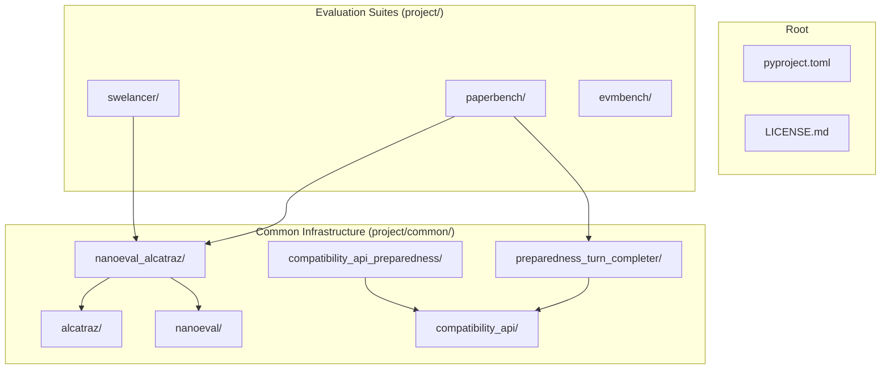
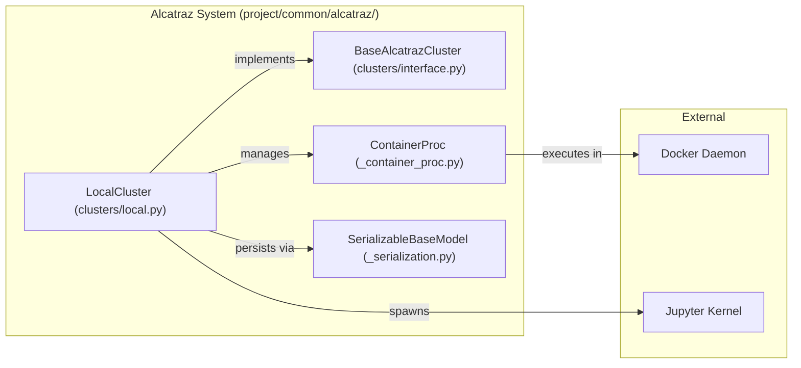
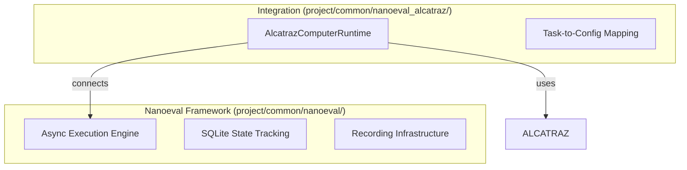

<!-- source: DeepWiki mcp.deepwiki.com · repo openai/frontier-evals · page 1 Overview · fetched 2026-10-26 -->

# Overview

Relevant source files

The following files were used as context for generating this wiki page:

- [LICENSE.md](LICENSE.md)
- [README.md](README.md)

## Purpose and Scope

The `frontier-evals` repository contains the evaluation suites used to measure the capabilities of frontier AI models across complex, real-world domains. It focuses on three primary benchmarks: **PaperBench** (AI research replication), **SWE-Lancer** (software engineering), and **EVMbench** (smart contract security).

The repository is organized as a monorepo, utilizing shared infrastructure for containerized execution (Alcatraz), evaluation orchestration (Nanoeval), and environment abstraction (Compatibility API). This modular architecture ensures that diverse evaluations can leverage a stable, high-performance backend for model interaction and task execution.

**Sources:** [README.md:1-7](), [README.md:25-35]()

## Repository Architecture

The repository follows a decoupled monorepo pattern where evaluation projects reside in `project/` and shared libraries reside in `project/common/`. Each directory is an independent project with its own dependency manifest.

### Monorepo Layout

**Sources:** [README.md:27-35](), [README.md:37-38]()

### Component Summary

| Component | Path | Description |
| :--- | :--- | :--- |
| **PaperBench** | `project/paperbench/` | Evaluates end-to-end replication of state-of-the-art AI papers. [README.md:5]() |
| **SWE-Lancer** | `project/swelancer/` | Evaluates models on real freelance software engineering tasks with end-to-end tests. [README.md:6]() |
| **EVMbench** | `project/evmbench/` | Evaluates smart contract security capabilities (Ethereum Virtual Machine). [README.md:7]() |
| **Alcatraz** | `project/common/alcatraz/` | Orchestration system for Docker containers and Jupyter kernels. |
| **Nanoeval** | `project/common/nanoeval/` | Shared evaluation framework (Task/Solver/Eval primitives). |
| **Compatibility API**| `project/common/compatibility_api/` | Abstract interface for storage and task definition. |

## Evaluation Projects

### PaperBench
PaperBench measures the ability of AI agents to perform high-level research tasks, such as reproducing the results of existing AI papers. It utilizes a multi-stage pipeline involving agent rollout, reproduction of results, and automated grading against established rubrics.
**Sources:** [README.md:5]()

### SWE-Lancer
SWE-Lancer tests models on real-world software engineering tasks sourced from freelance platforms. Unlike synthetic benchmarks, it requires the model to navigate large existing codebases and satisfy complex end-to-end test suites.
**Sources:** [README.md:6]()

### EVMbench
EVMbench provides a benchmark for smart contract security. It evaluates the model's performance in detecting vulnerabilities, patching insecure code, and generating exploits (exploits/ploits) within the Ethereum ecosystem.
**Sources:** [README.md:7]()

## Shared Infrastructure Details

### Alcatraz: Container Orchestration
Alcatraz is the primary execution engine for code-based evaluations. It manages the lifecycle of Docker containers where model-generated code is executed safely and in isolation.

**Sources:** [project/common/alcatraz/alcatraz/clusters/local.py](), [project/common/alcatraz/alcatraz/clusters/interface.py](), [project/common/alcatraz/alcatraz/clusters/_container_proc.py](), [project/common/alcatraz/alcatraz/clusters/_serialization.py]()

### Nanoeval: Evaluation Framework
Nanoeval provides the common logic for running evaluations. It abstracts the concepts of a `Task` (the problem), a `Solver` (the model/agent), and an `Eval` (the orchestration logic).

**Sources:** [README.md:31-34]()

## Development Workflow

The repository uses `uv` for dependency management and environment isolation. Each project directory is treated as a standalone workspace.

1. **Environment Setup**: Run `uv sync` within a project directory to install dependencies from the `uv.lock` file. [README.md:13-21]()
2. **Tooling**: Shared configuration for `Ruff` (linting) and `Black` (formatting) is defined in the root `pyproject.toml`. [README.md:29-45]()
3. **Shared Changes**: Modifications to `project/common/` libraries require bumping editable dependencies in the consuming evaluation projects. [README.md:46-47]()

**Sources:** [README.md:13-21](), [README.md:40-47]()

---

