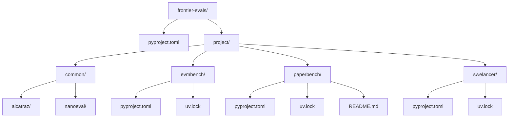
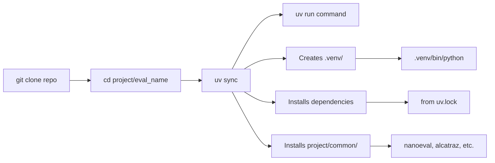

<!-- source: DeepWiki mcp.deepwiki.com · repo openai/frontier-evals · page 2 Getting Started · fetched 2026-10-26 -->

# Getting Started

<details>
<summary>Relevant source files</summary>

The following files were used as context for generating this wiki page:

- [.gitignore](.gitignore)
- [.lfsconfig](.lfsconfig)
- [README.md](README.md)

</details>


This document provides a comprehensive guide for setting up the frontier-evals repository, managing environments with `uv`, and running your first evaluation. It covers the basic workflow for getting started with any of the evaluation projects in the repository.

## Prerequisites

The frontier-evals repository requires the following tools and dependencies:

| Requirement | Purpose | Installation |
|-------------|---------|--------------|
| `uv` | Python package and environment manager | [Install from astral-sh/uv](https://github.com/astral-sh/uv) |
| Docker | Container runtime for evaluation execution | Platform-specific installation |
| Git / Git LFS | Version control and large file support | Platform-specific installation |
| Python 3.8+ | Runtime environment | Managed by `uv` |

Sources: [README.md:10-12](), [.lfsconfig:1-4]()

## Repository Structure

The frontier-evals repository follows a monorepo structure with shared infrastructure and isolated evaluation projects. Each project is self-contained with its own dependency lock file.

**Repository Layout**


Sources: [README.md:25-36]()

## Environment Management with uv

The repository uses `uv` for dependency management. Each evaluation project maintains its own isolated environment with a dedicated `pyproject.toml` and `uv.lock` file. This ensures that dependencies for one benchmark (e.g., PaperBench) do not conflict with another (e.g., EVMbench).

**Environment Setup Workflow**


### Setting Up an Evaluation Environment

1.  **Navigate to the evaluation project**:
    ```bash
    cd project/paperbench  # or swelancer, evmbench
    ```

2.  **Create and activate the environment**:
    ```bash
    uv sync
    ```

3.  **Verify the installation**:
    ```bash
    uv run pytest  # Run tests if available
    ```

The `uv sync` command reads the `uv.lock` file and creates a virtual environment in `.venv/` with all required dependencies installed, including editable installations of shared libraries from `project/common/`.

Sources: [README.md:12-14](), [README.md:39-44]()

## Running Your First Evaluation

Each evaluation project provides specific instructions in its `README.md` file. The general workflow follows this pattern:

### Basic Evaluation Execution Pattern

1.  **Enter the project directory and setup environment**:
    ```bash
    cd project/paperbench
    uv sync
    ```

2.  **Review project-specific documentation**:
    - Read the local `README.md` for configuration options.
    - Check `scripts/` or `runtime_*/` directories for orchestration details.

3.  **Execute the evaluation**:
    Follow the specific commands outlined in the project's README. Most evals use `uv run` to ensure the correct environment is used.

### Evaluation Project Quick Start

| Project | Directory | Purpose |
|---------|-----------|---------|
| **PaperBench** | `project/paperbench/` | End-to-end replication of AI papers |
| **SWE-Lancer** | `project/swelancer/` | Real freelance software engineering tasks |
| **EVMbench** | `project/evmbench/` | Smart contract security tasks |

Sources: [README.md:5-7](), [README.md:14-21]()

## Development Workflow

The repository uses `ruff` for linting and formatting. Configuration is shared via the root `pyproject.toml` and specialized profiles in `project/common/tooling/`.

### Quality Assurance

- **Linting**: Use `uv run ruff check --fix` to automatically fix common issues.
- **Formatting**: The project uses `ruff` (Black-compatible) for formatting.
- **Shared Utilities**: Shared libraries live in `project/common/`. Changes here may affect multiple evals. If you add a new shared subpackage, ensure you update the editable dependencies in the project-level `pyproject.toml` files.

Sources: [README.md:43-47]()

## Data Management

The repository uses **Git LFS** for large datasets, particularly for PaperBench.

- **Exclusion**: By default, some large data paths like `project/paperbench/data/**` are excluded from standard fetches to save bandwidth.
- **Errors**: The configuration `skipdownloaderrors = true` is used to prevent setup failures if specific large blobs are temporarily unavailable.

Sources: [.lfsconfig:1-4]()

## Next Steps

After completing the basic setup:

1.  **Explore specific evaluation projects**: Navigate to the `project/` subdirectories to read detailed instructions for PaperBench, SWE-Lancer, or EVMbench.
2.  **Understand the common framework**: Learn how `nanoeval` provides the base `Eval` and `Task` classes used by the benchmarks.
3.  **Execution Environment**: Familiarize yourself with `alcatraz`, the system responsible for managing Docker containers and Jupyter kernels during evaluation rollouts.

---

