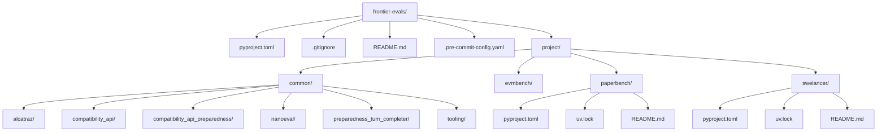
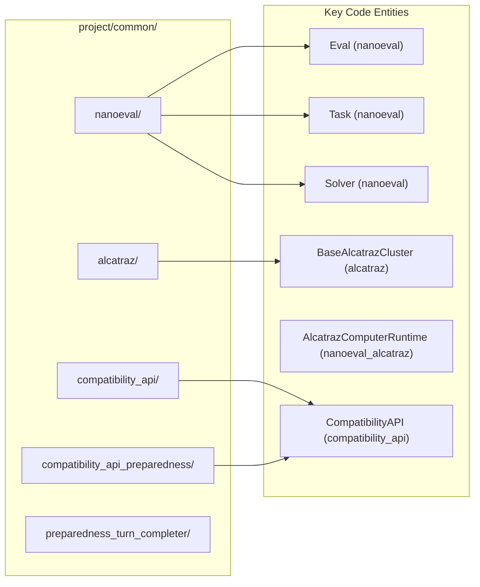
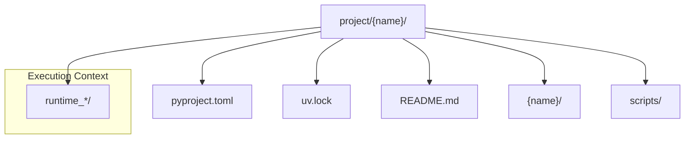
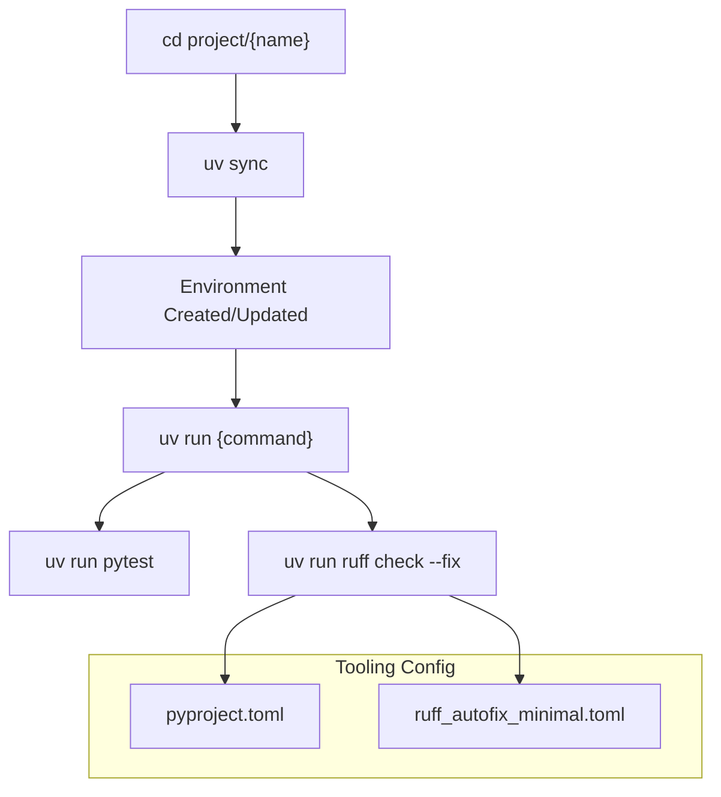

<!-- source: DeepWiki mcp.deepwiki.com · repo openai/frontier-evals · page 3 Repository Structure · fetched 2026-10-26 -->

# Repository Structure

Relevant source files

The following files were used as context for generating this wiki page:

- [.gitignore](.gitignore)
- [.lfsconfig](.lfsconfig)
- [.pre-commit-config.yaml](.pre-commit-config.yaml)
- [README.md](README.md)

This document explains the monorepo organization of the `frontier-evals` repository, covering directory hierarchies, shared library patterns, project isolation mechanisms, and dependency management strategies.

## Repository Organization

The `frontier-evals` repository follows a monorepo pattern with clear separation between shared infrastructure and individual evaluation projects. The top-level structure establishes shared tooling configuration while maintaining project isolation through individual `pyproject.toml` and `uv.lock` files.

### Monorepo Directory Structure

**Sources:** [README.md:25-37](), [.gitignore:1-168](), [.pre-commit-config.yaml:11-51]()

### Configuration Hierarchy

The repository uses a hierarchical configuration approach where shared tooling is defined at the root level and project-specific configurations extend these defaults.

| Configuration File | Scope | Purpose |
|-------------------|-------|---------|
| `pyproject.toml` (root) | Repository-wide | Shared tooling configuration for Ruff, Black, etc. [README.md:29]() |
| `project/*/pyproject.toml` | Project-specific | Dependencies, build settings, and metadata. [README.md:37]() |
| `uv.lock` (per project) | Project-specific | Locked dependency versions for reproducibility. [README.md:37]() |
| `.gitignore` (root) | Repository-wide | Standard Python exclusions and build artifacts. [.gitignore:1-168]() |
| `.pre-commit-config.yaml` | Repository-wide | Orchestrates `ruff` and `uv-lock` hooks across projects. [.pre-commit-config.yaml:1-51]() |

**Sources:** [README.md:29-37](), [.pre-commit-config.yaml:1-51]()

## Shared Libraries Architecture

The `project/common/` directory contains reusable infrastructure components that provide core functionality to evaluation projects. These shared libraries implement the foundational abstractions for evaluation execution, container management, and environment compatibility.

### Core Shared Components

**Sources:** [README.md:31](), [.pre-commit-config.yaml:11-51]()

### Dependency Flow and Tooling

Shared utilities live under `project/common`. Changes to these components may affect multiple evaluations, requiring updates to editable dependencies in project-specific `pyproject.toml` files [README.md:46]().

The `.pre-commit-config.yaml` defines specific scopes for linting and formatting:
- **Ruff Format/Strict**: Targets `alcatraz`, `paperbench`, `swelancer`, `compatibility_api`, `compatibility_api_preparedness`, and `preparedness_turn_completer` [.pre-commit-config.yaml:11-28]().
- **UV Lock**: Manages independent lock files for `paperbench`, `swelancer`, `alcatraz`, and `preparedness_turn_completer` [.pre-commit-config.yaml:34-51]().

**Sources:** [README.md:45-47](), [.pre-commit-config.yaml:11-51]()

## Project Structure Patterns

Each evaluation project (e.g., PaperBench, SWE-Lancer, EVMbench) is an isolated project with its own environment [README.md:37]().

### Standard Project Layout

**Sources:** [README.md:17-21](), [README.md:37]()

### Project Isolation Mechanisms

| Mechanism | Implementation | Purpose |
|-----------|----------------|---------|
| Virtual Environments | `uv sync` per project | Isolated Python dependencies. [README.md:13]() |
| Lock Files | `uv.lock` per project | Reproducible builds. [README.md:37]() |
| Configuration | `pyproject.toml` per project | Project-specific settings. [README.md:37]() |
| Entry Points | `scripts/` or `runtime_*/` | Orchestration details. [README.md:17]() |

**Sources:** [README.md:13-37]()

## Dependency Management Strategy

The repository uses `uv` for modern Python dependency management with emphasis on reproducibility and isolation [README.md:13]().

### Development Workflow Integration

**Sources:** [README.md:41-45](), [.pre-commit-config.yaml:17-19]()

## File Management and LFS

The repository uses Git LFS to manage large datasets, particularly for PaperBench.

### Large File Storage (LFS)
The `.lfsconfig` file is configured to exclude `project/paperbench/data/**` by default during fetches to save bandwidth, unless explicitly requested [.lfsconfig:1-4]().

### Ignored File Categories
The root `.gitignore` handles standard Python artifacts and environment-specific files:
- **Byte-code**: `__pycache__/`, `*.pyc` [.gitignore:7-9]()
- **Environments**: `.venv/`, `venv/`, `.env` [.gitignore:128-130]()
- **IDE Settings**: `.idea/`, `.vscode/` [.gitignore:159-168]()
- **Builds**: `dist/`, `build/`, `*.egg-info/` [.gitignore:16-29]()

**Sources:** [.lfsconfig:1-4](), [.gitignore:1-168]()

---

