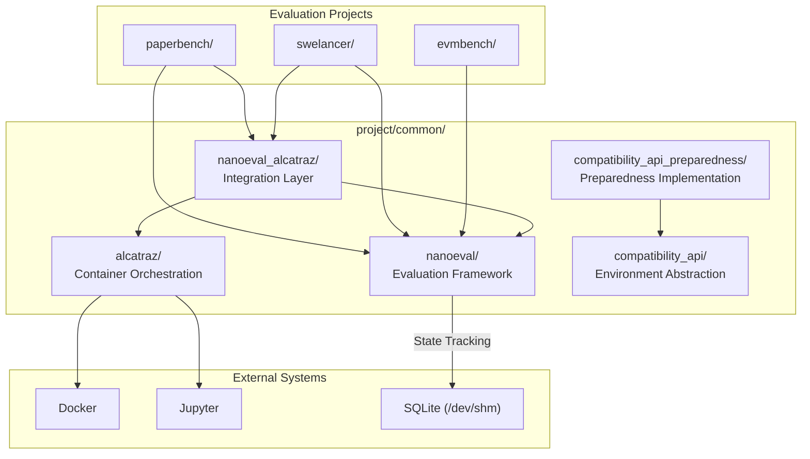
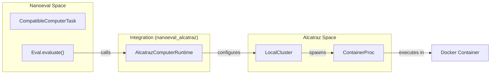

<!-- source: DeepWiki mcp.deepwiki.com · repo openai/frontier-evals · page 4 Core Evaluation Framework · fetched 2026-10-26 -->

# Core Evaluation Framework

Relevant source files

The following files were used as context for generating this wiki page:

- [project/common/compatibility_api/compatibility_api/api.py](project/common/compatibility_api/compatibility_api/api.py)
- [project/common/compatibility_api/compatibility_api/task.py](project/common/compatibility_api/compatibility_api/task.py)
- [project/common/nanoeval/README.md](project/common/nanoeval/README.md)
- [project/common/nanoeval/nanoeval/eval.py](project/common/nanoeval/nanoeval/eval.py)
- [project/common/nanoeval/nanoeval/evaluation.py](project/common/nanoeval/nanoeval/evaluation.py)

## Purpose and Scope

The Core Evaluation Framework provides the shared infrastructure components that enable scalable, reproducible AI model testing across the frontier-evals repository. Located in `project/common/`, these components are designed as modular, reusable libraries that evaluation projects compose to build complete evaluation systems.

This page provides an overview of the core infrastructure components and their roles. For detailed coverage of specific components:
- **Compatibility API**: Abstract environment interfaces. See [Compatibility API](#4.1) and [Compatibility API Preparedness](#4.2).
- **Nanoeval Framework**: The core evaluation engine. See [Nanoeval Framework](#4.3).
- **Alcatraz Integration**: Containerized execution for nanoeval. See [Nanoeval-Alcatraz Integration](#4.4) and [Alcatraz System](#5).

Sources: [project/common/nanoeval/README.md:1-11](), [project/common/compatibility_api/compatibility_api/api.py:7-10]()

## Infrastructure Components Overview

The common infrastructure is organized into specialized components that evaluation projects compose as needed.

### Component Architecture

Sources: [project/common/nanoeval/README.md:32-38](), [project/common/compatibility_api/compatibility_api/api.py:7-10]()

### Component Responsibilities

| Component | Location | Purpose | Key Code Entities |
|-----------|----------|---------|-------------------|
| `nanoeval` | `project/common/nanoeval/` | Core evaluation engine | `Eval`, `Task`, `Solver`, `run_eval_in_database` |
| `compatibility_api` | `project/common/compatibility_api/` | Environment-agnostic storage and task subset | `CompatibilityAPI`, `CompatibleComputerTask` |
| `alcatraz` | `project/common/alcatraz/` | Container orchestration | `LocalCluster`, `ContainerProc` |
| `nanoeval_alcatraz` | `project/common/nanoeval_alcatraz/` | Bridge between framework and containers | `AlcatrazComputerRuntime` |

Sources: [project/common/nanoeval/nanoeval/eval.py:112](), [project/common/compatibility_api/compatibility_api/api.py:7](), [project/common/compatibility_api/compatibility_api/task.py:10]()

## Nanoeval Framework

`nanoeval` is a high-performance library designed for ergonomic evaluation development. It operates like a tiny distributed system, using a per-process SQLite database (typically in `/dev/shm`) to track task state and results.

### Core Primitives
- **`Eval`**: A `chz` class that defines how to get tasks and evaluate them [project/common/nanoeval/nanoeval/eval.py:112-120]().
- **`Task`**: A separable, scoreable unit of work [project/common/nanoeval/nanoeval/eval.py:29-32]().
- **`Solver`**: A strategy to solve a task, often involving model sampling [project/common/nanoeval/README.md:20-22]().
- **`EvalSpec`**: Configuration for a specific run, including concurrency and recording settings [project/common/nanoeval/README.md:17-18]().

### Execution Flow
When `nanoeval.run()` is called, it queues tasks in SQLite. One or more executors (in-process or multiprocessing) poll the database, execute `evaluate()`, and persist results [project/common/nanoeval/README.md:32-44]().

For details, see [Nanoeval Framework](#4.3).

Sources: [project/common/nanoeval/README.md:13-44](), [project/common/nanoeval/nanoeval/evaluation.py:163-197]()

## Compatibility API: Environment Abstraction

The `CompatibilityAPI` provides an abstract interface for operations that vary across deployment environments, such as blob storage access.

### Abstract Interface Definition
The `CompatibilityAPI` class defines abstract properties for storage access:
- `blobstore_root_read`: For read-only access to datasets [project/common/compatibility_api/compatibility_api/api.py:25-32]().
- `blobstore_root_write`: For temporary write access [project/common/compatibility_api/compatibility_api/api.py:14-22]().

### Portable Computer Tasks
`CompatibleComputerTask` restricts the features of `ComputerTask` to a subset that is portable between the Alcatraz container system and other internal environments. It enforces:
- No internet access (`NetworkMode.NONE`) [project/common/compatibility_api/compatibility_api/task.py:30-32]().
- No volume mounts or side images [project/common/compatibility_api/compatibility_api/task.py:33-34]().
- Specific allowed Docker images [project/common/compatibility_api/compatibility_api/task.py:50-54]().

For details, see [Compatibility API](#4.1) and [Compatibility API Preparedness](#4.2).

Sources: [project/common/compatibility_api/compatibility_api/api.py:7-32](), [project/common/compatibility_api/compatibility_api/task.py:10-56]()

## Nanoeval-Alcatraz Integration

This integration layer allows `nanoeval` to execute tasks within isolated Docker containers managed by the Alcatraz system.

### Bridging Code to Containers

The `AlcatrazComputerRuntime` implements the `ComputerInterface` required by `nanoeval` solvers, translating high-level commands into Alcatraz container operations.

For details, see [Nanoeval-Alcatraz Integration](#4.4) and [Alcatraz System](#5).

Sources: [project/common/compatibility_api/compatibility_api/task.py:10-17](), [project/common/nanoeval/README.md:15-22]()

---

