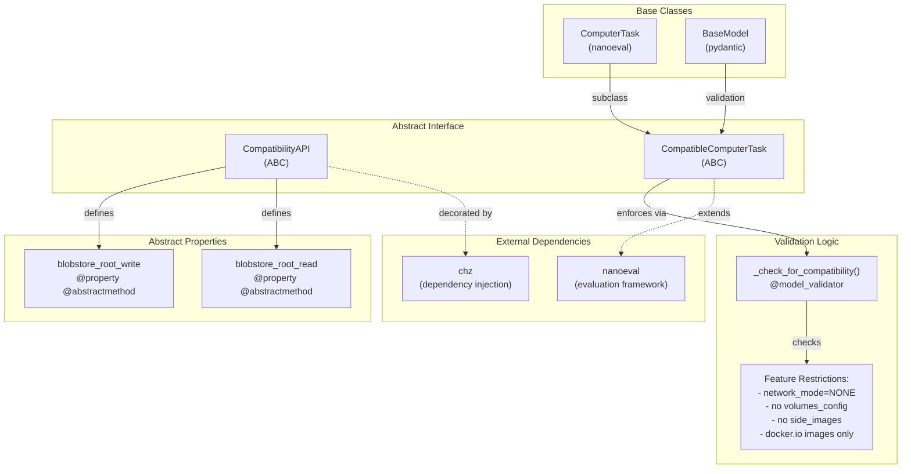
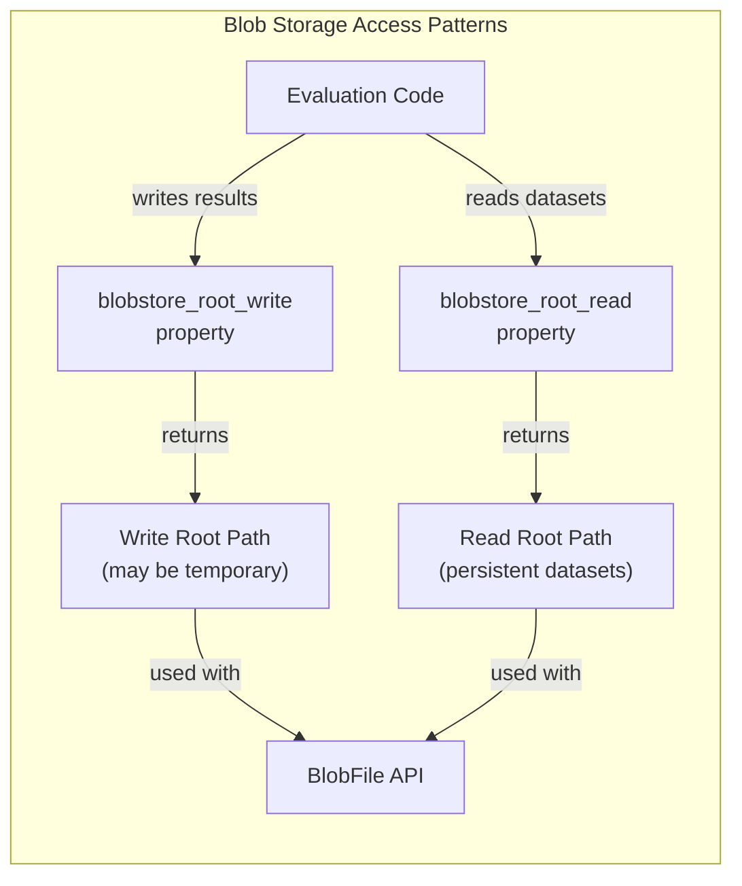
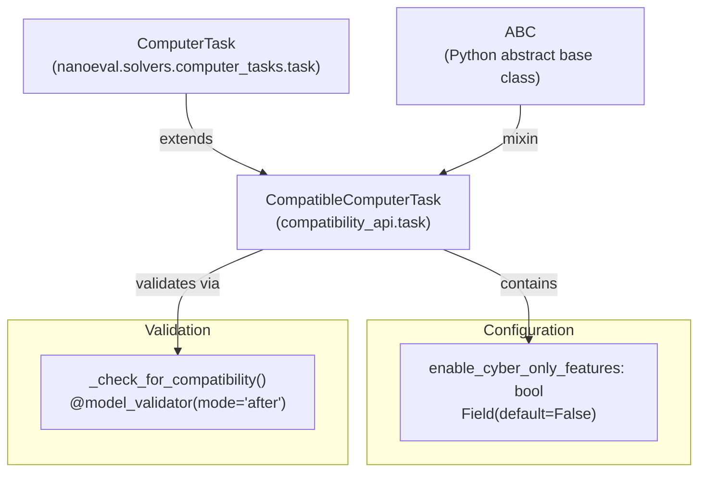
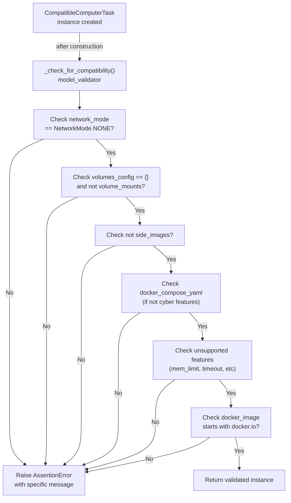

<!-- source: DeepWiki mcp.deepwiki.com · repo openai/frontier-evals · page 4.1 Compatibility API · fetched 2026-10-26 -->

# Compatibility API

Relevant source files

The following files were used as context for generating this wiki page:

- [.github/workflows/compatibility_api_lint.yml](.github/workflows/compatibility_api_lint.yml)
- [project/common/compatibility_api/compatibility_api/api.py](project/common/compatibility_api/compatibility_api/api.py)
- [project/common/compatibility_api/compatibility_api/task.py](project/common/compatibility_api/compatibility_api/task.py)
- [project/common/compatibility_api/pyproject.toml](project/common/compatibility_api/pyproject.toml)

## Purpose and Scope

The Compatibility API provides an abstract interface for writing environment-agnostic evaluations. It abstracts two critical areas of divergence between supported evaluation environments:

1.  **Blob storage access patterns** - Different environments may store and access persistent data differently.
2.  **Task definition constraints** - Different container orchestration systems support different feature sets.

This page documents the abstract interface defined in the `compatibility_api` package. For the concrete implementation used in the openai/preparedness environment, see [Compatibility API Preparedness](). For information about the Alcatraz container orchestration system that implements some of these abstractions, see [Alcatraz System]().

**Sources:** [project/common/compatibility_api/compatibility_api/api.py:1-33](), [project/common/compatibility_api/compatibility_api/task.py:1-57]()

---

## System Architecture

The Compatibility API consists of two main components that work together to enable portable evaluations:

**Architecture Overview**

**Sources:** [project/common/compatibility_api/compatibility_api/api.py:1-33](), [project/common/compatibility_api/compatibility_api/task.py:1-57](), [project/common/compatibility_api/pyproject.toml:1-36]()

---

## CompatibilityAPI Abstract Class

The `CompatibilityAPI` class [project/common/compatibility_api/compatibility_api/api.py:7]() provides an abstract interface for blob storage access. It uses the `chz` dependency injection framework [project/common/compatibility_api/compatibility_api/api.py:6]() and defines two abstract properties.

### Class Definition

| Component | Type | Purpose |
| :--- | :--- | :--- |
| `CompatibilityAPI` | Abstract Base Class | Root interface for environment abstraction [project/common/compatibility_api/compatibility_api/api.py:7]() |
| `@chz.chz` decorator | Dependency Injection | Enables injection of concrete implementations [project/common/compatibility_api/compatibility_api/api.py:6]() |
| `blobstore_root_write` | Abstract Property | Root path for write access to blob storage [project/common/compatibility_api/compatibility_api/api.py:14]() |
| `blobstore_root_read` | Abstract Property | Root path for read-only blob storage access [project/common/compatibility_api/compatibility_api/api.py:26]() |

**Sources:** [project/common/compatibility_api/compatibility_api/api.py:6-32]()

### Blob Storage Properties

**Data Flow for Storage Access**

**Sources:** [project/common/compatibility_api/compatibility_api/api.py:12-32]()

#### blobstore_root_write

This property [project/common/compatibility_api/compatibility_api/api.py:14]() returns a root folder path for write access to blob storage via `BlobFile`.

**Key Characteristics:**
*   Data written to this path is readable **in the current process** [project/common/compatibility_api/compatibility_api/api.py:18]().
*   Data **MAY NOT** be readable at the same path after process exit [project/common/compatibility_api/compatibility_api/api.py:18-19]().
*   Should **NOT** be used for storing datasets (use `blobstore_root_read` instead) [project/common/compatibility_api/compatibility_api/api.py:19-20]().
*   Intended for temporary output, results, and intermediate artifacts.

**Sources:** [project/common/compatibility_api/compatibility_api/api.py:12-22]()

#### blobstore_root_read

This property [project/common/compatibility_api/compatibility_api/api.py:26]() returns a root folder path for read-only access to blob storage.

**Key Characteristics:**
*   Data at this path is **NOT writable** [project/common/compatibility_api/compatibility_api/api.py:31]().
*   Intended for accessing persistent datasets and shared resources.
*   Guarantees stable read access across process boundaries.

**Sources:** [project/common/compatibility_api/compatibility_api/api.py:24-32]()

---

## CompatibleComputerTask Class

The `CompatibleComputerTask` class [project/common/compatibility_api/compatibility_api/task.py:10]() extends `ComputerTask` from `nanoeval` and enforces restrictions to ensure portability across different container orchestration systems like Alcatraz.

### Class Hierarchy

**Inheritance and Structure**

**Sources:** [project/common/compatibility_api/compatibility_api/task.py:10-56]()

### Compatibility Restrictions

The `_check_for_compatibility` validator [project/common/compatibility_api/compatibility_api/task.py:25]() enforces the following restrictions:

#### Network Restrictions

| Restriction | Requirement | Rationale |
| :--- | :--- | :--- |
| `network_mode` | Must be `NetworkMode.NONE` [project/common/compatibility_api/compatibility_api/task.py:30]() | Internet access is not portable across evaluation environments [project/common/compatibility_api/compatibility_api/task.py:27-29]() |

**Sources:** [project/common/compatibility_api/compatibility_api/task.py:27-32]()

#### Volume and Side Container Restrictions

| Feature | Restriction | Line Reference |
| :--- | :--- | :--- |
| `volumes_config` | Must be empty `{}` | [project/common/compatibility_api/compatibility_api/task.py:33]() |
| `volume_mounts` | Must be falsy | [project/common/compatibility_api/compatibility_api/task.py:33]() |
| `side_images` | Must be falsy | [project/common/compatibility_api/compatibility_api/task.py:34]() |

**Sources:** [project/common/compatibility_api/compatibility_api/task.py:33-34]()

#### Docker Compose Restrictions

| Feature | Restriction | Condition |
| :--- | :--- | :--- |
| `docker_compose_yaml` | Must be falsy | Unless `enable_cyber_only_features=True` [project/common/compatibility_api/compatibility_api/task.py:36-37]() |

**Sources:** [project/common/compatibility_api/compatibility_api/task.py:36-37]()

#### Unsupported Features

The following `ComputerTask` features are explicitly disallowed (might work but are untested):

| Feature | Status |
| :--- | :--- |
| `mem_limit` | Not supported [project/common/compatibility_api/compatibility_api/task.py:41]() |
| `shm_size` | Not supported [project/common/compatibility_api/compatibility_api/task.py:42]() |
| `timeout` | Not supported [project/common/compatibility_api/compatibility_api/task.py:43]() |
| `alcatraz_limits` | Not supported [project/common/compatibility_api/compatibility_api/task.py:44]() |
| `jupyter_setup` | Not supported [project/common/compatibility_api/compatibility_api/task.py:45]() |
| `disk_mount_path` | Not supported [project/common/compatibility_api/compatibility_api/task.py:46]() |

**Sources:** [project/common/compatibility_api/compatibility_api/task.py:40-47]()

#### Container Registry Requirements

| Requirement | Details |
| :--- | :--- |
| `docker_image` | Must be specified [project/common/compatibility_api/compatibility_api/task.py:51]() |
| Image source | Must start with `"docker.io"` OR be `"jupyter/base-notebook:3.11"` [project/common/compatibility_api/compatibility_api/task.py:52-53]() |
| Purpose | Ensures use of shared container registries for portability [project/common/compatibility_api/compatibility_api/task.py:54]() |

**Sources:** [project/common/compatibility_api/compatibility_api/task.py:50-54]()

### Validation Flow Diagram

**Task Compatibility Validation Sequence**

**Sources:** [project/common/compatibility_api/compatibility_api/task.py:24-56]()

---

## enable_cyber_only_features Flag

The `enable_cyber_only_features` field [project/common/compatibility_api/compatibility_api/task.py:19]() allows selective relaxation of restrictions for cyber-specific environments that have additional validation mechanisms.

**Behavior:**
*   When `False` (default): `docker_compose_yaml` is not allowed [project/common/compatibility_api/compatibility_api/task.py:37]().
*   When `True`: `docker_compose_yaml` is permitted, assuming the cyber environment handles validation [project/common/compatibility_api/compatibility_api/task.py:20]().

**Sources:** [project/common/compatibility_api/compatibility_api/task.py:19-22](), [project/common/compatibility_api/compatibility_api/task.py:36-37]()

---

## Dependencies

The compatibility API has minimal, well-defined dependencies:

| Dependency | Purpose | Configuration |
| :--- | :--- | :--- |
| `chz` | Dependency injection for `CompatibilityAPI` | Git source: `https://github.com/openai/chz.git` [project/common/compatibility_api/pyproject.toml:15]() |
| `pydantic` | Data validation for `CompatibleComputerTask` | Standard dependency [project/common/compatibility_api/pyproject.toml:5]() |
| `nanoeval` | Base `ComputerTask` class | Local editable dependency [project/common/compatibility_api/pyproject.toml:16]() |

**Development Dependencies:**

| Tool | Purpose | Version |
| :--- | :--- | :--- |
| `mypy` | Type checking | ≥1.15.0 [project/common/compatibility_api/pyproject.toml:10]() |
| `ruff` | Linting and formatting | ≥0.11.7 [project/common/compatibility_api/pyproject.toml:11]() |

**Sources:** [project/common/compatibility_api/pyproject.toml:1-36]()

---

## Usage Patterns

### Implementing a Concrete CompatibilityAPI

To create a concrete implementation (see [Compatibility API Preparedness]() for an example):

1.  Subclass `CompatibilityAPI` [project/common/compatibility_api/compatibility_api/api.py:7]().
2.  Implement `blobstore_root_write` property to return environment-specific write path [project/common/compatibility_api/compatibility_api/api.py:14]().
3.  Implement `blobstore_root_read` property to return environment-specific read path [project/common/compatibility_api/compatibility_api/api.py:26]().
4.  Register implementation with `chz` dependency injection framework [project/common/compatibility_api/compatibility_api/api.py:6]().

### Creating Compatible Tasks

To create a task definition that works across environments:

1.  Subclass `CompatibleComputerTask` instead of `ComputerTask` [project/common/compatibility_api/compatibility_api/task.py:10]().
2.  Ensure `network_mode` is set to `NetworkMode.NONE` [project/common/compatibility_api/compatibility_api/task.py:30]().
3.  Use Docker images from `docker.io` registry [project/common/compatibility_api/compatibility_api/task.py:52]().
4.  Avoid unsupported features (volumes, side containers, resource limits) [project/common/compatibility_api/compatibility_api/task.py:33-47]().
5.  Set `enable_cyber_only_features=True` only if specifically targeting a cyber environment [project/common/compatibility_api/compatibility_api/task.py:19]().

**Sources:** [project/common/compatibility_api/compatibility_api/api.py:6-32](), [project/common/compatibility_api/compatibility_api/task.py:10-56]()

---

## Network Access Rationale

The compatibility API enforces `network_mode = NetworkMode.NONE` for architectural consistency:

> "The only class of eval which is truly 'portable' is one that doesn't require external Internet access at all. This is definitely a large restriction in the design space. My guess is that this matters much more for setup scripts than actually permitting the model network access (e.g., maybe we could disable internet during setup, but re-enable for agent rollout), but I think it seems simpler to drop network access fully." [project/common/compatibility_api/compatibility_api/task.py:27-32]()

This design decision prioritizes **portability** over **flexibility**, ensuring evaluations can run in any environment without external network dependencies.

**Sources:** [project/common/compatibility_api/compatibility_api/task.py:27-32]()

---

