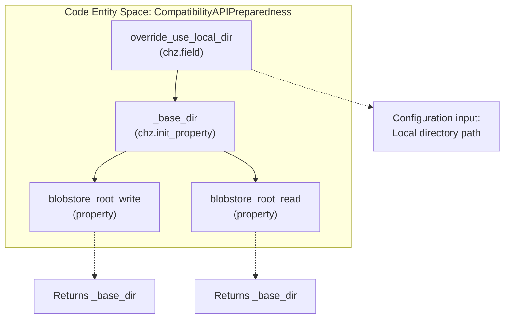
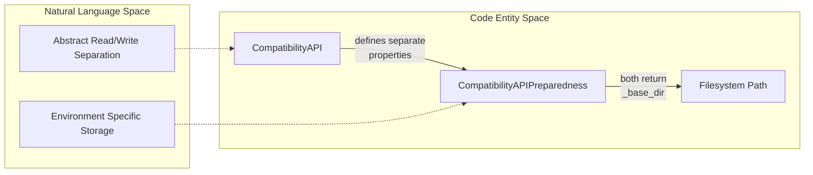
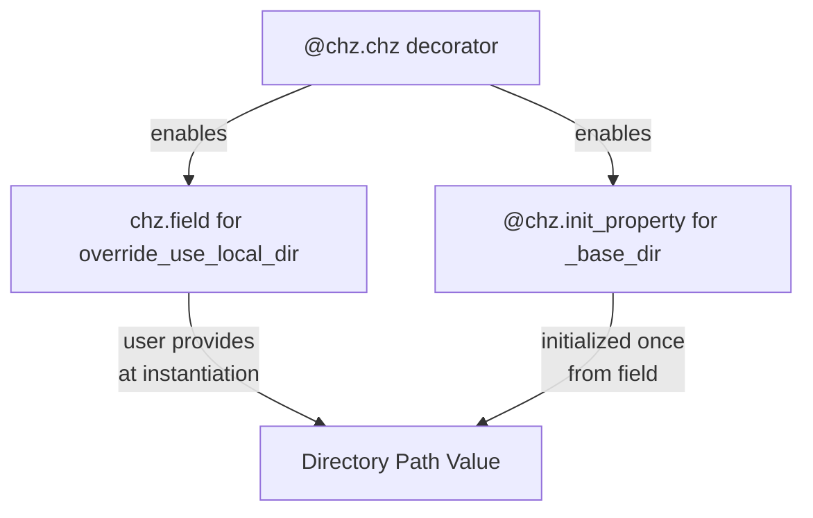

<!-- source: DeepWiki mcp.deepwiki.com · repo openai/frontier-evals · page 4.2 Compatibility API Preparedness · fetched 2026-10-26 -->

# Compatibility API Preparedness

<details>
<summary>Relevant source files</summary>

The following files were used as context for generating this wiki page:

- [.github/workflows/compatibility_api_preparedness_lint.yml](.github/workflows/compatibility_api_preparedness_lint.yml)
- [project/common/compatibility_api_preparedness/compatibility_api_preparedness/api.py](project/common/compatibility_api_preparedness/compatibility_api_preparedness/api.py)
- [project/common/compatibility_api_preparedness/pyproject.toml](project/common/compatibility_api_preparedness/pyproject.toml)

</details>


## Purpose and Scope

This document describes the `CompatibilityAPIPreparedness` class, which is a concrete implementation of the abstract `CompatibilityAPI` interface for the `openai/preparedness` environment. This implementation provides environment-specific blob storage path resolution for evaluations running in the preparedness infrastructure.

The package is managed using `uv` and includes dependencies on `chz` and the base `compatibility_api` package. It is subject to strict linting and type-checking via `ruff` and `mypy` as part of the repository's CI/CD pipeline.

**Sources**: [project/common/compatibility_api_preparedness/compatibility_api_preparedness/api.py:1-29](), [.github/workflows/compatibility_api_preparedness_lint.yml:1-51]()

## Architecture Overview

The `CompatibilityAPIPreparedness` class extends the abstract `CompatibilityAPI` interface to provide a simple, local directory-based implementation suitable for the `openai/preparedness` environment.

```mermaid
classDiagram
    class CompatibilityAPI {
        <<abstract>>
        +blobstore_root_write: str
        +blobstore_root_read: str
    }
    
    class CompatibilityAPIPreparedness {
        +override_use_local_dir: str
        -_base_dir: str
        +blobstore_root_write: str
        +blobstore_root_read: str
    }
    
    CompatibilityAPI <|-- "CompatibilityAPIPreparedness"
    
    note for CompatibilityAPI "Abstract interface defined in\ncompatibility_api/api.py"
    note for CompatibilityAPIPreparedness "Preparedness implementation\nin compatibility_api_preparedness/api.py"
```

**Diagram: Class Inheritance Structure**

The inheritance relationship is straightforward: `CompatibilityAPIPreparedness` implements all abstract properties defined in `CompatibilityAPI` by delegating to a single configurable base directory.

**Sources**: [project/common/compatibility_api_preparedness/compatibility_api_preparedness/api.py:6-28](), [project/common/compatibility_api_preparedness/pyproject.toml:1-6]()

## Implementation Details

### Class Structure and Configuration

The `CompatibilityAPIPreparedness` class uses the `chz` library for configuration management. It defines a single configuration field and derives all blob storage paths from it:



**Diagram: Data Flow from Configuration to Properties**

| Component | Type | Purpose |
|-----------|------|---------|
| `override_use_local_dir` | `chz.field` | Configuration field that specifies the local directory to use as the base path |
| `_base_dir` | `@chz.init_property` | Internal property that returns the configured base directory |
| `blobstore_root_write` | `@property` | Public interface for write-accessible blob storage root |
| `blobstore_root_read` | `@property` | Public interface for read-only blob storage root |

**Sources**: [project/common/compatibility_api_preparedness/compatibility_api_preparedness/api.py:14-28]()

### Base Directory Configuration

The `override_use_local_dir` field allows users to specify the base directory path when instantiating the class. The `_base_dir` property is decorated with `@chz.init_property`, which means it's initialized once during object construction:

[project/common/compatibility_api_preparedness/compatibility_api_preparedness/api.py:14-20]()

This design ensures that the base directory is immutable after initialization, preventing accidental path changes during evaluation execution.

**Sources**: [project/common/compatibility_api_preparedness/compatibility_api_preparedness/api.py:14-20]()

### Blob Storage Path Implementation

Both `blobstore_root_write` and `blobstore_root_read` return the same `_base_dir` value. This unified approach differs from the abstract interface's conceptual separation of read and write paths:

[project/common/compatibility_api_preparedness/compatibility_api_preparedness/api.py:22-28]()

| Property | Return Value | Access Pattern |
|----------|--------------|----------------|
| `blobstore_root_write` | `self._base_dir` | Read/write access |
| `blobstore_root_read` | `self._base_dir` | Read-only access (by convention) |

The preparedness implementation treats both as the same local directory, assuming the preparedness environment provides appropriate persistence guarantees.

**Sources**: [project/common/compatibility_api_preparedness/compatibility_api_preparedness/api.py:22-28]()

## Design Decisions

### Unified Path Strategy

The decision to return the same path for both read and write operations simplifies the preparedness implementation:



**Diagram: Path Resolution Strategy**

This approach works because:
1. The preparedness environment uses a local filesystem for blob storage.
2. The local directory provides both read and write capabilities.
3. Persistence guarantees are handled at the infrastructure level, not within the API.

**Sources**: [project/common/compatibility_api_preparedness/compatibility_api_preparedness/api.py:22-28]()

### Environment-Specific Implementation

The class documentation explicitly states it is "the openai/preparedness implementation" [project/common/compatibility_api_preparedness/compatibility_api_preparedness/api.py:8-11](). This indicates that:

- Other environments (client repos) have their own implementations.
- Each implementation adapts the abstract interface to its specific infrastructure.
- The preparedness environment uses a simple local directory model.

This design pattern allows evaluations to be written against the abstract `CompatibilityAPI` interface while supporting multiple deployment environments.

**Sources**: [project/common/compatibility_api_preparedness/compatibility_api_preparedness/api.py:7-12]()

## Dependency Management and CI

The package uses `uv` for dependency management, linking to other local components like `nanoeval` and `alcatraz` in editable mode.

[project/common/compatibility_api_preparedness/pyproject.toml:14-20]()

Continuous integration ensures code quality through two primary tools:
- **Mypy**: Performs static type checking using the configuration in `pyproject.toml`. [project/common/compatibility_api_preparedness/pyproject.toml:29-31]()
- **Ruff**: Executes strict linting checks. [.github/workflows/compatibility_api_preparedness_lint.yml:47-51]()

**Sources**: [project/common/compatibility_api_preparedness/pyproject.toml:14-31](), [.github/workflows/compatibility_api_preparedness_lint.yml:42-51]()

## Configuration Management with chz

The implementation leverages the `chz` library for declarative configuration:



**Diagram: chz Configuration Flow**

The `@chz.chz` decorator [project/common/compatibility_api_preparedness/compatibility_api_preparedness/api.py:6]() enables:
- Automatic constructor generation from field definitions.
- Type-safe configuration with documentation.
- Initialization-time property evaluation with `@chz.init_property`.

This pattern ensures configuration is validated at instantiation time and remains immutable throughout the object's lifecycle.

**Sources**: [project/common/compatibility_api_preparedness/compatibility_api_preparedness/api.py:6-20]()

---

