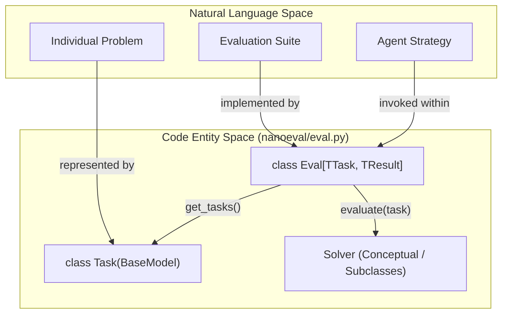
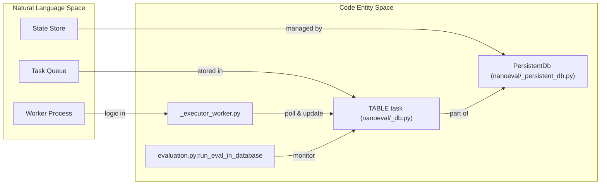

<!-- source: DeepWiki mcp.deepwiki.com · repo openai/frontier-evals · page 4.3 Nanoeval Framework · fetched 2026-10-26 -->

# Nanoeval Framework

Relevant source files

The following files were used as context for generating this wiki page:

- [project/common/nanoeval/README.md](project/common/nanoeval/README.md)
- [project/common/nanoeval/docs/computer_tasks.md](project/common/nanoeval/docs/computer_tasks.md)
- [project/common/nanoeval/nanoeval/_db.py](project/common/nanoeval/nanoeval/_db.py)
- [project/common/nanoeval/nanoeval/_executor_worker.py](project/common/nanoeval/nanoeval/_executor_worker.py)
- [project/common/nanoeval/nanoeval/_persistent_db.py](project/common/nanoeval/nanoeval/_persistent_db.py)
- [project/common/nanoeval/nanoeval/eval.py](project/common/nanoeval/nanoeval/eval.py)
- [project/common/nanoeval/nanoeval/evaluation.py](project/common/nanoeval/nanoeval/evaluation.py)
- [project/common/nanoeval/nanoeval/recorder.py](project/common/nanoeval/nanoeval/recorder.py)
- [project/common/nanoeval/nanoeval/recorder_protocol.py](project/common/nanoeval/nanoeval/recorder_protocol.py)
- [project/common/nanoeval/nanoeval/recorders.py](project/common/nanoeval/nanoeval/recorders.py)
- [project/common/nanoeval/nanoeval/solvers/computer_tasks/code_execution_interface.py](project/common/nanoeval/nanoeval/solvers/computer_tasks/code_execution_interface.py)
- [project/common/nanoeval/nanoeval/solvers/computer_tasks/limits.py](project/common/nanoeval/nanoeval/solvers/computer_tasks/limits.py)
- [project/common/nanoeval/nanoeval/solvers/computer_tasks/solver.py](project/common/nanoeval/nanoeval/solvers/computer_tasks/solver.py)
- [project/common/nanoeval/nanoeval/solvers/computer_tasks/steps.py](project/common/nanoeval/nanoeval/solvers/computer_tasks/steps.py)
- [project/common/nanoeval/nanoeval/solvers/computer_tasks/task.py](project/common/nanoeval/nanoeval/solvers/computer_tasks/task.py)
- [project/common/nanoeval/nanoeval/solvers/mcq.py](project/common/nanoeval/nanoeval/solvers/mcq.py)
- [project/common/nanoeval/nanoeval/solvers/mcq_api.py](project/common/nanoeval/nanoeval/solvers/mcq_api.py)
- [project/common/nanoeval/pyproject.toml](project/common/nanoeval/pyproject.toml)

The `nanoeval` library is a high-performance, minimalist evaluation framework designed for fast iteration and low indirection. It operates as a distributed system on a single machine, using a SQLite-backed state tracking mechanism to manage task execution across multiple processes.

## 1. Overview and Core Primitives

Nanoeval is built around four primary primitives that separate data loading, execution strategy, and scoring.

| Primitive | Class/Entity | Description |
| :--- | :--- | :--- |
| **Eval** | `Eval` | A `chz` class that enumerates tasks, executes them via a solver, and records results. [project/common/nanoeval/nanoeval/eval.py:112-112]() |
| **EvalSpec** | `EvalSpec` | Defines the evaluation to run along with runtime characteristics like concurrency and recording. [project/common/nanoeval/README.md:17-18]() |
| **Task** | `Task` | A separable, scoreable unit of work (e.g., a single question or coding problem). [project/common/nanoeval/nanoeval/eval.py:29-29]() |
| **Solver** | `Solver` | A strategy (often involving an LLM) to transform a `Task` into a result. [project/common/nanoeval/README.md:20-22]() |

### Natural Language to Code Entity Mapping: Core Primitives
The following diagram bridges the conceptual evaluation space to the specific classes defined in `nanoeval/eval.py`.

**Sources:** [project/common/nanoeval/nanoeval/eval.py:29-122](), [project/common/nanoeval/README.md:13-23]()

---

## 2. Execution Engine and State Tracking

Nanoeval functions like a tiny distributed system. When `nanoeval.run()` is called, the framework initializes a SQLite database to track the lifecycle of every task.

### SQLite-Backed State Management
The state is stored in a per-process SQLite database, typically located in `/dev/shm` (Linux) or `/tmp` (macOS) for performance. [project/common/nanoeval/README.md:35-36]()

*   **Database Schema:** The database contains tables for `eval` (metadata), `executor` (worker status), `task` (individual task state), and `metadata` (global configuration). [project/common/nanoeval/nanoeval/_db.py:68-124]()
*   **Persistence:** The `PersistentDb` class handles periodic backups of the local SQLite file to Azure Blob Storage, allowing for resumption after crashes. [project/common/nanoeval/nanoeval/_persistent_db.py:36-44]()
*   **WAL Mode:** The database uses Write-Ahead Logging (`PRAGMA journal_mode=WAL`) to support concurrent access by multiple executors. [project/common/nanoeval/nanoeval/_db.py:65-65]()

### Async Execution Flow
The `run_eval_in_database` function acts as the driver. [project/common/nanoeval/nanoeval/evaluation.py:99-99]() It monitors the database and waits for executors to update task results.

1.  **Queueing:** Tasks are inserted into the `task` table with `executor_pid` as `NULL`. [project/common/nanoeval/nanoeval/_db.py:88-100]()
2.  **Polling:** Executors poll the database using an `EXCLUSIVE` transaction to claim tasks by setting the `executor_pid`. [project/common/nanoeval/nanoeval/_executor_worker.py:161-200]()
3.  **Execution:** The executor runs `eval.evaluate(task)` asynchronously. [project/common/nanoeval/nanoeval/_executor_worker.py:86-86]()
4.  **Completion:** Results are serialized via `dill` and written back to the `task` table. [project/common/nanoeval/nanoeval/_executor_worker.py:94-108]()

### Natural Language to Code Entity Mapping: Execution System
This diagram maps the conceptual "Worker/Queue" model to the specific internal modules and database interactions.

**Sources:** [project/common/nanoeval/nanoeval/_db.py:88-100](), [project/common/nanoeval/nanoeval/_executor_worker.py:161-210](), [project/common/nanoeval/nanoeval/evaluation.py:99-105]()

---

## 3. Recording Infrastructure

Nanoeval uses a `RecorderProtocol` to decouple the evaluation logic from the logging backend. [project/common/nanoeval/nanoeval/recorder_protocol.py:23-23]()

*   **Recorder Context:** The `recorder` is managed via `ContextVar`, allowing different async tasks to log to their respective run streams without explicit passing of recorder objects. [project/common/nanoeval/nanoeval/recorder.py:14-14]()
*   **Key Methods:**
    *   `record_match`: Logs whether a model's answer was correct. [project/common/nanoeval/nanoeval/recorder_protocol.py:42-50]()
    *   `record_sampling`: Logs the prompt and the model's generated response. [project/common/nanoeval/nanoeval/recorder_protocol.py:52-59]()
    *   `record_error`: Captures system or model exceptions. [project/common/nanoeval/nanoeval/recorder_protocol.py:63-63]()

**Sources:** [project/common/nanoeval/nanoeval/recorder.py:14-28](), [project/common/nanoeval/nanoeval/recorder_protocol.py:23-70]()

---

## 4. Built-in Solvers and Computer Tasks

Nanoeval provides specialized infrastructure for complex evaluations, specifically Multiple Choice Questions (MCQ) and Computer Tasks.

### Multiple Choice Questions (MCQ)
The framework includes `MCQEval` and associated solvers for standardized prompting and logit-based or consensus-based scoring of multiple-choice tasks. [project/common/nanoeval/README.md:20-22](), [project/common/nanoeval/README.md:53-55]()

### Computer Tasks
`ComputerTask` represents evaluations involving code execution in isolated environments. [project/common/nanoeval/docs/computer_tasks.md:3-4]()

*   **ComputerInterface:** An abstract base class defining how an agent interacts with a container (shell commands, file uploads/downloads). [project/common/nanoeval/nanoeval/solvers/computer_tasks/code_execution_interface.py:71-71]()
*   **JupyterComputerInterface:** Extends the interface to support Python code execution via a Jupyter kernel. [project/common/nanoeval/nanoeval/solvers/computer_tasks/code_execution_interface.py:132-132]()
*   **Execution Lifecycle:**
    1.  `ComputerRuntime` initializes the environment from a `ComputerTask`.
    2.  `task.setup()` prepares the container.
    3.  The agent interacts via `send_shell_command` or `execute`.
    4.  `task.grade()` computes the final score. [project/common/nanoeval/docs/computer_tasks.md:7-12]()

### Rollout Limits
The `LimitsHelper` class enforces constraints on computer tasks to prevent runaway processes. [project/common/nanoeval/nanoeval/solvers/computer_tasks/limits.py:27-27]()

| Limit | Default | Description |
| :--- | :--- | :--- |
| `max_actions` | 100 | Maximum number of commands/executions allowed. |
| `max_time_seconds` | 3600 | Maximum duration for the agent rollout. |
| `total_sample_timeout`| 14400 | Total wall-clock time allowed for the task. |

**Sources:** [project/common/nanoeval/docs/computer_tasks.md:1-12](), [project/common/nanoeval/nanoeval/solvers/computer_tasks/code_execution_interface.py:71-152](), [project/common/nanoeval/nanoeval/solvers/computer_tasks/limits.py:27-45]()

---

