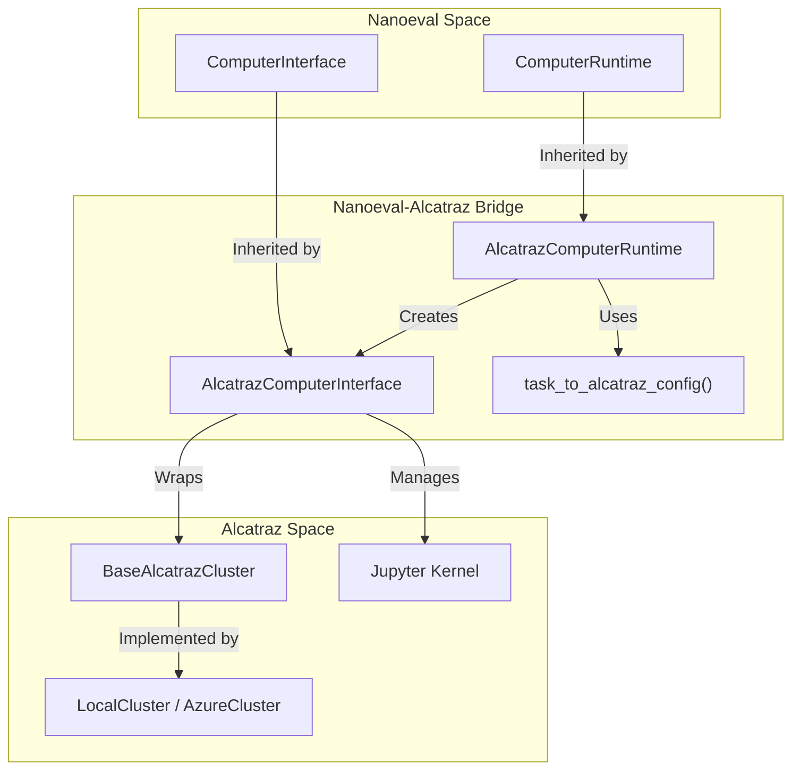
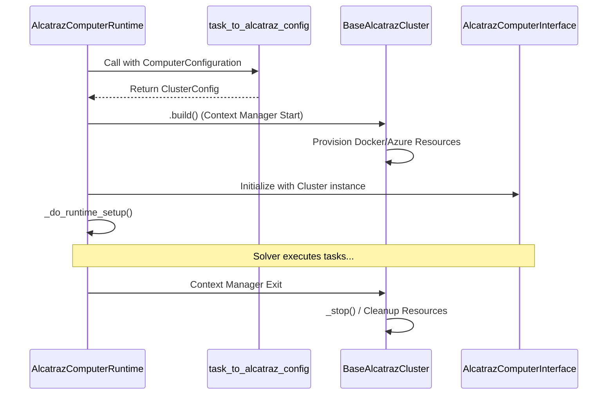

<!-- source: DeepWiki mcp.deepwiki.com · repo openai/frontier-evals · page 4.4 Nanoeval-Alcatraz Integration · fetched 2026-10-26 -->

# Nanoeval-Alcatraz Integration

Relevant source files

The following files were used as context for generating this wiki page:

- [project/common/nanoeval_alcatraz/nanoeval_alcatraz/__init__.py](project/common/nanoeval_alcatraz/nanoeval_alcatraz/__init__.py)
- [project/common/nanoeval_alcatraz/nanoeval_alcatraz/alcatraz_computer_interface.py](project/common/nanoeval_alcatraz/nanoeval_alcatraz/alcatraz_computer_interface.py)
- [project/common/nanoeval_alcatraz/nanoeval_alcatraz/task_to_alcatraz_config.py](project/common/nanoeval_alcatraz/nanoeval_alcatraz/task_to_alcatraz_config.py)
- [project/common/nanoeval_alcatraz/pyproject.toml](project/common/nanoeval_alcatraz/pyproject.toml)

The `nanoeval_alcatraz` package serves as the bridge between the `nanoeval` evaluation framework and the `alcatraz` container orchestration system. It implements the `ComputerInterface` and `ComputerRuntime` abstractions defined in `nanoeval`, allowing evaluation solvers to execute code and manage files within isolated Alcatraz-managed environments.

### Implementation Overview

The integration relies on two primary components:
1.  **Interface Wrappers**: Classes that map `nanoeval`'s shell and Jupyter execution calls to Alcatraz cluster commands.
2.  **Runtime Management**: Classes that handle the lifecycle of Alcatraz clusters (creation, setup, and teardown) based on task-specific configurations.

**System Interaction Flow**

"This diagram illustrates how `nanoeval` entities interact with `alcatraz` entities through the bridge classes."

Sources: [project/common/nanoeval_alcatraz/nanoeval_alcatraz/alcatraz_computer_interface.py:14-25](), [project/common/nanoeval_alcatraz/nanoeval_alcatraz/alcatraz_computer_interface.py:192-200]()

---

### Computer Interface Implementation

The `AlcatrazComputerInterface` implements the `JupyterComputerInterface` and `ComputerInterface` protocols. It delegates low-level operations to an underlying `BaseAlcatrazCluster` instance.

#### Shell and File Operations
*   **Shell Commands**: Executed via `run_command_streaming` which interacts with the Alcatraz cluster's container process management [project/common/nanoeval_alcatraz/nanoeval_alcatraz/alcatraz_computer_interface.py:86-88]().
*   **File Transfer**: `upload` and `download` methods directly wrap the cluster's native file handling capabilities [project/common/nanoeval_alcatraz/nanoeval_alcatraz/alcatraz_computer_interface.py:80-84]().
*   **Network Control**: If `allow_internet` is false, the interface uses `iptables` via the cluster to block container network access [project/common/nanoeval_alcatraz/nanoeval_alcatraz/alcatraz_computer_interface.py:58-68]().

#### Jupyter Execution
The interface manages a Jupyter kernel for stateful code execution. The `execute` method [project/common/nanoeval_alcatraz/nanoeval_alcatraz/alcatraz_computer_interface.py:106-140]() handles:
1.  **Lazy Initialization**: The kernel is started only upon the first `execute` call using `_start_jupyter_kernel_once` [project/common/nanoeval_alcatraz/nanoeval_alcatraz/alcatraz_computer_interface.py:142-146]().
2.  **Message Parsing**: Iterates through Jupyter protocol messages (`error`, `execute_result`, `stream`) to construct a `JupyterExecutionResult` [project/common/nanoeval_alcatraz/nanoeval_alcatraz/alcatraz_computer_interface.py:117-133]().
3.  **Exception Serialization**: Errors are captured into a `Python3ExceptionDict` for structured reporting [project/common/nanoeval_alcatraz/nanoeval_alcatraz/alcatraz_computer_interface.py:32-45]().

Sources: [project/common/nanoeval_alcatraz/nanoeval_alcatraz/alcatraz_computer_interface.py:48-159]()

---

### Task to Config Mapping

The `task_to_alcatraz_config` function is responsible for translating `ComputerConfiguration` (from `nanoeval`) into a `ClusterConfig` (for `alcatraz`). This mapping ensures that task requirements like specific Docker images, memory limits, or volume mounts are respected by the container runtime.

**Configuration Mapping Logic**

| Nanoeval Attribute (`ComputerConfiguration`) | Alcatraz Attribute (`ClusterConfig`) | Notes |
| :--- | :--- | :--- |
| `network_mode` | `no_network` | Only `NONE` and `UNPROXIED` are supported [project/common/nanoeval_alcatraz/nanoeval_alcatraz/task_to_alcatraz_config.py:19-26]() |
| `docker_image` | `image` | Specifies the primary container image [project/common/nanoeval_alcatraz/nanoeval_alcatraz/task_to_alcatraz_config.py:31-33]() |
| `mem_limit` | `mem_limit` | Sets container memory constraints [project/common/nanoeval_alcatraz/nanoeval_alcatraz/task_to_alcatraz_config.py:72-74]() |
| `volume_mounts` | `volumes_config` | Maps host paths to container paths [project/common/nanoeval_alcatraz/nanoeval_alcatraz/task_to_alcatraz_config.py:56-65]() |
| `alcatraz_limits` | `limits` | Direct passthrough of Alcatraz-specific resource limits [project/common/nanoeval_alcatraz/nanoeval_alcatraz/task_to_alcatraz_config.py:49-51]() |

Sources: [project/common/nanoeval_alcatraz/nanoeval_alcatraz/task_to_alcatraz_config.py:16-84]()

---

### Computer Runtime Lifecycle

The `AlcatrazComputerRuntime` manages the lifecycle of the environment using an asynchronous context manager.

**Runtime Lifecycle Flow**

"This diagram shows the sequence of entities and function calls involved in setting up and tearing down an evaluation environment."

*   **Setup**: The `_start_computer` method calls `task_to_alcatraz_config` and then invokes `.build()` on the resulting config to provision the cluster [project/common/nanoeval_alcatraz/nanoeval_alcatraz/alcatraz_computer_interface.py:183-189]().
*   **Validation**: `_do_runtime_setup` verifies that the requested network mode is supported before proceeding [project/common/nanoeval_alcatraz/nanoeval_alcatraz/alcatraz_computer_interface.py:177-181]().
*   **Cleanup**: When the context manager exits, the Alcatraz cluster is automatically stopped and resources are reclaimed [project/common/nanoeval_alcatraz/nanoeval_alcatraz/alcatraz_computer_interface.py:93-94]().

Sources: [project/common/nanoeval_alcatraz/nanoeval_alcatraz/alcatraz_computer_interface.py:163-200](), [project/common/nanoeval_alcatraz/nanoeval_alcatraz/task_to_alcatraz_config.py:16-22]()

---

