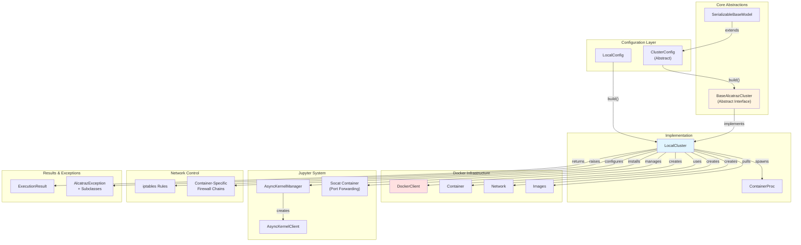
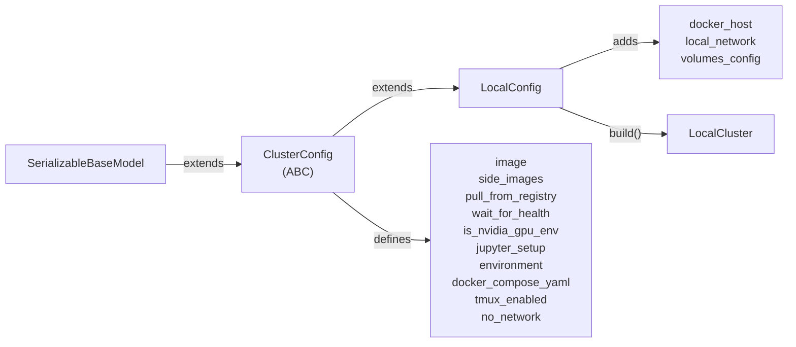
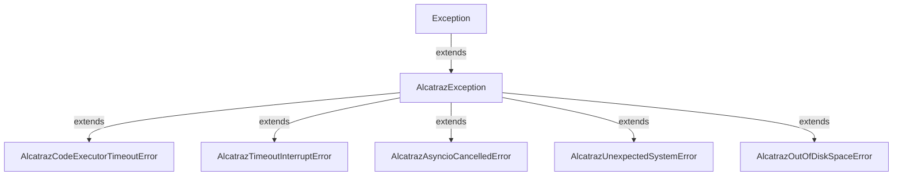
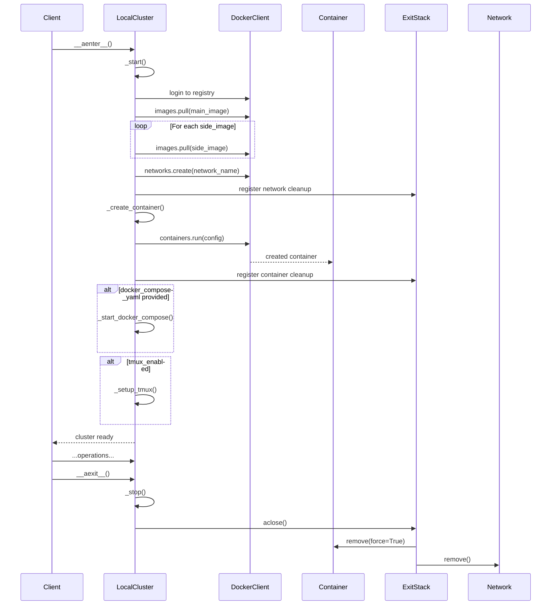
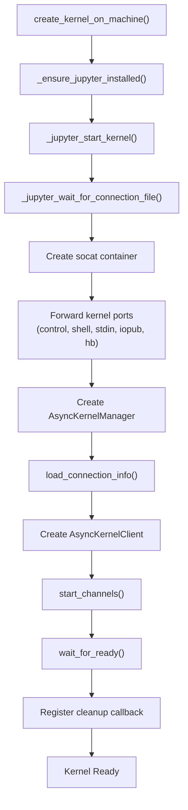
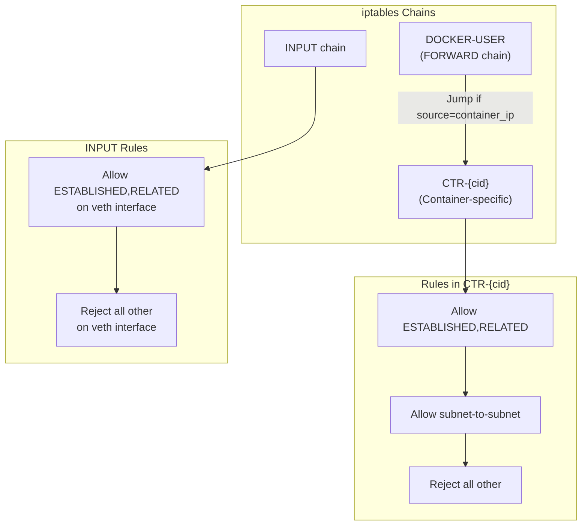

<!-- source: DeepWiki mcp.deepwiki.com · repo openai/frontier-evals · page 5 Alcatraz System · fetched 2026-10-26 -->

# Alcatraz System

<details>
<summary>Relevant source files</summary>

The following files were used as context for generating this wiki page:

- [project/common/alcatraz/alcatraz/__init__.py](project/common/alcatraz/alcatraz/__init__.py)
- [project/common/alcatraz/alcatraz/clusters/__init__.py](project/common/alcatraz/alcatraz/clusters/__init__.py)
- [project/common/alcatraz/alcatraz/clusters/interface.py](project/common/alcatraz/alcatraz/clusters/interface.py)
- [project/common/alcatraz/alcatraz/clusters/local.py](project/common/alcatraz/alcatraz/clusters/local.py)
- [project/common/alcatraz/pyproject.toml](project/common/alcatraz/pyproject.toml)

</details>


## Purpose and Scope

The Alcatraz System is a container orchestration framework that provides isolated execution environments for AI model evaluations. It manages Docker containers, Jupyter kernel connections, network isolation, and file transfer operations. This page provides an overview of the system's architecture, core components, and configuration model.

For detailed information about specific subsystems:
- Core architecture and `LocalCluster` implementation: see [Core Architecture and Local Cluster](#5.1)
- Container process management: see [Container Process Management](#5.2)
- Configuration serialization: see [Serialization and Configuration](#5.3)
- Utility functions: see [Utilities and Commands](#5.4)

**Sources:** [project/common/alcatraz/alcatraz/clusters/interface.py:1-41](), [project/common/alcatraz/alcatraz/clusters/local.py:1-100]()

---

## System Overview

Alcatraz provides sandboxed execution environments where evaluation code can run safely with controlled network access, resource limits, and state management. The system abstracts Docker operations behind a clean API that supports both synchronous shell commands and asynchronous Jupyter kernel execution.

### Key Capabilities

| Capability | Description |
|------------|-------------|
| **Container Management** | Create, configure, and manage Docker containers with GPU support, volume mounts, and custom runtimes |
| **Jupyter Integration** | Spawn and connect to Jupyter kernels inside containers with automatic port forwarding |
| **Network Isolation** | Configure firewall rules via iptables for container-specific internet blocking |
| **File Operations** | Upload/download files and directories using tar archives |
| **Process Control** | Execute shell commands, spawn processes with I/O control, and manage long-running tasks |
| **Docker Compose** | Support multi-container setups via docker-compose configuration |

**Sources:** [project/common/alcatraz/alcatraz/clusters/local.py:99-140]()

---

## Architecture Diagram



**Diagram: Alcatraz System Architecture**

This diagram shows the relationship between configuration classes, abstract interfaces, concrete implementations, and external dependencies. The `LocalConfig.build()` method instantiates a `LocalCluster`, which manages Docker resources, Jupyter kernels, and network isolation.

**Sources:** [project/common/alcatraz/alcatraz/clusters/local.py:99-167](), [project/common/alcatraz/alcatraz/clusters/interface.py:1-41](), [project/common/alcatraz/alcatraz/clusters/local.py:43-44]()

---

## Core Components

### Abstract Interface: `BaseAlcatrazCluster`

The `BaseAlcatrazCluster` class defines the contract for cluster implementations. It provides abstract methods for Docker client creation and cluster serialization, while implementing common functionality for container management.

**Key Abstract Methods:**
- `_get_docker_client()` - Returns platform-specific Docker client
- `serialize()` - Serializes cluster configuration for persistence

**Common Functionality:**
- Container lifecycle management
- Jupyter kernel operations
- Network configuration and blocking
- File transfer operations
- Process spawning and monitoring

**Sources:** [project/common/alcatraz/alcatraz/clusters/local.py:325-373]()

### Configuration Classes



**Diagram: Configuration Hierarchy**

The configuration system uses Pydantic models with validation. `ClusterConfig` defines common settings while `LocalConfig` adds Docker-specific fields.

**Sources:** [project/common/alcatraz/alcatraz/clusters/local.py:99-167]()

### Type Definitions

| Type | Definition | Usage |
|------|------------|-------|
| `ExecutionResult` | `TypedDict` with `exit_code: int` and `result: bytes` | Return type for shell commands |
| `VolumeConfig` | `TypedDict` with `bind_source`, `bind_dest`, `mode` | Volume mount configuration |
| `ContainerNetConfig` | `TypedDict` with `gateway`, `vm_private_ip`, `subnet` | Network configuration |
| `CommandOutputResult` | `TypedDict` with `exit_code`, `result`, `running` | Async command status |

**Sources:** [project/common/alcatraz/alcatraz/clusters/interface.py:4-7](), [project/common/alcatraz/alcatraz/clusters/local.py:66-97]()

---

## Exception Hierarchy



**Diagram: Alcatraz Exception Hierarchy**

All Alcatraz-specific exceptions inherit from `AlcatrazException`, which represents system errors that are not client errors (e.g., authentication failures).

**Sources:** [project/common/alcatraz/alcatraz/clusters/interface.py:9-41]()

---

## Container Lifecycle



**Diagram: Container Lifecycle Sequence**

The `LocalCluster` uses an `AsyncExitStack` to ensure proper cleanup of Docker resources. Resources are registered for cleanup as they're created, guaranteeing cleanup even if initialization fails partway through.

**Sources:** [project/common/alcatraz/alcatraz/clusters/local.py:545-741](), [project/common/alcatraz/alcatraz/clusters/local.py:742-758]()

---

## Jupyter Kernel Integration

The Alcatraz system integrates Jupyter kernels for interactive code execution inside containers. This requires port forwarding, connection file management, and kernel lifecycle control.

### Kernel Startup Flow



**Diagram: Jupyter Kernel Initialization**

The kernel runs inside the main container, but clients connect from the host. A socat container forwards the five ZeroMQ ports (control, shell, stdin, iopub, heartbeat) from the main container to the host.

**Sources:** [project/common/alcatraz/alcatraz/clusters/local.py:1293-1380]()

### Kernel Execution

The `send_kernel_command()` method executes code in the Jupyter kernel with timeout handling:

1. **Execute Code**: Send command via `AsyncKernelClient.execute()`
2. **Pull Messages**: Asynchronously read iopub messages via `_pull_messages()`
3. **Handle Timeout**: If timeout occurs, send SIGINT to kernel via `_interrupt_kernel()`
4. **Capture Output**: Wait additional time to capture keyboard interrupt traceback
5. **Handle Cancellation**: If asyncio task cancelled, interrupt kernel and raise `AlcatrazAsyncioCancelledError`

**Sources:** [project/common/alcatraz/alcatraz/clusters/local.py:1401-1482](), [project/common/alcatraz/alcatraz/clusters/local.py:199-263]()

---

## Network Isolation

Alcatraz provides two approaches to network isolation using iptables:

### Container-Specific Blocking

The `add_container_network_block_via_ip_tables()` method creates a unique iptables chain for each container:



**Diagram: Container-Specific Network Isolation**

The system creates a unique chain `CTR-{cid}` for each container (where `cid` is the first 12 characters of the container ID). The `DOCKER-USER` chain jumps to this container-specific chain based on source IP, allowing different containers to have different rules.

**Sources:** [project/common/alcatraz/alcatraz/clusters/local.py:1095-1120](), [project/common/alcatraz/alcatraz/clusters/local.py:429-481](), [project/common/alcatraz/alcatraz/clusters/local.py:1127-1181](), [project/common/alcatraz/alcatraz/clusters/local.py:1183-1215]()

---

## Command Execution

### Synchronous Commands: `send_shell_command()`

Executes commands using Docker's `exec_run()` API with optional timeout:

**Parameters:**
- `cmd: str` - Shell command to execute
- `timeout: int | None` - Optional timeout in seconds
- `user: str | None` - User to run as (defaults to root)
- `container_id: int` - Container index (default 0)
- `environment: dict[str, str] | None` - Environment variables
- `workdir: str | None` - Working directory

**Returns:** `ExecutionResult` with `exit_code` and `result` (bytes)

**Sources:** [project/common/alcatraz/alcatraz/clusters/local.py:802-843]()

### Process Spawning: `spawn_proc()`

For fine-grained I/O control, spawn processes using `ContainerProc`:

```python
handle = await cluster.spawn_proc(cmd=["python", "script.py"], stdin=True)
await cluster.proc_write_stdin(handle, b"input data\n")
await cluster.proc_close_stdin(handle)
```

This uses Docker's exec API with socket mode to access raw I/O streams via the `ContainerProc` class.

**Sources:** [project/common/alcatraz/alcatraz/clusters/local.py:936-972](), [project/common/alcatraz/alcatraz/clusters/_container_proc.py:1-100]()

---

## Configuration Reference

### `LocalConfig` Fields

| Field | Type | Default | Description |
|-------|------|---------|-------------|
| `image` | `str` | `"quay.io/jupyter/base-notebook:python-3.11"` | Main container image |
| `side_images` | `list[str]` | `[]` | Additional containers to start |
| `docker_host` | `str` | `"unix:///var/run/docker.sock"` | Docker daemon URL |
| `pull_from_registry` | `bool` | `True` | Pull images before starting |
| `wait_for_health` | `bool` | `True` | Wait for health check before proceeding |
| `local_network` | `bool` | `False` | Use `network_mode="host"` |
| `is_nvidia_gpu_env` | `bool` | `False` | Enable GPU support |
| `jupyter_setup` | `list[str]` | `["jupyter", "kernel", "--ip", "0.0.0.0"]` | Jupyter kernel startup command |
| `environment` | `dict[str, Any]` | `{}` | Environment variables |
| `volumes_config` | `VolumesConfig` | `{}` | Volume mounts |
| `docker_compose_yaml` | `str \| None` | `None` | Docker compose configuration |
| `tmux_enabled` | `bool` | `False` | Enable tmux support |
| `no_network` | `bool` | `False` | Start container with `network_mode="none"` |

**Sources:** [project/common/alcatraz/alcatraz/clusters/local.py:99-167]()

---

## Garbage Collection

`LocalCluster` implements automatic garbage collection of orphaned Docker resources using file locks:

**Mechanism:**
1. Each cluster instance holds a lock on `~/.alcatraz/local_cluster_docker_resource_locks/{container_group_name}.lock`
2. One instance acquires the leader lock at `~/.alcatraz/{docker_id}.lock`
3. Leader periodically scans for networks/containers without corresponding lock files
4. Leader removes orphaned resources and stale lock files

**Sources:** [project/common/alcatraz/alcatraz/clusters/local.py:1771-1775](), [project/common/alcatraz/alcatraz/clusters/local.py:1986-2016](), [project/common/alcatraz/alcatraz/clusters/local.py:2018-2087]()

---

