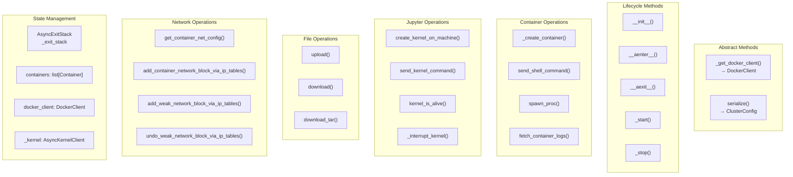
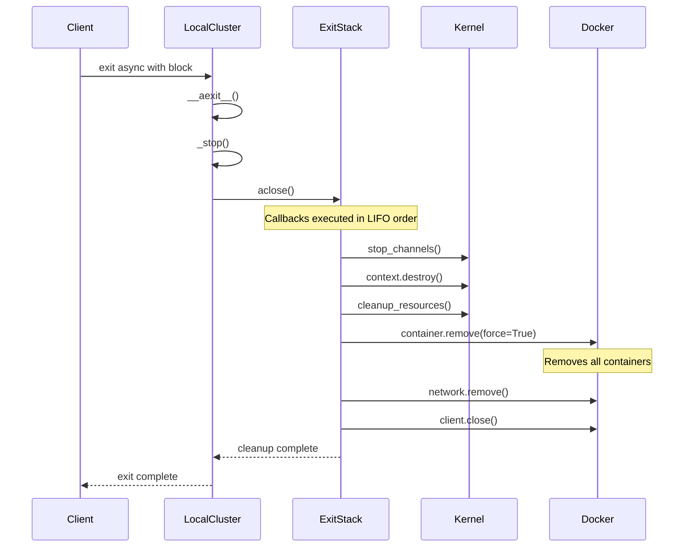
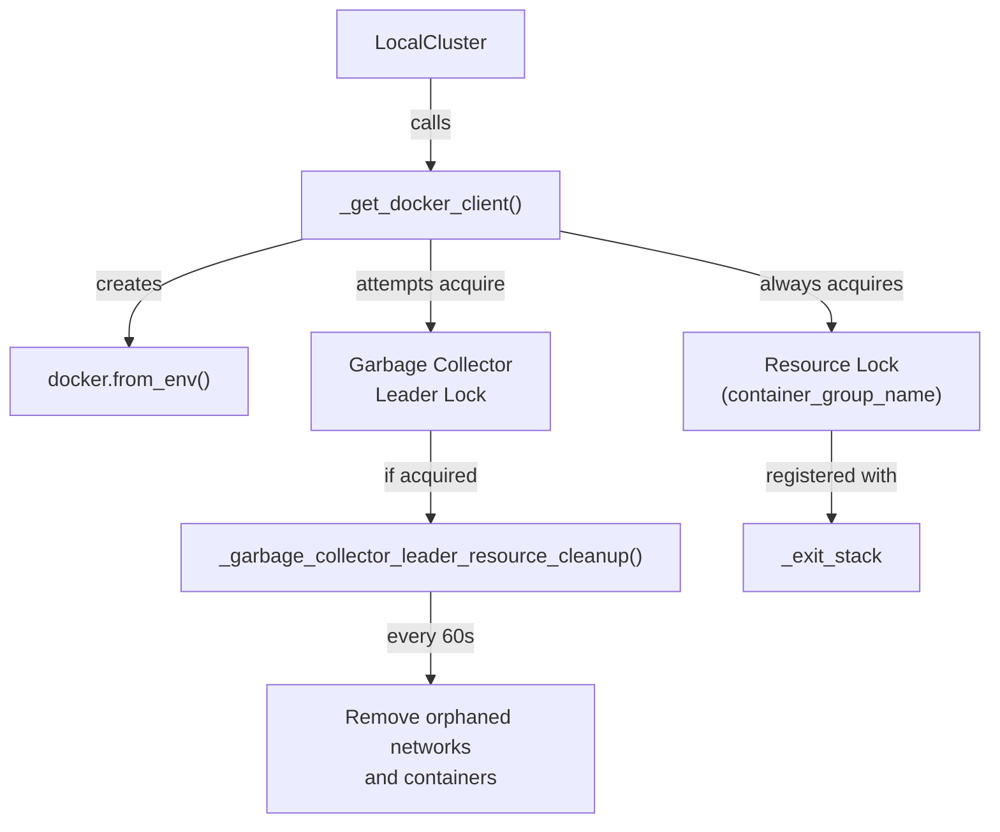
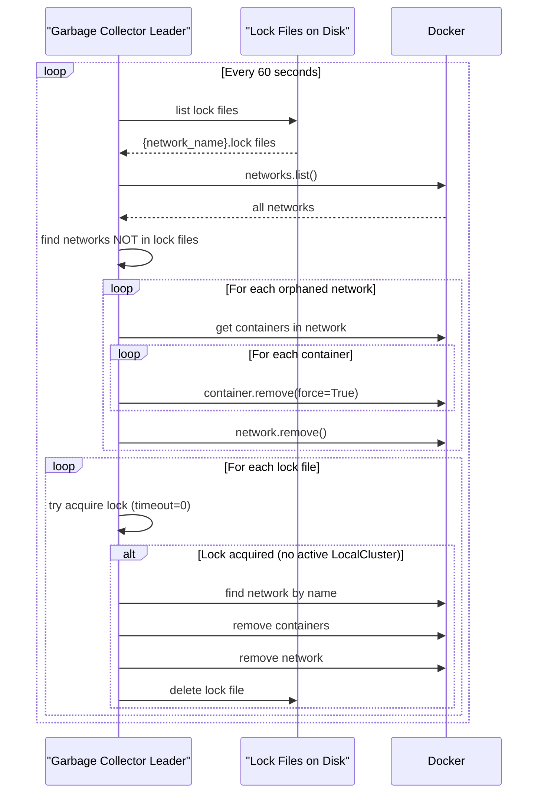
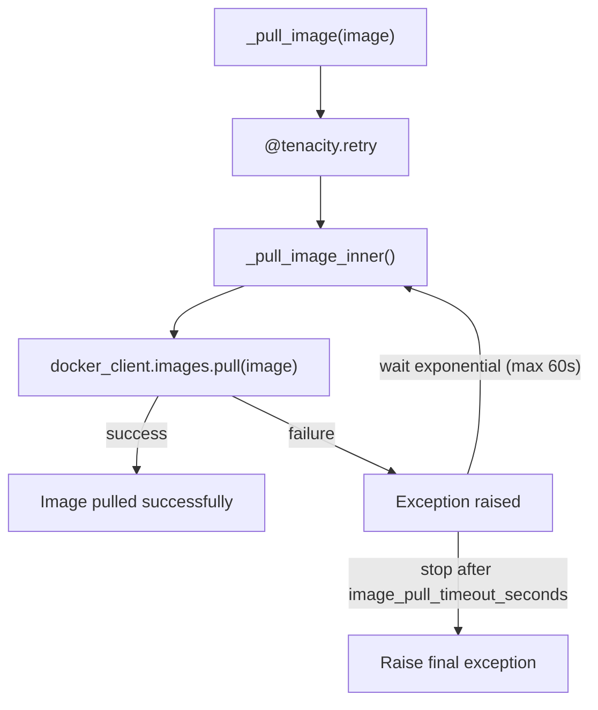
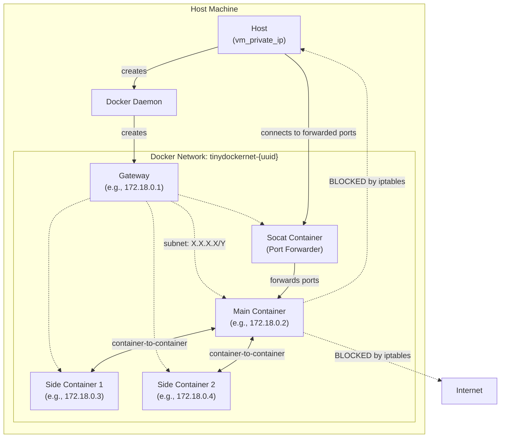

<!-- source: DeepWiki mcp.deepwiki.com · repo openai/frontier-evals · page 5.1 Core Architecture and Local Cluster · fetched 2026-10-26 -->

# Core Architecture and Local Cluster

<details>
<summary>Relevant source files</summary>

The following files were used as context for generating this wiki page:

- [project/common/alcatraz/alcatraz/__init__.py](project/common/alcatraz/alcatraz/__init__.py)
- [project/common/alcatraz/alcatraz/clusters/__init__.py](project/common/alcatraz/alcatraz/clusters/__init__.py)
- [project/common/alcatraz/alcatraz/clusters/interface.py](project/common/alcatraz/alcatraz/clusters/interface.py)
- [project/common/alcatraz/alcatraz/clusters/local.py](project/common/alcatraz/alcatraz/clusters/local.py)

</details>


## Purpose and Scope

This document covers the core architecture of the Alcatraz container orchestration system, focusing on the `BaseAlcatrazCluster` interface and its `LocalCluster` implementation. It explains Docker container lifecycle management, Jupyter kernel integration, network isolation, and the cleanup mechanisms that ensure proper resource deallocation.

For container process I/O management details, see [5.2 Container Process Management](). For cluster configuration persistence, see [5.3 Serialization and Configuration](). For utility functions like `run_command_streaming`, see [5.4 Utilities and Commands]().

**Sources:** [project/common/alcatraz/alcatraz/clusters/local.py:1-2092]()

---

## System Architecture Overview

```mermaid
graph TB
    subgraph "Configuration Layer"
        ClusterConfig["ClusterConfig<br/>(Abstract)"]
        LocalConfig["LocalConfig"]
        SerializableBaseModel["SerializableBaseModel"]
    end
    
    subgraph "Core Cluster Interface"
        BaseAlcatrazCluster["BaseAlcatrazCluster<br/>(Abstract)"]
    end
    
    subgraph "Implementation"
        LocalCluster["LocalCluster"]
    end
    
    subgraph "Infrastructure Components"
        DockerClient["DockerClient<br/>(docker-py)"]
        Container["Container"]
        Network["Network"]
        AsyncKernelManager["AsyncKernelManager<br/>(Jupyter)"]
        AsyncKernelClient["AsyncKernelClient<br/>(Jupyter)"]
        ContainerProc["ContainerProc"]
    end
    
    subgraph "Configuration Types"
        VolumesConfig["VolumesConfig"]
        ContainerNetConfig["ContainerNetConfig"]
        Limits["Limits"]
        ExecutionResult["ExecutionResult"]
    end
    
    SerializableBaseModel --> ClusterConfig
    ClusterConfig --> LocalConfig
    LocalConfig -->|"build()"| LocalCluster
    
    BaseAlcatrazCluster <|-- LocalCluster
    
    LocalCluster -->|"manages"| DockerClient
    LocalCluster -->|"creates"| Container
    LocalCluster -->|"creates"| Network
    LocalCluster -->|"spawns"| AsyncKernelManager
    LocalCluster -->|"connects via"| AsyncKernelClient
    LocalCluster -->|"uses"| ContainerProc
    
    LocalCluster -->|"configured by"| Limits
    LocalCluster -->|"uses"| VolumesConfig
    LocalCluster -->|"returns"| ExecutionResult
    LocalCluster -->|"provides"| ContainerNetConfig
```

**Sources:** [project/common/alcatraz/alcatraz/clusters/local.py:99-167](), [project/common/alcatraz/alcatraz/clusters/local.py:325-373](), [project/common/alcatraz/alcatraz/clusters/local.py:1816-1868]()

---

## Configuration Models

Alcatraz uses Pydantic models to define cluster configurations with validation.

### ClusterConfig (Abstract Base)

The `ClusterConfig` class defines common configuration parameters for all cluster types:

| Field | Type | Default | Description |
|-------|------|---------|-------------|
| `image` | `str` | `"quay.io/jupyter/base-notebook:python-3.11"` | Main Docker image |
| `side_images` | `list[str]` | `[]` | Additional images to start |
| `pull_from_registry` | `bool` | `True` | Whether to pull images from registry |
| `wait_for_health` | `bool` | `True` | Wait for container health checks |
| `is_nvidia_gpu_env` | `bool` | `False` | Enable NVIDIA GPU support |
| `jupyter_setup` | `list[str]` | `["jupyter", "kernel", "--ip", "0.0.0.0"]` | Jupyter kernel startup command |
| `environment` | `dict[str, Any]` | `{}` | Environment variables |
| `docker_compose_yaml` | `str \| None` | `None` | Docker Compose configuration |
| `tmux_enabled` | `bool` | `False` | Enable tmux for command execution |
| `no_network` | `bool` | `False` | Disable networking entirely |

The abstract `build()` method must be implemented to construct a cluster instance.

**Sources:** [project/common/alcatraz/alcatraz/clusters/local.py:99-140]()

### LocalConfig

The `LocalConfig` extends `ClusterConfig` for local Docker environments:

| Field | Type | Default | Description |
|-------|------|---------|-------------|
| `docker_host` | `str` | `"unix:///var/run/docker.sock"` | Docker daemon socket URL |
| `local_network` | `bool` | `False` | Use `network_mode="host"` |
| `volumes_config` | `VolumesConfig` | `{}` | Volume mount configurations |

The `build()` method returns a `LocalCluster` instance with all configuration parameters.

**Sources:** [project/common/alcatraz/alcatraz/clusters/local.py:142-167]()

### Supporting Types

```python
# Volume configuration
class VolumeConfig(TypedDict):
    bind_source: str  # Host path
    bind_dest: str    # Container path
    mode: NotRequired[Literal["ro", "rw"]]  # Default: "ro"

# Network configuration
class ContainerNetConfig(TypedDict):
    gateway: str        # Gateway IP address
    vm_private_ip: str  # Host machine IP
    subnet: str         # Subnet in X.X.X.X/Y format

# Resource limits
class Limits(TypedDict):
    docker_client_timeout_seconds: int
    image_pull_timeout_seconds: int
    initialization_concurrency: int
```

**Sources:** [project/common/alcatraz/alcatraz/clusters/local.py:66-316]()

---

## BaseAlcatrazCluster Interface

The `BaseAlcatrazCluster` abstract class defines the contract for all cluster implementations.

### Core Architecture



**Sources:** [project/common/alcatraz/alcatraz/clusters/local.py:325-373]()

### Initialization Parameters

The `BaseAlcatrazCluster.__init__()` accepts:

| Parameter | Type | Description |
|-----------|------|-------------|
| `main_image` | `str` | Primary Docker image |
| `side_images` | `list[str]` | Additional images to run alongside main |
| `runtime` | `str \| None` | Docker runtime (`"nvidia"`, `"sysbox-runc"`, `"runc"`) |
| `pull_from_registry` | `bool` | Whether to pull images |
| `health_check` | `bool` | Wait for health checks |
| `local_network` | `bool` | Use host networking |
| `jupyter_setup` | `list[str] \| None` | Jupyter kernel startup command |
| `is_nvidia_gpu_env` | `bool` | Enable GPU support |
| `privileged` | `bool` | Run containers in privileged mode |
| `shm_size` | `str \| None` | Shared memory size |
| `mem_limit` | `str \| None` | Memory limit |
| `limits` | `Limits` | Timeout and concurrency limits |
| `container_registry_credentials` | `ContainerRegistryCredentials \| None` | Registry auth |
| `docker_compose_yaml` | `str \| None` | Docker Compose configuration |
| `tmux_enabled` | `bool` | Use tmux for detached commands |
| `docker_host` | `str` | Docker daemon URL |
| `no_network` | `bool` | Disable networking |

**Sources:** [project/common/alcatraz/alcatraz/clusters/local.py:329-373]()

---

## Container Lifecycle

### Startup Flow

```mermaid
sequenceDiagram
    participant Client
    participant LocalCluster
    participant ExitStack
    participant Docker
    participant ACR as "Azure Container Registry"
    participant Container
    participant Network
    
    Client->>LocalCluster: async with LocalCluster(...)
    LocalCluster->>LocalCluster: __aenter__()
    LocalCluster->>LocalCluster: _start()
    
    alt Azure images present
        LocalCluster->>ACR: _acr_login(registry_name)
        ACR-->>LocalCluster: authenticated
    end
    
    LocalCluster->>Docker: from_env()
    Docker-->>LocalCluster: DockerClient
    LocalCluster->>ExitStack: register client.close()
    
    loop For each image
        LocalCluster->>Docker: images.pull(image)
        Docker-->>LocalCluster: image pulled
    end
    
    alt not no_network
        LocalCluster->>Docker: networks.create("tinydockernet-{uuid}")
        Docker-->>LocalCluster: Network
        LocalCluster->>ExitStack: register network.remove()
    end
    
    loop For main_image + side_images
        LocalCluster->>LocalCluster: _create_container()
        LocalCluster->>Docker: containers.run()
        Docker-->>Container: Container created
        LocalCluster->>ExitStack: register container.remove()
    end
    
    alt docker_compose_yaml
        LocalCluster->>LocalCluster: _start_docker_compose()
        LocalCluster->>Docker: docker-compose up
    end
    
    alt tmux_enabled
        LocalCluster->>LocalCluster: _setup_tmux()
        LocalCluster->>Container: exec_run("tmux -V")
    end
    
    LocalCluster-->>Client: LocalCluster instance
```



**Sources:** [project/common/alcatraz/alcatraz/clusters/local.py:545-720](), [project/common/alcatraz/alcatraz/clusters/local.py:742-749]()

### Container Creation

The `_create_container()` method orchestrates container creation with port allocation:

1. **Port Allocation**: Allocates random ports from `_FREE_PORTS` (default: 10000-32767) [project/common/alcatraz/alcatraz/clusters/local.py:169-184]().
2. **Container Creation**: Calls `docker_client.containers.run()` with port mappings [project/common/alcatraz/alcatraz/clusters/local.py:385-427]().
3. **Exit Stack Registration**: Registers cleanup callbacks for port deallocation and container removal.
4. **Returns**: `(host_port_leases, container)` tuple.

**Sources:** [project/common/alcatraz/alcatraz/clusters/local.py:385-427](), [project/common/alcatraz/alcatraz/clusters/local.py:169-184]()

### Shutdown Flow



**Sources:** [project/common/alcatraz/alcatraz/clusters/local.py:735-758]()

### Resource Cleanup with AsyncExitStack

The `_exit_stack` uses LIFO (Last-In-First-Out) ordering to ensure proper cleanup:

```python
# During startup (_start method):
self._exit_stack.push_async_callback(lambda: asyncio.to_thread(self.docker_client.close))
self._exit_stack.push_async_callback(lambda: asyncio.to_thread(self.docker_network.remove))
self._exit_stack.push_async_callback(lambda: asyncio.to_thread(ctr.remove, force=True))

# During container creation (_create_container):
self._exit_stack.push_async_callback(lambda: asyncio.to_thread(ctr.remove, force=True))
self._exit_stack.push(stack.__exit__)  # Port deallocation
```

This ensures containers are removed before networks, and networks are removed before the Docker client closes.

**Sources:** [project/common/alcatraz/alcatraz/clusters/local.py:414-420](), [project/common/alcatraz/alcatraz/clusters/local.py:577-614]()

---

## LocalCluster Implementation

### Docker Client Initialization



The `LocalCluster._get_docker_client()` method:

1. **Creates Docker Client**: Connects to Docker daemon via `docker_host` (default: Unix socket) [project/common/alcatraz/alcatraz/clusters/local.py:1970-1975]().
2. **Garbage Collector Leader Election**: Attempts to acquire a file lock at `~/.alcatraz/{docker_id}.lock`.
   - If acquired, starts background cleanup task `_garbage_collector_leader_resource_cleanup()` [project/common/alcatraz/alcatraz/clusters/local.py:1990-2010]().
   - Cleans up orphaned networks and containers from crashed LocalCluster instances.
3. **Resource Lock**: Acquires a file lock at `~/.alcatraz/local_cluster_docker_resource_locks/{container_group_name}.lock` [project/common/alcatraz/alcatraz/clusters/local.py:2011-2016]().
   - Indicates this LocalCluster instance is using Docker resources.
   - Prevents garbage collector from removing active resources.
4. **Exit Stack Registration**: Registers lock release callbacks.

**Sources:** [project/common/alcatraz/alcatraz/clusters/local.py:1970-2016](), [project/common/alcatraz/alcatraz/clusters/local.py:2018-2088]()

### Garbage Collection Mechanism



**Sources:** [project/common/alcatraz/alcatraz/clusters/local.py:2018-2088]()

---

## Docker Image Management

### Image Pulling with Retry Logic



The `_pull_image()` method uses `tenacity` for robust retries [project/common/alcatraz/alcatraz/clusters/local.py:530-543]():

- **Wait Strategy**: Exponential backoff with max 60 seconds between attempts.
- **Stop Strategy**: After `limits["image_pull_timeout_seconds"]` (default: 5 minutes).
- **Logging**: Logs warnings before each retry attempt.
- **Reraise**: Raises the final exception if all retries exhausted.

**Sources:** [project/common/alcatraz/alcatraz/clusters/local.py:530-543]()

### Azure Container Registry Authentication

The `_acr_login()` function extracts ACR registry names from images containing `.azurecr.io` and authenticates using Azure CLI (`az acr login`) with a 5-minute retry policy [project/common/alcatraz/alcatraz/clusters/local.py:266-293]().

**Sources:** [project/common/alcatraz/alcatraz/clusters/local.py:266-293](), [project/common/alcatraz/alcatraz/clusters/local.py:567-572]()

---

## Network Configuration and Isolation

### Network Topology



**Network Modes:**

| Mode | Value | Description |
|------|-------|-------------|
| Custom Network | `tinydockernet-{uuid}` | Default: Isolated network per cluster [project/common/alcatraz/alcatraz/clusters/local.py:600-614]() |
| Host Network | `network_mode="host"` | When `local_network=True` [project/common/alcatraz/alcatraz/clusters/local.py:683-689]() |
| No Network | `network_mode="none"` | When `no_network=True` [project/common/alcatraz/alcatraz/clusters/local.py:683-689]() |

**Sources:** [project/common/alcatraz/alcatraz/clusters/local.py:600-614](), [project/common/alcatraz/alcatraz/clusters/local.py:683-689]()

### Network Isolation via iptables

#### Firewall Stub Installation

The firewall stub creates infrastructure for container-specific network rules by creating a unique chain `CTR-{cid}` and jumping from `DOCKER-USER` to it [project/common/alcatraz/alcatraz/clusters/local.py:429-481]().

**Sources:** [project/common/alcatraz/alcatraz/clusters/local.py:429-481]()

#### Container-Specific Network Blocking

The `add_container_network_block_via_ip_tables()` method implements full network isolation by populating the `CTR-{cid}` chain with rules to reject outbound traffic while allowing internal subnet communication [project/common/alcatraz/alcatraz/clusters/local.py:1095-1119]().

**Sources:** [project/common/alcatraz/alcatraz/clusters/local.py:1095-1119](), [project/common/alcatraz/alcatraz/clusters/local.py:1127-1181](), [project/common/alcatraz/alcatraz/clusters/local.py:1183-1215]()

---

## Jupyter Kernel Management

### Kernel Startup Architecture

Jupyter kernels are managed by `AsyncKernelManager` and connected via `AsyncKernelClient` [project/common/alcatraz/alcatraz/clusters/local.py:1293-1380](). Because kernels run inside containers, Alcatraz uses `socat` containers to forward Jupyter's ZeroMQ ports (shell, iopub, stdin, control, heartbeat) from the host to the main container.

**Sources:** [project/common/alcatraz/alcatraz/clusters/local.py:1293-1380]()

### Code Execution with Timeout and Interrupt

The `send_kernel_command()` method executes code and monitors the IOPub channel for results [project/common/alcatraz/alcatraz/clusters/local.py:1401-1482]().

**Timeout Handling:** 
- On timeout, it calls `_interrupt_kernel()`, which sends `SIGINT` to the `ipykernel_launcher` process via `pkill` [project/common/alcatraz/alcatraz/clusters/local.py:1388-1399]().
- It then waits an additional 10 seconds to capture any final output or tracebacks.

**Sources:** [project/common/alcatraz/alcatraz/clusters/local.py:1401-1482](), [project/common/alcatraz/alcatraz/clusters/local.py:199-263](), [project/common/alcatraz/alcatraz/clusters/local.py:1388-1399]()

---

## Command Execution

### Detached Command Execution

For long-running commands, Alcatraz supports detached execution via `send_shell_command_and_get_cmd_id()` [project/common/alcatraz/alcatraz/clusters/local.py:1693-1742]().
- If `tmux_enabled` is true, it creates a tmux session to host the process.
- Otherwise, it uploads a wrapper script and starts a detached Docker exec session.
- Results are written to `/tmp/{cmd_id}_out` and the exit code to `/tmp/{cmd_id}_exit_code` [project/common/alcatraz/alcatraz/clusters/local.py:848-893]().

**Sources:** [project/common/alcatraz/alcatraz/clusters/local.py:1693-1742](), [project/common/alcatraz/alcatraz/clusters/local.py:848-893]()

### PTY Socket Management

PTY sockets provide interactive terminal sessions by creating a socket connection to a `docker exec` process with `tty=True` [project/common/alcatraz/alcatraz/clusters/local.py:905-934]().

**Sources:** [project/common/alcatraz/alcatraz/clusters/local.py:905-934]()

---

## File Transfer Operations

### Upload and Download

- **Upload**: Creates an in-memory tar archive and uses `container.put_archive()`. It includes a size check against `_MAX_UPLOAD_SIZE` (1GB) [project/common/alcatraz/alcatraz/clusters/local.py:1509-1564]().
- **Download**: Uses `container.get_archive()` to retrieve a tar stream, which is then extracted to return raw bytes [project/common/alcatraz/alcatraz/clusters/local.py:1489-1507]().

**Sources:** [project/common/alcatraz/alcatraz/clusters/local.py:1489-1507](), [project/common/alcatraz/alcatraz/clusters/local.py:1509-1564]()

---

## Exception Hierarchy

| Exception | Purpose |
|-----------|---------|
| `AlcatrazException` | Base exception for all Alcatraz-specific errors [project/common/alcatraz/alcatraz/clusters/interface.py:9-12]() |
| `AlcatrazCodeExecutorTimeoutError` | Raised when kernel code execution exceeds timeout [project/common/alcatraz/alcatraz/clusters/interface.py:15-16]() |
| `AlcatrazTimeoutInterruptError` | Raised if interrupting a timed-out execution fails [project/common/alcatraz/alcatraz/clusters/interface.py:19-22]() |
| `AlcatrazOutOfDiskSpaceError` | Raised when execution runs out of disk space [project/common/alcatraz/alcatraz/clusters/interface.py:37-40]() |

**Sources:** [project/common/alcatraz/alcatraz/clusters/interface.py:1-41]()

---

