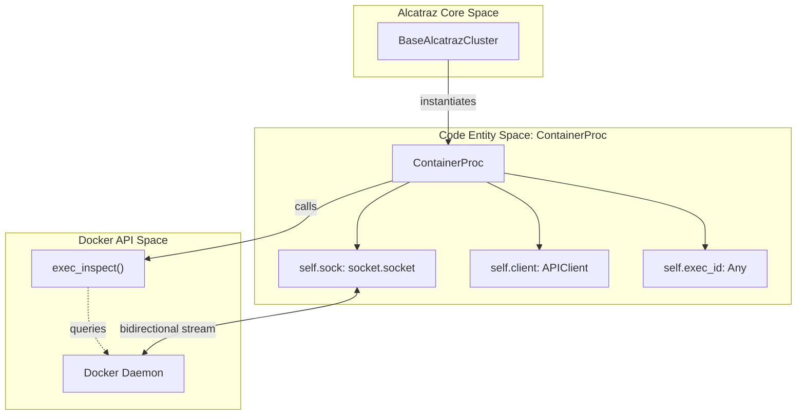
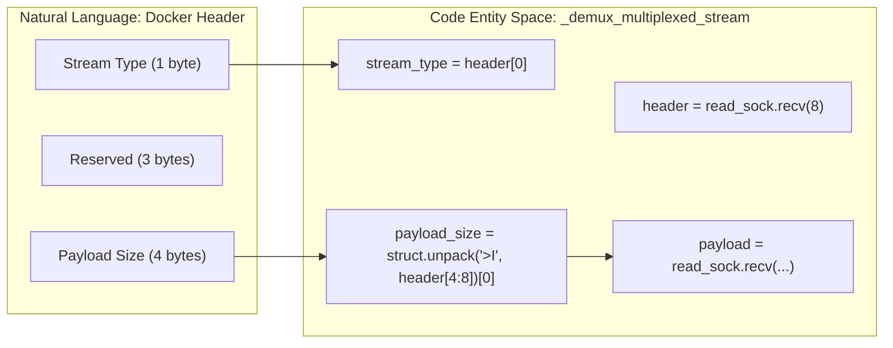

<!-- source: DeepWiki mcp.deepwiki.com · repo openai/frontier-evals · page 5.2 Container Process Management · fetched 2026-10-26 -->

# Container Process Management

Relevant source files

The following files were used as context for generating this wiki page:

- [project/common/alcatraz/alcatraz/clusters/_container_proc.py](project/common/alcatraz/alcatraz/clusters/_container_proc.py)

This document covers the low-level technical details of container process interaction within the `alcatraz` system. It focuses on the mechanics of process communication and Docker stream demultiplexing through the `ContainerProc` class.

## Container Process Interface

The `ContainerProc` class provides the primary interface for managing processes running inside Docker containers. It encapsulates the socket-based communication with Docker's exec API and handles the multiplexed stream protocol used by Docker.

### Process Communication Architecture

**Container Process Communication Flow**

Sources: [project/common/alcatraz/alcatraz/clusters/_container_proc.py:9-13]()

The `ContainerProc` class manages three key components:
- A `socket.socket` for bidirectional communication with the container process [project/common/alcatraz/alcatraz/clusters/_container_proc.py:11]().
- A `docker.APIClient` for querying process status [project/common/alcatraz/alcatraz/clusters/_container_proc.py:12]().
- An `exec_id` identifier for the specific execution instance [project/common/alcatraz/alcatraz/clusters/_container_proc.py:13]().

### Process Lifecycle and I/O Operations

| Method | Purpose | Implementation Detail |
|--------|---------|-----------------------|
| `write_stdin(data: bytes)` | Send data to process stdin | Uses `self.sock.sendall(data)` [project/common/alcatraz/alcatraz/clusters/_container_proc.py:15-16](). |
| `close_stdin()` | Close stdin stream | Uses `self.sock.shutdown(socket.SHUT_WR)` [project/common/alcatraz/alcatraz/clusters/_container_proc.py:18-19](). |
| `is_running()` | Check if process is still running | Calls `self.client.exec_inspect(self.exec_id)` [project/common/alcatraz/alcatraz/clusters/_container_proc.py:21-23](). |
| `read_output(timeout_sec: float)` | Read stdout/stderr with timeout | Uses `select.select` on the socket [project/common/alcatraz/alcatraz/clusters/_container_proc.py:25-38](). |

The `read_output` method returns a tuple where the first element indicates the stream type [project/common/alcatraz/alcatraz/clusters/_container_proc.py:25-33]():
- `0`: No data available within timeout.
- `1`: Data from `stdout`.
- `2`: Data from `stderr`.
- `None`: Process has ended (connection closed).

Sources: [project/common/alcatraz/alcatraz/clusters/_container_proc.py:15-38]()

## Stream Multiplexing and Demultiplexing

Docker uses a multiplexed stream protocol to combine `stdout` and `stderr` into a single socket connection when the TTY is disabled. The `_demux_multiplexed_stream` function handles the protocol parsing.

### Docker Multiplexed Stream Protocol

**Docker Stream Demultiplexing Logic**

Sources: [project/common/alcatraz/alcatraz/clusters/_container_proc.py:41-65]()

The demultiplexing process follows a strict 8-byte header format:

1. **Header Reading**: The function reads exactly 8 bytes from the socket. If 0 bytes are read, it indicates the connection is closed and returns `None` [project/common/alcatraz/alcatraz/clusters/_container_proc.py:47-50]().
2. **Stream Identification**: The first byte (`header[0]`) identifies the stream type (1 for stdout, 2 for stderr) [project/common/alcatraz/alcatraz/clusters/_container_proc.py:55]().
3. **Size Unpacking**: The payload size is extracted from the last 4 bytes of the header using big-endian unsigned integer unpacking (`">I"`) [project/common/alcatraz/alcatraz/clusters/_container_proc.py:56]().
4. **Payload Assembly**: The function enters a loop to read from the socket until the full `payload_size` has been received, handling potential partial reads [project/common/alcatraz/alcatraz/clusters/_container_proc.py:59-64]().

Sources: [project/common/alcatraz/alcatraz/clusters/_container_proc.py:41-65]()

---

