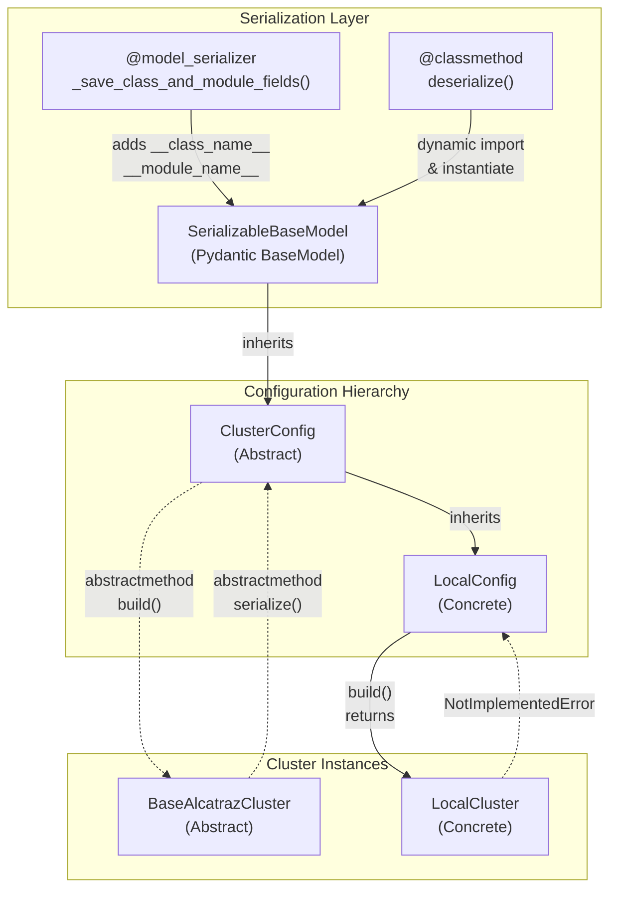
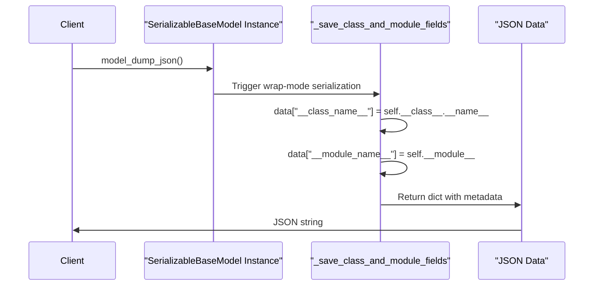
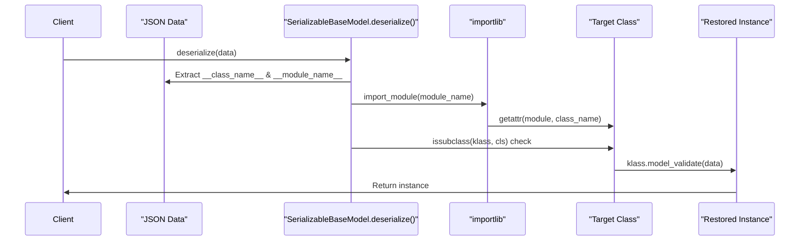

<!-- source: DeepWiki mcp.deepwiki.com · repo openai/frontier-evals · page 5.3 Serialization and Configuration · fetched 2026-10-26 -->

# Serialization and Configuration

<details>
<summary>Relevant source files</summary>

The following files were used as context for generating this wiki page:

- [project/common/alcatraz/alcatraz/clusters/_serialization.py](project/common/alcatraz/alcatraz/clusters/_serialization.py)
- [project/common/alcatraz/uv.lock](project/common/alcatraz/uv.lock)

</details>


## Purpose and Scope

This page documents the serialization and configuration system in Alcatraz that enables cluster state persistence and restoration. The system allows cluster configurations to be serialized to JSON and later deserialized to reconnect to existing remote instances without losing connection details or configuration state.

For information about the core cluster architecture and lifecycle management, see [Core Architecture and Local Cluster](#5.1).

**Sources:** [project/common/alcatraz/alcatraz/clusters/_serialization.py:1-10]()

---

## Overview

The serialization system consists of two primary components:

1. **`SerializableBaseModel`** - A Pydantic-based model that automatically preserves class and module information during serialization, enabling polymorphic deserialization. [project/common/alcatraz/alcatraz/clusters/_serialization.py:19-26]()
2. **`ClusterConfig` hierarchy** - Abstract configuration classes that define cluster parameters and provide a `build()` method to instantiate actual cluster objects. [project/common/alcatraz/alcatraz/clusters/local.py:99-167]()

The system enables two workflows:
- **Configuration serialization**: Save cluster configuration before instantiation.
- **State serialization**: Save cluster state after instantiation (limited support).

**Important limitation**: Serialization is NOT guaranteed to be stable across commits. Serialized data should not be saved in persistent storage and loaded in future versions of Alcatraz. [project/common/alcatraz/alcatraz/clusters/_serialization.py:8-9]()

**Sources:** [project/common/alcatraz/alcatraz/clusters/_serialization.py:1-53](), [project/common/alcatraz/alcatraz/clusters/local.py:99-167]()

---

## Serialization Architecture

The following diagram shows the relationship between serialization components and configuration classes:

**Serialization and Configuration Hierarchy**


**Sources:** [project/common/alcatraz/alcatraz/clusters/_serialization.py:19-52](), [project/common/alcatraz/alcatraz/clusters/local.py:99-167]()

---

## SerializableBaseModel

`SerializableBaseModel` extends Pydantic's `BaseModel` to support polymorphic serialization and deserialization without requiring advance knowledge of the concrete class type. [project/common/alcatraz/alcatraz/clusters/_serialization.py:19-26]()

### Implementation Details

| Component | Description | Location |
|-----------|-------------|----------|
| `_save_class_and_module_fields()` | Model serializer that injects `__class_name__` and `__module_name__` into serialized data. | [_serialization.py:28-36]() |
| `deserialize()` | Class method that dynamically imports the module and reconstructs the instance. | [_serialization.py:38-52]() |

### Serialization Flow

**Class Metadata Injection**


**Sources:** [project/common/alcatraz/alcatraz/clusters/_serialization.py:28-36]()

### Deserialization Flow

**Dynamic Polymorphic Reconstruction**


**Sources:** [project/common/alcatraz/alcatraz/clusters/_serialization.py:38-52]()

### Key Methods

**Serialization:**
```python
# Returns JSON string with class metadata
config.model_dump_json()  
```
[project/common/alcatraz/alcatraz/clusters/_serialization.py:5]()

**Deserialization:**
```python
# Returns typed instance using metadata in json_data
config = SerializableBaseModel.deserialize(json_data)  
```
[project/common/alcatraz/alcatraz/clusters/_serialization.py:6]()

**Sources:** [project/common/alcatraz/alcatraz/clusters/_serialization.py:1-10](), [project/common/alcatraz/alcatraz/clusters/_serialization.py:38-52]()

---

## Configuration Class Hierarchy

### ClusterConfig (Abstract Base)

`ClusterConfig` is the abstract base class for all cluster configurations. It inherits from `SerializableBaseModel` and defines common configuration parameters shared across different cluster types. [project/common/alcatraz/alcatraz/clusters/local.py:99-105]()

**Sources:** [project/common/alcatraz/alcatraz/clusters/local.py:99-140]()

### Configuration Fields

The following table categorizes the configuration fields by purpose:

| Category | Field | Type | Default | Description |
|----------|-------|------|---------|-------------|
| **Images** | `image` | `str` | `"quay.io/jupyter/base-notebook:python-3.11"` | Main container image (format: `repo:tag`) |
| | `side_images` | `list[str]` | `[]` | Additional container images to start |
| | `pull_from_registry` | `bool` | `True` | Whether to pull images from registry |
| **Behavior** | `wait_for_health` | `bool` | `True` | Wait for container health checks |
| | `tmux_enabled` | `bool` | `False` | Enable tmux for command execution |
| | `no_network` | `bool` | `False` | Disable network access |
| **Jupyter** | `jupyter_setup` | `list[str]` | `["jupyter", "kernel", "--ip", "0.0.0.0"]` | Jupyter kernel startup command |
| **Environment** | `environment` | `dict[str, Any]` | `{}` | Environment variables for containers |
| | `is_nvidia_gpu_env` | `bool` | `False` | Enable NVIDIA GPU support |
| **Azure** | `azure_files_config` | `dict \| None` | `None` | Azure Files mount configuration |
| | `azure_container_config` | `dict \| None` | `None` | Azure container storage configuration |
| **Compose** | `docker_compose_yaml` | `str \| None` | `None` | Docker Compose YAML content |

**Sources:** [project/common/alcatraz/alcatraz/clusters/local.py:99-120]()

### LocalConfig Additional Fields

`LocalConfig` extends `ClusterConfig` with local Docker-specific settings:

| Field | Type | Default | Description |
|-------|------|---------|-------------|
| `docker_host` | `str` | `"unix:///var/run/docker.sock"` | Docker daemon connection URL |
| `local_network` | `bool` | `False` | Use `network_mode="host"` |
| `volumes_config` | `VolumesConfig` | `{}` | Volume mount configurations |

**Sources:** [project/common/alcatraz/alcatraz/clusters/local.py:142-147]()

---

## Volume Configuration

The `VolumesConfig` type defines how host directories are mounted into containers. It is a mapping where the key is a name/identifier and the value is a `VolumeConfig` TypedDict. [project/common/alcatraz/alcatraz/clusters/local.py:66-79]()

**TypedDict Definition:**
- `bind_source` (str): Absolute path on host filesystem. [project/common/alcatraz/alcatraz/clusters/local.py:75-75]()
- `bind_dest` (str): Absolute path in container filesystem. [project/common/alcatraz/alcatraz/clusters/local.py:76-76]()
- `mode` (Literal["ro", "rw"]): Access mode, defaults to read-only. [project/common/alcatraz/alcatraz/clusters/local.py:77-77]()

**Sources:** [project/common/alcatraz/alcatraz/clusters/local.py:66-79]()

---

## Configuration Validation

`ClusterConfig` includes Pydantic field validators to ensure configuration correctness:

### Image Validation

The `_validate_image` method ensures the `image` string follows the `repo:tag` format. [project/common/alcatraz/alcatraz/clusters/local.py:122-126]()

### Side Images Validation

The `_validate_side_images` method checks that the list of side images is within size limits (60) and each image follows the `repo:tag` format. [project/common/alcatraz/alcatraz/clusters/local.py:128-135]()

**Sources:** [project/common/alcatraz/alcatraz/clusters/local.py:122-135]()

---

## Pydantic Configuration

`ClusterConfig` uses Pydantic's `ConfigDict` to control behavior:

| Setting | Value | Purpose |
|---------|-------|---------|
| `extra` | `"ignore"` | Ignore unknown fields in input data (forward compatibility). |
| `revalidate_instances` | `"always"` | Force revalidation on `model_copy()`. |

**Sources:** [project/common/alcatraz/alcatraz/clusters/local.py:115-120]()

---

## Build Pattern

The configuration classes implement a builder pattern where configurations construct cluster instances.

### LocalConfig.build() Implementation

The `build()` method extracts configuration fields and passes them to the `LocalCluster` constructor. [project/common/alcatraz/alcatraz/clusters/local.py:148-166]()

**Key steps:**
1. Extract all configuration fields from `self` using `model_dump`.
2. Filter or pass fields as keyword arguments to `LocalCluster.__init__()`.
3. Return an instantiated `LocalCluster` ready for use.

**Sources:** [project/common/alcatraz/alcatraz/clusters/local.py:148-166]()

---

## Limitations and Warnings

### Serialization Stability

**Critical Warning:** Serialization format is NOT stable across commits. Serialized data should not be saved in persistent storage. [project/common/alcatraz/alcatraz/clusters/_serialization.py:8-9]()

### LocalCluster Serialization

The `BaseAlcatrazCluster.serialize()` method is abstract, but `LocalCluster` explicitly does not implement it for instance state:

```python
@override
def serialize(self) -> ClusterConfig:
    raise NotImplementedError("LocalCluster cannot be serialized")
```
[project/common/alcatraz/alcatraz/clusters/local.py:2089-2091]()

This means only configurations (pre-instantiation) can be reliably serialized. State preservation after cluster creation is not supported for `LocalCluster`.

**Sources:** [project/common/alcatraz/alcatraz/clusters/local.py:2089-2091](), [project/common/alcatraz/alcatraz/clusters/_serialization.py:8-9]()

---

## Related Systems

- **[Core Architecture and Local Cluster](#5.1)**: For cluster lifecycle and Docker orchestration details.
- **[Container Process Management](#5.2)**: For process execution within configured containers.
- **[Utilities and Commands](#5.4)**: For command execution utilities used by configured clusters.

---

